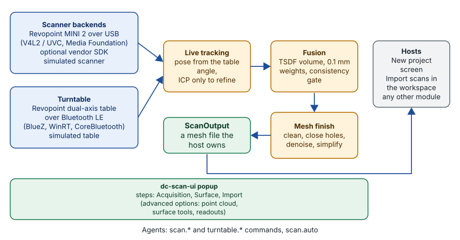

# DentalCraft Architecture

*The layers, the data flow of the aligner pipeline, the print pipeline and the scanner connector. Edition of 21 November 2026.*

> **Not a medical device.** DentalCraft is research and design software; nothing here is a claim of clinical validity.

## 1. Goals and constraints

DentalCraft turns intraoral or desktop scans into a treatment plan, a series of aligners and the files to print them. The architecture serves these constraints:

| Constraint | Consequence |
|---|---|
| The engine must be testable without a GPU or a window. | `dentalcraft-core` is headless; the application is a thin shell over it. |
| Dental logic must be replaceable and licensable per module. | Modules depend only on core, through one contract (`dc-module-api`). |
| AI agents and scripts must drive everything a user can. | Every action is a registered command with an id, a parameter schema and documentation. |
| A case must survive crashes, restarts and version changes. | Immutable case states, an undo stack, atomic saves, content-addressed blobs, migrations. |
| The same behaviour on Linux, Windows and macOS. | Platform parts sit behind traits with an implementation per platform. |
| No C++ toolchain on the build machines. | Pure-Rust dependencies (rustls with ring, zip with deflate, pure-Rust USB and Bluetooth stacks). |
| The algorithms must reproduce an existing, validated reference. | The original Blender add-on stays read-only as the **oracle**; golden tests compare the Rust code with it. |

## 2. Layers

*Figure 1. Core, module and application. The sign-in and diagnostics server is a separate service reached over HTTPS.*

The dependency rule is one-way: **application → module → core**. Core never knows a module, and a module never knows the application: a module hands the shell a menu tree, inspectors drawn with egui, commands and a scene description, and the shell hosts them. Popups such as the scan popup and the print popup are generic components of the application: they depend on neither the workspace nor any module, so any screen or module can host them.

## 3. The core

### 3.1 The case and its history

- A **case** (`dc-case`) holds the scans (with roles upper, lower or bite), the FDI-numbered teeth, poses (`Pose { t: DVec3, q: DQuat }`), the world frame, blob references (the BLAKE3 hash of a mesh) and one opaque **module state** per module.
- A case state is **immutable** and shared (`Arc<CaseState>`). A **command** (`dc-command`) takes a state and returns the next one: `fn apply(&self, &CaseState, &mut JobCtx) -> Result<CaseState>`. The **undo stack** is a stack of states with structural sharing and a memory budget, so undo and redo are pointer moves and an unchanged mesh is never copied.
- The **step history** records processing steps (`StepRecord { step, inputs_hash, outputs, by_hand }`) with retry, rewind and undo of a rewind. It is saved with the project; the undo stack is not.
- **Jobs** (`dc-jobs`) run long work on worker threads with progress (a fraction and a message key) and a cancellation token. A job's result comes back as a command, so it is undoable like everything else.

### 3.2 Meshes and geometry

`dc-mesh` holds the triangle mesh, topology (adjacency, boundary loops, components), validation and file I/O; units are detected at import (metres, centimetres, micrometres become millimetres). `dc-geom` holds the kernels behind a `Backend` trait so a GPU backend can be added later: a BVH, point-to-plane ICP, quadric edge-collapse decimation, Liepa hole filling, signed distance fields (offset, closing, meshing), a TSDF volume, harmonic and sparse solves with a preconditioned conjugate gradient, mesh repair and finishing. Everything is parallel with rayon and deterministic where the output must not change between platforms.

### 3.3 Session, registry and MCP

`dc-session` owns the open project, the case state inside its undo stack, the step history, the registered modules, the jobs, and the **registry of every agent-drivable command**: the built-in ones (`project.*`, `case.*`, `edit.*`, `steps.*`, `view.set`, `scan.*`, `turntable.*`, `print.*`) plus the specs the modules register. The CLI and the MCP server call `execute`, `batch`, `describe` and `inspect` on it. `dc-mcp` is a hand-written JSON-RPC server over stdio behind a `Host` trait: the host is either the headless session or a **remote host** that forwards to the running application over a local bridge, so the same tools work with and without a window.

### 3.4 Scene, i18n, theme

`dc-scene` describes what the viewport shows (meshes with colours or labels, lines, points, 3D labels, overlays) without any GPU type, so modules stay GPU-free and the CPU renderer (`dc-raster`) can draw the same scene to a PNG. `dc-i18n` embeds one Fluent bundle per crate and switches all of them at once; `dc-theme` turns the design tokens into an egui theme.

## 4. The module contract

A module implements the `Module` trait of `dc-module-api`:

| Member | Meaning |
|---|---|
| `id`, `name_key` | `aligners`, and the Fluent key of "Aligners" / "Allineatori". |
| `menu()` | A `MenuTree`: groups and leaves, each with an id, label and description keys, an icon and a status (`Ready` or `Stub`). A leaf can declare input kinds, for example `ScannerInput { roles }`, which is what makes the **Scan** button appear. |
| `commands()` | `CommandDesc` and `CommandSpec`: the ids, parameter schemas and run functions that the session registers. |
| `inspector(ui, ctx)` | Draws the inspector with egui, reading the advanced-options flag. |
| `scene(state)` | The `SceneItem`s the viewport shows for a case state. |
| `data_codec()` | A `ModuleCodec` that reads and writes the module's state in `.dcprj`, with schema migrations. |

Modules are compiled in and collected in a `ModuleRegistry`; which ones are usable depends on the user's entitlement. The Aligners module is the first; others (model builder, splints, crowns) would plug in the same way.

## 5. The aligner pipeline

*Figure 2. The nine steps and the two production outputs. Every arrow is a command; every state is saved in the case.*

The stages live in `dca-algo`, one module per stage, and are exposed as commands by `dca-module`. Each stage reads the case, produces a new state and is one undo step.

| Step | Command (leaf) | What it computes | Stored in the case |
|---|---|---|---|
| 1 Import scans | `aligners.case.import-scans` | Reads STL, OBJ, PLY, recognises the arch (name, then geometry), converts units, and **closes an open arch scan with a flat base** perpendicular to its occlusal axis, in the same undo step. The closed solid is *the* case scan; the scan as read stays as its prefix. | Scans, roles, `scan_bases` |
| 2 Find the teeth | `aligners.teeth.find` | Finds the occlusal direction (smallest principal axis of the scan) and the arch orientation (a symmetric fourth-order polynomial fitted to the crown tops), builds a cusp profile along the arch with a crown score, then places the tooth boundaries by dynamic programming over typical tooth widths, with missing teeth allowed. One FDI-numbered **seed** per tooth. The proposal is checked before it is accepted (below). | Tooth marks, missing teeth, orientation |
| 3 Separate teeth and gum | `aligners.preparation.segmentation.automatic` | Simplifies the scan to about 30 000 faces, then runs a **random-walk segmentation on the face graph**: edge weights come from the dihedral angle (concave folds weigh more than convex ones), seeds are a disk around every tooth mark plus gingival constraints. The labels are projected back to the full scan, cleaned, and every border is refined at full resolution. | A tooth label per face |
| 4 3D teeth | `aligners.teeth.build` | Cuts each crown along a smooth margin line, removes the scanner's bridges between neighbours, and closes the opening with rings narrowing to a neck and a rounded stump, faired as the smoothest surface tangent to the crown (minimum thin-plate energy). The result is a watertight, consistently wound solid; the tooth axis, width and centre of resistance are measured; a gingiva that follows the teeth is built. | Solids, frames, gingiva, `teeth_basis` |
| 5 Case analysis | `aligners.diagnosis.space-analysis` | Space available and needed, Little irregularity index, Bolton ratios, a complexity score. | Diagnosis, hand edits |
| 6 Bite | `aligners.occlusion.align` | Registers the lower arch to the upper on the bite scans (coarse pairing, then fine ICP), or places a **virtual bite** by maximum intercuspation from a starting pose (midlines aligned, overjet, Class I molars). Reports residuals, contact area and interpenetration; optionally corrects it. | Arch relation, bite report |
| 7 Final position | `aligners.planning.setup.automatic` | A target pose per tooth within movement limits: arch line, expansion, space closure, IPR, vertical movements, held teeth. | Setup, arch line, results |
| 8 Aligners | `aligners.planning.aligners` | Splits each tooth's movement into stages (patterns, per-tooth speed, overcorrection, collision avoidance), then the calendar. | Stages with poses, calendar |
| 9 Clinical review | `aligners.review.classify` | Proposes classifications from the evidence (difficulty, pattern, attachments, risk); the clinician confirms. | Review records |
| Export | `aligners.output.export-all` | Builds the printable model of each stage on a flat base, the **shell** (offset solid, hollowed), the trim along the aligner edge, bite ramps and an engraved stamp, runs the **print check**, and writes the report, calendar and manifest. | Files in a folder |

**Rules the pipeline must keep.** These have regressed before and each has a test:

- Adjacent separate teeth stay separate objects; they are never merged.
- Tooth detection stops at the last molars. A proposal with a third molar where the scan has only gum behind the last molar, or one that stretches a tooth over the gum, is corrected. This is a deliberate deviation from the add-on: its plain proposal stays available and bit-identical (`autoseed::propose`), and the application uses the checked one (`autoseed::run`).
- Teeth never spin through a full turn: poses are stored as canonical quaternions with a non-negative scalar part (a Kani law), so the shortest rotation is always taken.
- The study model is generated at the start (the scans are closed on import) so the 3D view is a digital twin of reality.
- Aligners are not drawn by default; they are built for the view only on request.

**Staleness.** Each downstream result records what it was built from (for example `teeth_basis`). When an upstream change makes it stale (the tooth marks, the brush colours, the teeth), the result is **kept but marked out of date**, or cleared when it can no longer be valid, and the interface says which steps to run again.

## 6. The application

`dentalcraft-app` is a thin shell over the engine:

- **Screens:** Home, sign-in, support, new project, and the module **workspace** (menu tree, 3D view, inspector, timeline, status bar). The inspector of every function is drawn from one table, so a new function follows the menu law by adding an entry.
- **Threads:** the UI thread draws and never blocks. A command from a button runs on a job thread with a job context; its result arrives as a new case state. A frame pacer with vsync caps the frame rate at 60 FPS.
- **Viewport (`dc-viewport`):** wgpu inside egui. Picking is on the CPU through the engine's BVH; selection is shown by an outline pass over a mask, and a transform gizmo previews moves without changing the case until the drag ends.
- **Saving:** the workspace saves a project that has a file two seconds after the last change (never during a command, a save or a dialog), one save at a time with the next queued; leaving saves first. The case is written whole, including brush-edited tooth composition.
- **Bridge:** `dentalcraft --control <port>` listens on `127.0.0.1` and runs the same commands as the CLI inside the window, so an agent's changes are undoable there. A few commands exist only on the bridge (window layout, view, screenshots).
- **Sign-in (`dc-auth-client`):** OpenID Connect authorisation code with PKCE over a loopback redirect to `127.0.0.1:<port>/callback`; the id token is verified against the server's JWKS; the refresh token is kept in the OS keyring (Secret Service, Keychain, Credential Manager) so the session survives restarts.
- **Updates (`dc-update`):** a minisign-signed manifest is checked with a key built into the program; every download is checked against its size and SHA-256; each package kind has its own installation path: a standalone folder and an AppImage are replaced when the app closes, the Windows setup and MSI are run once the app has quit, and deb, rpm and Flatpak only get the package manager command (the user manual, section 2.4, describes what the user sees).
- **Diagnostics (`dc-diagnostics`):** off until the user opts in. A sanitiser removes paths, names, patient codes, e-mail addresses and tokens before anything is queued; the queue is bounded; sending is rate-limited and backs off.

## 7. The print pipeline

*Figure 3. From the exported shells to a GOO file per plate. The red box lists the hard checks that stop the preparation before any file is written.*

Printing is implemented in `dc-print` (engine, headless) and `dc-print-ui` (the popup). It prepares the **directly printed aligner shells** for the Elegoo Saturn 4 Ultra 16K, in clear biocompatible resin. The aligners module adds the leaf **Print** and the per-aligner tracking.

### 7.1 Inputs

- **Parts:** the exported shells (`stampa_resina/*.stl`), one part per aligner, optionally with per-face labels (`fitting`, `outer`, `rim`, `stamp`) in the project's `DCM1` format. Without labels the pipeline derives the fitting side geometrically.
- **Printer profile:** data, not code. The Saturn 4 Ultra 16K profile gives the resolution (15120 × 6230), the pixel pitch (14 µm on X, 19 µm on Y), the build volume (211.68 × 118.37 × 220 mm), the accepted layer heights (10 to 200 µm), the mirror flags and the printer's **machine parameters**: the built-in **DENTAL 45** set, a firmware `M5000` file prepared with Elegoo's engineers (Z travel 230 mm, tilt 140°, vat at 45 °C, light source combined, slow and fast release speeds and times, vat volume 870 ml). The machine parameters feed the time and resin estimates.
- **Resin values:** entered once by the user from the resin maker's sheet (layer height, exposures, bottom layers, rest, density). There is no built-in resin preset.

### 7.2 Stages

1. **Orient.** A search over a small set of candidate poses: the cavity opening points straight up, away from the plate, so resin drains and no cup forms; tilts of a few degrees about eight horizontal axes cut the thin wall obliquely, which shrinks the per-layer cross-section and the peel force. The score penalises fitting area facing down first, then outer area needing support, then height and cross-section. A final yaw lays the footprint's long side along the plate's X axis.
2. **Supports, outer side only.** Seeds on the lowest points of down-facing regions and a spaced set of points on outer overhangs get a strut each: a closed tapered prism with a 0.35 mm cone tip entering the part by 0.2 mm, a 1.0 mm shaft and a chamfered raft. A contact is accepted only if it touches a non-fitting, down-facing face, keeps a minimum clearance from every fitting face, and its body misses the part; otherwise offsets are tried.
3. **Hard checks.** *No support contact on or near the fitting side*, and *no unsupported island*: on the sliced layers, every region that starts in mid-air must sit on a support tip. A failed check stops the preparation with a code naming the cause; nothing is written.
4. **Nest.** Footprints (convex hulls) are rasterised on a grid and placed with a bottom-left fill at quarter turns, tallest and largest first, respecting the gap and the plate margins. Several fixed strategies are tried and the best (fewest plates, lowest total height) is kept. The arithmetic is integer once a footprint is rasterised, so the same parts give the same plates on every platform.
5. **Slice.** Layer *i* is the section at *z = (i + ½)·h*. Triangles are sorted by the first layer they cross and swept; each crossing gives one directed segment, with crossing points interpolated bit-identically for neighbours so contours close exactly. Pixels are sampled at their centres with the **nonzero winding rule over all meshes together**, so supports overlapping a part form one solid with no mesh boolean. The result is a list of **runs** per layer; **a layer bitmap never exists**. Layers are computed in parallel in batches, strictly in order, in f64 with a fixed order of operations, so the output is identical on every platform and with any number of threads.
6. **GOO V3.** The writer follows Elegoo's published "Goo Format Spec V1.2": big-endian, a 195 477-byte header with two RGB565 previews, then per layer 64 bytes of settings, the RLE-encoded image with its checksum, and the file ending. The header carries the volume (lit pixels × pixel area × layer height, supports included), the weight (volume × density), the time and the MD5. A reader parses a file back for the tests and for `print.*` inspection.
7. **Estimate.** Time is the preheat (vat from room temperature to 45 °C), plus bottom layers (exposure and slow tilt) plus the other layers (exposure, rest and tilt time from the machine parameters); the resin to pour includes what must stay in the vat. The estimate assumes the slow release mode, which bounds the time from above.

### 7.3 Outputs and tracking

One plate is one `plate_NN.goo` (and optionally `plate_NN.stl`, plate with supports, for inspection), saved to a USB stick or a folder. The module records, in its state in the `.dcprj`, a **print record per aligner** (arch, number, active or passive) with a status: missing (never marked), queued, sent, printed, failed, reprint. Transitions are validated (`printed` only by the user's confirmation or a printer report, never by the app on its own) and applied by one undoable command, `aligners.print.mark`.

### 7.4 Extension points

A printer is **data plus a format**, so more can be added: a profile (how to recognise it, pixel grid, build volume, layer range, defaults, machine parameters) and a slice format behind a writer trait; GOO V3 is the first. Network backends (the printer's SDCP V3 protocol over Wi-Fi) and a simulated printer are planned and are **not** part of this edition: files travel by USB stick.

## 8. The scanner connector

*Figure 4. Devices, tracking, fusion and mesh finish, ending in a mesh file that the host imports.*

The scanner connector (`dc-scanner`, with `dc-ble` and `dc-turntable`) is a capability of the whole application, not of one module: the **scan popup** (`dc-scan-ui`) is generic, owns its jobs and its temporary files, and hands a mesh to whichever screen opened it. A module declares on a leaf that it accepts the scanner and which roles (`ScannerInput`); the new-project screen and the workspace host the popup. The connector is in alpha.

### 8.1 Extensible devices

- A `ScannerBackend` enumerates devices quickly without opening them and opens one by id; a `ScannerDevice` streams depth frames (millimetres, pinhole intrinsics, device timestamps). A **simulated scanner** is always registered, so every path is testable without hardware.
- **Revopoint MINI 2 over USB** (`revopoint-usb`): the scanner computes depth on the device and streams it as a standard UVC camera. The backend reads the depth node with plain V4L2 on Linux and Media Foundation on Windows, and with its own user-space UVC reader on macOS (compile-checked, never run on a Mac). It needs no vendor SDK. A **closed list** of vendor extension-unit requests is used, the same on every platform: the fill light (on while streaming, off after), a fast exposure profile and the read-only factory calibration file. No other request, no firmware, no writes.
- **Turntables** (`dc-turntable`): a device trait with a simulated table and the Revopoint dual-axis table over **Bluetooth LE** (`dc-ble`: BlueZ on Linux, WinRT on Windows, CoreBluetooth on macOS). A connection must succeed at the first attempt and a dropped link is reconnected and the job resumed.
- Adding hardware means implementing the two traits and registering the backend; vendor SDKs are loaded at run time if the user installed them, never linked at build time.

### 8.2 The automatic scan

1. **Calibration:** `turntable.calibrate` fits the table axis from pairwise registered stops (24 stops of 15°), with error codes for each way it can fail; a calibration is reloaded when its file changes and refused as outdated when the rig no longer fits it.
2. **Stop-and-capture:** `scan.auto` turns the table in steps, waits for it to settle and takes the median of several frames at each stop. The default covers five tilts (−20° to +20° in 10° steps) at 7.5° steps of rotation, 3 frames per stop, 245 stops, about nine minutes.
3. **Tracking:** the pose comes from the table angle (read at capture time, because frames arrive late), and constrained ICP refines only what the angle cannot know, on points inside a region of interest around the platter, so the static background never pulls the pose toward identity. A consistency gate re-registers or drops the views of an object that moved.
4. **Fusion:** a sparse TSDF volume at 0.1 mm, with weights; the mesh is taken straight from the volume.
5. **Finish:** clean, close every hole except the base, bilateral denoise (up to 0.01 mm), parallel quadric decimation bounded by a sampled surface error of 0.015 mm, an 8° normal cap and a 0.3 mm maximum edge.
6. **Hand-over:** a `ScanOutput` owns its temporary mesh file until the host drops it; the host imports it with a role.

The world frame of a rig scan has +Z along the table axis, the origin on the axis at platter height and +X toward the scanner. The low-quality output of a scan is never accepted as the result of the automatic flow.

## 9. Cross-cutting concerns

| Concern | How it is handled |
|---|---|
| **Persistence** | `.dcprj` ZIP container, BLAKE3-verified blobs, atomic saves with a `.bak`, migrations per container and per module, read-only open for newer versions. |
| **Errors** | Stable kebab-case codes; the interface maps them to localised sentences; a failure leaves the case as it was. |
| **Internationalisation** | One Fluent bundle per crate, English base and Italian, key-parity tests; run-time language switch. |
| **Determinism** | Fixed operation order and integer arithmetic where outputs must match across platforms (nesting, slicing, orientation). |
| **Privacy** | The case holds a pseudonymised code; diagnostics are opt-in, sanitised and anonymous; the website collects nothing. |
| **Platform parity** | Traits with a Linux, Windows and macOS implementation; what could not be run on a platform is said plainly. |
| **Verification** | Unit and property tests, golden oracle tests, headless UI tests, bounded model checking (Kani) of rules that must always hold. |

## 10. Decisions that shaped the design

| Decision | Reason |
|---|---|
| Full rewrite in Rust (ADR 0001) | The Blender host limited the user interface, undo, data model, testing and the regulatory dossier. |
| Separate repositories for core, module and app | Modules can be licensed and shipped separately; core stays headless. |
| Scans closed at import | The closed solid is the digital twin used by the view, the bite, the stamp, the trim line and the export. |
| Checked tooth numbering | A plain proposal numbered gum behind the last molars; the check stops detection at the last molars. |
| Menu law | A click never runs anything, so a user can look at any step without side effects. |
| Advanced options off by default | The simple view shows what to do next; hidden values stay in effect. |
| Print by USB stick first | No network dependency; the network protocol is added later behind the same backend trait. |
| No resin preset | Only the resin maker knows the exposure for their material on this printer. |

## 11. Known limits of this edition

- Printing has not been validated by printing real aligners; wall-thickness compensation and the fit are to be measured. The printer reports a platform size slightly different from the maker's specification; the profile uses the specification.
- macOS builds are not published; the macOS code paths (UVC reader, CoreBluetooth, bundle, updater) were only compile-checked.
- The planning (setup, staging) and production outputs are not validated for clinical use.
- Scanner calibration and quality were measured on Linux and in a Windows virtual machine; tilt views are weaker on Windows.
