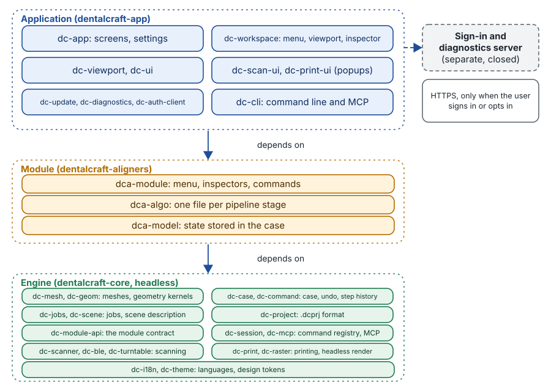
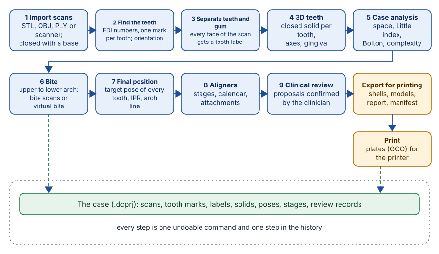
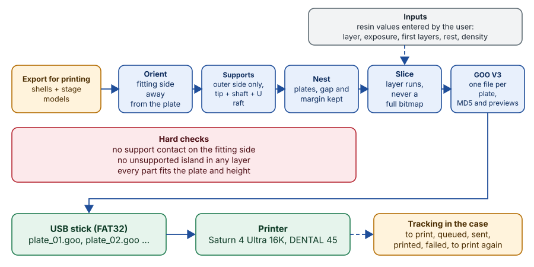

# DentalCraft Architecture

*The layers, the data flow of the aligner pipeline, the print pipeline and the scanner connector. Edition of 28 November 2026, for DentalCraft 0.2.0-alpha.16 (Aligners module 0.2.0-alpha.14, engine 0.3.0-alpha.10).*

> **Not a medical device.** DentalCraft is research and design software; nothing here is a claim of clinical validity.

## 1. Goals and constraints

DentalCraft turns intraoral or desktop scans into a treatment plan, a series of aligners and the files to print them. The architecture serves these constraints:

| Constraint | Consequence |
|---|---|
| The engine must be testable without a GPU or a window. | `dentalcraft-core` is headless; the application is a thin shell over it. |
| Dental logic must be replaceable and licensable per module. | Modules depend only on core, through one contract (`dc-module-api`). |
| AI agents and scripts must drive everything a user can. | Every action is a registered command with an id, a parameter schema and documentation. |
| A case must survive crashes, restarts and version changes. | Immutable case states, an undo stack, atomic saves, content-addressed blobs, migrations. |
| The same behaviour on Linux, Windows and macOS. | Platform parts sit behind traits with an implementation per platform. |
| No C++ toolchain on the build machines. | Pure-Rust dependencies (rustls with ring, zip with deflate, pure-Rust USB and Bluetooth stacks). |
| The algorithms must reproduce an existing, validated reference. | The original Blender add-on stays read-only as the **oracle**; golden tests compare the Rust code with it. |

## 2. Layers

*Figure 1. Core, module and application. The sign-in and diagnostics server is a separate service reached over HTTPS.*

The dependency rule is one-way: **application → module → core**. Core never knows a module, and a module never knows the application: a module hands the shell a menu tree, inspectors drawn with egui, commands and a scene description, and the shell hosts them. Popups such as the scan popup and the print popup are generic components of the application: they depend on neither the workspace nor any module, so any screen or module can host them.

## 3. The core

### 3.1 The case and its history

- A **case** (`dc-case`) holds the scans (with roles upper, lower or bite), the FDI-numbered teeth, poses (`Pose { t: DVec3, q: DQuat }`), the world frame, blob references (the BLAKE3 hash of a mesh) and one opaque **module state** per module.
- A case state is **immutable** and shared (`Arc<CaseState>`). A **command** (`dc-command`) takes a state and returns the next one: `fn apply(&self, &CaseState, &mut JobCtx) -> Result<CaseState>`. The **undo stack** is a stack of states with structural sharing and a memory budget, so undo and redo are pointer moves and an unchanged mesh is never copied.
- The **step history** records processing steps (`StepRecord { step, inputs_hash, outputs, by_hand }`) with retry, rewind and undo of a rewind. It is saved with the project; the undo stack is not.
- **Jobs** (`dc-jobs`) run long work on worker threads with progress (a fraction and a message key) and a cancellation token. A job's result comes back as a command, so it is undoable like everything else.

### 3.2 Meshes and geometry

`dc-mesh` holds the triangle mesh, topology (adjacency, boundary loops, components), validation and file I/O; units are detected at import (metres, centimetres, micrometres become millimetres). `dc-geom` holds the kernels behind a `Backend` trait so a GPU backend can be added later: a BVH, point-to-plane ICP, quadric edge-collapse decimation, Liepa hole filling, signed distance fields (offset, closing, meshing), a TSDF volume, harmonic and sparse solves with a preconditioned conjugate gradient, mesh repair and finishing. Everything is parallel with rayon and deterministic where the output must not change between platforms.

### 3.3 Session, registry and MCP

`dc-session` owns the open project, the case state inside its undo stack, the step history, the registered modules, the jobs, and the **registry of every agent-drivable command**: the built-in ones (`project.*`, `case.*`, `edit.*`, `steps.*`, `view.set`, `scan.*`, `turntable.*`, `print.*`) plus the specs the modules register. The CLI and the MCP server call `execute`, `batch`, `describe` and `inspect` on it. `dc-mcp` is a hand-written JSON-RPC server over stdio behind a `Host` trait: the host is either the headless session or a **remote host** that forwards to the running application over a local bridge, so the same tools work with and without a window.

### 3.4 Scene, i18n, theme

`dc-scene` describes what the viewport shows (meshes with colours or labels, lines, points, 3D labels, overlays) without any GPU type, so modules stay GPU-free and the CPU renderer (`dc-raster`) can draw the same scene to a PNG. `dc-i18n` embeds one Fluent bundle per crate and switches all of them at once; `dc-theme` turns the design tokens into an egui theme.

## 4. The module contract

A module implements the `Module` trait of `dc-module-api`:

| Member | Meaning |
|---|---|
| `id`, `name_key` | `aligners`, and the Fluent key of "Aligners" / "Allineatori". |
| `menu()` | A `MenuTree`: groups and leaves, each with an id, label and description keys, an icon and a status (`Ready` or `Stub`). A leaf can declare input kinds, for example `ScannerInput { roles }`, which is what makes the **Scan** button appear. |
| `commands()` | `CommandDesc` and `CommandSpec`: the ids, parameter schemas and run functions that the session registers. |
| `inspector(ui, ctx)` | Draws the inspector with egui, reading the advanced-options flag. |
| `scene(state)` | The `SceneItem`s the viewport shows for a case state. |
| `data_codec()` | A `ModuleCodec` that reads and writes the module's state in `.dcprj`, with schema migrations. |

Modules are compiled in and collected in a `ModuleRegistry`; which ones are usable depends on the user's entitlement. The Aligners module is the first; others (model builder, splints, crowns) would plug in the same way.

## 5. The aligner pipeline

*Figure 2. The nine steps and the two production outputs. Every arrow is a command; every state is saved in the case.*

The stages live in `dca-algo`, one module per stage, and are exposed as commands by `dca-module`. Each stage reads the case, produces a new state and is one undo step.

| Step | Command (leaf) | What it computes | Stored in the case |
|---|---|---|---|
| 1 Import scans | `aligners.case.import-scans` | Reads STL, OBJ, PLY, recognises the arch (name, then geometry), converts units, and **closes an open arch scan with a flat base** perpendicular to its occlusal axis, in the same undo step. The closed solid is *the* case scan; the scan as read stays as its prefix. A scan of any role leaves the case with `case.remove-scan` (one undo step; the module clears what depended on it). | Scans, roles, `scan_bases` |
| 2 Find the teeth | `aligners.teeth.find` | Finds the occlusal direction (smallest principal axis of the scan) and the arch orientation (a symmetric fourth-order polynomial fitted to the crown tops), builds a cusp profile along the arch with a crown score, then places the tooth boundaries by dynamic programming over typical tooth widths, with missing teeth allowed. One FDI-numbered **seed** per tooth. The proposal is checked before it is accepted (below). | Tooth marks, missing teeth, orientation |
| 3 Separate teeth and gum | `aligners.preparation.segmentation.automatic` | Simplifies the scan to about 30 000 faces, then runs a **random-walk segmentation on the face graph**: edge weights come from the dihedral angle (concave folds weigh more than convex ones), seeds are a disk around every tooth mark plus gingival constraints. The labels are projected back to the full scan, cleaned, and every border is refined at full resolution. | A tooth label per face |
| 4 3D teeth | `aligners.teeth.build` | Cuts each crown along a smooth margin line, removes the scanner's bridges between neighbours, and closes the opening with rings narrowing to a neck and a rounded stump, faired as the smoothest surface tangent to the crown (minimum thin-plate energy). The result is a watertight, consistently wound solid; the tooth axis, width and centre of resistance are measured; a gingiva that follows the teeth is built and **closed with a flat base** 3 mm under its lowest point along the occlusal axis (`FLAG_BASE`), so it is a closed solid. The base stays still when teeth move; the aligner scene, the shell and the export use the gingiva without the base. | Solids, frames, gingiva, `teeth_basis` |
| 5 Case analysis | `aligners.diagnosis.space-analysis` | Space available and needed, Little irregularity index, Bolton ratios, a complexity score. | Diagnosis, hand edits |
| 6 Bite | `aligners.occlusion.align` | Registers the arches on the bite scans: the lower arch stays, each bite scan is found on it (coarse pairing, then fine ICP on the crowns) and the upper arch moves onto the bite scans; or places a **virtual bite** by maximum intercuspation from a starting pose (midlines aligned, overjet, Class I molars). A partial or low-quality scan registers when its teeth fit: how good it is and what it covers become **reasons to review** in the bite report (`rms_above_good`, `few_teeth`, `low_coherence`, `front_only`, `one_side_only`, `scans_disagree`, `interpenetration`, `arches_not_in_contact`, `scan_ignored:<scan>`), with verdict `good` or `to_review`. It is refused (`BiteError`, nothing moves) only for a fit that cannot be trusted: no bite scan fits, the arches do not face each other, or they interpenetrate beyond `bite_penetration_max` (1.0 mm). Reports residuals, contact area and interpenetration; optionally corrects it. | Arch relation, bite report |
| 7 Final position | `aligners.planning.setup.automatic` | A target pose per tooth within movement limits: arch line, expansion, space closure, IPR, vertical movements, held teeth. | Setup, arch line, results |
| 8 Aligners | `aligners.planning.aligners` | Splits each tooth's movement into stages (patterns, per-tooth speed, overcorrection, collision avoidance), then the calendar. | Stages with poses, calendar |
| 9 Clinical review | `aligners.review.classify` | Proposes classifications from the evidence (difficulty, pattern, attachments, risk); the clinician confirms. | Review records |
| Export | `aligners.output.export-all` | Builds the printable model of each stage on a flat base, the **shell** (offset solid, hollowed), the trim along the aligner edge, bite ramps and an engraved stamp, runs the **print check**, and writes the report, calendar and manifest. | Files in a folder |

**Rules the pipeline must keep.** These have regressed before and each has a test:

- Adjacent separate teeth stay separate objects; they are never merged.
- Tooth detection stops at the last molars. A proposal with a third molar where the scan has only gum behind the last molar, or one that stretches a tooth over the gum, or merges crowded teeth, is corrected: the teeth are found again with the arch free to end at the last crown (`FreeEnds` in the dynamic programme; the reasons and the first numbering are in `diagnostics.checked`). This is a deliberate deviation from the add-on: its plain proposal stays available and bit-identical (`autoseed::propose`), and the application uses the checked one (`autoseed::propose_checked`, through `autoseed::run`).
- A bite scan is a functional scan: the application never draws it in the 3D view (only while the Three points tool is open) and it cannot be picked there.
- Teeth never spin through a full turn: poses are stored as canonical quaternions with a non-negative scalar part (a Kani law), so the shortest rotation is always taken.
- The study model is generated at the start (the scans are closed on import) so the 3D view is a digital twin of reality.
- Aligners are not drawn by default; they are built for the view only on request.
- Tooth numbers are permanent teeth only, FDI 11 to 48. A deciduous number (51 to 85) is refused by name wherever a tooth number enters (the missing teeth, a tooth mark, a segmentation seed), never silently given to a neighbour or to the gum. The third molar is decided for each side on its own.
- A tooth is never kept open. A reconstructed crown is accepted only when every edge belongs to exactly two faces; when no attempt is closed the tooth fails with its number (`ReconstructError::NotClosed`) and the step changes nothing. The separation names in its result an arch it skipped for lack of tooth marks, and placing a mark closer to another one than half a tooth width gives a warning.
- Every number that bounds work or size is checked on every path that can supply it, not only in the settings command: the staging limits, the crown cap and the speed of a tooth (a cap of 0 is not "no cap"; at most 999 aligners per tooth), the lag speed of the control visit (0.3 to 1), the voxels (0.04 to 0.5 mm) and the shell wall (at least two voxels). The staging result reports the steps over a limit (a post-condition check of the plan) and the IPR that no aligner carries.
- A passive aligner is not a copy: it is the last shell stamped with its own number, the passive mark `P` and its own date. The print check fits a part to the Elegoo Saturn 4 Ultra 16K plate (211.68 × 118.37 × 220 mm less the 4 mm nesting margin in X and Y).
- A project with one arch has no bite. One decision, `bite_use(upper, lower, stored)` (`BiteUse::of` for a case), is asked by every stage: one arch never uses a bite whatever is stored, a stored bite is used only with both arches and something stored, both arches keep the bite (three Kani laws). With one arch nothing is estimated, synthesised or taken by default; the bite commands answer `applies: false`, `reason: "one_arch"` and change nothing; the Bite step counts as complete once the arch of the scan is settled; the aligners are made from the one arch (no occlusal shaping, no ramps, no bite with the aligners worn, no Bolton ratio); `aligners.demo` never makes an arch next to the scans of a patient. The app's inspector of Bite says that it does not apply.
- The last tooth of each side must be a crown. The checked proposal tests its end teeth (across the arch the scan falls 2.5 mm under their top within 7.5 mm on both sides, the two walls at most 12.5 mm apart); one that fails (the heel, slope or back of a model base as high as the crowns) is the doubt `EndNotTooth`, and the arch is profiled again over the whole scan with the height part of the crown score, cut back at the middle of every end tooth that is no crown, and the teeth found and checked again (`autoseed/ends.rs`), kept only when no worse (its end teeth are crowns and every contact of the first proposal is still a boundary within 1 mm). In the segmentation, more than 2 mm past the distal surface of the last tooth of a side the scan is a gingival constraint of the walk, whatever its height (`GUM_DISTAL_MM`). The check after the segmentation merges two regions only with evidence of one crown (`one_crown`: no groove, fold under 1.25; the two parts together at most 1.5 typical widths of the kept tooth, each part narrower than 0.9 of it); the pairs it keeps apart are a doubt (`kept_apart`), and after a correction only the teeth from the most mesial changed seed distally in its quadrant may change number (`renumber_touched`).
- A 3D tooth has no tunnel. A scan can hold a tunnel a few triangles wide through a thin incisal edge, a cusp tip or a fissure, which in a crown is a handle of its surface. `crown_patch` cuts every handle where it is narrowest (`reconstruct/handles.rs`: the shortest loop of edges that does not split the crown, its triangles taken away, the holes closed by a fan to their centre) and the gate of the closed tooth judges every closing with `dc_mesh::solid_topology` (closed, one piece, genus 0); with none, the tooth fails with `Tunnel(fdi)`. A crown without handles is left as it is, byte for byte. This departs from the add-on, which keeps the tunnels; the oracle tests report it as a departure.
- The aligner border and the space over the gum. The smooth border is raised at least `papilla_relief_mm` (default 1, 0 to 3) above the gingival margin all along the arch, in a rounded notch round every papilla held 0.5 mm under the contact of the two crowns and never lowered (four Kani laws on the lift); where the notch leaves a hole through the wall or a cap apart, the aligner is trimmed again with half the relief, then none (`PAPILLA_RETRY_SHARES`), and the export notes it. The closed field the shell is read from also takes in the region within `gum_clearance_mm` (default 0.3, 0 to 1) of the gingiva (`shell::gum_relieved`), so over the gingiva, the papillae too, the shell stands that far out with a wall as thick; the printed model keeps the field without it. 0 for either gives the add-on's border and shell back, which the oracle tests keep. A margin border is held under a flat wall it would slice (`trim/flat.rs`), and the print check reports where a hole through the wall is (the centre of the shortest loop through each handle).
- A scan and a study model are clean solids, and the pipeline says when one is not. `scan_base` closes an open scan: faces folded back over it are taken out, the open edges are followed into cycles, only the border of each piece is walled down to the base and every other cycle is filled in place (never extruded into a chimney), and the result is counted with `dc_mesh::solid_topology`; a scan that is still not a closed solid raises the import warning `not_closed` (`dc_case::WarningCode::NotClosed`) with the edges left. The study models are built from the scan the same way, keep the scanned anatomy (undercuts included), close the tunnels the build makes, and base two arches as a pair only when they are in occlusion (otherwise each on its own); a model that is not one clean solid gets the warning `not_solid`. The app shows both as sticky notices.
- The plan must not jump when a few vertices of the segmentation change. The setup derotates a tooth only by the excess of its rotation over the tolerance of its zone (not under 0.5°) and takes the scale of the robust arch line once, from the canines and premolars; the staging checks collisions on every crown point, never delays a tooth against a neighbour that never moves, keeps a delay only when it lowers the worst overlap of its pair, and lists every collision it leaves (`unresolved`, the notes, `staging_collisions`, the report). The add-on's rules stay behind configuration flags used only by the parity tests (`Config::plugin_derotation`, `Config::plugin_line_scale`, `Params::delay_against_still`, `Params::delay_without_gain`, `Params::sample_points`).

**Staleness.** Each downstream result records what it was built from (for example `teeth_basis`). When an upstream change makes it stale (the tooth marks, the brush colours, the teeth), the result is **kept but marked out of date**, or cleared when it can no longer be valid, and the interface says which steps to run again.

## 6. The application

`dentalcraft-app` is a thin shell over the engine:

- **Screens:** Home, sign-in, support, new project, and the module **workspace** (menu tree, 3D view, inspector, timeline, status bar). The inspector of every function is drawn from one table, so a new function follows the menu law by adding an entry.
- **Threads:** the UI thread draws and never blocks. A command from a button runs on a job thread with a job context; its result arrives as a new case state. A frame pacer with vsync caps the frame rate at 60 FPS.
- **Viewport (`dc-viewport`):** wgpu inside egui. Picking is on the CPU through the engine's BVH; selection is shown by an outline pass over a mask, and a transform gizmo previews moves without changing the case until the drag ends.
- **Saving:** the workspace saves a project that has a file two seconds after the last change (never during a command, a save or a dialog), one save at a time with the next queued; leaving saves first. The case is written whole, including brush-edited tooth composition. A save is refused, with a message that names where the number is (worded in English and Italian, the entry and the path as detail), when the project holds a number that is not finite, and the previous file stays untouched; a `.bak` that cannot be replaced or a folder that cannot be synced is a warning notice after a save that worked. A file opened read-only is never written over, however its path is spelled, by Save, the automatic save, Save as or the bridge's `project.save`. A command that leaves the case as it was adds no undo step and nothing to save.
- **Bridge:** `dentalcraft --control <port>` listens on `127.0.0.1` and runs the same commands as the CLI inside the window, so an agent's changes are undoable there. A few commands exist only on the bridge (window layout, view, screenshots). Every connection must first prove a per-launch token (a 256-bit secret in a file readable only by the user) in both directions, with BLAKE3 keyed hashes, before anything runs; a line is at most 16 MiB, at most 4 connections are open at once, and the consent for diagnostics cannot be given over it (developer guide, section 6.7).
- **Sign-in (`dc-auth-client`):** OpenID Connect authorisation code with PKCE over a loopback redirect to `127.0.0.1:<port>/callback`; the id token is verified against the server's JWKS; the refresh token is kept in the OS keyring (Secret Service, Keychain, Credential Manager) so the session survives restarts. A computer clock more than five minutes off is an error of its own (`Clock`, a message about the clock) and never wipes the stored session.
- **Updates (`dc-update`):** a minisign-signed manifest is checked with a key built into the program; every download is checked against its size and SHA-256; each package kind has its own installation path: a standalone folder and an AppImage are replaced when the app closes, the Windows setup and MSI are run once the app has quit, and deb, rpm and Flatpak only get the package manager command (the user manual, section 2.4, describes what the user sees). The installer is hashed again right before it runs (an AppImage before it replaces itself; on Windows the helper that starts the setup or MSI once the app has quit also checks its Authenticode signer against the pinned DentalCraft certificate).
- **Diagnostics (`dc-diagnostics`):** off until the user opts in, and the consent can be given only in the application: the command line, MCP and the bridge can only turn it off. A sanitiser removes paths (only an allow-list of DentalCraft's own and the system's folders stays), project and scan file names, names, device serial numbers and MAC addresses, e-mail addresses and tokens before anything is queued, and turns the patient codes the app remembers into salted digests; the queue is bounded; sending is rate-limited, backs off and goes only to an HTTPS address.
- **Settings (`dc-app`):** a dialog opened by the gear of the top bars or by the account menu, with four sections (General: language and theme; Workspace: **Advanced options and parameters**; Updates; Privacy). Every change is saved at once in `settings.json`. The setting is **off by default**: the shell puts it in egui's memory every frame (`dc_module_api::set_advanced_ui`) and widgets and modules read it with `advanced_ui`, so a module never needs to know the dialog. Off, inspectors show only the automatic runs and the most useful manual corrections, and the menu marks the step to do next with a **Next** pill; commands keep all their parameters (`app.settings.get` and `app.settings.set` read and change it).
- **Print popup (`dc-print-ui`):** opened with the aligners that the leaf **Print** lists; it reads the shells, pairs each shell of an export with its stage model (a model that does not fit refuses the preparation; a loose shell is prepared with a warning), asks for the resin values once (kept in `print-resin.json` next to `settings.json`), prepares the plates on a background thread with progress and a cancel button, shows each plate from above with the estimates, and saves the files to a folder or USB stick. When files are saved, the workspace records their aligners as sent with one undoable `aligners.print.mark`.
- **Step history (`dc-workspace`, `history.rs`):** a `StepHistory` for every version of the case. A run of a menu function that lands as a new version is recorded, a correction with a tool of its inspector is recorded as done by hand, a step run again or corrected by hand drops the records of the functions after it, and after every change a record goes when the case no longer holds the result of its function (`Module::leaf_done`); undo and redo bring back the history of their version. A step is done only when the case holds its result; a function that is not a step (an export, the study models) is also done from its record, on the case its run left. On open, a record of a step is kept only when the case holds its result; a history that cannot be read keeps the file read-only, with a warning. The save writes the live history.
- **Aligner in the view:** the aligner of `aligners.view.aligner` is drawn over what its arch shows (the scan, the 3D teeth or the study model; `scene_meshes` and the renders of the bridge and the CLI), at the stage shown, translucent and never picked; a hidden arch, the scan of Three points and the region of a tooth leave it out. `app.window.view` takes `model` (`scan` or `teeth`), the **Scan** / **3D teeth** choice of the toolbar. The inspectors of Aligners and of Find the teeth show what the commands only report (steps over a limit, IPR that no aligner carries, marks too close), kept with the part of the case they are true of, so an undo or a new run never leaves a stale warning.
- **View toggles (`dc-workspace`, `overlay.rs`):** the tooth colours, the tooth marks, the tooth numbers and the contact map are always in the toolbar, whether the advanced options are on or off, and off at the start of the application, in a new project and in an opened one; nothing but the user turns them on, and they are kept neither in the project nor in the settings. The tooth brush lends two of them: `overlay::follow_brush` is the pure decision (the state shown, the state before the brush, whether the brush is the open tool). Opening the brush turns the colours and the numbers on and remembers them; inside it a toggle by hand wins; closing it, by any way, restores each to what it was before; the marks and the contact map are never touched (five Kani laws). The brush is tied to the tool being open, not to selecting its menu entry, which only selects. `app.window.view` sets and answers `colours`, `marks`, `numbers` and `contacts`.

## 7. The print pipeline

*Figure 3. From the exported shells to a GOO file per plate. The red box lists the hard checks that stop the preparation before any file is written.*

Printing is implemented in `dc-print` (engine, headless) and `dc-print-ui` (the popup). It prepares the **directly printed aligner shells** for the Elegoo Saturn 4 Ultra 16K, in clear biocompatible resin. The aligners module adds the leaf **Print** and the per-aligner tracking.

### 7.1 Inputs

- **Parts:** the exported shells (`stampa_resina/*.stl`), one part per aligner. A part can carry a per-face flag, fitting or not, when the caller of the library supplies it; the commands and the print window read plain mesh files and take the flags from the **stage model** or from the geometry (next bullet).
- **Fitting side:** the surface of a shell that touches the teeth, which never gets a support. **For a shell of an export it is read from its stage model, not guessed.** The export writes every shell next to the model it was built on: `modelli_termoformatura/<model>.stl` beside `stampa_resina/`, paired with the shell by the export's `*_manifest_stampa.csv` or else by name (a passive shell takes the model of the last stage), with the clearance taken from `manifest.json`. The shell's intaglio is that model's surface moved out by the clearance, except where the shell bridges the gaps between the teeth, so the sides are decided per wall surface: wall faces are paired across the wall (a ray into the material meets a face that points the other way at 0.6 to 1.6 times the median wall thickness), joined by edges into surfaces, and a surface is fitting when most of its faces lie on the model (within the clearance plus 0.3 mm); the rim bands and the strokes of the engraved stamp are decided face by face. If fewer than 30 % of the faces lie on the model, the shell and the model are from another stage or another frame and the preparation refuses (`print-model-mismatch`). A part that is not from an export takes its fitting side from its geometry: the enclosure of each face (rays over its outer hemisphere) is compared with that of the face facing it across the wall, and the cavity side is the more enclosed one. The summary of `print.prepare` says which route each part took (`fitting_source`: `model` or `geometry`). The print window follows the same two routes: it pairs a shell of an export with its model exactly as `print.prepare` does and refuses a model that does not fit, and it still prepares a loose shell outside an export, but warns "Fitting side guessed from shape; export again." and names the aligners concerned.
- **Printer profile:** data, not code. The Saturn 4 Ultra 16K profile gives the resolution (15120 × 6230), the pixel pitch (14 µm on X, 19 µm on Y), the build volume (211.68 × 118.37 × 220 mm), the accepted layer heights (10 to 200 µm), the mirror flags and the printer's **machine parameters**: the built-in **DENTAL 45** set, a firmware `M5000` file prepared with Elegoo's engineers (Z travel 230 mm, tilt 140°, vat at 45 °C, light source combined, slow and fast release speeds and times, vat volume 870 ml). The machine parameters feed the time and resin estimates.
- **Resin values:** entered once by the user from the resin maker's sheet (layer height, exposures, bottom layers, rest, density). There is no built-in resin preset.
- **Profile validation:** the profile has a `validated` flag, false for the Saturn 4 Ultra 16K until its dimensional scale (pixel pitch) and left/right orientation (mirror flags) are checked against the printer on a measured test print. While it is false, every `print.prepare` result carries the warning `print-profile-not-validated` and the print window shows it.

### 7.2 Stages

1. **Orient.** A search over a small set of candidate poses: the base pose turns the cavity opening (the area-weighted mean normal of the fitting faces) straight up, **away from the plate**, so the occlusal side faces the plate and carries the supports, resin drains and no cup forms; tilts of up to 45° in 15° steps about eight horizontal axes (X, Y and the diagonals) cut the thin wall obliquely, which shrinks the per-layer cross-section and the peel force. The score penalises fitting area facing down first, then outer area needing support, then height and cross-section; ties go to the earlier candidate. Candidates are tried best first, sliced at the job's layer height (only the layers where a fitting vertex starts the solid), and the first that starts no island on the fitting side wins (such an island, the counter of an engraved letter facing down for one, could never get a strut). When the supports of that pose fail a hard check, a **wide search** runs (`orient::wide_poses`): every direction of the opening on a 5° grid over the whole sphere (the old tilts and the flipped poses included), refined at 2.5° and 1.25° around the best when none qualifies. A direction qualifies when it starts no island on the fitting side; the qualifying ones are ranked by the old score, those whose islands all start away from the fitting side first, and the job supports and checks at most 16 of them in turn, keeping the first that passes. The search is deterministic (ordered parallel collection, index tie-breaks); the island rule and the strut clearances are unchanged. If no pose passes, the failure with the fewest islands is reported with the number of poses tried and where the lowest island starts. A final yaw lays the footprint's smallest enclosing rectangle with its long side along the plate's X axis.
2. **Supports, outer side only, on a U-shaped raft.** Seeds on the lowest points of down-facing regions and a spaced set of points (2.5 mm apart, on faces that are not fitting and face down beyond 45°) get a strut each: a closed 8-sided tapered prism with a 0.35 mm cone tip entering the part by 0.2 mm and a 1.0 mm shaft. A contact is accepted only if it touches a non-fitting, down-facing face, keeps at least 0.35 mm from every fitting face, and its body misses the part; otherwise offsets of 0.5 and 1 mm in eight directions are tried. The island check then runs at the job's layer height and adds struts, in up to four rounds, where a region starts in mid-air on the outer side. The struts stand on a 1.0 mm **raft** that **follows the feet instead of filling their hull**: a chamfered pad round each foot (1.5 mm beyond the flared foot), joined to its neighbours by chamfered bands 4 mm wide along the edges of the minimum spanning tree of the feet. On an arch of teeth the feet follow the arch, so the raft is a **U**; it is one closed mesh, sliced together with the part and the struts, and it saves resin and peel force compared with a full plate.
3. **Hard checks.** *No support contact on or near the fitting side*, and *no unsupported island*: on the sliced layers, every region that starts in mid-air must sit on a support tip. A failed check stops the preparation with a code naming the cause; nothing is written.
4. **Nest.** Footprints (convex hulls) are rasterised on a grid and placed with a bottom-left fill at quarter turns, tallest and largest first, respecting the gap and the plate margins. Several fixed strategies are tried and the best (fewest plates, lowest total height) is kept. The arithmetic is integer once a footprint is rasterised, so the same parts give the same plates on every platform.
5. **Slice.** Layer *i* is the section at *z = (i + ½)·h*. Triangles are sorted by the first layer they cross and swept; each crossing gives one directed segment, with crossing points interpolated bit-identically for neighbours so contours close exactly. Pixels are sampled at their centres with the **nonzero winding rule over all meshes together**, so supports overlapping a part form one solid with no mesh boolean. The result is a list of **runs** per layer; **a layer bitmap never exists**. Layers are computed in parallel in batches, strictly in order, in f64 with a fixed order of operations, so the output is identical on every platform and with any number of threads.
6. **GOO V3.** The writer follows Elegoo's published "Goo Format Spec V1.2": big-endian, a 195 477-byte header with two RGB565 previews, then per layer 64 bytes of settings, the RLE-encoded image with its checksum, and the file ending. The header carries the volume (lit pixels × pixel area × layer height, supports included), the weight (volume × density), the time and the MD5. A reader parses a file back for the tests and for `print.*` inspection.
7. **Estimate.** Time is the preheat (vat from room temperature to 45 °C), plus bottom layers (exposure and slow tilt) plus the other layers (exposure, rest and tilt time from the machine parameters); the resin to pour includes what must stay in the vat. The estimate assumes the slow release mode, which bounds the time from above.

### 7.3 Outputs and tracking

One plate is one `plate_NN.goo` (and optionally `plate_NN.stl`, plate with supports, for inspection), saved to a USB stick or a folder. A part that is not a closed, consistently oriented solid with a positive volume is refused (`print-invalid-part`) before it is sliced. `print.prepare` writes every file to a fresh temporary file first and syncs it; only when the whole set is written does it remove the plate files of an earlier run that it did not write and rename the new ones into place, so a failed or cancelled run leaves the folder as it was. It also writes `summary.json`, which carries `profile_validated` and `warnings`. The preview image of each plate follows the same pixel map as the layers.

**Tracking.** The module owns a leaf, **Print** (`aligners.production.print`, group Production), and three commands. The leaf only lists the aligners to print, with the folder of the last export (**Export for printing** records it, absolute, in the module state as `export_dir`), and changes nothing; in the application its output opens the print window with those parts. The series is the one the export writes: aligners 1 to N of each arch with aligners, then passive aligners up to the longer series of the two. Each aligner has an id (`SUP-03`, `INF-12-P`) and, once marked, a **print record** in the module state in the `.dcprj` (schema version 2): status, time, who marked it (`user`, `printer` or `app`), the job (the plate file) and a reason. The statuses are *missing* (no record: still to print), *queued*, *sent*, *printed*, *failed* and *reprint*. Transitions are validated by one pure function and applied by one undoable command, `aligners.print.mark`, all or none:

| To | From | By |
|---|---|---|
| `queued` | missing, `failed`, `reprint` | anyone |
| `sent` | anything but `printed` (a new job from `sent` is allowed) | anyone |
| `failed` | `queued`, `sent` | anyone |
| `reprint` | `printed`, `failed` | the user |
| `printed` | anything but `printed` | the user |
| `printed` | `sent` | the printer's report |

`printed` is never set by the app on its own, and a printed aligner leaves `printed` only for `reprint` by the user: both are Kani laws. The records are facts about the aligners made, so they stay when a scan is replaced or the series is computed again. When the print window saves files, the application marks their aligners `sent` with `by: app` and the plate files as the job.

### 7.4 Extension points

A printer is **data plus a format**, so more can be added: a profile (how to recognise it, pixel grid, build volume, layer range, defaults, machine parameters) and a slice format behind a writer trait; GOO V3 is the first. Network backends (the printer's SDCP V3 protocol over Wi-Fi) and a simulated printer are planned and are **not** part of this edition: files travel by USB stick.

## 8. The scanner connector

*Figure 4. Devices, tracking, fusion and mesh finish, ending in a mesh file that the host imports.*

The scanner connector (`dc-scanner`, with `dc-ble` and `dc-turntable`) is a capability of the whole application, not of one module: the **scan popup** (`dc-scan-ui`) is generic, owns its jobs and its temporary files, and hands a mesh to whichever screen opened it. A module declares on a leaf that it accepts the scanner and which roles (`ScannerInput`); the new-project screen and the workspace host the popup. The connector is in alpha.

### 8.1 Extensible devices

- A `ScannerBackend` enumerates devices quickly without opening them and opens one by id; a `ScannerDevice` streams depth frames (millimetres, pinhole intrinsics, device timestamps). A **simulated scanner** is always registered, so every path is testable without hardware.
- **Revopoint MINI 2 over USB** (`revopoint-usb`): the scanner computes depth on the device and streams it as a standard UVC camera. The backend reads the depth node with plain V4L2 on Linux and Media Foundation on Windows, and with its own user-space UVC reader on macOS (compile-checked, never run on a Mac). It needs no vendor SDK. A **closed list** of vendor extension-unit requests is used, the same on every platform: the fill light (on while streaming, off after), a fast exposure profile and the read-only factory calibration file. No other request, no firmware, no writes.
- **Turntables** (`dc-turntable`): a device trait with a simulated table and the Revopoint dual-axis table over **Bluetooth LE** (`dc-ble`: BlueZ on Linux, WinRT on Windows, CoreBluetooth on macOS). A connection must succeed at the first attempt and a dropped link is reconnected and the job resumed.
- Adding hardware means implementing the two traits and registering the backend; vendor SDKs are loaded at run time if the user installed them, never linked at build time.

### 8.2 The automatic scan

1. **Calibration:** `turntable.calibrate` fits the table axis from pairwise registered stops (24 stops of 15°), with error codes for each way it can fail; a calibration is reloaded when its file changes and refused as outdated when the rig no longer fits it.
2. **Stop-and-capture:** `scan.auto` turns the table in steps, waits for it to settle and takes the median of several frames at each stop. The default covers five tilts (−20° to +20° in 10° steps) at 7.5° steps of rotation, 3 frames per stop, 245 stops, about nine minutes.
3. **Tracking:** the pose comes from the table angle (read at capture time, because frames arrive late), and constrained ICP refines only what the angle cannot know, on points inside a region of interest around the platter, so the static background never pulls the pose toward identity. A consistency gate re-registers or drops the views of an object that moved.
4. **Fusion:** a sparse TSDF volume at 0.1 mm, with weights; the mesh is taken straight from the volume.
5. **Finish:** clean, close every hole except the base, bilateral denoise (up to 0.01 mm), parallel quadric decimation bounded by a sampled surface error of 0.015 mm, an 8° normal cap and a 0.3 mm maximum edge.
6. **Hand-over:** a `ScanOutput` owns its temporary mesh file until the host drops it; the host imports it with a role.

The world frame of a rig scan has +Z along the table axis, the origin on the axis at platter height and +X toward the scanner. The low-quality output of a scan is never accepted as the result of the automatic flow.

## 9. Cross-cutting concerns

| Concern | How it is handled |
|---|---|
| **Persistence** | `.dcprj` ZIP container, BLAKE3-verified blobs, atomic saves through a uniquely named temporary file with a `.bak`, migrations per container and per module, read-only open for newer versions and for files with a damaged part or an unreadable step history. A save refuses a number that is not finite (nothing is written) and reports a `.bak` or folder-sync failure as a warning; a load bounds every declared size and refuses duplicate or inconsistent entries. |
| **Errors** | Stable kebab-case codes; the interface maps them to localised sentences; a failure leaves the case as it was. |
| **Internationalisation** | One Fluent bundle per crate, English base and Italian, key-parity tests; run-time language switch. |
| **Determinism** | Fixed operation order and integer arithmetic where outputs must match across platforms (nesting, slicing, orientation). |
| **Privacy** | The case holds a pseudonymised code; diagnostics are opt-in (consent only in the application), sanitised, anonymous and sent over HTTPS only; the website collects nothing. |
| **Trust boundaries** | The control bridge needs a per-launch token (mutual challenge-response) and caps lines, connections and batch length; an update installer is verified again right before it runs; hostile project, PLY and STL files are bounded and refused rather than read. |
| **Platform parity** | Traits with a Linux, Windows and macOS implementation; what could not be run on a platform is said plainly. |
| **Verification** | Unit and property tests, golden oracle tests, headless UI tests, bounded model checking (Kani) of rules that must always hold. |

## 10. Decisions that shaped the design

| Decision | Reason |
|---|---|
| Full rewrite in Rust (ADR 0001) | The Blender host limited the user interface, undo, data model, testing and the regulatory dossier. |
| Separate repositories for core, module and app | Modules can be licensed and shipped separately; core stays headless. |
| Scans closed at import | The closed solid is the digital twin used by the view, the bite, the stamp, the trim line and the export. |
| Checked tooth numbering | A plain proposal numbered gum behind the last molars; the check stops detection at the last molars. |
| Menu law | A click never runs anything, so a user can look at any step without side effects. |
| Advanced options off by default | The simple view shows what to do next; hidden values stay in effect. |
| Print by USB stick first | No network dependency; the network protocol is added later behind the same backend trait. |
| No resin preset | Only the resin maker knows the exposure for their material on this printer. |

## 11. Known limits of this edition

- Printing has not been validated by printing real aligners; wall-thickness compensation and the fit are to be measured. The printer reports a platform size slightly different from the maker's specification; the profile uses the specification.
- The profile of the Saturn 4 Ultra 16K is not validated: its dimensional scale (pixel pitch) and its left/right orientation (mirror flags) have not been checked against the printer, so every `print.prepare` result carries the warning `print-profile-not-validated` and the print window shows it. Verify the size of a test piece before use.
- macOS builds are not published; the macOS code paths (UVC reader, CoreBluetooth, bundle, updater) were only compile-checked.
- The planning (setup, staging) and production outputs are not validated for clinical use.
- Scanner calibration and quality were measured on Linux and in a Windows virtual machine; tilt views are weaker on Windows.
