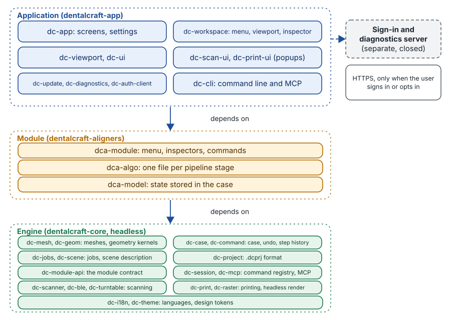
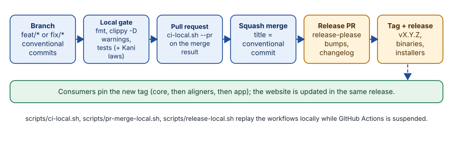
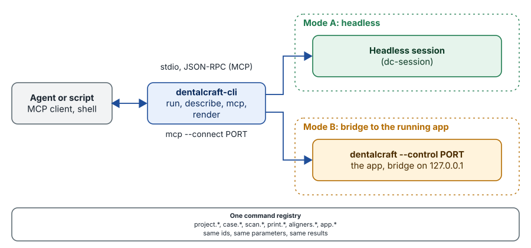
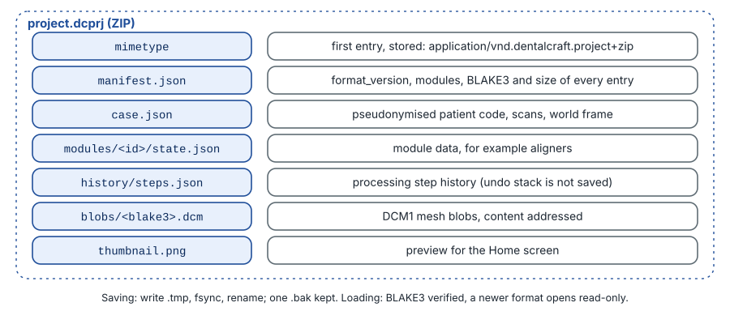

# DentalCraft Developer Guide

*How the repositories fit together, how to build, test and release them, how an agent drives the application, and how to contribute. Edition of 21 November 2026, for DentalCraft 0.2.0-alpha.13 (Aligners module 0.2.0-alpha.12, engine 0.3.0-alpha.8).*

> **Not a medical device.** DentalCraft is research and design software. It is not certified for clinical use, and nothing in this guide changes that.

## 1. Introduction

DentalCraft is a desktop application for digital dentistry, written in Rust. Its first module, **Aligners**, plans clear-aligner treatments from scans. The project replaces an earlier Blender add-on with a standalone application and a headless engine (decision record `0001`, "Full rewrite in Rust"); the add-on's behaviour is still the oracle that the algorithms are tested against.

The source is public under the **PolyForm Noncommercial License 1.0.0**: you may read, build, study, change and share it, and use the application, for any noncommercial purpose. Commercial use is not allowed, and this is not an open-source licence in the OSI sense; for commercial licensing contact the author at `hello@dentalcraft.app`. The authentication server (a separate Go service) is closed and is not part of the published sources.

### 1.1 Repositories

| Repository | Language | Role |
|---|---|---|
| `dentalcraft` | none | Superproject: pins the other repositories as git submodules, holds the plan, the decision records, the design files, the local CI and release scripts, the Kani notes and the hardware designs. No code, no version. |
| `dentalcraft-core` | Rust | The headless engine: meshes, geometry, case model, `.dcprj` I/O, commands, jobs, module API, session, MCP server, scanner, printing, i18n, theme. |
| `dentalcraft-aligners` | Rust | The *Aligners* module (id `aligners`; "Aligners" in English, "Allineatori" in Italian). Depends on core only. |
| `dentalcraft-app` | Rust | The shipped application and its command-line tool: shell, screens, viewport, popups, update, diagnostics, packaging. Depends on core and aligners. |
| `dentalcraft-web` | Node | The website: downloads, feature statuses and the "What's new" of every release. |
| `dentalcraft-docs` | Markdown | These documents, in English and Italian, as Markdown, DOCX and PDF. |

All repositories are under `https://github.com/dnviti/`.

### 1.2 Principles

- **Core is headless.** It builds and tests without a GPU or a window. Modules depend only on core. The application depends on both.
- **Everything is a command.** Every user action is a registered command with an id, a parameter schema and documentation, reachable from the window, the CLI and the MCP server alike. A feature is not done until it is reachable as a command.
- **Same behaviour on every platform.** Linux is the development platform; each change and feature works identically on Linux, Windows and macOS, or the work is not finished. A platform-specific part (V4L2 against Media Foundation, BlueZ against WinRT and CoreBluetooth) needs its equivalent elsewhere.
- **Pure Rust.** No C++ toolchain is needed to build: TLS is `rustls` with `ring` (not `aws-lc`), `zip` uses deflate (not zstd).
- **Persistence is complete.** Saving writes the whole case, including the tooth composition made with the brush; a save must succeed for every kind of content.

## 2. Repository and crate map



*Figure 1. Core, module and application. Arrows point from a layer to what it depends on.*

### 2.1 dentalcraft-core

| Crate | What it holds |
|---|---|
| `dc-mesh` | Triangle mesh container, topology queries, validation, STL/OBJ/PLY I/O. |
| `dc-geom` | Geometry kernels behind a `Backend` trait: BVH, ICP, QEM decimation, hole filling, signed distance fields, TSDF, sparse solvers, mesh finishing. |
| `dc-case` | The case: scans and their roles, FDI numbering, poses, world frame, content-addressed blobs, module state. |
| `dc-command` | Undoable commands, the undo stack, the processing step history. |
| `dc-jobs` | Background jobs with progress and cancellation. |
| `dc-scene` | GPU-agnostic scene description: meshes, lines, points, 3D labels, overlays. |
| `dc-project` | The `.dcprj` format: manifest, layout, load and save, migrations. |
| `dc-module-api` | The module contract: `Module`, menu tree, command descriptors and specs, registry, codecs, the advanced-options flag. |
| `dc-session` | The headless engine session: open project, undo, step history, jobs and the **command registry** (`execute`, `batch`, `describe`, `inspect`). |
| `dc-mcp` | A hand-written JSON-RPC MCP server over stdio, behind a `Host` trait (headless session or running app). |
| `dc-scanner`, `dc-ble`, `dc-turntable` | 3D scanner connector: device backends, live tracking, TSDF fusion, point-cloud and mesh editing; Bluetooth LE links; turntables. |
| `dc-print` | Resin printing: printer profiles, the DENTAL 45 machine parameters, orientation (fitting side from the stage model or the geometry), supports on a U-shaped raft, nesting, the slicer, the GOO V3 writer and reader, and the `print.*` commands. |
| `dc-raster` | CPU rasteriser for headless renders and screenshots. |
| `dc-i18n`, `dc-theme` | Fluent localisation (English, Italian, switchable at run time) and design tokens. |

### 2.2 dentalcraft-aligners

| Crate | What it holds |
|---|---|
| `dca-model` | The module state stored in the case: seeds, labels, tooth frames, diagnosis, setup, stages, review and print records, settings; schema migrations. |
| `dca-algo` | One module per pipeline stage: `autoseed`, `frame`, `segmentation`, `reconstruct`, `gingiva`, `diagnosis`, `occlusion` and `bite`, `setup`, `staging`, `schedule`, `review`, `shell`, `trim`, `stamp`, `ramps`, `export`, `visits`. |
| `dca-module` | `AlignersModule`: menu tree, inspectors, the commands (`aligners.*`) and their i18n. |

### 2.3 dentalcraft-app

| Crate | What it holds |
|---|---|
| `dc-app` | The binary `dentalcraft`: Home, sign-in, support, new project, settings dialog, bridge (`--control`). |
| `dc-workspace` | The module workspace: menu, viewport host, inspector, timeline, status bar, import, save and autosave. |
| `dc-viewport` | The wgpu 3D viewport inside egui: orbit camera, standard dental views, CPU picking, outline, gizmo. |
| `dc-ui` | The design system: tokens, fonts, icons, theme and shared widgets. |
| `dc-scan-ui`, `dc-print-ui` | The generic scan popup and print popup, hosted by any screen or module. |
| `dc-auth-client` | OpenID Connect sign-in with PKCE over a loopback redirect; refresh token in the OS keyring. |
| `dc-update` | Signed update manifest check and installation by install kind. |
| `dc-diagnostics` | Opt-in anonymous crash, error and session reports. |
| `dc-cli` | The binary `dentalcraft-cli`: command line and MCP server. |

## 3. Build, run, test

### 3.1 Toolchain

Rust 1.99.1, pinned by `rust-toolchain.toml` in every Rust repository (with `rustfmt` and `clippy`). Edition 2024. `egui`, `eframe` and `egui-wgpu` are pinned to `=0.37.0` in every repository and must be upgraded together.

```sh
export PATH="$HOME/.cargo/bin:$PATH"
```

On Linux the GUI loads Wayland, X11, xkbcommon and Vulkan at run time, so no `-devel` packages are needed. A C compiler (`gcc`) is needed for a few build scripts.

### 3.2 Get the code

```sh
git clone --recurse-submodules https://github.com/dnviti/dentalcraft.git
cd dentalcraft
git submodule update --init --recursive   # if you cloned without --recurse-submodules
```

Submodule URLs are relative (`../<repo>.git`), so they use the same protocol and credentials as the superproject. Each submodule tracks `main`.

### 3.3 Run

```sh
cd dentalcraft-app
cargo run -p dc-app --release          # the application
cargo run -p dc-cli -- info            # the command-line tool
```

Signing in is optional: local projects work without an account. A debug build looks for the account server at `http://127.0.0.1:8787` and a release build at the production address; `DC_AUTH_ISSUER=<url>` overrides it. `DC_UPDATE_URL` points the update check at another site (the verification key never changes).

### 3.4 The per-crate gate

Every Rust repository passes the same three commands, and a change is not ready until they do:

```sh
cargo fmt --all --check
cargo clippy --workspace --all-targets -- -D warnings
cargo test --workspace
```

The aligners repository runs its tests in release mode with debug assertions and overflow checks on (`cargo test --workspace --release` with `CARGO_PROFILE_RELEASE_DEBUG_ASSERTIONS=true` and `CARGO_PROFILE_RELEASE_OVERFLOW_CHECKS=true`), because the geometry tests are slow in debug.

After every change, also build the release binaries so the result can be tried:

```sh
cd dentalcraft-app
cargo build --release --workspace --bins
git checkout -- Cargo.lock        # see section 4
# target/release/dentalcraft and target/release/dentalcraft-cli
```

### 3.5 Tests that need data

Some tests compare the Rust code with the original Blender add-on on real scans. They need data that is never committed and skip themselves when it is missing:

- `DC_REAL_SCANS` (the scans) with `DC_TEETH_REAL_ORACLE` or `DC_SEGMENTATION_REAL_ORACLE` (oracle output regenerated with the scripts under `tests/fixtures/`);
- `DC_TEETH3DS` for the public Teeth3DS dataset;
- `DC_AUTH_IT=1` for the sign-in integration test, which needs the (closed) account server.

Never commit scans, patient coordinates or datasets.

### 3.6 Faster dev builds

The superproject's `.cargo/config.toml` enables `sccache` and the `mold` linker for builds started inside it (Fedora: `sudo dnf install mold sccache`). These are for development only: the local CI and the release scripts build outside the superproject with a clean environment, so release binaries never use build accelerators or linker overrides and match what a clean machine produces.

## 4. The local `[patch]` and `Cargo.lock`

`dentalcraft-aligners` and `dentalcraft-app` depend on the other repositories as git dependencies, pinned by tag:

```toml
dc-case = { git = "https://github.com/dnviti/dentalcraft-core.git", tag = "v0.3.0-alpha.8" }
```

To work on core and a consumer at the same time without publishing anything, the superproject's `.cargo/config.toml` redirects those git sources to the working trees:

```toml
[patch."https://github.com/dnviti/dentalcraft-core.git"]
dc-mesh = { path = "dentalcraft-core/crates/dc-mesh" }
# ...one line per crate...

[patch."https://github.com/dnviti/dentalcraft-aligners.git"]
dca-model = { path = "dentalcraft-aligners/crates/dca-model" }
# ...

[net]
git-fetch-with-cli = true     # use the git CLI: SSH agent and credential helpers
```

The patch applies only to builds started **inside the superproject**. A submodule cloned on its own, and the CI, resolve the pinned tags.

Rules that follow:

- Building inside the superproject rewrites the submodule's `Cargo.lock` with path sources for `dc-*` and `dca-*`. **Never commit that.** Run `git checkout -- Cargo.lock` in the submodule before you commit.
- Internal path dependencies carry no `version =` requirement: release-please would rewrite it and break the build.
- Consumers pin tags (`tag = "vX.Y.Z"`). After a core release, move the aligners pin, then the app pins, then bump the superproject pointers.

## 5. Local CI and release



*Figure 2. The flow from a branch to a tagged release.*

GitHub Actions are currently suspended on the repositories, to save runner capacity. The workflow files stay in place, untouched, and remain the reference. The scripts in the superproject's `scripts/` replay them, step by step, so that a change behaves locally exactly as it would on a runner. The full procedure is `docs/local-ci.md` in the superproject; this section is its summary.

| Script | Replaces |
|---|---|
| `scripts/ci-local.sh <repo\|super\|all> [--ref R] [--pr]` | The CI workflow of each repository. |
| `scripts/pr-merge-local.sh <repo> <pr>` | The pull-request checks, then the squash merge. |
| `scripts/release-local.sh <repo>` | release-please and the jobs it chains (binaries, installers, images). |
| `scripts/kani-local.sh <core\|aligners\|app>` | Formal verification (section 9); a local gate, never run by CI. |
| `scripts/actions-status.sh` | Shows and restores the Actions switch of the repositories. |
| `scripts/third-party-notices.py` | Regenerates the third-party notices before an app release. |

### 5.1 The day-to-day flow

1. Commit on a `feat/*` or `fix/*` branch in the submodule, then run `scripts/ci-local.sh <repo>`.
2. Push the branch and open a pull request.
3. Run `scripts/pr-merge-local.sh <repo> <pr>`. It tests the merge of the PR into `origin/main` (as GitHub tests `refs/pull/N/merge`), then squash-merges only if that passed.
4. Squash titles are **conventional commits** (`feat:`, `fix:`, `chore:`…), because release-please reads them.
5. Run `scripts/release-local.sh <repo>` (with `--dry-run` first). It runs the real release-please CLI, at the version the official action bundles, against the repository's own config and manifest: first `github-release`, then `release-pr`. Merging the release PR and running it again creates the tag and the GitHub release and runs the chained jobs.

### 5.2 What a clean CI run means

`ci-local.sh` tests a **committed ref** (it refuses a dirty tree) checked out outside the superproject, so core and aligners resolve to their pinned tags. It drops every environment variable that changes the build (`CARGO_*`, `RUST*`, `GO*`…), uses the pinned toolchain, and runs the same steps as the workflow: format, clippy with `-D warnings`, tests. A green dev build inside the superproject is **not** CI: never merge, release or call work done without a green `ci-local.sh` on the exact commit.

### 5.3 Versioning and release

- Versioning is release-please: release type `simple` for the Rust repositories, `prerelease` versioning with the `alpha` type, tags `vX.Y.Z[-alpha.N]` with no component prefix, and the version kept in `Cargo.toml` and `version.txt` by the config. **Never edit versions, changelogs or manifests by hand, and never create tags by hand.**
- A core release comes first (tag, then consumers pin it); aligners and app follow; the superproject pointers are bumped last with `chore(submodule): <repo> a vX.Y.Z`.
- An app release builds the binaries (Linux and Windows) and the installers: AppImage, deb, rpm, Flatpak, a Windows setup and an MSI, and the signed update manifest `update.json`, plus a checksum file. Linux binaries are built on Ubuntu 24.04, so they need glibc 2.39 at most; Windows files are signed with the project's self-signed certificate. The release keys are held by the maintainer only.
- **The website follows every release:** downloads, feature statuses and a "What's new" entry for the version, then the site image is rebuilt and rolled out. A release is not done until the live site shows the new version.

## 6. The agent interface: CLI and MCP



*Figure 3. Headless mode and bridge mode drive the same command registry.*

`dentalcraft-cli` (the binary of the `dc-cli` crate) is both a command-line tool and an MCP server. There are two modes:

- **Headless:** an in-process engine session with the Aligners module. No window.
- **Bridge:** the application runs with `dentalcraft --control <port>`, and the CLI uses `mcp --connect <port>`. The commands then run inside the window and are undoable there.

```sh
dentalcraft-cli app -- --control 7300      # starts the app with the bridge, prints its pid
dentalcraft-cli mcp --connect 7300         # serves the running app over MCP
dentalcraft-cli mcp                        # serves a headless session over MCP
```

### 6.1 The subcommands

| Subcommand | Purpose |
|---|---|
| `info` | The engine, its modules and commands as JSON; with `--in`, the summary of a case. |
| `commands` | Lists the command ids, one per line, with their labels. |
| `describe <id>` | Explains one command and prints its parameter schema (JSON Schema). |
| `run` | Runs commands in order on one case, then saves it. |
| `render` | Draws the case as a PNG with the CPU renderer (`--view occlusal\|occlusal_lower\|frontal\|back\|left\|right\|top\|iso`, `--stage N`, `--model teeth\|scan`). |
| `mcp` | Serves the commands over MCP on stdio. |
| `app` | Starts the application, found next to the CLI or on `PATH`. |
| `update`, `licence` | Look for and install an update; print the licence or the third-party notices. |

### 6.2 `run`

```sh
dentalcraft-cli run --in upper.stl --in lower.stl --role upper --role lower \
  --cmd 'aligners.teeth.find' \
  --cmd 'aligners.preparation.segmentation.automatic={"arch":"all"}' \
  --save case.dcprj --print
```

- `--in FILE` is repeatable: a `.dcprj` (first only; it is opened) and/or STL, OBJ or PLY scans, imported in one call. The arch of a scan is taken from its name, else from its geometry.
- `--role auto|upper|lower|bite`, once for all scans or once per scan in `--in` order.
- `--cmd ID[=JSON]` runs one command; `--cmd-file FILE` reads one per line (`ID=JSON` or JSON lines `{"id":…,"params":{…}}`; blank lines and `#` comments are ignored).
- It prints one JSON object: `{"results": [{"id","output"}…], "import", "saved", "case"}`. Coordinates are millimetres. Changes are undoable with `edit.undo`.

### 6.3 The MCP tools

The server speaks MCP (JSON-RPC 2.0, one message per line, protocol 2025-06-18) and exposes these tools:

| Tool | Purpose |
|---|---|
| `list_commands`, `describe_command` | Discover the command ids and their parameter schemas. |
| `execute`, `batch` | Run one command, or several in order. |
| `inspect` | Read the case back (`scans`, `modules.aligners`, steps…, with a path such as `scans.0`). |
| `new_project`, `open`, `save` | Project lifecycle. |
| `import_scan` | Import STL, OBJ or PLY files, with a role. |
| `undo`, `redo`, `steps` | Undo stack and processing-step history. |
| `render` | A PNG of the current view. |

To use it from an MCP client, register the command as a stdio server, for example:

```json
{ "mcpServers": { "dentalcraft": { "command": "dentalcraft-cli", "args": ["mcp"] } } }
```

A typical agent flow is `new_project` or `open`, then `import_scan`, then module commands through `execute`, `inspect` to read results, `save`.

### 6.4 The command registry

Command ids are dotted and stable. The groups are:

| Prefix | What it drives |
|---|---|
| `project.*`, `case.*`, `edit.*`, `steps.*`, `view.set` | Project lifecycle, scan import and roles, undo and redo, step history, the view. |
| `scan.*`, `turntable.*` | The scanner connector and the turntable (including `scan.auto` and `turntable.calibrate`). |
| `print.*` | Printer profiles and machine parameters, and the preparation of print plates (`print.prepare`): section 6.6. |
| `aligners.*` | The Aligners module: the pipeline, its settings (`aligners.settings.*`), manual tools, review, production, export, follow-up, the leaf Print and the tracking of printed aligners (`aligners.production.print`, `aligners.print.*`: section 6.6). |
| `app.*` | Application commands: update, diagnostics, settings (`app.settings.get`, `app.settings.set {advanced}`: section 6.6), window layout and view. Over the bridge only where they need a window. |

Appendix A lists every command id and label of this edition; `dentalcraft-cli describe <id>` gives the parameters. The leaves of the menu are the commands `aligners.<path>`: **Run everything automatically** is `aligners.auto`, **Find the teeth** is `aligners.teeth.find`, **Export for printing** is `aligners.output.export-all`.

### 6.5 Rules for new commands

- Register the command in the module (or in `dc-session` for engine commands) with a stable id, a parameter struct deriving `JsonSchema`, and documentation in the module's Fluent files.
- A command that changes the case is **one undo step**. Refusals are errors with a stable kebab-case code, and change nothing.
- Long work runs as a job with progress and cancellation, and leaves the case as it was when cancelled.
- Every command that can change the case must be classified in the workspace save test (`dc-workspace/tests/save.rs`), which runs it through the workspace, saves, reopens and compares the case.

### 6.6 The print, print tracking and settings commands

**`print.*`** are session commands of core (`dc-print`): they are in the CLI, in MCP and on the bridge alike. They work on files, not on the case, and change nothing in it. In the application each runs on a thread of its own and answers when it ends (`print.prepare` takes minutes), while the window keeps drawing.

| Command | Parameters | Result |
|---|---|---|
| `print.profiles` | none | `{profiles}`: for each printer `id`, `machine_name`, `resolution_x`, `resolution_y`, `pixel_pitch_x_um`, `pixel_pitch_y_um`, `build_mm` (X, Y, Z; Z is the print height limit), `layer_min_um`, `layer_max_um`, `mirror_x`, `mirror_y` and `machine`, a summary of its machine parameters (`entries` is their count). Built in: `saturn-4-ultra-16k` (Elegoo Saturn 4 Ultra 16K, machine parameters DENTAL 45). |
| `print.machine-params` | `profile?` (default `saturn-4-ultra-16k`) | The machine parameters as the firmware's `M5000` file sets them: `name`, `source`, `z_travel_mm` (230), `tilt_angle_deg` (140), `tank_target_c` and `preheat_target_c` (45), `heat_cycle_limit_min` (35), `light_source` (`combined`), `light_pwm` (255), `vat_max_ml` (870), `vat_min_level_mm` (4), `vat_size_mm`, `resin_estimate`, `slow` and `fast` (the tilt release modes), `estimate_correction_ms`, `first_layers_rest_s`, `saved`, and `entries`: all 160 values of the file, each with group, axis, letter, value, text and the comment of its line. |
| `print.prepare` | exactly one of `inputs` (shell files, STL, OBJ or PLY) and `dir` (every `.stl` of a folder, in name order, for example `stampa_resina`); `out_dir` (a folder other than `dir`); the resin values `layer_um`, `exposure_s`, `bottom_exposure_s`, `bottom_layers`, `rest_s`, `resin_name`, `density_g_ml`, **every one required**; `profile?`, `pwm?` (255), `gap_mm?` (3), `margin_mm?` (4) | Orients every part, adds supports and a raft, checks them, nests the parts on as few plates as possible, slices each plate and writes `plate_NN.goo`, `plate_NN.stl` and `summary.json` into `out_dir` (each through a `.tmp` file, synced and renamed). It returns the summary: the totals (plates, parts, volume, weight, estimated time), each plate and, for each part, its plan (plate, orientation, contacts, quarter turns, offset, height, and `fitting_source`: `model` when the fitting side was read from the stage model, `geometry` otherwise). |

A missing resin value is refused before anything is read (`print-no-resin-preset`, which lists the missing names): no value is ever guessed. The codes of the print commands are stable and the message starts with the code: `invalid-params`, `print-no-resin-preset`, `print-unknown-profile`, `print-no-machine-params`, `print-no-inputs`, `print-read`, `print-write`, `print-model-mismatch`, `print-no-parts`, `print-invalid-part`, `print-invalid-settings`, `print-fitting-contact`, `print-island-unsupported`, `print-part-too-tall`, `print-part-too-big`, `print-invalid-footprint`, `print-invalid-layout`, `print-vat-overflow`, `print-file`, `print-io`, `print-mesh` and `print-cancelled`. A call that has to change (parameters, resin values, profile, inputs, a model mismatch, invalid settings or layout) is an invalid command; the other failures are failed commands; a cancelled run is a cancelled command, and a failed or cancelled run leaves no partial file.

**`aligners.print.*`** are commands of the Aligners module (`dca-module`):

| Command | Parameters | What it does |
|---|---|---|
| `aligners.production.print` | `arch?` (`all`, `upper`, `lower`) | The leaf **Print**. It lists the aligners to print and changes nothing. Output: `print_parts` (per aligner: id such as `SUP-03` or `INF-12-P`, name, arch, number, passive flag, the shell file of the last export or `null`, status), `export_dir` (the folder of the last **Export for printing**, or `null`), `printed`, `missing`. In the application its output opens the print window. |
| `aligners.print.parts` | `arch?` | The same aligners, with their status and record (when, by whom, job, reason). Output: `parts`, `export_dir`. |
| `aligners.print.status` | `arch?` | `total`, `printed`, `missing` (every aligner not printed yet), `by_status`, `printed_ids`, `missing_ids`. |
| `aligners.print.mark` | `ids`, `status` (`queued`, `sent`, `printed`, `failed`, `reprint`), `by?` (`user` by default, `printer`, `app`), `job?`, `reason?` | One undoable change, all or none: an aligner whose status cannot change that way refuses the whole mark (the transitions are in the architecture, section 7.3). Output: `marked`, `summary`. |

The statuses and the transition function live in `dca-model` (`print_transition`), with two Kani laws: only the user (or the printer, from `sent`) marks an aligner printed, and a printed aligner leaves `printed` only for `reprint` by the user. The records are in the module state (schema version 2: `prints`, `export_dir`); a state of schema 1 migrates by getting both empty.

**`app.settings.get`** and **`app.settings.set`** (source `app`, in `dc_diagnostics::settings`) drive the Settings dialog. `app.settings.get` answers `{advanced, language, theme, check_updates, diagnostics}` (defaults: `false`, the system language, `dark`, `true`, `null` until the user chose). `app.settings.set` takes `advanced` (true or false) and nothing else: another key, or a value that is not a boolean, is refused. On the bridge the window changes at once and the setting is saved in `settings.json`; in `dentalcraft-cli` (headless, also over MCP) the command writes the app's settings file, keeps its other keys, and the application reads it at its next start. The commands keep all their parameters whether the switch is on or off: **advanced** hides controls, it never removes a parameter from a command.

## 7. The `.dcprj` format



*Figure 4. The project container.*

A project is a ZIP file. The first entry, `mimetype`, is stored (not compressed) and holds `application/vnd.dentalcraft.project+zip`; the other JSON entries are deflated.

| Entry | Content |
|---|---|
| `manifest.json` | `format`, `format_version`, project id, app version, units (`mm`), the modules with their versions and schema versions, and for every entry its BLAKE3 hash and size. |
| `case.json` | A **pseudonymised** patient code (no names), the scans with role, source name, source units and mesh reference, and the world frame (occlusal plane XY, midline Y, incisors toward −Y, lower arch toward +Z). |
| `modules/<id>/state.json` | The module's data, for example everything of `aligners`: tooth poses are `Pose { t: [f64; 3], q: [f64; 4] xyzw }` relative to the tooth's initial pose, in world millimetres. |
| `history/steps.json` | The processing-step history. The undo stack is not saved. |
| `blobs/<blake3>.dcm` | Meshes in the `DCM1` blob format, addressed by the BLAKE3 of their canonical bytes (so equal meshes are stored once). |
| `thumbnail.png` | The preview shown on the Home screen. |

`DCM1` is little-endian: a magic, a version, the vertex and face counts and an attribute table, then `f32×3` positions, `u32×3` indices, optional normals and optional per-vertex and per-face `u16` labels.

Guarantees:

- **BLAKE3 is verified on load.** A mismatch opens the project read-only with an error.
- **Saving is atomic:** write `*.dcprj.tmp`, `fsync`, rename; one `.bak` of the previous file is kept.
- **Migrations** are chained on the JSON value, per container (`format_version`) and per module (`schema_version`). A file from a newer version opens read-only. Module state of an unknown module is kept opaque and written back, and flagged in the interface.
- Floating-point numbers round-trip exactly (`serde_json` with `float_roundtrip`): a project saved and reopened keeps every decimal.

## 8. Internationalisation and interface rules

### 8.1 Fluent keys

Every user-visible string is a Fluent key, in English (the base) and Italian. Each crate with text has `i18n.toml` and `i18n/{en,it}/<crate>.ftl`, and declares its bundle once:

```rust
dc_i18n::bundle!(pub fn loader);

let label = dc_i18n::fl!(loader(), "aligners-title");   // key checked at compile time
let text  = dc_i18n::tr("aligners-menu-planning-aligners"); // key resolved at run time
```

All bundles register in one process-wide registry, so `dc_i18n::set_language` switches every crate together. **A test checks that every key exists in both languages** (`dc_i18n::parity`): a new key needs both entries or the build fails. Never hard-code text.

Key conventions for a module: `aligners-menu-<path>` (label) and `aligners-desc-<path>` (description) for a leaf, the dots of the path turned into hyphens; `aligners-cmd-<name>` and `aligners-cmd-<name>-doc` for a command; `aligners-err-…` for an error. Errors travel as stable kebab-case **codes** and are mapped to localised sentences by the interface, so agents and tests match on codes.

Italian runs about 20 to 35 % longer than English: never set fixed widths on buttons, and let section headers wrap.

### 8.2 The design system

Build interface from the `dc-ui` widgets and tokens, not ad-hoc styling. The design source is `docs/design` in the superproject (`tokens.json`, `ui-spec.md`, the screens). Conventions: no sharp corners or edges, a simple and uncluttered interface that shows what the user must do next, vsync on with the frame rate capped at 60 FPS.

### 8.3 The menu law

- The menu is grouped by **function**, never by "automatic" against "manual".
- Clicking a menu entry, pressing Enter on it or its shortcut key **only selects it and shows its inspector**. It never starts a computation, a dialog or a tool, whether the step is done or not.
- The inspector of a function holds everything about it, in this order: title and description, status, parameters, the automatic Run button, then manual corrections. A step already done is not re-run by clicking it.

### 8.4 Settings and the advanced switch

`Settings.advanced` (default off, saved in `settings.json`) is set from the **Settings** dialog (`dc-app`, sections General, Workspace, Updates, Privacy; every change is saved at once), and the shell hands it to every screen each frame with `dc_module_api::set_advanced_ui(ctx, on)`. Inspectors, the scan popup and the print popup read it through `dc_module_api::advanced_ui(ctx)`. Controls are classified: ESSENTIAL ones always show; the rest only with advanced on (for the print popup, the **Print settings**: support tip, thickness, raft, plate spacing). Values that become hidden stay in effect: switching off hides, it never resets. In the simple view the next step is marked with a **Next** pill in the menu (`ws-menu-next`) and a **Next step** badge in the inspector (`ws-next-step`). The agent commands are `app.settings.get` and `app.settings.set` (section 6.6).

## 9. Formal verification with Kani

[Kani](https://github.com/model-checking/kani) is a bounded model checker for Rust: a proof harness takes symbolic inputs (`kani::any()`) and Kani checks every value they can take within the bounds the harness sets, plus every panic, overflow, out-of-bounds index and `unwrap` it reaches.

- Laws are harnesses in a `#[cfg(kani)] mod kani_proofs { … }` module, in the file of the code under proof. They are never compiled by normal builds, clippy or tests, and the CI never runs them. Crates that hold harnesses declare `unexpected_cfgs = { level = "warn", check-cfg = ['cfg(kani)'] }` under `[lints.rust]`.
- Install once: `cargo install --locked kani-verifier && cargo kani setup`.
- Run: `scripts/kani-local.sh <core|aligners|app> [--ref R] [--dev]`; `--dev` verifies the working tree while you write harnesses; `-- --harness <name>` runs one.
- **When a rule must always hold, write it as a law:** find the pure function that decides it, write the harness, fix the code if the law fails, and add the law to the table in `docs/kani.md`. **Never weaken a law to make it pass**; narrow the bounds only when Kani does not finish, and write down why.
- Prove pure logic, not I/O. Maps of closures, `HashMap`, `format!`, ZIP, BLAKE3 and `serde_json` are out of reach: harness the small pure helper, or use `proptest`.
- Before merging a change to code covered by laws, run Kani on the committed ref together with the local CI.

As of this edition there are 38 harnesses (core 19, aligners 15, app 4): FDI numbering rules, voxel key packing, queue keys, schedule dates and intervals, the short-way rotation (no 360° spin), arch membership of every tooth, the print tracking (printed only by the user or the printer; a printed aligner leaves `printed` only for a reprint), timeline bounds and the 60 FPS cap. The GOO run-length encoding round trip of `dc-print` is sampled with proptest instead: Kani does not finish on it.

## 10. Testing strategy

- **Unit tests** per crate; **proptest** for topology, `.dcprj` and the GOO run-length encoding. The print engine has tests for each stage (orientation, supports and the hard checks, nesting, slicing, the file writer and reader, the machine parameters, the whole job) and for the `print.*` commands through a headless session.
- **Golden oracle tests:** the Rust algorithms are compared with the original Blender add-on on fixtures and on real scans, with tolerances (vertices Hausdorff below 0.01 mm, labels at least 99 %, poses within 0.01 mm and 0.05°, diagnosis relative error below 1e-3). Where the Rust code intentionally deviates (for example the arch-end check of *Find the teeth*), the deviation is recorded and tested.
- **Headless UI logic** with `egui_kittest`: every screen in both languages, key parity, the settings, the workspace save test. wgpu snapshot tests need a GPU and run locally only.
- **Behaviour that regressed once gets a test:** adjacent teeth stay separate, detection stops at the last molars, teeth never spin through 360°, a bite never visibly interpenetrates, the session survives a restart.

## 11. Adding a feature

1. Read the plan and decisions in the superproject (`docs/plan/`), and decide which repository owns it: engine behaviour in core, dental logic in aligners, screens in the app.
2. Write the algorithm as a pure function in `dca-algo` (or `dc-geom`), with tests, and an oracle test when a reference exists.
3. Add the state to `dca-model` (a defaulted field avoids a schema bump; otherwise add a migration).
4. Register the command in `dca-module` with its parameter schema and docs; make it one undo step; add the Fluent keys in both languages.
5. Add the leaf to the menu (or a tool to an inspector) and its inspector entry; follow the menu law.
6. Classify the command in the workspace save test; make sure it is reachable from the CLI and MCP.
7. Check Windows and macOS equivalents of anything platform-specific.
8. Run the gate (section 3.4), the local CI on the commit, Kani if a law is touched, and build the release binary.
9. Update this documentation and the website's feature statuses with the release.

## 12. Contributing

Each code repository has its own `CONTRIBUTING.md`, with the same rules; the superproject's covers the documentation, the design files, the hardware designs and the scripts. This is a small project with one maintainer: keep changes focused and talk before you do something big. Read the `CODE_OF_CONDUCT.md` and the licence first.

### 12.1 Licence of a contribution and the Developer Certificate of Origin

By sending a contribution you agree that: you wrote it, or you have the right to submit it; you keep the copyright in it; you grant the author a perpetual, worldwide, non-exclusive, royalty-free, irrevocable licence to use, copy, modify, distribute and sublicense it under any licence terms, including commercial ones (this lets the author relicense the project, for example to offer commercial licences); and it is also available to everyone under the PolyForm Noncommercial License 1.0.0 like the rest of the project. The exact text is in `CONTRIBUTING.md`; if you cannot agree to it, do not send a contribution.

Every commit needs a `Signed-off-by` line with your real name and e-mail address. It says you accept the **Developer Certificate of Origin 1.1** (<https://developercertificate.org/>), which in short says: the contribution is yours or you may submit it under the project's licence; it is public and a record of it, including your sign-off, is kept; and you submit it under the licence of the repository. Git adds the line for you:

```sh
git commit -s -m "docs: describe the change"
```

A pull request with unsigned commits is not merged.

### 12.2 How to propose a change

- Open an issue first for anything larger than a small fix, so the direction is agreed before the work.
- Work on a branch `feat/<topic>`, `fix/<topic>` or `docs/<topic>` and open a pull request against `main`. One feature at a time; keep the change small and complete.
- Use **conventional commits** (`feat:`, `fix:`, `perf:`, `docs:`, `test:`, `refactor:`, `chore:`). The pull request is squash-merged and its title becomes the commit message, so the title follows the same format; release-please reads it.
- Do not edit versions, changelogs, manifests or tags, and do not include a submodule pointer bump: the maintainer makes it after a release.
- Add only your own paths to a commit; never commit the `Cargo.lock` rewritten by the local patch, scans, datasets or credentials. **Never commit patient data:** no real scans, no `.dcprj` from real cases, no third-party datasets. Test data must be synthetic.
- Do not add secrets, host names, customer data or other details of private infrastructure to any file.
- Follow the interface and i18n rules (chapter 8), keep the gate green (section 3.4) and describe in the pull request what you ran and what you could not verify (for example the platforms you could not test).
- No new dependency without discussion; pure Rust only.
- If you add a scientific, technical or standards source, add it to `SOURCES.md` (and to the Sources document of this documentation) with authors, year, title, venue and DOI or URL.
- DentalCraft is not a certified medical device: never present a change as clinically validated.
- Contributions written with AI assistance are welcome on the same terms: the person who signs off is responsible for the change.

### 12.3 Reporting problems

Bugs and ideas: open an issue in the repository concerned, saying what you did, what you expected and what happened. **Do not attach patient data.** **Security problems are reported privately**, never in a public issue or pull request: use GitHub's private vulnerability reporting for the repository (the Security tab, "Report a vulnerability"), or write to `hello@dentalcraft.app` with the subject `Security: dentalcraft`. The closed account server is reported by e-mail. DentalCraft is in alpha, so only the latest release receives fixes.

## Appendix A. Command ids

The commands registered in this edition, as printed by `dentalcraft-cli commands`. `dentalcraft-cli describe <id>` gives the parameters of one.


| Command id | Label |
|---|---|
| `project.new` | New project |
| `project.open` | Open project |
| `project.save` | Save project |
| `case.import` | Import scan |
| `case.set-role` | Set scan role |
| `edit.undo` | Undo |
| `edit.redo` | Redo |
| `steps.list` | List steps |
| `steps.rewind` | Go back to step |
| `view.set` | Set view |
| `scan.devices` | List scanners |
| `scan.connect` | Connect scanner |
| `scan.disconnect` | Disconnect scanner |
| `scan.start` | Start scanning |
| `scan.pause` | Pause scanning |
| `scan.resume` | Resume scanning |
| `scan.stop` | Stop scanning |
| `scan.reset` | Reset scan |
| `scan.status` | Scan status |
| `scan.settings` | Scan settings |
| `scan.cloud` | Edit point cloud |
| `scan.mesh-build` | Build mesh |
| `scan.reconstruct` | Rebuild fine mesh |
| `scan.mesh` | Repair mesh |
| `scan.undo` | Undo scan edit |
| `scan.redo` | Redo scan edit |
| `scan.export` | Export scan |
| `scan.import` | Import scan into the case |
| `scan.close` | Close the scan session |
| `scan.auto` | Automatic turntable scan |
| `turntable.devices` | List turntables |
| `turntable.connect` | Connect turntable |
| `turntable.disconnect` | Disconnect turntable |
| `turntable.move` | Move turntable |
| `turntable.speed` | Turntable speed |
| `turntable.stop` | Stop turntable |
| `turntable.home` | Turntable to zero |
| `turntable.status` | Turntable status |
| `turntable.calibrate` | Calibrate turntable |
| `turntable.calibration` | Turntable calibration |
| `aligners.case.import-scans` | Import scans |
| `aligners.case.detect-arch` | Arch recognition |
| `aligners.case.set-arch` | Choose the arch |
| `aligners.case.make-base` | Close with a base |
| `aligners.frame` | Patient position |
| `aligners.demo` | Demo arch |
| `aligners.preparation.orientation.automatic` | Automatic orientation |
| `aligners.preparation.numbering.automatic` | Number the teeth |
| `aligners.settings.find-teeth` | Settings of Find the teeth |
| `aligners.preparation.segmentation.automatic` | Separate teeth and gum |
| `aligners.settings.segmentation` | Settings of Separate teeth and gum |
| `aligners.preparation.segmentation.check` | Check the separated teeth |
| `aligners.teeth.frames` | Tooth axes and widths |
| `aligners.preparation.reconstruction.automatic` | Close all the 3D teeth |
| `aligners.preparation.reconstruction.rebuild-tooth` | Rebuild one 3D tooth |
| `aligners.preparation.gingiva` | Gingiva |
| `aligners.diagnosis.space-analysis` | Case analysis |
| `aligners.diagnosis.little-index` | Little irregularity index |
| `aligners.diagnosis.bolton` | Bolton analysis |
| `aligners.diagnosis.complexity` | Complexity score |
| `aligners.diagnosis.edit-values` | Correct the case analysis by hand |
| `aligners.planning.setup.automatic` | Final position |
| `aligners.settings.setup` | Settings of Final position |
| `aligners.planning.setup.reset` | Back to the initial position |
| `aligners.planning.setup.line` | Arch line |
| `aligners.planning.staging.automatic` | Aligner sequence |
| `aligners.settings.staging` | Settings of Aligners |
| `aligners.planning.tooth-speed` | Slow a tooth |
| `aligners.review.classify` | Clinical review |
| `aligners.review.decide` | Decide a review item |
| `aligners.review.set-value` | Choose a review value |
| `aligners.review.bulk` | Decide all review items |
| `aligners.planning.schedule` | Aligner calendar |
| `aligners.occlusion.virtual-bite` | Virtual bite |
| `aligners.occlusion.contact-map` | Contact map |
| `aligners.occlusion.bite-registration.icp` | Bite from the bite scans |
| `aligners.occlusion.bite-registration.three-points` | Three points |
| `aligners.occlusion.bite-correct` | Correct the interpenetration |
| `aligners.components.transform` | Move, turn or scale a 3D component |
| `aligners.occlusion.bite-with-aligners` | Bite with aligners |
| `aligners.occlusion.bite-ramps` | Bite ramps |
| `aligners.settings.production` | Production settings |
| `aligners.production.aligner-end` | Where the aligner ends |
| `aligners.production.shell.automatic` | Aligner shell |
| `aligners.production.base-labels` | Printable model |
| `aligners.production.blockout` | Blockout model |
| `aligners.production.trim-line` | Trim line |
| `aligners.production.stamp` | Identification stamp |
| `aligners.output.export-stl` | Export moved scans and calendar |
| `aligners.output.print-check` | Print check |
| `aligners.output.manifest` | List of exported files |
| `aligners.output.report` | Full export package |
| `aligners.view.aligner` | Aligner in the 3D view |
| `aligners.view.aligner-exact` | Exact aligner of a stage |
| `aligners.output.study-models` | Study models |
| `aligners.settings.study-models` | Study model settings |
| `aligners.followup.visits` | Control visit |
| `aligners.followup.tracking` | Re-plan |
| `aligners.preparation.segmentation.manual-brush` | Tooth brush |
| `aligners.preparation.segmentation.clean-borders` | Clean borders |
| `aligners.preparation.numbering.renumber` | Change a tooth number |
| `aligners.preparation.numbering.mark-missing` | Missing tooth |
| `aligners.preparation.numbering.place-seeds` | Mark a tooth |
| `aligners.preparation.numbering.delete-seed` | Delete a tooth |
| `aligners.preparation.numbering.sequence` | Number the teeth in order |
| `aligners.preparation.numbering.clear-seeds` | Clear the tooth marks |
| `aligners.manual.rebuild-tooth` | Rebuild one tooth by hand |
| `aligners.manual.tooth-region` | Show the region of a tooth |
| `aligners.planning.movements` | Move a tooth |
| `aligners.teeth.find` | Find the teeth |
| `aligners.teeth.build` | 3D teeth |
| `aligners.occlusion.align` | Bite |
| `aligners.planning.aligners` | Aligners |
| `aligners.output.export-all` | Export for printing |
| `aligners.auto` | Run everything automatically |
| `app.update.check` | Check for updates |
| `app.update.apply` | Update DentalCraft |
| `app.diagnostics.status` | Diagnostics status |
| `app.diagnostics.set` | Turn diagnostics on or off |
| `app.diagnostics.preview` | Show what is sent |
| `app.diagnostics.send` | Send diagnostics now |
| `app.settings.get` | Settings |
| `app.settings.set` | Change the settings |
| `print.profiles` | List printer profiles |
| `print.machine-params` | Printer machine parameters |
| `print.prepare` | Prepare print plates |
| `aligners.production.print` | Print |
| `aligners.print.parts` | List the aligners to print |
| `aligners.print.status` | Count the printed aligners |
| `aligners.print.mark` | Mark aligners as printed |
