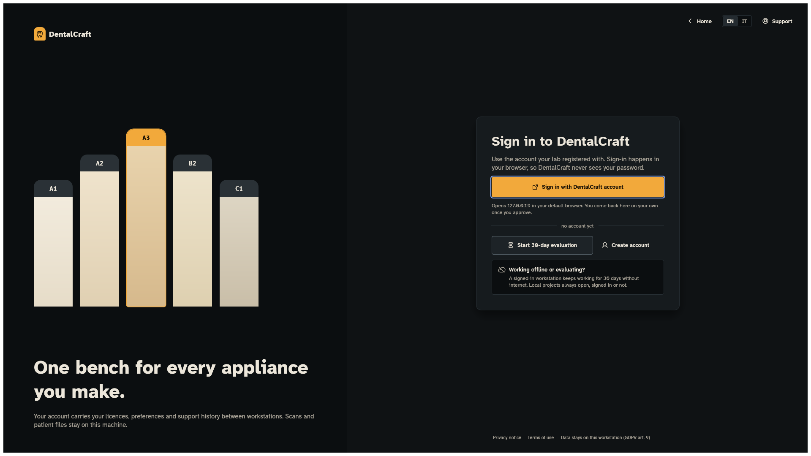
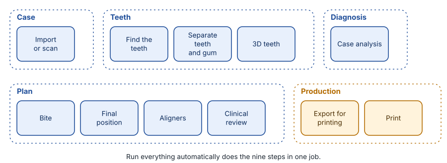
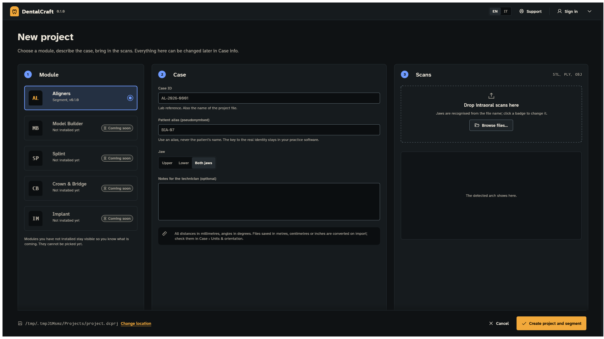
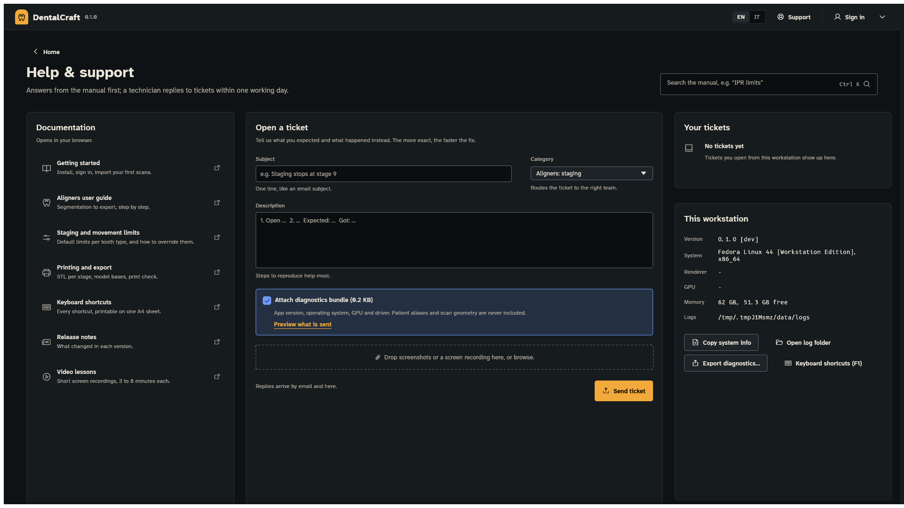

# DentalCraft User Manual

*Planning clear-aligner treatments with the Aligners module: from scan to printed aligner. Edition of 28 November 2026, for DentalCraft 0.2.0-alpha.16 (Aligners module 0.2.0-alpha.14, engine 0.3.0-alpha.10), which makes saving, project files, tooth numbering, treatment planning, export, print preparation, sign-in, updates and diagnostics stricter, and clearer about what they refuse and what they only warn about, handles a project with one arch, closes scans and study models into clean solids and says when it cannot, plans with a derotation that follows the excess and no needless delays, keeps the aligner edge clear of the papillae and the aligner off the gum, offers the tooth colours, marks, numbers and the contact map as toolbar toggles that start off, and keeps a live step history, on top of removing scans, the bite registration that accepts partial scans, Settings with the "Advanced options and parameters" switch and direct printing on the Elegoo Saturn 4 Ultra 16K.*

> **Important: not a medical device.** DentalCraft is not a certified medical device. It has no CE marking, no FDA clearance and no clinical validation. Do not use it on patients or for clinical decisions. Every plan it produces must be checked by a qualified clinician, and every printed aligner by a qualified person, before any use. Use it for evaluation, training, research and design tests only; the licence allows noncommercial use only.

## 1. About this manual

DentalCraft is a desktop application for digital dentistry, written in Rust. Its first module, **Aligners**, plans orthodontic aligner treatments from intraoral or desktop scans: it finds and separates the teeth, builds them as 3D solids, analyses the case, registers the bite, computes the final tooth positions, splits the movement into aligner stages, and exports the files needed to print the aligners, or prints them directly in clear resin.

DentalCraft is in alpha. Some functions are partial, they change between versions, and the screens in this manual may differ in detail from your version. Where this manual describes something that is not finished, it says so.

### 1.1 How to read it

- Chapter 2 installs the program. Chapter 3 covers the first start, signing in and **Settings**.
- Chapter 4 explains how the window is organised. Chapter 5 follows the workflow step by step, from the scan to the printer.
- Chapters 6 to 9 cover the 3D view, saving, troubleshooting and privacy.
- Menu and button names are written in **bold** as they appear in English. The Italian interface has the same structure; its names are in the Italian edition of this manual.

### 1.2 What you need

- A 64-bit computer with a graphics card and a recent driver for Vulkan (Linux) or DirectX 12 or Vulkan (Windows). A recent integrated GPU is enough for a single case.
- Scans of the arches in STL, OBJ or PLY format, or a Revopoint MINI 2 scanner (alpha, see section 5.2.4).
- For printing: an Elegoo Saturn 4 Ultra 16K, a clear biocompatible aligner resin with its maker's settings for that printer, and a FAT32 USB stick.

## 2. Install

DentalCraft is offered both as an installer and as a standalone folder. Choose one. Every package contains the application (`dentalcraft`) and the command-line tool (`dentalcraft-cli`).

### 2.1 Linux

The Linux programs need glibc 2.39 or newer: Debian 13, Ubuntu 24.04, Fedora 40 and later all qualify. The graphics libraries (Wayland or X11, Vulkan) are loaded at run time.

| Format | How to install | How it updates |
|---|---|---|
| Flatpak (any distribution) | `flatpak install --user --from https://dentalcraft.app/linux/DentalCraft.flatpakref` | `flatpak update` |
| Fedora (dnf) | `sudo dnf config-manager addrepo --from-repofile=https://dentalcraft.app/linux/dentalcraft.repo` then `sudo dnf install dentalcraft` | `sudo dnf upgrade dentalcraft` |
| Debian and Ubuntu (apt) | add the key and the repository, then `sudo apt update && sudo apt install dentalcraft` (commands below) | `sudo apt upgrade dentalcraft` |
| AppImage | download the file, `chmod +x DentalCraft-<version>-x86_64.AppImage`, run it | the in-app updater |
| Standalone | unpack `dentalcraft_<version>_linux_x86_64.tar.gz` anywhere and run `dentalcraft` | the in-app updater |

For apt, add the signing key and the repository once:

```sh
curl -fsSL https://dentalcraft.app/linux/dentalcraft.gpg | sudo tee /usr/share/keyrings/dentalcraft.gpg > /dev/null
curl -fsSL https://dentalcraft.app/linux/dentalcraft.list | sudo tee /etc/apt/sources.list.d/dentalcraft.list > /dev/null
sudo apt update && sudo apt install dentalcraft
```

The dnf and apt packages install the repository themselves, so later updates arrive with the rest of the system. dnf asks you to accept the signing key: check its fingerprint against the one on the download page. On an AppImage without FUSE (for example in a container) add `--appimage-extract-and-run`. The AppImage also runs the command-line tool: `DentalCraft-<version>-x86_64.AppImage --cli <arguments>`.

The Flatpak has access to your home folder (projects live in `~/DentalCraft`), the network (sign-in, update check) and the system keyring (the sign-in session survives a restart).

### 2.2 Windows

Windows 10 or 11, 64-bit.

| Format | What it does |
|---|---|
| `DentalCraft-<version>-setup.exe` | Installs for the current user, no administrator rights. Start-menu shortcut, optional desktop shortcut, entry in **Apps & features**. |
| `DentalCraft-<version>-x86_64.msi` | Installs for all users in `C:\Program Files\DentalCraft` (administrator rights). `msiexec /i <file> /passive` shows only a progress bar. |
| `dentalcraft_<version>_windows_x86_64.zip` | Standalone: unpack anywhere, even on a USB stick, and open `dentalcraft.exe`. Nothing is installed. |

The Windows programs and installers are signed with DentalCraft's own self-signed certificate. Windows does not know that certificate, so SmartScreen ("Windows protected your PC") can still warn and show an unknown publisher: choose **More info** then **Run anyway** only for a file you downloaded from the official download page. Compare its SHA-256 checksum with the one on that page or in the release's checksum file before you run it.

### 2.3 macOS

There is no macOS download yet. The code for a macOS build (a universal `DentalCraft.app`, CoreBluetooth, camera access) exists, but it has been checked only by compiling on Linux; nobody has run it on a Mac. The macOS build will be published once it has been tested.

### 2.4 Updates

The application checks the DentalCraft website for a newer version at start-up (you can turn this off in **Settings**, section **Updates**) and when you choose **Check now**. The answer is signed, and the application verifies the signature, the size and the checksum of everything it downloads before it installs anything.

- **Standalone folder, AppImage, setup.exe and MSI:** the dialog offers **Update now**, **Later** and **Skip this version**. **Restart now** saves the open project, installs the update and starts the new version; **Later** installs it when DentalCraft closes.
- **deb, rpm, Flatpak:** the dialog gives you the command for your package manager; nothing is downloaded by DentalCraft.

Before it runs, the installer is checked **again**. A downloaded file waits on disk, where other programs of your user could change it, so DentalCraft hashes it once more right before it installs it (for an AppImage, right before it replaces the running one) and compares the hash with the one in the signed manifest. On Windows the setup.exe or MSI must also carry the signature of the DentalCraft certificate (section 2.2), and this check is repeated by the helper that starts the installer once DentalCraft has quit. If either check fails, nothing is installed.

### 2.5 The command-line tool

`dentalcraft-cli` is installed next to the application. It runs the same commands without a window and serves them to AI agents (chapter 6 of the developer guide). `dentalcraft-cli --version` prints the version, `dentalcraft-cli licence` the licence and `dentalcraft-cli licence --third-party` the third-party notices.

## 3. First start

### 3.1 Consent for diagnostics

On the first start DentalCraft asks whether it may send **anonymous diagnostic data**. The box is not ticked: if you do not tick it, nothing is collected or sent. Chapter 9 says exactly what is and is not sent. You can change your mind at any time in **Settings**, section **Privacy**.

### 3.2 Language and theme

The **EN / IT** switch at the top right of the Home screen changes the language of the whole interface at once; it is also in **Settings**, section **General**, where the theme (**Dark**, **Light** or **System**) is chosen.

### 3.3 Signing in

Local projects always open, signed in or not. Signing in loads your licences and preferences and keeps them in step between workstations.



*Figure 1. The sign-in screen (screenshot of version 0.1.0; the wording of some secondary elements has changed since).*

1. Choose **Sign in with DentalCraft account**. DentalCraft opens your default web browser on a page of the DentalCraft account server; the application never sees your password.
2. Sign in there and approve. The browser sends you back to the application, which waits on a local address of your own computer (`127.0.0.1`) for the answer.
3. The window changes to **Signed in**. The session is kept in your operating system's keyring and survives restarts of the application.

If the browser does not open, use **Reopen browser** or **Copy sign-in link** in the waiting screen. **Cancel** or the Escape key stops the attempt. The button for the 30-day evaluation is not available yet: you do not need an account to work locally. A signed-in workstation keeps working for 30 days without internet access.

**If the clock of your computer is wrong.** The sign-in is checked against the time. If the clock of your computer is off by more than five minutes, the sign-in cannot be checked and DentalCraft says so: **The clock of this computer looks wrong, so the sign-in cannot be checked. Set the correct date and time, then try again.** This does not sign you out: the saved session is kept. Set the date and time right (or let the system set them automatically) and try again.

### 3.4 Settings and the "Advanced options and parameters" switch

Open **Settings** with the gear button in the top bar of the Home screen and of the workspace, or from the account menu (**Settings…**). The dialog has four sections. Every change takes effect at once and is saved; Esc, a click outside the dialog or **Close** closes it.

| Section | What it holds |
|---|---|
| **General** | **Interface language** (EN / IT) and **Theme** (**Dark**, **Light**, **System**). |
| **Workspace** | The switch **Advanced options and parameters**. |
| **Updates** | **Check for updates at startup** (on by default) and **Check now**. |
| **Privacy** | **Send anonymous diagnostic data** (the same choice as at the first start; off until you tick it). |

**Advanced options and parameters is off by default**, and the application then shows the simple view:

- the side panels show the automatic steps and the most useful manual corrections only;
- the menu marks the step to do next with a **Next** pill, and its inspector carries a **Next step** badge, so it is always visible what to do to get to the aligners;
- the status bar readouts, the technical settings of each function, the scan point-cloud tools and the extra print settings are hidden.

Switch it **on** when you want every parameter and technical value. Values you set while it was on stay in effect when you switch it off again: switching off hides controls, it does not reset anything. Agents and scripts can read and change the same switch with the commands `app.settings.get` and `app.settings.set` (developer guide, section 6.6); the commands keep all their parameters whether the switch is on or off.

## 4. How the window is organised



*Figure 2. The six menu groups and the steps they hold.*

The workspace has these regions:

- **Top bar:** back to Home, the module and project name, the save status (section 7), **Undo**, **Redo**, **Save**, **Settings**, **Help** and the account.
- **Left menu**, grouped by function: **Case**, **Teeth**, **Diagnosis**, **Plan**, **Production**, **Follow-up**. The footer counts the nine steps of the workflow done so far (`3/9`). A tick marks a function whose result is in the case. The filter field at the top is reached with the `/` key.
- **3D view** in the middle, with a toolbar (views, arches, display, layers), the view cube and the timeline of the aligner stages at the bottom.
- **Inspector** on the right: everything about the selected function.
- **Status bar:** hints, the running job with its progress bar and a cross to stop it.

The menu and the inspector are resizable by dragging their edges (double-click resets); their sizes are remembered.

### 4.1 The menu rule

Clicking a menu entry, or pressing Enter or its shortcut key on it, **only selects it and shows its inspector**. It never starts a computation, a file dialog or a tool, whether the step is done or not. A step is run only by the button in its inspector, which reads **Run**, or **Run again** once the step is done. A step already done is never re-run by clicking it.

The inspector of every function has the same layout, top to bottom: title and description; **status** (**Done** or **Not done yet**, with the result of the last run); **Parameters** (advanced view); **Automatic** (the Run button); **Manual corrections** (the tools of that function, one button each).

**What counts as done.** A step shows as done, and counts in the footer, only while the case holds its result. The application keeps a step history for every version of the case: a run of a function is recorded; a correction made with a tool of its inspector is recorded as done by hand; running a step again, or correcting it by hand, removes the records of the functions after it, because they were computed from its old result; and **Undo** and **Redo** bring back the history of the version they go to. A function that is not one of the nine steps (an export, **Study models**) shows as done from its record, on the case its run left, until the next change. The history is saved with the project, and when a project is opened a record of a step is kept only if the case holds its result.

### 4.2 Every change can be undone

Each command you run, each manual correction and each parameter change is one undoable step: **Undo** and **Redo** (`Ctrl+Z`, `Ctrl+Shift+Z`) in the top bar walk through them.

A command that leaves the case exactly as it was, such as a query that only reads (the region of a tooth), adds no undo step: the project is not marked as unsaved and nothing is saved by itself.

### 4.3 The nine steps and the shortcut

The steps are: Import scans, Find the teeth, Separate teeth and gum, 3D teeth, Case analysis, Bite, Final position, Aligners, Clinical review. **Run everything automatically** (group **Case**) does all of them in one background job, one undo-able result, stopping with a clear message at the first step that fails; the case is then left as it was.

## 5. The workflow, step by step

### 5.1 New project

From **Home** choose **New project** (or **Open project…** for an existing `.dcprj` file).



*Figure 3. The New project screen (screenshot of version 0.1.0: the button now reads **Create project**, and creating a project no longer starts any processing).*

1. **Module:** **Aligners**. The other entries are future modules and cannot be picked.
2. **Case:**
   - **Case ID**: your lab reference. The name of the project file is made of this and the patient alias.
   - **Patient alias**: a pseudonym. **Never type the patient's name**; the key to the real identity stays in your practice software.
   - **Jaw**: **Upper**, **Lower** or **Both jaws**.
   - **Notes for the technician** (optional).
3. **Scans:** drop STL, PLY or OBJ files, choose **Browse files…**, or choose **Scan** to scan with a connected 3D scanner (section 5.2.4). You can also start with no scans and import them later in the workspace.
4. The path of the project file is at the bottom (**Change location**). **Create project** creates the project only; nothing is processed yet.

Projects are kept by default in a `DentalCraft/Projects` folder in your home folder. The file is a single `.dcprj` container (chapter 7).

### 5.2 Step 1: Import scans (group Case)

The inspector's **Run** button opens the file dialog (STL, OBJ or PLY).

**File formats.** STL files are read in both forms, text and binary, also when the header of a binary file starts with the word `solid` (some exporters write it). A PLY file whose header declares more vertices or faces than the file can hold is refused with a message, instead of being read: a damaged file cannot make the program run out of memory.

#### 5.2.1 Scan roles

Each scan has a role: **Upper**, **Lower** or **Bite**. DentalCraft recognises the arch from the file name, and from the shape of the scan when the name says nothing. A badge on each scan says how its role was decided; a guess can be confirmed, and any role can be changed by clicking the badge. Metres, centimetres and micrometres are converted to millimetres at import.

#### 5.2.2 Closed at import

An arch scan that is open under the gum is **closed into a clean solid** in the same undo step. A flat base (3 mm under its lowest point) walls the border of the scan. Holes inside the scan are filled in place, following the surface around them, and never become chimneys down to the base; faces folded back over the scan (an edge shared by more than two faces) are taken out and their hole is filled the same way. The closed solid is the scan that is shown, saved, used for the bite and printed; the scan as it was read is kept inside it. A bite scan, a scan that is already closed and a mesh with fewer than 1000 faces are left as they are.

**When a scan cannot be closed.** The import does not hide it. The scan is imported all the same, and a notice **Scan not closed** stays on screen (it is never timed out or grouped with the minor notices) with what is left: **arch.stl: the scan could not be closed into a clean solid: 12 open edges and 3 edges shared by more than two faces are left. The export may fail on it: check the scan, or scan again.** Check the scan, or scan again, before you go on.

#### 5.2.3 Manual corrections

In the inspector, under **Manual corrections** and **Scans in the case**:

- **Role** of each scan. Moving a scan to the other arch renumbers its tooth marks (13 becomes 43) and rebuilds what depended on it.
- **Flip the occlusal side**, if the side of the teeth was recognised the wrong way round. Pressed again it flips it back.
- **Close with a base** (and **Run again**) for each arch scan; the slider **Base height** sets the base from 0.5 to 20 mm.
- **Remove the scan** (the bin button on the row, or the Delete key): see section 5.2.5. A dialog asks first; everything computed from the scan goes, and `Ctrl+Z` brings it back.

#### 5.2.4 Scanning with a 3D scanner (alpha)

The scan button next to **Import scans** opens the **scan popup**, which works the same from the New project screen and from the workspace. It drives a **Revopoint MINI 2** and the **Revopoint dual-axis turntable** (over Bluetooth LE). The scanner connector is in alpha and was tested on Linux and in Windows; it has not been run on macOS.

In the simple view the popup has three steps: **1 Acquisition**, **2 Surface**, **3 Import**. The advanced view adds the point-cloud tools, the surface tools, the readouts and the acquisition settings.

1. **Acquisition.** Connect the scanner and the turntable. Fix the object to the platter with a little putty: a model that only rests on the platter can slip when the table tilts. Calibrate the turntable once for a given position of the scanner and the table (about two minutes), then start the **automatic scan**: the table turns in steps, stops, and the scanner takes several frames at each stop. The default covers five tilts (−20°, −10°, 0°, +10°, +20°) in 7.5° steps and takes about nine minutes. The scan is made at the best quality; low-quality output is not accepted.
2. **Surface.** The mesh is built, cleaned, holes are closed (except the base), the surface is smoothed within 0.01 mm and optimised.
3. **Import.** Choose the role of the scan (upper, lower or bite) and hand it to the project.

Steady, diffuse lighting gives the cleanest scans: the repository includes a design for a scanner enclosure with controlled LED lighting. The scanner's own fill light is turned on while streaming and off afterwards.

#### 5.2.5 Removing a scan or an imported model

Any scan in the case, whatever its role (**Upper**, **Lower** or **Bite**), can be removed: a file imported by mistake, a model of another patient, a bad take of a bite.

**Four ways to start the removal** (all four do the same):

- The **bin button** on the scan's row in **Scans in the case** (inspector of **Import scans**).
- The **bin button** on each bite scan's row in the inspector of **Bite**.
- The **Remove the scan** button in **Selected component**, the first block of the right panel, when the scan is the selected component.
- The `Delete` or `Backspace` key with the scan selected. The key does nothing while a tool is open or while you type in a text field, so Backspace in a field never removes a scan.

**Confirm.** A dialog **Remove the scan?** names the scan and says that it leaves the case together with everything computed from it, and that `Ctrl+Z` brings it back. **Remove** confirms; anything else cancels, and nothing has changed until you confirm.

**Result.** The removal is one undo step. A notice says **Scan removed**; when results were cleared, a second notice, **Results cleared**, lists them. `Ctrl+Z` brings back the scan and everything it cleared together; `Ctrl+Shift+Z` removes it again.

**What is cleared:**

- **An arch scan (upper or lower)** takes with it everything derived from that arch: its tooth marks and teeth marked missing, the tooth colours (teeth and gum), tooth axes and measures, the 3D teeth, the gingiva, the case analysis (including the Bolton ratios and the complexity score, which need both arches), the final position, the aligners, the clinical review, the bite ramps, the control visits and the study model of that arch. The bite registration is cleared too, to be redone. Your settings are kept. The other arch is not touched: it stays where the bite registration moved it, so run **Bite** again. The case's reference frame is reset, as when a scan is replaced.
- **A bite scan** clears only the bite registration, and only when that scan took part in it. A virtual bite, and a registration made on the other bite scan, stay. The arches stay where the registration moved them: run **Bite** again. A project left with one arch has no bite to redo (section 5.7).

**When it is refused.** An arch scan cannot be removed while the case holds data of a module that this version cannot read (a file written by a newer version): the notice says why. A bite scan can still be removed.

### 5.3 Step 2: Find the teeth (group Teeth)

**Run** numbers the teeth of each arch automatically (FDI numbers) and then orients the arch; the result is one **tooth mark** per tooth, one undo step.

**Parameters:**

- **Search also the third molars** (off by default).
- **Missing teeth**: FDI numbers separated by commas (for example `35, 45`). A wrong number shows a red message; the list is saved when you leave the field.
- **Teeth found**: a grid per arch, right side of the patient first. A filled box means the tooth has a mark, a crossed box that it is missing, an empty box that it has no mark.

DentalCraft checks its own proposal. If the numbering would give a third molar where the scan has only gum behind the last molars, would stretch a tooth over the gum at the end of the arch, or would merge two crowded teeth into one, the teeth are found again with the arch free to end at the last crown, instead of shifting every number after the error. A phantom tooth behind the last molar is therefore not numbered, and neighbouring teeth stay separate teeth. An erupted third molar keeps its number. Detection stops at the last molars; it never invents teeth beyond them. As always, check the numbers before moving on.

**The last tooth of each side must be a crown.** A model of the teeth has a base, and its heel or the slope behind the last molar can be as high as the crowns, so that the plain proposal puts a tooth on it and loses or shifts the smooth last molars. DentalCraft therefore tests the end teeth: across the arch the scan must fall about 2.5 mm under the top of the tooth within 7.5 mm on both sides, and the two walls must be about the width of a molar apart (at most 12.5 mm). A heel, a slope or the back of a model base fails this test. When an end tooth fails it, the check reports the doubt `end_not_tooth`; the arch is profiled again over the whole scan, the end teeth that are no crown are cut back, and the teeth are found and checked again. The new numbering is taken only if it is no worse: its end teeth are crowns and every contact between teeth of the first proposal is still a boundary within 1 mm. Otherwise the first numbering stays, with the doubt.

**Third molars are judged one side at a time.** A crown at the end of one side does not make DentalCraft number a third molar on the other side where the scan has only gum: each side is decided on its own. When one side has a third molar as high as the crown next to it, the third molar of the other side is numbered as well only if its crown is nearly as high as that of its neighbour.

**Only permanent teeth.** The numbers 11 to 18, 21 to 28, 31 to 38 and 41 to 48 are supported. A deciduous (milk) tooth number, 51 to 85, is refused with a message that names it (**75 is a deciduous (milk) tooth: only permanent teeth (11 to 48) are supported**), in the list of missing teeth as well as in the tooth marks, instead of its crown being given to a neighbouring tooth or to the gum.

**Two marks very close together.** Placing a mark closer to another one than about half the width of a tooth is not refused, but it is risky: the separation could leave one of the two teeth without a crown. The command that places the mark answers with a warning (**the marks of teeth 14 and 15 are only 3.2 mm apart, less than half the width of a tooth: the separation may leave one of them without a crown; check that each mark sits on its own tooth**), and the inspector of **Find the teeth** shows it under the status for as long as the marks stay as they are: an undo, or a new run, never leaves a warning that is no longer true.

**Manual corrections:** **Mark a tooth** (click to place or move, Shift+click to delete the nearest mark), **Delete a tooth**, **Change a tooth number**, **Missing tooth**, **Number the teeth in order** (click each tooth in turn: `S` skips, Backspace goes back, Enter or Esc finishes) and **Clear all the tooth marks**.

When the marks change, the steps that depended on them are marked out of date or cleared, and a notice lists them. `Ctrl+Z` brings everything back.

### 5.4 Step 3: Separate teeth and gum (group Teeth)

**Run** paints every tooth of the scan with its own colour; the gum stays uncoloured. It starts from the tooth marks, needs at least four marks covering both sides and the front teeth, and runs one arch at a time. The status bar shows its sub-steps (simplified scan, first separation, colours on the full scan, borders at full resolution, cleanup).

**Parameters:** **Scan detail (faces)** 5000 to 200000 (default 30000), **Tooth edge sensitivity** 0.01 to 1 (default 0.2), **Border smoothing** 0.1 to 10 (default 1.0).

Neighbouring teeth stay separate teeth: they are never merged into one. Running again erases the colours you painted by hand. **Manual corrections:** **Tooth brush** (key `B`: click or drag on the scan to paint the chosen tooth; Shift paints gum, Ctrl fills the crown) and **Clean borders**. The view switches to the scan so the new colours are visible.

When no arch is asked for and one arch has a scan but no tooth marks, that arch is skipped and the result names it and says why (**the lower arch has no tooth marks: run Find the teeth first**); the other arch is separated as usual. A tooth mark with a deciduous tooth number is refused by name before anything is computed (section 5.3).

More than 2 mm behind the distal surface of the last tooth of a side, the scan is taken as gum however high it is, so the base of a model behind the last molar is never painted as a crown.

**The check after the separation.** Besides the numbering, the separation is checked (the check also runs inside **Run everything automatically**): a boundary between two regions with no groove, a piece narrower than a crown, a crown wider than one tooth. The check joins two regions into one tooth only when there is evidence of **one crown**: no groove at all between them, the two parts together at most 1.5 typical tooth widths, and each part narrower than 0.9 of a tooth. Two real neighbours whose contact is fused or shallow stay two teeth: the pair is listed as a doubt (**… and … have no clear groove between them, but they are not two parts of one tooth: kept as two teeth, check the boundary between them**) and in the result of the command under `kept_apart`. After a correction only the teeth from the most mesial changed mark, in its quadrant, can change number: a renumbering that would change teeth no correction touched is not applied, and the result says so.

### 5.5 Step 4: 3D teeth (group Teeth)

**Run** gives each tooth as a **closed 3D solid** with its axis and builds a gum that follows the teeth. Every tooth is closed and squared off, so no mesh is left open, and the gum is closed too: a flat base, 3 mm under its lowest point along the occlusal axis, makes it a closed solid like the base of an imported arch scan. The base stays still while the teeth move; the aligners and the export are built without it. It needs the teeth to be separated. The final position and the aligners of the arch, if any, are cleared because they were planned on the old teeth.

After brush corrections, **Run again** rebuilds only the arch's teeth that changed; the others keep their solids. **Rebuild a tooth** rebuilds a single tooth, and **Show the region** highlights the region a tooth was built from.

**A tooth that cannot be closed.** DentalCraft never keeps an open tooth. If every way of closing a tooth leaves a hole or an edge shared by more than two faces, the step stops and the message names the tooth and the arch: **tooth 36 of the lower arch could not be closed into a solid: every try leaves a hole or an edge shared by more than two faces; check its crown with the brush, then build the teeth again**. Correct the crown of that tooth with the brush and run the step again. **Rebuild a tooth** also checks the region first and says in words what is wrong with it: too small for a crown, too low (it looks like gingiva), too wide (it may include two teeth), split in parts, touching the border of the scan, or with holes.

**Tunnels through a tooth.** A scan can hold a tunnel a few triangles wide through a thin incisal edge, a cusp tip or a fissure. A closed tooth that kept it would have a hole through it. The 3D tooth does not keep it: the tunnel is cut where it is narrowest and the hole is closed, so every 3D tooth is one closed piece without a hole through it (the information of the tooth reports how many tunnels were cut, `handles_cut`). A tooth without a tunnel is built exactly as before. If no way of closing a tooth leaves it free of tunnels, the step stops and names the tooth: **tooth 36 of the lower arch could not be closed into a solid: every try leaves a tunnel through the tooth; check its crown with the brush, then build the teeth again**.

### 5.6 Step 5: Case analysis (group Diagnosis)

**Run** computes, per arch: the space available and needed (**Crowding**, **Spacing** or **Enough space**), the **Little irregularity index** with its category, the midline offset and the largest space; then the **Bolton ratios** (only with both arches: one arch has no ratio between arches, and its report has none) and a **complexity score** of the case.

**Manual corrections** (**Correct the case analysis by hand**) let the clinician set the four values they can measure themselves: crowding or spacing, Little index, midline offset, largest space. A card that carries a hand value shows the badge **Includes values set by hand**, and the export report marks them.

### 5.7 Step 6: Bite (group Plan)

The bite sets how the upper arch faces the lower one. It is functional only: it sets the occlusion, and the **bite scan is never shown as a 3D object** in the view (it appears only while you pick its three points, and it cannot be picked by clicking in the view).

**A project with one arch has no bite.** With only one arch there is nothing to put it in occlusion with, so nothing is estimated, made up or taken by default. The inspector of **Bite** says that it does not apply and why (**The project has only the lower arch: there is no bite. Nothing is estimated, and the aligners are made from this arch alone.**) in place of its status, parameters, **Run** button and corrections; it still lists the bite scans the case holds, so that they can be removed (section 5.2.5). A bite that an old project still stores is ignored and not shown. The step counts as complete once the arch of the scan is settled (while the arch of the only scan is still a guess, nothing counts as done), so the footer counts it, **Bite** is never the next step, and **Run everything automatically** goes on with the one arch. The aligners are made from that arch alone: no occlusal shaping of the shells, no bite ramps, no bite with the aligners worn, and no Bolton ratios. A demo arch is never added next to the scans of a patient: **a demo arch goes only into a case of demo arches**. For an agent, the bite commands (the registration, three points, the correction, the virtual bite, the contact map, the bite with the aligners worn and the ramps) answer `applies: false`, `reason: "one_arch"`, the arch and the same sentence, and change nothing.

- With **bite scans** in the case (one per side for an intraoral scanner, or one scan round the arch for models in occlusion), **Run** registers the arches on them. A partial or low-quality bite scan is used too, as long as its teeth fit the arches: a scan of the front teeth only, of one side, or with holes, noise or soft tissue. It is not refused for being incomplete: it registers, and the report tells you what to check (**to check**, below). A bite is accepted when the front part is captured correctly: the back of the mouth need not be complete.
- With **both arches** and no bite scan, **Run** uses a **virtual bite**, and says so in a warning: for the clinical relation, register the buccal bite.
- **Import the bite scans…** imports the files with the role bite.
- **Three points** (manual): pick three points far apart on the lower arch, then the same three, in the same order, on the bite scan, and optionally the same for the upper arch.
- **Correct the interpenetration** moves the upper arch along the occlusal axis to the first contact. The report shows the interpenetration found, the one left and the opening.

The registration report shows **Bite registered** when there is nothing to check, or **Bite registered, to check** with one line per reason. The reasons come from how good the scan is and how much of the mouth it covers, never from a refusal:

- **RMS above good:** the scan deviates more than 0.10 mm from an arch (RMS deviation on the lower or the upper arch).
- **Few teeth:** fewer than four teeth of an arch are in the bite scan.
- **Low coherence:** less than 70 % of the scan's surface facing an arch lies within 0.10 mm of it (a noisy or distorted scan).
- **Front teeth only** or **one side only:** the scan does not reach the back teeth, or the other side; the relation there is extrapolated. Add the scan of the other side, or check the contacts on the patient.
- **The two bite scans disagree:** with two scans, the upper teeth are more than 0.10 mm apart (did the patient close differently?).
- **Interpenetration:** the arches go into each other by more than 0.10 mm; **Correct the interpenetration** removes it.
- **The arches do not touch:** the closest points are more than 0.10 mm apart (was the patient in maximum intercuspation?).
- **Scan ignored:** with two bite scans (two sides, or two takes of the same teeth), one that does not fit the arches while the other does is left out and named in the report. The registration rests on the other scan, and the ignored one stays where it was. Two takes saved under the same file name are told apart by a number, for example `(2)`.

A "to check" bite is registered and used: the line tells you what to verify. A bite is **refused**, and nothing moves, only when the fit cannot be trusted at all: no bite scan fits the arches (another patient, a mirrored scan, or a scan without the teeth of both arches; with two scans the message gives the reason of the one that came closest), the registered arches do not face each other, or they interpenetrate by more than 1.0 mm after the fit. The same message also appears when there are more than two bite scans, when an arch has no separated teeth, or when a scan is too small. After a refusal, try another take or **Three points**, or remove the wrong scan (section 5.2.5). The estimate of a virtual bite never takes over silently after a refusal. The two arches never visibly interpenetrate in the 3D view after this step.

### 5.8 Step 7: Final position (group Plan)

**Run** computes the target pose of every tooth with the plan's parameters, the IPR (interproximal reduction) needed, and the arch line. With both arches and no bite registered it shows **Bite first** and refuses: run **Bite**, then this step. The inspector's result lines give, per arch, the expansion, the incisor movement, the IPR in millimetres and contacts, the teeth held, and **Crowding not resolved** as a warning when it applies.

**Parameters** (advanced view): which **Teeth** move (incisors and canines, up to the premolars, or all), and folded groups for **Arch line and tolerances**, **Teeth held and midline**, **Space** (order, expansion, advancement, retraction, close the gaps), **IPR** and **Vertical movements**. After changing parameters, run the step again. **The values to confirm must be checked by an orthodontist.**

**Manual corrections:** **Move a tooth** (the clinical components mesial/distal, buccal/lingual, extrusion/intrusion, torque, tip and rotation, with − and + steps; lock the tooth; exact values), **Arch line** (drag the 11 points of the curve and **Apply the line**, which can recompute the final position on it), and **Back to the initial position**.

The layer **Target position** of the 3D view shows the teeth at their final position as a translucent ghost.

**How the automatic final position decides.** Two rules keep the plan steady when a few triangles of the segmentation change. They are not parameters.

- **A tooth is derotated only by the excess over its tolerance.** A tooth rotated against the arch line is turned by the part of its rotation that is beyond the tolerance of its zone: **Rotation tolerated (degrees)** for incisors and canines (1°) and **Rotation tolerated, posterior teeth (degrees)** for premolars and molars (5°). An incisor rotated by 3° is turned by 2°, not by 3°. The turn is not made at all when the excess is under 0.5°, and from there it grows continuously. Before, a tooth beyond its tolerance was turned fully onto the line, so a rotation measured within the noise of the tolerance decided between no movement and a full derotation, with its space and IPR.
- **The arch line has one scale.** The arch line goes through the prominent cusps with a robust fit, in which a tooth far from the line weighs less. How far counts as "far" (the scale of the weights: 6 times the median distance of the cusps from the line, at least 0.6 mm) is taken once, from the first line and from the canines and premolars only (from every tooth when there are fewer than two), and no longer again at every round from every tooth. The weights stay continuous. The line, and with it where the incisors are placed, no longer moves when the distance of one tooth crosses the median.

**The final position aligns every tooth.** By default the automatic final position aligns all the teeth and holds no molar; a project saved with the old defaults (incisors and canines only, molars held) takes the new ones when it is opened. In detail:

- **Spaces are closed with the posterior teeth.** The premolars and molars behind a space move mesially to close it. Each side of the arch makes its own room, and the midline stays where it is.
- **The last tooth of each side never moves distally** and keeps its height. With the advanced options on, **Largest distal movement of the last tooth of each side (mm)** (0 to 0.5 mm, default 0) allows it up to that amount (`distal_max_mm`).
- **No IPR on a contact that is open at rest**, and contacts left open on the crowns in the final position are closed.
- **No therapy to derotate a premolar or a molar.** A posterior tooth turned back is longer along the arch; its derotation is given up, as far as the arch needs, before any IPR, expansion or advancement is planned for it. The note **partial derotation** lists the teeth concerned.

### 5.9 Step 8: Aligners (group Plan)

**Run** splits the movement into stages: one aligner per stage, with a calendar. The result shows the number of aligners, the days (for example from a start date, worn 22 hours a day), the pattern used and the collisions left.

**Parameters** (advanced view): **Periodontium** (healthy, stage I, II, III), **Pattern** (automatic, simultaneous, sequential, structured), the calendar (**Aligner change**: fixed interval or adaptive 7/14 days, **Days per aligner** 5 to 21, **Start of treatment**) and the **Largest movement per aligner** group.

**Manual corrections:** **Slow a tooth** (select the tooth in the view, choose a speed between 0.2 and 1, **Slow the tooth**; the arch's aligners are recomputed in the same undo step).

**Limits are checked everywhere.** The limits of **Largest movement per aligner** and the crown cap are checked wherever they come from: the settings of the case, a value read from a project file, or an override given to the command by an agent. A value outside its range is refused before anything is planned, with a message such as **step_linear_mm must be between 0.05 and 0.5 (got 2)**; a limit of 0 is never taken as "no limit". The ranges are: **Translation per aligner** and **Vertical movement per aligner** 0.05 to 0.5 mm; **Rotation per aligner** and **Rotation of canines and premolars** 0.25 to 4°; **Torque and tip per aligner** 0.1 to 3°; **Largest move of the crown** 0.05 to 0.6 mm; **Contact tolerated** 0 to 0.5 mm. The speed of a slowed tooth is 0.2 to 1: a stored speed outside that range is refused and the message names the tooth. A tooth that would need more than 999 aligners is refused too. The result of the planning lists every step that is still over a limit (`over_limit`: tooth, component, the largest step and its limit) and every IPR that no aligner carries (`ipr_unscheduled`); in a sound plan both lists are empty. The inspector of **Aligners** shows them under the status: **Steps over the clinical limit: n** (for example **Tooth 14: the rotation moves 2.6° in one aligner, 0.6° over the limit of 2°.**) and **IPR that no aligner carries** (**The IPR between teeth 13 and 14 is in no aligner: do it by hand.**). Like the warning of two close marks, they are shown only while the plan they belong to is the one in the case, and they are not saved with the project; slowing a tooth reports its new plan too.

**Delays and collisions.** The staging checks the adjacent crowns at every aligner, on every crown point above the gingival band, not on a sample. When a tooth would press into a neighbour more than the plan allows, it can be delayed by 2 to 8 aligners; a delay is kept only when it lowers the worst overlap of that pair over the whole plan. A tooth is never delayed against a neighbour that never moves, because the delay would only move the same contact to a later aligner and lengthen the plan. Where no delay helps, the collision is left, and it is listed: in the inspector of **Aligners**, in a warning block **Collisions left in the plan: n** with one line per collision (for example **Aligner 9: teeth 12 and 11 penetrate 0.62 mm, 0.05 mm over the 0.57 mm the plan allows.**, with the arch named when both arches have a result), in the notes of the plan and in the export report. The list is kept in the case, so a reopened project shows it too. The allowance of a pair is its overlap at rest plus the tolerance and its IPR, because the crowns of a case often overlap at rest already. To remove a collision, correct the final position, add IPR or slow a tooth.

**The aligner in the 3D view.** Aligners are **not** shown by default. The inspector section **The aligner in the view** has **Show the aligner** / **Hide the aligner** and **Exact aligner of this stage** (the solid the export writes, for the stage shown). They are built only when you ask.

**The aligner over the scan, the teeth and the study model.** The aligner shown is drawn over whatever its arch shows: the scan, the 3D teeth (the **Scan** and **3D teeth** choice of the toolbar; the view shows the scan by itself after **Separate teeth and gum**) or the study model. It is translucent, it can never be picked, and it follows the stage of the timeline, so dragging the timeline moves it. A hidden arch, the scan of **Three points** and the region of a tooth leave it out. The pictures of the command line and of the control bridge draw it the same way.

The **timeline** at the bottom of the 3D view is a plain slider over stages 0 to N. Drag it, or use `,` and `.` for the previous and next stage (Shift for five), Space to play, Home and End for the first and last. The number of the stage is written above the handle.

### 5.10 Step 9: Clinical review (group Plan)

**Run** makes a record for each classification the program proposes from the evidence: case difficulty, aligner pattern, whether the case is treatable with aligners only, per-tooth movement risk and attachment, crown measures and tooth type. The clinician confirms or changes them before production.

Filter the list (**All**, **To review**, **With a note**, **Selected tooth**). For each item you can **Confirm** the proposal, choose another value from its options, or go **Back to the proposal**. The group **All together** has **Confirm those without a note**: items that carry a note to check are never confirmed in bulk. The attachments and the aligner pattern in force feed the calendar, the export and the report.

### 5.11 Export for printing (group Production)

This function is not one of the nine steps. Its inspector first asks where the aligner ends and then the quality of the print files.

- **Where the aligner ends:** for each arch and side, the last tooth the aligner covers. The teeth behind it are not covered and do not move. If a tooth is missing and the shell behind the gap would be weak, the inspector advises another end.
- **Quality of the print files:** **Draft** (0.25 mm detail), **Light** (0.15 mm), **Standard** (0.1 mm, production files, the default), **High** (0.08 mm).
- Advanced groups: **Aligner edge** (equator, straight, scalloped, smooth; edge height and extension; **Edge clear of the papillae**; path of insertion), **Shell** (thickness, inner clearance, **Space over the gum**), **Identification text** (arch, number and date engraved inside), **Bite with the aligners worn**, ramps and quality. With one arch there is no occlusal shaping, no ramps and no bite with the aligners worn (section 5.7).

**Export** opens a folder dialog and works in the background (it can take a long time; stop it with the cross in the status bar). The files are built in a hidden folder and moved into place when all are made; the manifest comes last, so an interrupted export leaves no half-written folder. It writes the aligner shells and the models (STL), the calendar, a **print check** per file (closed surface, one piece, no self-intersection, no hole through the wall, positive volume, fits the plate) and a report. The files go to the folders `modelli_termoformatura` and `stampa_resina`, next to `print_check.json`, `stages.csv`, `visits.ics`, `report.html` and `manifest.json`. A shell that fails the print check stops the export of all aligners with a message: do not print such a file.

**Study models** (same group) exports flat-based models of the arches.

**Study models** is a function of its own: once run it shows as done, and the aligner shown stays visible beside the study model of its arch.

**Study models are clean solids.** Each model is built from the scan followed along its open edges, as the import closes a scan: folded faces are taken out, only the real borders are walled down to the base and every other hole is capped. A model that is closed already, with a base of its own, is kept whole and seated on the base along all of its bottom. The scanned anatomy is kept as it is, undercuts included: crowns that overhang the gum are not filled in down to the base. The holes through the model that the build makes are closed; the tunnels of the scan itself are kept when closing them would move the surface. Two arches are based as a pair only when they are in occlusion (their occlusal directions within 45° of opposite and the centres of their crowns within 20 mm); two that are not in occlusion yet, as the scans are read before the bite, are each based on their own. When a model is not one clean solid, a notice stays on screen so that you check it: **The lower study model is not one clean solid: 2 pieces, 0 open edges, 0 edges shared by more than two faces and 2 holes through it that the scan does not have are left. It may not print as it should: check it, or build it again.** The report of the command counts every model as the print check counts an STL file (watertight, pieces, genus, open edges, edges shared by more than two faces, tunnels).

**Checks of the export.** The resolution of the print files (the voxel) must be between 0.04 and 0.5 mm; the four qualities are inside that range. The wall of the shell (**Shell**, thickness 0.3 to 2 mm) must be at least two voxels thick, because a thinner wall would come out of the model with holes through it: the shell is refused with a message instead (with the Draft quality, 0.25 mm, the wall must be at least 0.5 mm). The **print check** tests the fit against the build plate of the Elegoo Saturn 4 Ultra 16K, 211.68 × 118.37 × 220 mm, less the 4 mm margin that the print preparation keeps from every edge in X and Y: a part must fit in 203.68 × 110.37 × 220 mm.

**Passive aligners.** Every passive aligner has its own file, engraved (when **Identification text** is on) with its own number, the passive mark `P` and its own date, never as a copy of the last active aligner's file. Each file has its own entry, hash and print check in the manifest.

**The edge clear of the papillae and the space over the gum.** Two advanced settings keep the aligner off the soft tissue. With the advanced options off, their default values apply.

- **Edge clear of the papillae** (group **Aligner edge**, 0 to 3 mm, default 1 mm; it acts on the **smooth** edge). The smooth edge follows the gingival margin, but a papilla rises 1 to 4 mm above the margin between two teeth, so the edge could come down onto it and leave the aligner tight there. The edge is now kept at least this high above the margin all along the arch: it goes round every papilla in a rounded notch, held 0.5 mm under the contact of the two crowns. 0 gives the earlier edge back. Where the notch would leave a hole through the wall, or a cap on a piece apart, the aligner is trimmed again with half the relief, then with none, and the export report notes it (**border … mm above the papillae instead of … mm (a hole through the wall otherwise)**).
- **Space over the gum** (group **Shell**, 0 to 1 mm, default 0.3 mm). Where the aligner covers the gingiva, the papillae between the teeth too, the shell stands this far out with a wall as thick, and rounds off over the gingival margin; on the teeth it fits as before. The printed model keeps the field without it. The export, the aligner of the view, and the shell and trim commands all apply it. 0 gives the earlier shell back.

Both are also parameters of the trim-line command (`papilla_relief_mm`, `gum_clearance_mm`) and production settings stored in the case (`aligners.settings.production`).

**The border does not slice a wall.** A border taken from the gingival margin (straight, scalloped or smooth) could run over the top of a crown whose label stops short of its gingival margin, for example after hand corrections of a molar, and cut the occlusal wall lengthwise; the aligner then came out with holes through the wall. The trim now holds the border under a flat wall it would slice. When the print check finds a hole through the wall it says where: **n holes through the wall, near (x, y, z) mm (coordinates of the file)**.

**The aligner goes straight between the teeth, with its edge at the equator.** With the smooth edge (the default):

- The shell is formed on a model whose spaces between neighbouring teeth are filled, above and under the contact and across spaces up to 3 mm: the wall goes straight from one crown to the next and never into the space between two teeth or onto the papilla. A missing tooth is not bridged this way (a bar joins the two sides).
- The edge is straight, at the height of the equator (the widest part) of each crown, never nearer than 2 mm to the gingival zenith of the tooth, and at least **Edge clear of the papillae** above the tip of every papilla.
- **Bridge between the teeth (recess, smaller = straighter)** (group **Aligner edge**, 0 to 2.5 mm, default 0; `recess_mm`): how far inside the lines tangent to the two crowns the bridge stands. 0 is a straight bridge.

Projects saved with this version store the aligner settings in a newer format: an older version opens them with those settings kept as they are, read-only.

### 5.12 Print (group Production)

Print takes the exported aligners to the **Elegoo Saturn 4 Ultra 16K**: it orients each shell, adds supports, places the shells on the printer's plate, slices them and writes one print file per plate. Aligners are printed directly in clear biocompatible resin. Washing and curing are done by hand in the lab and are outside the program.

> **Not yet proven on real prints.** The print files have been checked against Elegoo's published format and a simulated printer. Printing real aligners and measuring their wall thickness and fit is a later phase; until then treat the output as a test.


*Figure 4. Export, orientation, supports, nesting, slicing, GOO files, USB stick, printer, and the tracking kept in the case.*

#### 5.12.1 Before you start

1. Make the aligners (step 8) and run **Export for printing**. The project remembers the folder of that export: the print window reads the aligner shells from its `stampa_resina` folder. Without an export it says **Not exported yet: run "Export for printing" first.**
2. Prepare the printer with the DENTAL 45 machine parameters (section 5.12.2).
3. Have the resin maker's settings for the Saturn 4 Ultra 16K at hand (section 5.12.3).
4. Have a **FAT32** USB stick (16 GB or less works best; the printer reads ASCII file names).

#### 5.12.2 The printer: DENTAL 45 machine parameters

DentalCraft ships the profile of the Saturn 4 Ultra 16K with the **DENTAL 45** machine-parameter set, prepared with Elegoo's engineers. The set is an `M5000` G-code file of firmware parameters (Z axis, the tilt of the vat, the heater, the light source, the vat); DentalCraft reads it to work out heating, release and time. The printer must be running the same set. The values the program relies on:

| Parameter | DENTAL 45 |
|---|---|
| Z axis travel | 230 mm (the print height limit stays 220 mm) |
| Total tilt angle of the release | 140° |
| Resin (vat) target temperature | 45 °C, preheat target 45 °C |
| Time limit of one heating cycle | 35 min |
| Light source (I3 C) | 2: the print file's exposure settings and the machine's are combined |
| Light source power (PWM) | 255 (full) |
| Vat maximum volume | 870 ml |
| Lowest resin level accepted by the level detection | 4 mm |
| Vat width × length used to turn the level into a volume | 143 × 244 mm |
| Tilt speed, first 50 layers and after (slow set) | 36 °/s, then 72 °/s |
| Tilt speed, first 50 layers and after (fast set) | 36 °/s, then 144 °/s |
| Tilt motion time per layer, slow mode | 8420 ms for the first 50 layers, then 4410 ms |
| Tilt motion time per layer, fast mode | 8420 ms for the first 50 layers, then 2430 ms |

The release mode (slow or fast) is chosen on the printer's touchscreen. The time estimate of the print window assumes the slow mode, so the real time can be shorter in fast mode. The printer also warms the vat to 45 °C before the first layer, and the estimate includes that wait. The printer reports a platform size slightly different from the maker's specification; DentalCraft uses the specification (15120 × 6230 pixels of 14 × 19 µm, 211.68 × 118.37 mm) and compares what the printer reports with it.

#### 5.12.3 The resin values you enter

DentalCraft ships **no preset for any aligner resin**: only the resin's maker knows the exposure for their material on this printer. You enter the values once (they are kept in `print-resin.json` in the application's settings folder: `~/.config/dentalcraft` on Linux, `%APPDATA%\DentalCraft\dentalcraft\config` on Windows, `~/Library/Application Support/app.DentalCraft.dentalcraft` on macOS) and they stay for the next prints. Without them **Prepare the print** is disabled with the hint **Enter your resin's values first**.

| Field | What to enter |
|---|---|
| **Resin name** | 1 to 31 plain letters, digits or spaces (no accents). Written into the print files. |
| **Layer height (mm)** | Between 0.01 and 0.2 mm. |
| **Exposure of each layer (s)** | The maker's value for normal layers. |
| **Exposure of the first layers (s)** | The maker's value for the bottom layers, which are lit longer so the print holds on the plate. |
| **Number of first layers** | How many layers count as bottom layers. |
| **Pause before each exposure (s)** | Lets the resin settle before each layer is lit. |
| **Resin density (g/ml)** | Used to turn volume into weight. |

Copy these from the maker's sheet for this printer, never from another resin. DentalCraft does not guess or compensate any of them.

#### 5.12.4 Prepare the print

1. Select **Print** in the group **Production**. The inspector shows **Printed x of y** and **Still to print: n**, and one row per aligner with its status (section 5.12.6).
2. Choose **Prepare print…**. The print window **Print aligners** opens with the aligners still to print already chosen; use **All**, **None** or the tick of each aligner.
3. Check **Printer** (the profile, and that the files go to the printer on a USB stick, so no network is needed) and **Resin** (the summary of your values, or **Enter your resin's values**).
4. Choose **Prepare the print**. The window reads the aligners, turns them, adds supports and places them on the plate, then prepares the layers of each plate.

**Supports are never on the fitting side.** Each shell is oriented with its fitting side (the inner surface that touches the teeth) facing away from the plate: the opening of the aligner points up, so resin drains and no cup forms. The orientation first tries tilts of up to 45° in 15° steps, which cut the thin wall obliquely and lower the force that peels each layer off the vat. If the supports of that pose fail one of the two checks below, it searches every direction of the opening over the whole sphere (a 5° grid, refined to 2.5° and 1.25° when none qualifies), supports and checks the best of them (at most 16) in turn, and keeps the first that passes; a part that passes in the first pose costs nothing more. It also turns the aligner so that its long side lies along the long side of the plate. Supports touch only the outer side: small cone tips (0.35 mm) on a thin shaft (1.0 mm). The shafts stand on a **raft**, a 1.0 mm base that is printed on the plate. The raft does not fill the whole area under the aligner: it follows the feet of the supports, a chamfered pad round each foot joined to its neighbours by 4 mm bands, so under a dental arch it is **U-shaped**. It saves resin and comes off together with the supports. Two checks run before any file is written, and a failure stops the preparation with a message naming the cause:

- no support may touch the fitting side or its rim (**A support would touch the inside of an aligner**);
- no region of any layer may start in mid-air without a support (**A part of an aligner would print in mid-air without a support**).

When no pose passes, the preparation stops with **No pose of this aligner lets every part rest on a support: the shell needs correcting.** The technical detail names the part, the number of regions left in mid-air, the poses tried and where the lowest region starts, in the coordinates of the part's own file. Other support settings do not help then: correct the shell (the teeth, the aligner edge) and export again.

**How the fitting side is known.** The preparation has to know which surface of a shell is the fitting side, so that no support touches it. For a shell of an export, the print window and the command `print.prepare` take it from the **stage model**: the model of the arch at that stage that **Export for printing** writes in the folder `modelli_termoformatura`, next to `stampa_resina`, paired with the shell through the export's manifest (a passive aligner uses the model of the last stage). The part of the shell that lies on its model (the clearance and the engraved text included) is the fitting side, and the window says so: **Fitting side taken from each aligner's model in the export: the supports stay on the outer side.** If less than 30 % of a shell lies on its model (another stage, or another position), the preparation stops, writes nothing and says **An aligner does not match its model in the export (another stage or another position). Export the aligners again.** (code `print-model-mismatch`). A loose shell that is not in an export with its models is still prepared, but its fitting side is guessed from its shape, and the window warns **Fitting side guessed from shape; export again.** with **Guessed for:** and the names of the aligners: a support could touch the side that sits on the teeth, so export the aligners again before you print them.

In the advanced view **Print settings** exposes the **Tip where a support touches** (default 0.35 mm), the **Support thickness** (1.0 mm), the **Base under the supports** (1.0 mm, the thickness of the raft) and the plate spacing (**Space between aligners** 3 mm, **Space from the plate edge** 4 mm). If an aligner does not fit, reduce the spacing from the plate edge.

The plate preview shows each plate from above (**Plate n of N**, **Previous plate**, **Next plate**) with the estimates: the aligners on the plate, the layers, the print time (about; it includes the heating wait) and the resin. **Resin to pour in the vat (at least)** also takes the vat's minimum level into account.

**A part must be a solid.** The preparation refuses an aligner that is not a closed, consistently oriented solid with a positive volume and no hole through its wall: a file with open edges, with an edge shared by more than two faces, with flipped or inward faces, or with a hole through the wall (**An aligner's shape cannot be printed as it is. Export the aligners again.**; the detail line says which, for example **2 holes through the wall (genus 2)**). Vertices are matched by their exact position, as the STL file has them, and triangles without area are left out, so the preparation and the print check of the export agree on every exported shell; the print window reads the aligners the same way. Nothing is sliced and no file is written.

**The files are swapped in only when all are written.** Every plate file is first written to a temporary file beside its final name and synced. Only when the whole set is written are the `plate_NN.goo` and `plate_NN.stl` files of an earlier preparation that this one did not write removed, and the new files renamed into place. A failed or cancelled preparation leaves the folder as it was, so it never holds a mix of old and new plates, and plates of an earlier, longer run never stay beside the new ones. Nothing but those plate files is ever removed.

**The printer size and orientation are not yet checked.** The print window shows the warning **Printer size and orientation not yet checked**: the dimensional scale and the left/right orientation of the printer profile are not yet checked against the printer, so **verify the size of a test piece before use**. The preparation is not blocked, but print and measure a test piece before you print aligners. The preview image stored in each plate file follows the same orientation as the layers (the mirror flags of the profile).

#### 5.12.5 Save to a USB stick

1. Choose **Save print files…** and select the USB stick (FAT32). Each plate becomes one file, `plate_01.goo`, `plate_02.goo`, and so on, in the GOO format of Elegoo printers. The aligners on the saved plates are recorded as **Sent to the printer** (section 5.12.6).
2. **Save the plate with its supports as STL…** writes the same plates as STL files, for inspection.
3. When the files are saved the window says **Put the USB stick in the printer, choose the file on its screen and start the print.** Do so on the printer.
4. After printing: remove the supports from the outer side, wash and cure as the resin maker says, then check the wall thickness and the fit before use. Washing and curing are manual lab steps outside DentalCraft.

#### 5.12.6 The printed and missing tracking

DentalCraft keeps, in the project, the print status of every aligner of the series (arch, number, passive or active, written as its id: `SUP-03` is upper aligner 3, `INF-12-P` is lower passive aligner 12), so you always see which are printed and which remain. The leaf **Print** of the group **Production** shows them: **Printed x of y**, **Still to print: n**, and one row per aligner. Selecting the leaf only shows this; its button **Prepare print…** opens the print window.

| Status (inspector / print window) | Meaning |
|---|---|
| **To print** | Never marked. |
| **Queued** / **Being prepared** | Put in the queue for a plate. The print window does not set it itself: it goes straight to **Sent** when you save the files; an agent can set it with `aligners.print.mark`. |
| **Sent** / **Sent to the printer** | The plate file was saved for the printer. |
| **Printed** | You confirmed it. DentalCraft never marks an aligner printed by itself; only your confirmation, or a printer's report that the job finished, does. |
| **Failed** | The print failed. |
| **To print again** | Printed, but broken or lost: it goes back on the list. |

In the inspector of **Print**, **Mark…** gives **Printed**, **Failed** or **To print again** to an aligner; each mark is one undoable change saved with the project. The marks are facts about the aligners you made: they stay when a scan is replaced or the series is computed again. A mark that does not make sense is refused and nothing changes (for example **Printed** on an aligner already printed; an aligner leaves **Printed** only when you ask to print it again). The print window preselects what is still missing the next time.

#### 5.12.7 If the preparation fails

| Message | What to do |
|---|---|
| **An aligner's shape cannot be printed as it is** / **file could not be read** | Export the aligners again. The first message also appears when an aligner is not a closed solid (holes, open or doubled edges, flipped faces). |
| **A resin value is out of range** | Check the resin values (layer height 0.01 to 0.2 mm). |
| **An aligner does not match its model in the export** | The shell and its model must come from the same export: export the aligners again. |
| **A support would touch the inside of an aligner** | Try other support settings (advanced view). |
| **No pose of this aligner lets every part rest on a support** | The shell needs correcting: correct the teeth or the aligner edge and export again (section 5.12.4). |
| **An aligner with its supports is taller than the printer can print** | Print fewer or smaller parts on the plate; contact support if one aligner alone is too tall. |
| **An aligner does not fit on the plate** / **The spacing leaves no room** | Reduce the spacing from the plate edge or between aligners. |
| **The files could not be saved there** | Check the USB stick and that it has room; use FAT32. |
| **There is no folder to save in** | Export the aligners first. |

### 5.13 Follow-up (group Follow-up)

**Control visit** compares a new scan with the plan and tells you which teeth are on track and which are behind. **Re-plan** makes a new series of aligners from the last control visit, keeping the ones already delivered. Both are follow-up functions and do not count among the nine steps.

In the control visit, the teeth that are behind get a lower speed in the new aligners, the **lag speed** (`lag_speed`), a factor from 0.3 to 1 (default 0.75). A value outside that range is refused, because a lower one would stretch the new plan into hundreds of aligners.

## 6. The 3D view

The toolbar over the view has: the standard views (**Occlusal**, **Front**, **Left**, **Right**, **Back**); the **Upper** and **Lower** arch toggles; the display mode (**Solid**, **Transparent**, **Wireframe**); the tools **Measure**, **Angle** and **Section**; layers (tooth colours, tooth marks, tooth numbers, contact map); **IPR** and attachment marks; and the group **Models in the view** (**Study models**, **Target position**, **Aligner**). The 3D view always shows the upper and lower arches (teeth and gum) together unless you hide one.

**The four view toggles.** The tooth colours, the tooth marks, the tooth numbers and the contact map are always in the toolbar, with the advanced options on or off (a toggle with nothing to show stays enabled and off; the contact map explains when it is not available). They are **off by default**: a new project, an opened project and the application at start show none of them. Only you turn them on, and Find the teeth or the separation never do; they are kept neither in the project nor in the settings. **Entering the tooth brush** turns the tooth colours and the tooth numbers on, and leaving it, however (another tool, an undo, a change of state), puts each back as it was before; a toggle you press while the brush is open is yours until you leave. The tooth marks and the contact map are never touched by the brush. Selecting **Tooth brush** in the menu only selects it: the colours and numbers come on when the tool is open. The colours that the separation paints are seen when you turn the **Tooth colours** toggle on.

- **Camera:** right-drag to orbit, middle-drag to pan, scroll to zoom; the view cube at the top right snaps to a standard view.
- **Selecting:** with no tool open, click a component (a 3D tooth, a gingiva, a scan, a tooth number). The selection gets a bold outline around the object, and the inspector starts with **Selected component**.
- **Gizmo:** the selected component carries a transform gizmo: `W` move, `E` rotate, `R` scale (teeth only; Ctrl snaps to 0.5 mm, 5°, ×0.05). A drag is previewed and applied as one undoable step; Esc cancels it. A tooth moves in the plan at the stage shown, never at stage 0.
- **Tooth numbers** appear as chips over the teeth when the **Tooth numbers** toggle is on; `Alt`+click on a number, a mark or the scan chooses that tooth for the brush.
- **Bite scan:** the bite scan is not drawn in the view (only while the **Three points** tool is open) and cannot be picked by clicking: it is a functional scan, not a model. Remove it from its row in the lists (section 5.2.5).

| Key | Action |
|---|---|
| `Ctrl+S`, `Ctrl+Z`, `Ctrl+Shift+Z` | Save, undo, redo |
| `Ctrl+W` | Close the project (saves first) |
| `/` | Focus the menu filter |
| `A`, `B`, `S` | Select Separate teeth and gum, its brush, Aligners (never runs them) |
| `,` `.` Shift, Space, Home, End | Previous/next stage (five with Shift), play, first, last |
| `W`, `E`, `R` | Move, rotate, scale the selected component |
| Delete, Backspace | Remove the selected scan (asks first) |
| Esc | Deselect, close the open tool |
| `F1` | The keyboard sheet |

The application renders with vertical sync and caps the frame rate at 60 frames per second.

## 7. Saving, autosave and project files

A project is one `.dcprj` file (a ZIP container: the case, the scans as mesh blobs, the module data, the step history and a thumbnail). It holds the **complete state of the case**, including the tooth composition (tooth marks and the colours painted with the brush), every parameter and every result.

- **Save** (`Ctrl+S`) writes the case as it is at that moment, atomically: a temporary file is written, flushed to disk and renamed, and one `.bak` copy of the previous file is kept. A save asked for while another runs follows it.
- **Automatic save:** a project that has a file saves itself about two seconds after your last change (never while a command that changes the case is running, a save is running or a dialog is open). A project never saved has no file yet, so nothing is saved by itself until your first **Save**; a file opened read-only is never written by itself.
- **Save status** after the project name: **Saving…**, **Saved**, **Unsaved changes** or **Not saved**. A failed save is never silent: an error notice stays until you close it.
- **Leaving** (Home, `Ctrl+W`, closing the window) saves a project that has a file first, without asking; a project never saved asks whether to save.
- A file written by a newer version opens read-only. Module data your version cannot read is kept and written back.
- **A save is refused, and nothing is written, when the project holds a number that is not finite.** A project file cannot store NaN or infinity, so such a file would not open again. The save stops before any file is touched and says where the number is: **Not saved: modules/aligners/state.json contains an invalid number (not finite) at …. The previous file is unchanged.** (the entry and the path are the technical detail). The previous file and its `.bak` stay exactly as they were. The message points to a defect of the program: report it (chapter 9).
- **Warnings after a save that worked.** The new file is in place, but the notice **Project saved, with a warning** says that its safety net did not work: **The backup copy (.bak) could not be updated: it holds an older version or is missing** (for example the `.bak` is locked or read-only, or a folder has its name), or **The folder could not be written to disk: a power cut now could still lose the save.** Fix the cause (space, permissions, the `.bak` file) and save again.
- **Damaged or tampered files are refused when they are opened.** A project file that does not add up is refused with a message and nothing is loaded: a missing or unreadable manifest or case, a case whose size differs from the manifest, duplicate entry names (**The project file is damaged: it contains the same entry more than once.**), or sizes that cannot be true (an entry over 2 GiB, entries over 16 GiB together, or over about 1100 times the size of the file). A file with a damaged or missing part (a mesh with a wrong hash or not found, a module state that cannot be read, an entry whose size is not the one the file declares) opens **read-only** with the problem listed in your language (for example **A 3D model of the project (…) could not be loaded: it is missing from the file or damaged.**, **… is … bytes, but the file declares … bytes: the file is damaged.**), so it is never saved over; the notice on opening lists the problems that block writing. A project whose step history cannot be read opens read-only too (**The record of the steps (history/steps.json) cannot be read: …**), because saving would replace the history with an empty one. An empty history, or a file without one, is the empty history and opens normally.
- **A file opened read-only is never written over**, however its path is written (a relative path, `..`, a folder reached through a link, upper and lower case on Windows): not by **Save**, not by the automatic save, and not by the `project.save` of the control bridge. **Save as** on that same file says so: **This is the file that was opened read-only, and it is not written over: in Save as, choose another file.**

## 8. Troubleshooting

| Problem | What to do |
|---|---|
| The application does not start on Linux with a GPU error | Update the graphics driver; make sure Vulkan works (`vulkaninfo`). Run `dentalcraft` from a terminal to read the message. |
| The AppImage does not start | Add `--appimage-extract-and-run` (no FUSE). |
| Windows SmartScreen warns | See section 2.2: the files are signed with a self-signed certificate. Verify the checksum, then **Run anyway**. |
| Sign-in does not return to the application | Use **Reopen browser** or **Copy sign-in link**. Make sure the browser can open `127.0.0.1`. |
| **The clock of this computer looks wrong** | Set the correct date and time (more than five minutes of difference cannot be checked), then sign in again. The saved session is kept. |
| A step does nothing when I click its menu entry | By design: the click only selects. Use **Run** in the inspector. |
| **Run** is disabled | Another command is running (see the status bar); wait or stop it with the cross. |
| **Bite first** | With both arches, run **Bite** before **Final position**. |
| **Bite registered, to check** | The registration is used but one or more lines say what to verify (section 5.7). Check the contacts with the contact map and on the patient, or add a better bite scan. |
| The bite is refused | No bite scan fitted the arches, the arches do not face each other, or they interpenetrate by more than 1.0 mm. Read the message, try another take or **Three points**, or remove the wrong scan (section 5.2.5). |
| **Does not apply** (in **Bite**) | The project has only one arch, so there is no bite (section 5.7). Nothing is wrong; the aligners are made from that arch. |
| **Opened read-only** | The file has a damaged part or a step history that cannot be read. The notice lists the problems. Use **Save as** to another file; the original is never written over (section 7). |
| A step lost its tick or shows **Results out of date** | A change upstream (tooth marks, colours, teeth) made it stale. Run it, then the steps after it, again. `Ctrl+Z` undoes the change. |
| **Not a tooth number** | Use FDI numbers: 11 to 18, 21 to 28, 31 to 38, 41 to 48. |
| An arch was not numbered | The message names the scan to check; that arch keeps the marks it had. Mark the teeth by hand or fix the scan, then run again. |
| **… is a deciduous (milk) tooth** | Only permanent teeth are supported: use 11 to 18, 21 to 28, 31 to 38, 41 to 48 (section 5.3). |
| **Tooth … could not be closed into a solid** | Check the crown of that tooth with the brush, then build the teeth again (section 5.5). |
| **… must be between … and … (got …)** | A staging limit or a speed is outside its range (section 5.9): use a value inside it. |
| I imported the wrong scan | Use the bin button on its row (or select it and press Delete). Confirm; `Ctrl+Z` brings it back with what it cleared. See section 5.2.5. |
| **Save failed** | Check the folder is writable and the disk has room, then **Save** again. The previous file is kept as `.bak`. |
| **Scan not closed** | The import could not close the scan into a clean solid and says how many edges are left (section 5.2.2). Check the scan in the view, or scan again, before the export. |
| **The … study model is not one clean solid** | Check the model, or build it again (section 5.11). It may not print as it should. |
| **Collisions left in the plan** | The staging could not remove them with a delay that helps. The inspector of **Aligners** lists each one; correct the final position, add IPR or slow a tooth (section 5.9). |
| **Not saved: … contains an invalid number** | Nothing was written and the previous file is as it was. It is a defect: send the diagnostics (chapter 9) with your report. |
| **Project saved, with a warning** | The file is saved; its `.bak` copy or the folder sync failed. Fix the cause and save again (section 7). |
| Scanner is not found or the stream stops | Reconnect the scanner. Linux: your user must be allowed to use the camera device. Windows: allow camera access for desktop apps. The app says if the device was lost. |
| The turntable does not connect | Switch it off and on, bring it close and connect again. It should connect at the first attempt; you never need to forget or re-pair it to switch devices. If it does not, send the diagnostics (chapter 9) with your report. |
| Print preparation fails | See section 5.12.7. |

The **Support** screen (from Home) has the manual, a ticket form, a diagnostics preview and **Export diagnostics…**, which writes a file you can attach to a report.



*Figure 5. The Support screen (screenshot of version 0.1.0).*

## 9. Privacy and diagnostics

- **Your files stay on your computer.** Scans, projects and patient data are never uploaded. The case holds only a pseudonymised patient code; never type a patient's name.
- **Anonymous diagnostics are off until you opt in** (the box at the first start, and **Settings > Privacy**). When on, DentalCraft sends reports of crashes and errors: the kind of problem, the part of the program, a short technical message, the last log lines, and the program version, operating system, graphics card and memory. It never sends scans, projects, patient data, your account, your name or e-mail address, or the names of your files and folders; those are removed from every text first.
- **Look before it is sent:** **Support** > **Show what is sent**. Turning diagnostics off deletes the queue and the random installation number.
- **What is removed from every report first:** the paths of files and folders (only DentalCraft's own folders and the system's are kept, because they name nobody), the names of project and scan files, your home folder and user name, the serial numbers of devices (scanner, turntable), MAC addresses, e-mail addresses and access codes, and the patient codes the application remembers.
- **Only you can switch it on.** The consent is the box at the first start or in **Settings > Privacy**. A program or an agent that drives DentalCraft (command line, MCP, the control bridge) can turn diagnostics off, never on: the command is refused with the error `consent-only-in-app`.
- **Reports travel only over HTTPS.** An address that is not HTTPS is accepted only on your own computer (for development); otherwise nothing is sent.
- **The website** has no forms and collects no data.

## 10. Disclaimer, licence and support

- **Not a certified medical device.** See the notice at the start of this manual. DentalCraft makes no claim of clinical accuracy, and the plan, the aligners and the print files are not validated for patient use.
- **Licence.** The application and its source code are source-available under the PolyForm Noncommercial License 1.0.0: you may use, change and share them for any noncommercial purpose; commercial use is not allowed (for commercial licensing write to `hello@dentalcraft.app`). The software is provided as is, without warranty. The licence text is in the repositories and in the application (account menu > **Licence and notices**, or `dentalcraft-cli licence`). Third-party components remain under their own licences (`dentalcraft-cli licence --third-party`).
- **Feedback and problems:** the **Support** screen, or `hello@dentalcraft.app`.

## Appendix A. Glossary

| Term | Meaning |
|---|---|
| Aligner | A transparent removable appliance worn for a stage of treatment. |
| Arch | The upper or the lower row of teeth. |
| Attachment | A small bump bonded to a tooth to help an aligner grip it. |
| Bite | The relation between the upper and the lower arch when they close. |
| FDI | The two-digit tooth numbering: 11 to 18, 21 to 28, 31 to 38, 41 to 48. |
| Fitting side | The inner surface of an aligner, which touches the teeth. |
| GOO | The print-file format of Elegoo resin printers. |
| IPR | Interproximal reduction: a small amount of enamel removed between neighbouring teeth to make room. |
| Little index | A measure of the irregularity of the front teeth. |
| Passive aligner | An aligner that no longer moves the teeth: it holds them while the other arch finishes a longer series. |
| Raft | The thin base printed on the plate under the supports. It follows the feet of the supports, so under an arch it is U-shaped. |
| Stage | One step of the movement; one aligner per stage. |
| Stage model | The model of an arch at one stage of the movement, which an aligner of that stage is built on. Export for printing writes it next to the aligner shells. |
| Tooth mark | The point DentalCraft puts on each tooth when it finds the teeth. |
