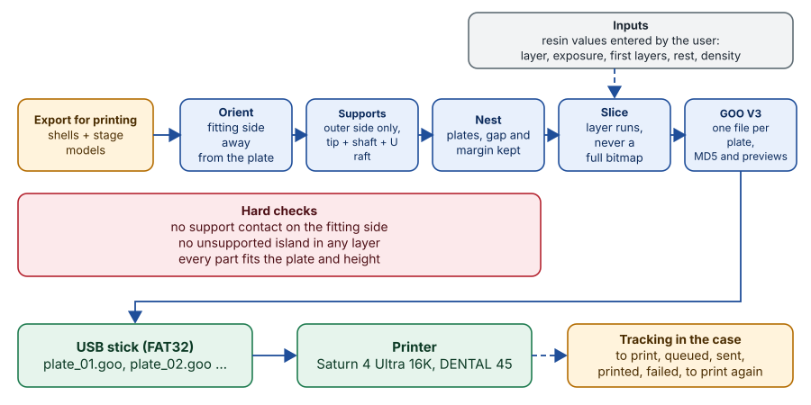

# DentalCraft User Manual

*Planning clear-aligner treatments with the Aligners module: from scan to printed aligner. Edition of 21 November 2026, for DentalCraft 0.2.0-alpha.13 (Aligners module 0.2.0-alpha.12, engine 0.3.0-alpha.8), which adds Settings with the "Advanced options and parameters" switch and direct printing on the Elegoo Saturn 4 Ultra 16K.*

> **Important: not a medical device.** DentalCraft is not a certified medical device. It has no CE marking, no FDA clearance and no clinical validation. Do not use it on patients or for clinical decisions. Every plan it produces must be checked by a qualified clinician, and every printed aligner by a qualified person, before any use. Use it for evaluation, training, research and design tests only; the licence allows noncommercial use only.

## 1. About this manual

DentalCraft is a desktop application for digital dentistry, written in Rust. Its first module, **Aligners**, plans orthodontic aligner treatments from intraoral or desktop scans: it finds and separates the teeth, builds them as 3D solids, analyses the case, registers the bite, computes the final tooth positions, splits the movement into aligner stages, and exports the files needed to print the aligners, or prints them directly in clear resin.

DentalCraft is in alpha. Some functions are partial, they change between versions, and the screens in this manual may differ in detail from your version. Where this manual describes something that is not finished, it says so.

### 1.1 How to read it

- Chapter 2 installs the program. Chapter 3 covers the first start, signing in and **Settings**.
- Chapter 4 explains how the window is organised. Chapter 5 follows the workflow step by step, from the scan to the printer.
- Chapters 6 to 9 cover the 3D view, saving, troubleshooting and privacy.
- Menu and button names are written in **bold** as they appear in English. The Italian interface has the same structure; its names are in the Italian edition of this manual.

### 1.2 What you need

- A 64-bit computer with a graphics card and a recent driver for Vulkan (Linux) or DirectX 12 or Vulkan (Windows). A recent integrated GPU is enough for a single case.
- Scans of the arches in STL, OBJ or PLY format, or a Revopoint MINI 2 scanner (alpha, see section 5.2.4).
- For printing: an Elegoo Saturn 4 Ultra 16K, a clear biocompatible aligner resin with its maker's settings for that printer, and a FAT32 USB stick.

## 2. Install

DentalCraft is offered both as an installer and as a standalone folder. Choose one. Every package contains the application (`dentalcraft`) and the command-line tool (`dentalcraft-cli`).

### 2.1 Linux

The Linux programs need glibc 2.39 or newer: Debian 13, Ubuntu 24.04, Fedora 40 and later all qualify. The graphics libraries (Wayland or X11, Vulkan) are loaded at run time.

| Format | How to install | How it updates |
|---|---|---|
| Flatpak (any distribution) | `flatpak install --user --from https://dentalcraft.app/linux/DentalCraft.flatpakref` | `flatpak update` |
| Fedora (dnf) | `sudo dnf config-manager addrepo --from-repofile=https://dentalcraft.app/linux/dentalcraft.repo` then `sudo dnf install dentalcraft` | `sudo dnf upgrade dentalcraft` |
| Debian and Ubuntu (apt) | add the key and the repository, then `sudo apt update && sudo apt install dentalcraft` (commands below) | `sudo apt upgrade dentalcraft` |
| AppImage | download the file, `chmod +x DentalCraft-<version>-x86_64.AppImage`, run it | the in-app updater |
| Standalone | unpack `dentalcraft_<version>_linux_x86_64.tar.gz` anywhere and run `dentalcraft` | the in-app updater |

For apt, add the signing key and the repository once:

```sh
curl -fsSL https://dentalcraft.app/linux/dentalcraft.gpg | sudo tee /usr/share/keyrings/dentalcraft.gpg > /dev/null
curl -fsSL https://dentalcraft.app/linux/dentalcraft.list | sudo tee /etc/apt/sources.list.d/dentalcraft.list > /dev/null
sudo apt update && sudo apt install dentalcraft
```

The dnf and apt packages install the repository themselves, so later updates arrive with the rest of the system. dnf asks you to accept the signing key: check its fingerprint against the one on the download page. On an AppImage without FUSE (for example in a container) add `--appimage-extract-and-run`. The AppImage also runs the command-line tool: `DentalCraft-<version>-x86_64.AppImage --cli <arguments>`.

The Flatpak has access to your home folder (projects live in `~/DentalCraft`), the network (sign-in, update check) and the system keyring (the sign-in session survives a restart).

### 2.2 Windows

Windows 10 or 11, 64-bit.

| Format | What it does |
|---|---|
| `DentalCraft-<version>-setup.exe` | Installs for the current user, no administrator rights. Start-menu shortcut, optional desktop shortcut, entry in **Apps & features**. |
| `DentalCraft-<version>-x86_64.msi` | Installs for all users in `C:\Program Files\DentalCraft` (administrator rights). `msiexec /i <file> /passive` shows only a progress bar. |
| `dentalcraft_<version>_windows_x86_64.zip` | Standalone: unpack anywhere, even on a USB stick, and open `dentalcraft.exe`. Nothing is installed. |

The Windows programs and installers are signed with DentalCraft's own self-signed certificate. Windows does not know that certificate, so SmartScreen ("Windows protected your PC") can still warn and show an unknown publisher: choose **More info** then **Run anyway** only for a file you downloaded from the official download page. Compare its SHA-256 checksum with the one on that page or in the release's checksum file before you run it.

### 2.3 macOS

There is no macOS download yet. The code for a macOS build (a universal `DentalCraft.app`, CoreBluetooth, camera access) exists, but it has been checked only by compiling on Linux; nobody has run it on a Mac. The macOS build will be published once it has been tested.

### 2.4 Updates

The application checks the DentalCraft website for a newer version at start-up (you can turn this off in **Settings**, section **Updates**) and when you choose **Check now**. The answer is signed, and the application verifies the signature, the size and the checksum of everything it downloads before it installs anything.

- **Standalone folder, AppImage, setup.exe and MSI:** the dialog offers **Update now**, **Later** and **Skip this version**. **Restart now** saves the open project, installs the update and starts the new version; **Later** installs it when DentalCraft closes.
- **deb, rpm, Flatpak:** the dialog gives you the command for your package manager; nothing is downloaded by DentalCraft.

### 2.5 The command-line tool

`dentalcraft-cli` is installed next to the application. It runs the same commands without a window and serves them to AI agents (chapter 6 of the developer guide). `dentalcraft-cli --version` prints the version, `dentalcraft-cli licence` the licence and `dentalcraft-cli licence --third-party` the third-party notices.

## 3. First start

### 3.1 Consent for diagnostics

On the first start DentalCraft asks whether it may send **anonymous diagnostic data**. The box is not ticked: if you do not tick it, nothing is collected or sent. Chapter 9 says exactly what is and is not sent. You can change your mind at any time in **Settings**, section **Privacy**.

### 3.2 Language and theme

The **EN / IT** switch at the top right of the Home screen changes the language of the whole interface at once; it is also in **Settings**, section **General**, where the theme (**Dark**, **Light** or **System**) is chosen.

### 3.3 Signing in

Local projects always open, signed in or not. Signing in loads your licences and preferences and keeps them in step between workstations.


*Figure 1. The sign-in screen (screenshot of version 0.1.0; the wording of some secondary elements has changed since).*

1. Choose **Sign in with DentalCraft account**. DentalCraft opens your default web browser on a page of the DentalCraft account server; the application never sees your password.
2. Sign in there and approve. The browser sends you back to the application, which waits on a local address of your own computer (`127.0.0.1`) for the answer.
3. The window changes to **Signed in**. The session is kept in your operating system's keyring and survives restarts of the application.

If the browser does not open, use **Reopen browser** or **Copy sign-in link** in the waiting screen. **Cancel** or the Escape key stops the attempt. The button for the 30-day evaluation is not available yet: you do not need an account to work locally. A signed-in workstation keeps working for 30 days without internet access.

### 3.4 Settings and the "Advanced options and parameters" switch

Open **Settings** with the gear button in the top bar of the Home screen and of the workspace, or from the account menu (**Settings…**). The dialog has four sections. Every change takes effect at once and is saved; Esc, a click outside the dialog or **Close** closes it.

| Section | What it holds |
|---|---|
| **General** | **Interface language** (EN / IT) and **Theme** (**Dark**, **Light**, **System**). |
| **Workspace** | The switch **Advanced options and parameters**. |
| **Updates** | **Check for updates at startup** (on by default) and **Check now**. |
| **Privacy** | **Send anonymous diagnostic data** (the same choice as at the first start; off until you tick it). |

**Advanced options and parameters is off by default**, and the application then shows the simple view:

- the side panels show the automatic steps and the most useful manual corrections only;
- the menu marks the step to do next with a **Next** pill, and its inspector carries a **Next step** badge, so it is always visible what to do to get to the aligners;
- the status bar readouts, the technical settings of each function, the scan point-cloud tools and the extra print settings are hidden.

Switch it **on** when you want every parameter and technical value. Values you set while it was on stay in effect when you switch it off again: switching off hides controls, it does not reset anything. Agents and scripts can read and change the same switch with the commands `app.settings.get` and `app.settings.set` (developer guide, section 6.6); the commands keep all their parameters whether the switch is on or off.

## 4. How the window is organised


*Figure 2. The six menu groups and the steps they hold.*

The workspace has these regions:

- **Top bar:** back to Home, the module and project name, the save status (section 7), **Undo**, **Redo**, **Save**, **Settings**, **Help** and the account.
- **Left menu**, grouped by function: **Case**, **Teeth**, **Diagnosis**, **Plan**, **Production**, **Follow-up**. The footer counts the nine steps of the workflow done so far (`3/9`). A tick marks a function whose result is in the case. The filter field at the top is reached with the `/` key.
- **3D view** in the middle, with a toolbar (views, arches, display, layers), the view cube and the timeline of the aligner stages at the bottom.
- **Inspector** on the right: everything about the selected function.
- **Status bar:** hints, the running job with its progress bar and a cross to stop it.

The menu and the inspector are resizable by dragging their edges (double-click resets); their sizes are remembered.

### 4.1 The menu rule

Clicking a menu entry, or pressing Enter or its shortcut key on it, **only selects it and shows its inspector**. It never starts a computation, a file dialog or a tool, whether the step is done or not. A step is run only by the button in its inspector, which reads **Run**, or **Run again** once the step is done. A step already done is never re-run by clicking it.

The inspector of every function has the same layout, top to bottom: title and description; **status** (**Done** or **Not done yet**, with the result of the last run); **Parameters** (advanced view); **Automatic** (the Run button); **Manual corrections** (the tools of that function, one button each).

### 4.2 Every change can be undone

Each command you run, each manual correction and each parameter change is one undoable step: **Undo** and **Redo** (`Ctrl+Z`, `Ctrl+Shift+Z`) in the top bar walk through them.

### 4.3 The nine steps and the shortcut

The steps are: Import scans, Find the teeth, Separate teeth and gum, 3D teeth, Case analysis, Bite, Final position, Aligners, Clinical review. **Run everything automatically** (group **Case**) does all of them in one background job, one undo-able result, stopping with a clear message at the first step that fails; the case is then left as it was.

## 5. The workflow, step by step

### 5.1 New project

From **Home** choose **New project** (or **Open project…** for an existing `.dcprj` file).


*Figure 3. The New project screen (screenshot of version 0.1.0: the button now reads **Create project**, and creating a project no longer starts any processing).*

1. **Module:** **Aligners**. The other entries are future modules and cannot be picked.
2. **Case:**
   - **Case ID**: your lab reference. The name of the project file is made of this and the patient alias.
   - **Patient alias**: a pseudonym. **Never type the patient's name**; the key to the real identity stays in your practice software.
   - **Jaw**: **Upper**, **Lower** or **Both jaws**.
   - **Notes for the technician** (optional).
3. **Scans:** drop STL, PLY or OBJ files, choose **Browse files…**, or choose **Scan** to scan with a connected 3D scanner (section 5.2.4). You can also start with no scans and import them later in the workspace.
4. The path of the project file is at the bottom (**Change location**). **Create project** creates the project only; nothing is processed yet.

Projects are kept by default in a `DentalCraft/Projects` folder in your home folder. The file is a single `.dcprj` container (chapter 7).

### 5.2 Step 1: Import scans (group Case)

The inspector's **Run** button opens the file dialog (STL, OBJ or PLY).

#### 5.2.1 Scan roles

Each scan has a role: **Upper**, **Lower** or **Bite**. DentalCraft recognises the arch from the file name, and from the shape of the scan when the name says nothing. A badge on each scan says how its role was decided; a guess can be confirmed, and any role can be changed by clicking the badge. Metres, centimetres and micrometres are converted to millimetres at import.

#### 5.2.2 Closed at import

An arch scan that is open under the gum is **closed with a flat base** (3 mm under its lowest point) in the same undo step. The closed solid is the scan that is shown, saved, used for the bite and printed; the scan as it was read is kept inside it. A bite scan, a scan that is already closed and a mesh with fewer than 1000 faces are left as they are.

#### 5.2.3 Manual corrections

In the inspector, under **Manual corrections** and **Scans in the case**:

- **Role** of each scan. Moving a scan to the other arch renumbers its tooth marks (13 becomes 43) and rebuilds what depended on it.
- **Flip the occlusal side**, if the side of the teeth was recognised the wrong way round. Pressed again it flips it back.
- **Close with a base** (and **Run again**) for each arch scan; the slider **Base height** sets the base from 0.5 to 20 mm.
- **Remove the scan** (the bin button, or Delete). A dialog asks first; everything computed from the scan goes, and `Ctrl+Z` brings it back.

#### 5.2.4 Scanning with a 3D scanner (alpha)

The scan button next to **Import scans** opens the **scan popup**, which works the same from the New project screen and from the workspace. It drives a **Revopoint MINI 2** and the **Revopoint dual-axis turntable** (over Bluetooth LE). The scanner connector is in alpha and was tested on Linux and in Windows; it has not been run on macOS.

In the simple view the popup has three steps: **1 Acquisition**, **2 Surface**, **3 Import**. The advanced view adds the point-cloud tools, the surface tools, the readouts and the acquisition settings.

1. **Acquisition.** Connect the scanner and the turntable. Fix the object to the platter with a little putty: a model that only rests on the platter can slip when the table tilts. Calibrate the turntable once for a given position of the scanner and the table (about two minutes), then start the **automatic scan**: the table turns in steps, stops, and the scanner takes several frames at each stop. The default covers five tilts (−20°, −10°, 0°, +10°, +20°) in 7.5° steps and takes about nine minutes. The scan is made at the best quality; low-quality output is not accepted.
2. **Surface.** The mesh is built, cleaned, holes are closed (except the base), the surface is smoothed within 0.01 mm and optimised.
3. **Import.** Choose the role of the scan (upper, lower or bite) and hand it to the project.

Steady, diffuse lighting gives the cleanest scans: the repository includes a design for a scanner enclosure with controlled LED lighting. The scanner's own fill light is turned on while streaming and off afterwards.

### 5.3 Step 2: Find the teeth (group Teeth)

**Run** numbers the teeth of each arch automatically (FDI numbers) and then orients the arch; the result is one **tooth mark** per tooth, one undo step.

**Parameters:**

- **Search also the third molars** (off by default).
- **Missing teeth**: FDI numbers separated by commas (for example `35, 45`). A wrong number shows a red message; the list is saved when you leave the field.
- **Teeth found**: a grid per arch, right side of the patient first. A filled box means the tooth has a mark, a crossed box that it is missing, an empty box that it has no mark.

DentalCraft checks its own proposal: if the numbering would give a third molar where the scan has only gum behind the last molars, or would merge a crowded tooth with its neighbour, the proposal is corrected rather than shifting every number after it. Detection stops at the last molars; it never invents teeth beyond them.

**Manual corrections:** **Mark a tooth** (click to place or move, Shift+click to delete the nearest mark), **Delete a tooth**, **Change a tooth number**, **Missing tooth**, **Number the teeth in order** (click each tooth in turn: `S` skips, Backspace goes back, Enter or Esc finishes) and **Clear all the tooth marks**.

When the marks change, the steps that depended on them are marked out of date or cleared, and a notice lists them. `Ctrl+Z` brings everything back.

### 5.4 Step 3: Separate teeth and gum (group Teeth)

**Run** paints every tooth of the scan with its own colour; the gum stays uncoloured. It starts from the tooth marks, needs at least four marks covering both sides and the front teeth, and runs one arch at a time. The status bar shows its sub-steps (simplified scan, first separation, colours on the full scan, borders at full resolution, cleanup).

**Parameters:** **Scan detail (faces)** 5000 to 200000 (default 30000), **Tooth edge sensitivity** 0.01 to 1 (default 0.2), **Border smoothing** 0.1 to 10 (default 1.0).

Neighbouring teeth stay separate teeth: they are never merged into one. Running again erases the colours you painted by hand. **Manual corrections:** **Tooth brush** (key `B`: click or drag on the scan to paint the chosen tooth; Shift paints gum, Ctrl fills the crown) and **Clean borders**. The view switches to the scan so the new colours are visible.

### 5.5 Step 4: 3D teeth (group Teeth)

**Run** gives each tooth as a **closed 3D solid** with its axis and builds a gum that follows the teeth. Every tooth is closed and squared off, so no mesh is left open. It needs the teeth to be separated. The final position and the aligners of the arch, if any, are cleared because they were planned on the old teeth.

After brush corrections, **Run again** rebuilds only the arch's teeth that changed; the others keep their solids. **Rebuild a tooth** rebuilds a single tooth, and **Show the region** highlights the region a tooth was built from.

### 5.6 Step 5: Case analysis (group Diagnosis)

**Run** computes, per arch: the space available and needed (**Crowding**, **Spacing** or **Enough space**), the **Little irregularity index** with its category, the midline offset and the largest space; then the **Bolton ratios** and a **complexity score** of the case.

**Manual corrections** (**Correct the case analysis by hand**) let the clinician set the four values they can measure themselves: crowding or spacing, Little index, midline offset, largest space. A card that carries a hand value shows the badge **Includes values set by hand**, and the export report marks them.

### 5.7 Step 6: Bite (group Plan)

The bite sets how the upper arch faces the lower one. It is functional only: it sets the occlusion, and the **bite scan is never shown as a 3D object** in the view (except while you pick its three points).

- With **bite scans** in the case (one per side for an intraoral scanner, or one scan round the arch for models in occlusion), **Run** registers the arches on them. A bite is accepted when the front part is captured correctly: the back of the mouth need not be complete.
- With no bite scan, **Run** uses a **virtual bite**, and says so in a warning: for the clinical relation, register the buccal bite.
- **Import the bite scans…** imports the files with the role bite.
- **Three points** (manual): pick three points far apart on the lower arch, then the same three, in the same order, on the bite scan, and optionally the same for the upper arch.
- **Correct the interpenetration** moves the upper arch along the occlusal axis to the first contact. The report shows the interpenetration found, the one left and the opening.

The registration report shows **Bite registered** or **Bite registered, to check**, with one line per reason to check (for example a residual above 0.10 mm, fewer than four teeth in contact, front teeth only). The two arches never visibly interpenetrate in the 3D view after this step.

### 5.8 Step 7: Final position (group Plan)

**Run** computes the target pose of every tooth with the plan's parameters, the IPR (interproximal reduction) needed, and the arch line. With both arches and no bite registered it shows **Bite first** and refuses: run **Bite**, then this step. The inspector's result lines give, per arch, the expansion, the incisor movement, the IPR in millimetres and contacts, the teeth held, and **Crowding not resolved** as a warning when it applies.

**Parameters** (advanced view): which **Teeth** move (incisors and canines, up to the premolars, or all), and folded groups for **Arch line and tolerances**, **Teeth held and midline**, **Space** (order, expansion, advancement, retraction, close the gaps), **IPR** and **Vertical movements**. After changing parameters, run the step again. **The values to confirm must be checked by an orthodontist.**

**Manual corrections:** **Move a tooth** (the clinical components mesial/distal, buccal/lingual, extrusion/intrusion, torque, tip and rotation, with − and + steps; lock the tooth; exact values), **Arch line** (drag the 11 points of the curve and **Apply the line**, which can recompute the final position on it), and **Back to the initial position**.

The layer **Target position** of the 3D view shows the teeth at their final position as a translucent ghost.

### 5.9 Step 8: Aligners (group Plan)

**Run** splits the movement into stages: one aligner per stage, with a calendar. The result shows the number of aligners, the days (for example from a start date, worn 22 hours a day), the pattern used and the collisions left.

**Parameters** (advanced view): **Periodontium** (healthy, stage I, II, III), **Pattern** (automatic, simultaneous, sequential, structured), the calendar (**Aligner change**: fixed interval or adaptive 7/14 days, **Days per aligner** 5 to 21, **Start of treatment**) and the **Largest movement per aligner** group.

**Manual corrections:** **Slow a tooth** (select the tooth in the view, choose a speed between 0.2 and 1, **Slow the tooth**; the arch's aligners are recomputed in the same undo step).

**The aligner in the 3D view.** Aligners are **not** shown by default. The inspector section **The aligner in the view** has **Show the aligner** / **Hide the aligner** and **Exact aligner of this stage** (the solid the export writes, for the stage shown). They are built only when you ask.

The **timeline** at the bottom of the 3D view is a plain slider over stages 0 to N. Drag it, or use `,` and `.` for the previous and next stage (Shift for five), Space to play, Home and End for the first and last. The number of the stage is written above the handle.

### 5.10 Step 9: Clinical review (group Plan)

**Run** makes a record for each classification the program proposes from the evidence: case difficulty, aligner pattern, whether the case is treatable with aligners only, per-tooth movement risk and attachment, crown measures and tooth type. The clinician confirms or changes them before production.

Filter the list (**All**, **To review**, **With a note**, **Selected tooth**). For each item you can **Confirm** the proposal, choose another value from its options, or go **Back to the proposal**. The group **All together** has **Confirm those without a note**: items that carry a note to check are never confirmed in bulk. The attachments and the aligner pattern in force feed the calendar, the export and the report.

### 5.11 Export for printing (group Production)

This function is not one of the nine steps. Its inspector first asks where the aligner ends and then the quality of the print files.

- **Where the aligner ends:** for each arch and side, the last tooth the aligner covers. The teeth behind it are not covered and do not move. If a tooth is missing and the shell behind the gap would be weak, the inspector advises another end.
- **Quality of the print files:** **Draft** (0.25 mm detail), **Light** (0.15 mm), **Standard** (0.1 mm, production files, the default), **High** (0.08 mm).
- Advanced groups: **Aligner edge** (equator, straight, scalloped, smooth; edge height and extension; path of insertion), **Shell** (thickness, inner clearance), **Identification text** (arch, number and date engraved inside), **Bite with the aligners worn**, ramps and quality.

**Export** opens a folder dialog and works in the background (it can take a long time; stop it with the cross in the status bar). The files are built in a hidden folder and moved into place when all are made; the manifest comes last, so an interrupted export leaves no half-written folder. It writes the aligner shells and the models (STL), the calendar, a **print check** per file (closed surface, one piece, no self-intersection, no hole through the wall, positive volume, fits the plate) and a report. The files go to the folders `modelli_termoformatura` and `stampa_resina`, next to `print_check.json`, `stages.csv`, `visits.ics`, `report.html` and `manifest.json`. A shell that fails the print check stops the export of all aligners with a message: do not print such a file.

**Study models** (same group) exports flat-based models of the arches.

### 5.12 Print (group Production)

Print takes the exported aligners to the **Elegoo Saturn 4 Ultra 16K**: it orients each shell, adds supports, places the shells on the printer's plate, slices them and writes one print file per plate. Aligners are printed directly in clear biocompatible resin. Washing and curing are done by hand in the lab and are outside the program.

> **Not yet proven on real prints.** The print files have been checked against Elegoo's published format and a simulated printer. Printing real aligners and measuring their wall thickness and fit is a later phase; until then treat the output as a test.



*Figure 4. Export, orientation, supports, nesting, slicing, GOO files, USB stick, printer, and the tracking kept in the case.*

#### 5.12.1 Before you start

1. Make the aligners (step 8) and run **Export for printing**. The project remembers the folder of that export: the print window reads the aligner shells from its `stampa_resina` folder. Without an export it says **Not exported yet: run "Export for printing" first.**
2. Prepare the printer with the DENTAL 45 machine parameters (section 5.12.2).
3. Have the resin maker's settings for the Saturn 4 Ultra 16K at hand (section 5.12.3).
4. Have a **FAT32** USB stick (16 GB or less works best; the printer reads ASCII file names).

#### 5.12.2 The printer: DENTAL 45 machine parameters

DentalCraft ships the profile of the Saturn 4 Ultra 16K with the **DENTAL 45** machine-parameter set, prepared with Elegoo's engineers. The set is an `M5000` G-code file of firmware parameters (Z axis, the tilt of the vat, the heater, the light source, the vat); DentalCraft reads it to work out heating, release and time. The printer must be running the same set. The values the program relies on:

| Parameter | DENTAL 45 |
|---|---|
| Z axis travel | 230 mm (the print height limit stays 220 mm) |
| Total tilt angle of the release | 140° |
| Resin (vat) target temperature | 45 °C, preheat target 45 °C |
| Time limit of one heating cycle | 35 min |
| Light source (I3 C) | 2: the print file's exposure settings and the machine's are combined |
| Light source power (PWM) | 255 (full) |
| Vat maximum volume | 870 ml |
| Lowest resin level accepted by the level detection | 4 mm |
| Vat width × length used to turn the level into a volume | 143 × 244 mm |
| Tilt speed, first 50 layers and after (slow set) | 36 °/s, then 72 °/s |
| Tilt speed, first 50 layers and after (fast set) | 36 °/s, then 144 °/s |
| Tilt motion time per layer, slow mode | 8420 ms for the first 50 layers, then 4410 ms |
| Tilt motion time per layer, fast mode | 8420 ms for the first 50 layers, then 2430 ms |

The release mode (slow or fast) is chosen on the printer's touchscreen. The time estimate of the print window assumes the slow mode, so the real time can be shorter in fast mode. The printer also warms the vat to 45 °C before the first layer, and the estimate includes that wait. The printer reports a platform size slightly different from the maker's specification; DentalCraft uses the specification (15120 × 6230 pixels of 14 × 19 µm, 211.68 × 118.37 mm) and compares what the printer reports with it.

#### 5.12.3 The resin values you enter

DentalCraft ships **no preset for any aligner resin**: only the resin's maker knows the exposure for their material on this printer. You enter the values once (they are kept in `print-resin.json` in the application's settings folder: `~/.config/dentalcraft` on Linux, `%APPDATA%\DentalCraft\dentalcraft\config` on Windows, `~/Library/Application Support/app.DentalCraft.dentalcraft` on macOS) and they stay for the next prints. Without them **Prepare the print** is disabled with the hint **Enter your resin's values first**.

| Field | What to enter |
|---|---|
| **Resin name** | 1 to 31 plain letters, digits or spaces (no accents). Written into the print files. |
| **Layer height (mm)** | Between 0.01 and 0.2 mm. |
| **Exposure of each layer (s)** | The maker's value for normal layers. |
| **Exposure of the first layers (s)** | The maker's value for the bottom layers, which are lit longer so the print holds on the plate. |
| **Number of first layers** | How many layers count as bottom layers. |
| **Pause before each exposure (s)** | Lets the resin settle before each layer is lit. |
| **Resin density (g/ml)** | Used to turn volume into weight. |

Copy these from the maker's sheet for this printer, never from another resin. DentalCraft does not guess or compensate any of them.

#### 5.12.4 Prepare the print

1. Select **Print** in the group **Production**. The inspector shows **Printed x of y** and **Still to print: n**, and one row per aligner with its status (section 5.12.6).
2. Choose **Prepare print…**. The print window **Print aligners** opens with the aligners still to print already chosen; use **All**, **None** or the tick of each aligner.
3. Check **Printer** (the profile, and that the files go to the printer on a USB stick, so no network is needed) and **Resin** (the summary of your values, or **Enter your resin's values**).
4. Choose **Prepare the print**. The window reads the aligners, turns them, adds supports and places them on the plate, then prepares the layers of each plate.

**Supports are never on the fitting side.** Each shell is oriented with its fitting side (the inner surface that touches the teeth) facing away from the plate: the opening of the aligner points up, so resin drains and no cup forms. The orientation also tries tilts of up to 45° in 15° steps, which cut the thin wall obliquely and lower the force that peels each layer off the vat, and it turns the aligner so that its long side lies along the long side of the plate. Supports touch only the outer side: small cone tips (0.35 mm) on a thin shaft (1.0 mm). The shafts stand on a **raft**, a 1.0 mm base that is printed on the plate. The raft does not fill the whole area under the aligner: it follows the feet of the supports, a chamfered pad round each foot joined to its neighbours by 4 mm bands, so under a dental arch it is **U-shaped**. It saves resin and comes off together with the supports. Two checks run before any file is written, and a failure stops the preparation with a message naming the cause:

- no support may touch the fitting side or its rim (**A support would touch the inside of an aligner**);
- no region of any layer may start in mid-air without a support (**A part of an aligner would print in mid-air without a support**).

**How the fitting side is known.** The preparation has to know which surface of a shell is the fitting side. The command `print.prepare` takes it from the **stage model**, the model of the arch at that stage that **Export for printing** writes in the folder `modelli_termoformatura`, next to `stampa_resina`: the part of the shell that lies on its model (the clearance and the engraved text included) is the fitting side, and a passive aligner uses the model of the last stage. If less than 30 % of the shell lies on its model (another stage, or another frame), the preparation stops with the code `print-model-mismatch` and writes nothing. A part that does not come from an export gets its fitting side from its shape. The print window of this version always works it out from the shape of each shell.

In the advanced view **Print settings** exposes the **Tip where a support touches** (default 0.35 mm), the **Support thickness** (1.0 mm), the **Base under the supports** (1.0 mm, the thickness of the raft) and the plate spacing (**Space between aligners** 3 mm, **Space from the plate edge** 4 mm). If an aligner does not fit, reduce the spacing from the plate edge.

The plate preview shows each plate from above (**Plate n of N**, **Previous plate**, **Next plate**) with the estimates: the aligners on the plate, the layers, the print time (about; it includes the heating wait) and the resin. **Resin to pour in the vat (at least)** also takes the vat's minimum level into account.

#### 5.12.5 Save to a USB stick

1. Choose **Save print files…** and select the USB stick (FAT32). Each plate becomes one file, `plate_01.goo`, `plate_02.goo`, and so on, in the GOO format of Elegoo printers. The aligners on the saved plates are recorded as **Sent to the printer** (section 5.12.6).
2. **Save the plate with its supports as STL…** writes the same plates as STL files, for inspection.
3. When the files are saved the window says **Put the USB stick in the printer, choose the file on its screen and start the print.** Do so on the printer.
4. After printing: remove the supports from the outer side, wash and cure as the resin maker says, then check the wall thickness and the fit before use. Washing and curing are manual lab steps outside DentalCraft.

#### 5.12.6 The printed and missing tracking

DentalCraft keeps, in the project, the print status of every aligner of the series (arch, number, passive or active, written as its id: `SUP-03` is upper aligner 3, `INF-12-P` is lower passive aligner 12), so you always see which are printed and which remain. The leaf **Print** of the group **Production** shows them: **Printed x of y**, **Still to print: n**, and one row per aligner. Selecting the leaf only shows this; its button **Prepare print…** opens the print window.

| Status (inspector / print window) | Meaning |
|---|---|
| **To print** | Never marked. |
| **Queued** / **Being prepared** | Put in the queue for a plate. The print window does not set it itself: it goes straight to **Sent** when you save the files; an agent can set it with `aligners.print.mark`. |
| **Sent** / **Sent to the printer** | The plate file was saved for the printer. |
| **Printed** | You confirmed it. DentalCraft never marks an aligner printed by itself; only your confirmation, or a printer's report that the job finished, does. |
| **Failed** | The print failed. |
| **To print again** | Printed, but broken or lost: it goes back on the list. |

In the inspector of **Print**, **Mark…** gives **Printed**, **Failed** or **To print again** to an aligner; each mark is one undoable change saved with the project. The marks are facts about the aligners you made: they stay when a scan is replaced or the series is computed again. A mark that does not make sense is refused and nothing changes (for example **Printed** on an aligner already printed; an aligner leaves **Printed** only when you ask to print it again). The print window preselects what is still missing the next time.

#### 5.12.7 If the preparation fails

| Message | What to do |
|---|---|
| **An aligner's shape cannot be printed as it is** / **file could not be read** | Export the aligners again. |
| **A resin value is out of range** | Check the resin values (layer height 0.01 to 0.2 mm). |
| **A support would touch the inside of an aligner** / **a part would print in mid-air** | Try other support settings (advanced view). |
| **An aligner with its supports is taller than the printer can print** | Print fewer or smaller parts on the plate; contact support if one aligner alone is too tall. |
| **An aligner does not fit on the plate** / **The spacing leaves no room** | Reduce the spacing from the plate edge or between aligners. |
| **The files could not be saved there** | Check the USB stick and that it has room; use FAT32. |
| **There is no folder to save in** | Export the aligners first. |

### 5.13 Follow-up (group Follow-up)

**Control visit** compares a new scan with the plan and tells you which teeth are on track and which are behind. **Re-plan** makes a new series of aligners from the last control visit, keeping the ones already delivered. Both are follow-up functions and do not count among the nine steps.

## 6. The 3D view

The toolbar over the view has: the standard views (**Occlusal**, **Front**, **Left**, **Right**, **Back**); the **Upper** and **Lower** arch toggles; the display mode (**Solid**, **Transparent**, **Wireframe**); the tools **Measure**, **Angle** and **Section**; layers (tooth colours, tooth marks, tooth numbers, contact map); **IPR** and attachment marks; and the group **Models in the view** (**Study models**, **Target position**, **Aligner**). The 3D view always shows the upper and lower arches (teeth and gum) together unless you hide one.

- **Camera:** right-drag to orbit, middle-drag to pan, scroll to zoom; the view cube at the top right snaps to a standard view.
- **Selecting:** with no tool open, click a component (a 3D tooth, a gingiva, a scan, a tooth number). The selection gets a bold outline around the object, and the inspector starts with **Selected component**.
- **Gizmo:** the selected component carries a transform gizmo: `W` move, `E` rotate, `R` scale (teeth only; Ctrl snaps to 0.5 mm, 5°, ×0.05). A drag is previewed and applied as one undoable step; Esc cancels it. A tooth moves in the plan at the stage shown, never at stage 0.
- **Tooth numbers** appear as chips over the teeth; `Alt`+click on a number, a mark or the scan chooses that tooth for the brush.

| Key | Action |
|---|---|
| `Ctrl+S`, `Ctrl+Z`, `Ctrl+Shift+Z` | Save, undo, redo |
| `Ctrl+W` | Close the project (saves first) |
| `/` | Focus the menu filter |
| `A`, `B`, `S` | Select Separate teeth and gum, its brush, Aligners (never runs them) |
| `,` `.` Shift, Space, Home, End | Previous/next stage (five with Shift), play, first, last |
| `W`, `E`, `R` | Move, rotate, scale the selected component |
| Delete, Backspace | Remove the selected scan (asks first) |
| Esc | Deselect, close the open tool |
| `F1` | The keyboard sheet |

The application renders with vertical sync and caps the frame rate at 60 frames per second.

## 7. Saving, autosave and project files

A project is one `.dcprj` file (a ZIP container: the case, the scans as mesh blobs, the module data, the step history and a thumbnail). It holds the **complete state of the case**, including the tooth composition (tooth marks and the colours painted with the brush), every parameter and every result.

- **Save** (`Ctrl+S`) writes the case as it is at that moment, atomically: a temporary file is written, flushed to disk and renamed, and one `.bak` copy of the previous file is kept. A save asked for while another runs follows it.
- **Automatic save:** a project that has a file saves itself about two seconds after your last change (never while a command that changes the case is running, a save is running or a dialog is open). A project never saved has no file yet, so nothing is saved by itself until your first **Save**; a file opened read-only is never written by itself.
- **Save status** after the project name: **Saving…**, **Saved**, **Unsaved changes** or **Not saved**. A failed save is never silent: an error notice stays until you close it.
- **Leaving** (Home, `Ctrl+W`, closing the window) saves a project that has a file first, without asking; a project never saved asks whether to save.
- A file written by a newer version opens read-only. Module data your version cannot read is kept and written back.

## 8. Troubleshooting

| Problem | What to do |
|---|---|
| The application does not start on Linux with a GPU error | Update the graphics driver; make sure Vulkan works (`vulkaninfo`). Run `dentalcraft` from a terminal to read the message. |
| The AppImage does not start | Add `--appimage-extract-and-run` (no FUSE). |
| Windows SmartScreen warns | See section 2.2: the files are signed with a self-signed certificate. Verify the checksum, then **Run anyway**. |
| Sign-in does not return to the application | Use **Reopen browser** or **Copy sign-in link**. Make sure the browser can open `127.0.0.1`. |
| A step does nothing when I click its menu entry | By design: the click only selects. Use **Run** in the inspector. |
| **Run** is disabled | Another command is running (see the status bar); wait or stop it with the cross. |
| **Bite first** | With both arches, run **Bite** before **Final position**. |
| A step lost its tick or shows **Results out of date** | A change upstream (tooth marks, colours, teeth) made it stale. Run it, then the steps after it, again. `Ctrl+Z` undoes the change. |
| **Not a tooth number** | Use FDI numbers: 11 to 18, 21 to 28, 31 to 38, 41 to 48. |
| An arch was not numbered | The message names the scan to check; that arch keeps the marks it had. Mark the teeth by hand or fix the scan, then run again. |
| **Save failed** | Check the folder is writable and the disk has room, then **Save** again. The previous file is kept as `.bak`. |
| Scanner is not found or the stream stops | Reconnect the scanner. Linux: your user must be allowed to use the camera device. Windows: allow camera access for desktop apps. The app says if the device was lost. |
| The turntable does not connect | Switch it off and on, bring it close and connect again. It should connect at the first attempt; you never need to forget or re-pair it to switch devices. If it does not, send the diagnostics (chapter 9) with your report. |
| Print preparation fails | See section 5.12.7. |

The **Support** screen (from Home) has the manual, a ticket form, a diagnostics preview and **Export diagnostics…**, which writes a file you can attach to a report.


*Figure 5. The Support screen (screenshot of version 0.1.0).*

## 9. Privacy and diagnostics

- **Your files stay on your computer.** Scans, projects and patient data are never uploaded. The case holds only a pseudonymised patient code; never type a patient's name.
- **Anonymous diagnostics are off until you opt in** (the box at the first start, and **Settings > Privacy**). When on, DentalCraft sends reports of crashes and errors: the kind of problem, the part of the program, a short technical message, the last log lines, and the program version, operating system, graphics card and memory. It never sends scans, projects, patient data, your account, your name or e-mail address, or the names of your files and folders; those are removed from every text first.
- **Look before it is sent:** **Support** > **Show what is sent**. Turning diagnostics off deletes the queue and the random installation number.
- **The website** has no forms and collects no data.

## 10. Disclaimer, licence and support

- **Not a certified medical device.** See the notice at the start of this manual. DentalCraft makes no claim of clinical accuracy, and the plan, the aligners and the print files are not validated for patient use.
- **Licence.** The application and its source code are source-available under the PolyForm Noncommercial License 1.0.0: you may use, change and share them for any noncommercial purpose; commercial use is not allowed (for commercial licensing write to `hello@dentalcraft.app`). The software is provided as is, without warranty. The licence text is in the repositories and in the application (account menu > **Licence and notices**, or `dentalcraft-cli licence`). Third-party components remain under their own licences (`dentalcraft-cli licence --third-party`).
- **Feedback and problems:** the **Support** screen, or `hello@dentalcraft.app`.

## Appendix A. Glossary

| Term | Meaning |
|---|---|
| Aligner | A transparent removable appliance worn for a stage of treatment. |
| Arch | The upper or the lower row of teeth. |
| Attachment | A small bump bonded to a tooth to help an aligner grip it. |
| Bite | The relation between the upper and the lower arch when they close. |
| FDI | The two-digit tooth numbering: 11 to 18, 21 to 28, 31 to 38, 41 to 48. |
| Fitting side | The inner surface of an aligner, which touches the teeth. |
| GOO | The print-file format of Elegoo resin printers. |
| IPR | Interproximal reduction: a small amount of enamel removed between neighbouring teeth to make room. |
| Little index | A measure of the irregularity of the front teeth. |
| Passive aligner | An aligner that no longer moves the teeth: it holds them while the other arch finishes a longer series. |
| Raft | The thin base printed on the plate under the supports. It follows the feet of the supports, so under an arch it is U-shaped. |
| Stage | One step of the movement; one aligner per stage. |
| Stage model | The model of an arch at one stage of the movement, which an aligner of that stage is built on. Export for printing writes it next to the aligner shells. |
| Tooth mark | The point DentalCraft puts on each tooth when it finds the teeth. |
