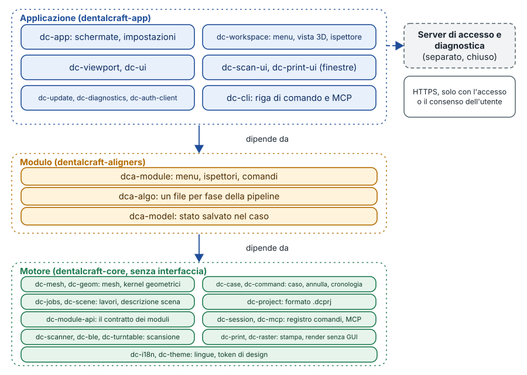
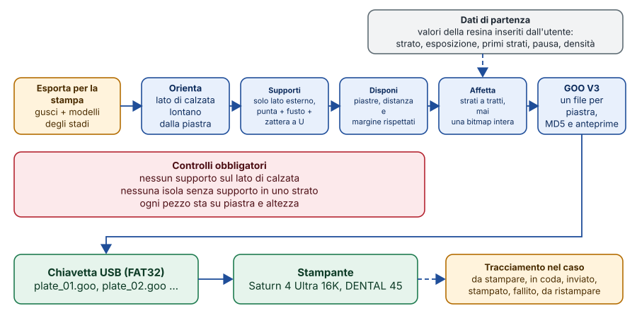

# DentalCraft: Architettura

*I livelli, il flusso dei dati della pipeline degli allineatori, la pipeline di stampa e il connettore dello scanner. Edizione del 21 novembre 2026.*

> **Non è un dispositivo medico.** DentalCraft è software per la ricerca e la progettazione; nulla qui costituisce una dichiarazione di validità clinica.

## 1. Obiettivi e vincoli

DentalCraft trasforma scansioni intraorali o da banco in un piano di trattamento, una serie di allineatori e i file per stamparli. L'architettura risponde a questi vincoli:

| Vincolo | Conseguenza |
|---|---|
| Il motore deve essere provabile senza GPU né finestra. | `dentalcraft-core` non ha interfaccia; l'applicazione è un sottile involucro sopra di esso. |
| La logica dentale deve essere sostituibile e concedibile in licenza per modulo. | I moduli dipendono solo dal core, attraverso un unico contratto (`dc-module-api`). |
| Agenti di intelligenza artificiale e script devono poter fare tutto ciò che fa un utente. | Ogni azione è un comando registrato con un id, uno schema dei parametri e una documentazione. |
| Un caso deve sopravvivere a arresti, riavvii e cambi di versione. | Stati del caso immutabili, stack di annullamento, salvataggi atomici, blob indirizzati dal contenuto, migrazioni. |
| Lo stesso comportamento su Linux, Windows e macOS. | Le parti di piattaforma stanno dietro trait con un'implementazione per ciascuna. |
| Nessuna toolchain C++ sulle macchine di compilazione. | Dipendenze in Rust puro (rustls con ring, zip con deflate, stack USB e Bluetooth in Rust puro). |
| Gli algoritmi devono riprodurre un riferimento esistente e validato. | Il componente aggiuntivo Blender originale resta in sola lettura come **oracolo**; i test di riferimento confrontano il codice Rust con esso. |

## 2. Livelli

*Figura 1. Core, modulo e applicazione. Il server di accesso e diagnostica è un servizio separato raggiunto via HTTPS.*

La regola delle dipendenze è a senso unico: **applicazione → modulo → core**. Il core non conosce mai un modulo, e un modulo non conosce mai l'applicazione: un modulo consegna alla shell un albero del menu, ispettori disegnati con egui, comandi e una descrizione della scena, e la shell li ospita. Le finestre come quella di scansione e quella di stampa sono componenti generici dell'applicazione: non dipendono né dall'area di lavoro né da alcun modulo, quindi qualsiasi schermata o modulo può ospitarle.

## 3. Il core

### 3.1 Il caso e la sua storia

- Un **caso** (`dc-case`) contiene le scansioni (con ruoli superiore, inferiore o morso), i denti numerati FDI, le pose (`Pose { t: DVec3, q: DQuat }`), il sistema di riferimento del mondo, i riferimenti ai blob (l'hash BLAKE3 di una mesh) e uno **stato di modulo** opaco per ogni modulo.
- Uno stato del caso è **immutabile** e condiviso (`Arc<CaseState>`). Un **comando** (`dc-command`) prende uno stato e restituisce il successivo: `fn apply(&self, &CaseState, &mut JobCtx) -> Result<CaseState>`. Lo **stack di annullamento** è una pila di stati con condivisione strutturale e un budget di memoria, quindi annulla e ripeti sono spostamenti di puntatori e una mesh invariata non viene mai copiata.
- La **cronologia dei passi** registra i passi di elaborazione (`StepRecord { step, inputs_hash, outputs, by_hand }`) con ripetizione, riavvolgimento e annullamento del riavvolgimento. Si salva con il progetto; lo stack di annullamento no.
- I **lavori** (`dc-jobs`) eseguono lavori lunghi su thread di lavoro con avanzamento (una frazione e una chiave di messaggio) e un segnale di annullamento. Il risultato di un lavoro torna come comando, quindi si può annullare come ogni altra cosa.

### 3.2 Mesh e geometria

`dc-mesh` contiene la mesh triangolare, la topologia (adiacenze, anelli di bordo, componenti), la validazione e l'I/O dei file; le unità sono riconosciute all'importazione (metri, centimetri, micrometri diventano millimetri). `dc-geom` contiene i kernel dietro un trait `Backend`, così in futuro si potrà aggiungere un backend GPU: un BVH, ICP punto-piano, decimazione a collasso di spigoli con metrica quadrica, riempimento dei buchi di Liepa, campi di distanza con segno (offset, chiusura, meshing), un volume TSDF, risoluzioni armoniche e sparse con gradiente coniugato precondizionato, riparazione e rifinitura delle mesh. Tutto è parallelo con rayon e deterministico dove l'output non deve cambiare tra piattaforme.

### 3.3 Sessione, registro e MCP

`dc-session` possiede il progetto aperto, lo stato del caso dentro il suo stack di annullamento, la cronologia dei passi, i moduli registrati, i lavori e il **registro di ogni comando pilotabile da agenti**: quelli incorporati (`project.*`, `case.*`, `edit.*`, `steps.*`, `view.set`, `scan.*`, `turntable.*`, `print.*`) più le specifiche che i moduli registrano. La CLI e il server MCP chiamano `execute`, `batch`, `describe` e `inspect` su di esso. `dc-mcp` è un server JSON-RPC scritto a mano su stdio dietro un trait `Host`: l'host è la sessione senza interfaccia oppure un **host remoto** che inoltra all'applicazione in esecuzione attraverso un ponte locale, così gli stessi strumenti funzionano con e senza finestra.

### 3.4 Scena, i18n, tema

`dc-scene` descrive ciò che mostra il viewport (mesh con colori o etichette, linee, punti, etichette 3D, sovrapposizioni) senza alcun tipo di GPU, così i moduli restano senza GPU e il renderer su CPU (`dc-raster`) può disegnare la stessa scena in un PNG. `dc-i18n` incorpora un bundle Fluent per crate e li cambia tutti insieme; `dc-theme` trasforma i token di design in un tema egui.

## 4. Il contratto dei moduli

Un modulo implementa il trait `Module` di `dc-module-api`:

| Membro | Significato |
|---|---|
| `id`, `name_key` | `aligners`, e la chiave Fluent di «Aligners» / «Allineatori». |
| `menu()` | Un `MenuTree`: gruppi e foglie, ognuna con un id, chiavi di etichetta e descrizione, un'icona e uno stato (`Ready` o `Stub`). Una foglia può dichiarare tipi di ingresso, per esempio `ScannerInput { roles }`, che fa comparire il pulsante **Scansiona**. |
| `commands()` | `CommandDesc` e `CommandSpec`: gli id, gli schemi dei parametri e le funzioni di esecuzione che la sessione registra. |
| `inspector(ui, ctx)` | Disegna l'ispettore con egui, leggendo il flag delle opzioni avanzate. |
| `scene(state)` | I `SceneItem` che il viewport mostra per uno stato del caso. |
| `data_codec()` | Un `ModuleCodec` che legge e scrive lo stato del modulo in `.dcprj`, con migrazioni dello schema. |

I moduli sono compilati dentro e raccolti in un `ModuleRegistry`; quali sono utilizzabili dipende dal diritto d'uso dell'utente. Il modulo Allineatori è il primo; altri (costruttore di modelli, bite, corone) si inserirebbero allo stesso modo.

## 5. La pipeline degli allineatori

*Figura 2. I nove passi e le due uscite di produzione. Ogni freccia è un comando; ogni stato è salvato nel caso.*

Le fasi stanno in `dca-algo`, un modulo per fase, e sono esposte come comandi da `dca-module`. Ogni fase legge il caso, produce un nuovo stato ed è un solo passo annullabile.

| Passo | Comando (foglia) | Cosa calcola | Salvato nel caso |
|---|---|---|---|
| 1 Importa scansioni | `aligners.case.import-scans` | Legge STL, OBJ, PLY, riconosce l'arcata (nome, poi geometria), converte le unità e **chiude una scansione d'arcata aperta con una base piana** perpendicolare al suo asse occlusale, nello stesso passo annullabile. Il solido chiuso è *la* scansione del caso; la scansione com'era stata letta resta come suo prefisso. | Scansioni, ruoli, `scan_bases` |
| 2 Trova i denti | `aligners.teeth.find` | Trova la direzione occlusale (asse principale più piccolo della scansione) e l'orientamento dell'arcata (un polinomio simmetrico di quarto grado adattato alle sommità delle corone), costruisce un profilo delle cuspidi lungo l'arcata con un punteggio della corona, poi colloca i confini dei denti con la programmazione dinamica su larghezze tipiche, ammettendo denti assenti. Un **punto** FDI per dente. La proposta viene controllata prima di essere accettata (sotto). | Punti dente, denti assenti, orientamento |
| 3 Separa denti e gengiva | `aligners.preparation.segmentation.automatic` | Semplifica la scansione a circa 30 000 facce, poi esegue una **segmentazione a passeggiata aleatoria sul grafo delle facce**: i pesi degli spigoli vengono dall'angolo diedro (le pieghe concave pesano più di quelle convesse), i semi sono un disco attorno a ogni punto dente più vincoli gengivali. Le etichette sono riportate sulla scansione completa, ripulite, e ogni bordo è rifinito alla piena risoluzione. | Un'etichetta di dente per faccia |
| 4 Denti 3D | `aligners.teeth.build` | Taglia ogni corona lungo una linea di margine liscia, toglie i ponti dello scanner tra i vicini e chiude l'apertura con anelli che si restringono in un colletto e un moncone arrotondato, rifiniti come la superficie più liscia tangente alla corona (minima energia di piastra sottile). Il risultato è un solido a tenuta stagna con avvolgimento coerente; si misurano asse, larghezza e centro di resistenza del dente; si costruisce una gengiva che segue i denti. | Solidi, sistemi di riferimento, gengiva, `teeth_basis` |
| 5 Analisi del caso | `aligners.diagnosis.space-analysis` | Spazio disponibile e necessario, indice di irregolarità di Little, rapporti di Bolton, un punteggio di complessità. | Diagnosi, correzioni a mano |
| 6 Morso | `aligners.occlusion.align` | Registra l'arcata inferiore sulla superiore usando le scansioni del morso (accoppiamento grossolano, poi ICP fine), oppure colloca un **morso virtuale** per massima intercuspidazione partendo da una posa iniziale (linee mediane allineate, overjet, molari di Classe I). Riporta scarti, area di contatto e compenetrazione; facoltativamente la corregge. | Relazione tra arcate, relazione del morso |
| 7 Posizione finale | `aligners.planning.setup.automatic` | Una posa finale per dente entro limiti di movimento: linea d'arcata, espansione, chiusura degli spazi, IPR, movimenti verticali, denti tenuti fermi. | Setup, linea d'arcata, risultati |
| 8 Allineatori | `aligners.planning.aligners` | Suddivide il movimento di ogni dente in stadi (schemi, velocità per dente, sovracorrezione, evitamento delle collisioni), poi il calendario. | Stadi con pose, calendario |
| 9 Revisione clinica | `aligners.review.classify` | Propone classificazioni in base alle evidenze (difficoltà, schema, attacchi, rischio); il clinico conferma. | Record di revisione |
| Esportazione | `aligners.output.export-all` | Costruisce il modello stampabile di ogni stadio su base piana, il **guscio** (solido in offset, svuotato), il taglio lungo il bordo dell'allineatore, le rampe del morso e un timbro inciso, esegue il **controllo di stampa**, e scrive relazione, calendario ed elenco dei file. | File in una cartella |

**Regole che la pipeline deve mantenere.** Si sono già rotte in passato e ognuna ha un test:

- I denti adiacenti separati restano oggetti separati; non vengono mai fusi.
- Il riconoscimento dei denti si ferma agli ultimi molari. Una proposta con un terzo molare dove la scansione ha solo gengiva dietro l'ultimo molare, o che allunga un dente sulla gengiva, viene corretta. È uno scostamento voluto dal componente aggiuntivo: la sua proposta semplice resta disponibile e identica bit per bit (`autoseed::propose`), e l'applicazione usa quella controllata (`autoseed::run`).
- I denti non fanno mai un giro completo: le pose sono memorizzate come quaternioni canonici con parte scalare non negativa (una legge di Kani), così si prende sempre la rotazione più breve.
- Il modello di studio viene generato all'inizio (le scansioni si chiudono all'importazione) così la vista 3D è un gemello digitale della realtà.
- Gli allineatori non si disegnano in partenza; si costruiscono per la vista solo su richiesta.

**Obsolescenza.** Ogni risultato a valle registra da cosa è stato costruito (per esempio `teeth_basis`). Quando una modifica a monte lo rende obsoleto (i punti dente, i colori del pennello, i denti), il risultato è **conservato ma segnato come non aggiornato**, oppure azzerato quando non può più essere valido, e l'interfaccia dice quali passi rieseguire.

## 6. L'applicazione

`dentalcraft-app` è un sottile involucro sopra il motore:

- **Schermate:** Home, accesso, assistenza, nuovo progetto e l'**area di lavoro** del modulo (albero del menu, vista 3D, ispettore, linea del tempo, barra di stato). L'ispettore di ogni funzione è disegnato da un'unica tabella, quindi una nuova funzione segue la regola del menu aggiungendo una voce.
- **Thread:** il thread dell'interfaccia disegna e non si blocca mai. Un comando da un pulsante gira su un thread di lavoro con un contesto di lavoro; il suo risultato arriva come un nuovo stato del caso. Un regolatore di fotogrammi con vsync limita la frequenza a 60 FPS.
- **Viewport (`dc-viewport`):** wgpu dentro egui. La selezione avviene su CPU tramite il BVH del motore; la selezione è mostrata da un passaggio di contorno su una maschera, e un gizmo di trasformazione mostra in anteprima gli spostamenti senza cambiare il caso finché il trascinamento non finisce.
- **Salvataggio:** l'area di lavoro salva un progetto che ha un file due secondi dopo l'ultima modifica (mai durante un comando, un salvataggio o una finestra), un salvataggio alla volta con il successivo in coda; uscire salva prima. Il caso viene scritto intero, compresa la composizione dei denti modificata con il pennello.
- **Ponte:** `dentalcraft --control <porta>` è in ascolto su `127.0.0.1` ed esegue gli stessi comandi della CLI dentro la finestra, così le modifiche di un agente si possono annullare lì. Pochi comandi esistono solo sul ponte (disposizione della finestra, vista, schermate).
- **Accesso (`dc-auth-client`):** codice di autorizzazione OpenID Connect con PKCE su reindirizzamento locale a `127.0.0.1:<porta>/callback`; l'id token viene verificato con il JWKS del server; il token di aggiornamento è nel portachiavi del sistema (Secret Service, Keychain, Credential Manager) così la sessione sopravvive ai riavvii.
- **Aggiornamenti (`dc-update`):** un manifesto firmato con minisign viene controllato con una chiave incorporata nel programma; ogni download è verificato su dimensione e SHA-256; ogni tipo di pacchetto ha il suo percorso di installazione: una cartella autonoma e un AppImage vengono sostituiti alla chiusura dell'app, il setup e l'MSI di Windows vengono eseguiti dopo che l'app si è chiusa, e per deb, rpm e Flatpak si dà solo il comando del gestore di pacchetti (il manuale utente, sezione 2.4, descrive ciò che vede l'utente).
- **Diagnostica (`dc-diagnostics`):** disattivata finché l'utente non dà il consenso. Un sanificatore toglie percorsi, nomi, codici paziente, indirizzi e-mail e token prima che qualsiasi cosa venga messa in coda; la coda è limitata; l'invio ha un limite di frequenza e rallenta quando serve.

## 7. La pipeline di stampa

*Figura 3. Dai gusci esportati a un file GOO per piatto. Il riquadro rosso elenca i controlli obbligatori che fermano la preparazione prima che venga scritto un file.*

La stampa è realizzata in `dc-print` (motore, senza interfaccia) e `dc-print-ui` (la finestra). Prepara i **gusci degli allineatori stampati direttamente** per la Elegoo Saturn 4 Ultra 16K, in resina trasparente biocompatibile. Il modulo Allineatori aggiunge la foglia **Stampa** e il tracciamento per allineatore.

### 7.1 Ingressi

- **Pezzi:** i gusci esportati (`stampa_resina/*.stl`), un pezzo per allineatore, eventualmente con etichette per faccia (`fitting`, `outer`, `rim`, `stamp`) nel formato `DCM1` del progetto. Senza etichette la pipeline ricava il lato di calzata dalla geometria.
- **Profilo della stampante:** dati, non codice. Il profilo della Saturn 4 Ultra 16K dà la risoluzione (15120 × 6230), il passo dei pixel (14 µm su X, 19 µm su Y), il volume di stampa (211,68 × 118,37 × 220 mm), le altezze di strato accettate (da 10 a 200 µm), i flag di specchiatura e i **parametri macchina** della stampante: l'insieme incorporato **DENTAL 45**, un file `M5000` di firmware preparato con gli ingegneri di Elegoo (corsa Z 230 mm, inclinazione 140°, vasca a 45 °C, sorgente luminosa combinata, velocità e tempi di distacco lento e veloce, volume della vasca 870 ml). I parametri macchina alimentano le stime di tempo e resina.
- **Valori della resina:** inseriti una volta dall'utente dalla scheda del produttore (altezza dello strato, esposizioni, strati di base, pausa, densità). Non esiste un preset di resina incorporato.

### 7.2 Fasi

1. **Orienta.** Una ricerca su un piccolo insieme di pose candidate: l'apertura della cavità punta dritta verso l'alto, lontano dal piatto, così la resina scola e non si forma un bicchiere; inclinazioni di pochi gradi attorno a otto assi orizzontali tagliano la parete sottile in obliquo, il che riduce la sezione per strato e la forza di distacco. Il punteggio penalizza prima l'area di calzata rivolta verso il basso, poi l'area esterna che richiede supporto, poi altezza e sezione. Una rotazione finale dispone il lato lungo dell'impronta lungo l'asse X del piatto.
2. **Supporti, solo lato esterno.** I punti più bassi delle regioni rivolte verso il basso e un insieme spaziato di punti sugli sbalzi esterni ricevono un puntello ciascuno: un prisma rastremato chiuso con una punta conica da 0,35 mm che entra nel pezzo di 0,2 mm, un fusto da 1,0 mm e una base smussata. Un contatto è accettato solo se tocca una faccia non di calzata rivolta verso il basso, mantiene una distanza minima da ogni faccia di calzata e il suo corpo non incontra il pezzo; altrimenti si provano degli spostamenti.
3. **Controlli obbligatori.** *Nessun contatto di supporto sul lato di calzata né vicino ad esso*, e *nessuna isola senza supporto*: sugli strati affettati, ogni regione che inizia nel vuoto deve poggiare su una punta di supporto. Un controllo fallito ferma la preparazione con un codice che indica la causa; non viene scritto nulla.
4. **Disponi.** Le impronte (involucri convessi) sono rasterizzate su una griglia e disposte con un riempimento dal basso a sinistra a quarti di giro, prima le più alte e le più grandi, rispettando la distanza e i margini del piatto. Si provano diverse strategie fisse e si tiene la migliore (meno piatti, altezza totale minore). L'aritmetica è intera una volta rasterizzata un'impronta, quindi gli stessi pezzi danno gli stessi piatti su ogni piattaforma.
5. **Affetta.** Lo strato *i* è la sezione a *z = (i + ½)·h*. I triangoli sono ordinati per il primo strato che attraversano e spazzati; ogni attraversamento dà un segmento orientato, con i punti di attraversamento interpolati in modo identico per i vicini, così i contorni si chiudono esattamente. I pixel si campionano al centro con la **regola dell'avvolgimento non nullo su tutte le mesh insieme**, così i supporti che si sovrappongono a un pezzo formano un solido unico senza operazioni booleane sulle mesh. Il risultato è un elenco di **tratti** per strato; **una bitmap dello strato non esiste mai**. Gli strati si calcolano in parallelo a gruppi, rigorosamente in ordine, in f64 con un ordine fisso delle operazioni, così l'output è identico su ogni piattaforma e con qualsiasi numero di thread.
6. **GOO V3.** Lo scrittore segue la «Goo Format Spec V1.2» pubblicata da Elegoo: big-endian, un'intestazione di 195 477 byte con due anteprime RGB565, poi per ogni strato 64 byte di impostazioni, l'immagine codificata RLE con il suo checksum e la chiusura del file. L'intestazione contiene il volume (pixel accesi × area del pixel × altezza dello strato, supporti inclusi), il peso (volume × densità), il tempo e l'MD5. Un lettore rilegge un file per i test e per l'ispezione con `print.*`.
7. **Stima.** Il tempo è il preriscaldo (vasca dalla temperatura ambiente a 45 °C), più gli strati di base (esposizione e inclinazione lenta), più gli altri strati (esposizione, pausa e tempo di inclinazione dai parametri macchina); la resina da versare comprende ciò che deve restare nella vasca. La stima assume la modalità di distacco lenta, che limita il tempo dall'alto.

### 7.3 Uscite e tracciamento

Un piatto è un `plate_NN.goo` (e facoltativamente `plate_NN.stl`, piatto con i supporti, per ispezione), salvato su una chiavetta USB o in una cartella. Il modulo registra, nel suo stato nel `.dcprj`, un **record di stampa per allineatore** (arcata, numero, attivo o passivo) con uno stato: mancante (mai segnato), in coda, inviato, stampato, non riuscito, da ristampare. Le transizioni sono validate (`printed` solo per conferma dell'utente o rapporto della stampante, mai dall'app da sola) e applicate da un solo comando annullabile, `aligners.print.mark`.

### 7.4 Punti di estensione

Una stampante è **dati più un formato**, quindi se ne possono aggiungere altre: un profilo (come riconoscerla, griglia di pixel, volume di stampa, intervallo degli strati, valori predefiniti, parametri macchina) e un formato di affettatura dietro un trait di scrittura; GOO V3 è il primo. I backend di rete (il protocollo SDCP V3 della stampante via Wi-Fi) e una stampante simulata sono previsti e **non** fanno parte di questa edizione: i file viaggiano con una chiavetta USB.

## 8. Il connettore dello scanner

*Figura 4. Dispositivi, tracciamento, fusione e rifinitura della mesh, fino a un file mesh che il chiamante importa.*

Il connettore dello scanner (`dc-scanner`, con `dc-ble` e `dc-turntable`) è una capacità dell'intera applicazione, non di un modulo: la **finestra di scansione** (`dc-scan-ui`) è generica, possiede i propri lavori e i propri file temporanei, e consegna una mesh a qualunque schermata l'abbia aperta. Un modulo dichiara su una foglia che accetta lo scanner e quali ruoli (`ScannerInput`); la schermata Nuovo progetto e l'area di lavoro ospitano la finestra. Il connettore è in alpha.

### 8.1 Dispositivi estensibili

- Un `ScannerBackend` elenca i dispositivi rapidamente senza aprirli e ne apre uno per id; un `ScannerDevice` trasmette fotogrammi di profondità (millimetri, intrinseci a foro stenopeico, timestamp del dispositivo). Uno **scanner simulato** è sempre registrato, così ogni percorso si può provare senza hardware.
- **Revopoint MINI 2 via USB** (`revopoint-usb`): lo scanner calcola la profondità sul dispositivo e la trasmette come una normale fotocamera UVC. Il backend legge il nodo di profondità con semplice V4L2 su Linux e Media Foundation su Windows, e con un proprio lettore UVC in spazio utente su macOS (solo compilato, mai eseguito su un Mac). Non richiede alcun SDK del produttore. Si usa un **elenco chiuso** di richieste dell'extension unit del produttore, uguale su ogni piattaforma: la luce di riempimento (accesa durante l'acquisizione, spenta dopo), un profilo di esposizione rapida e la lettura in sola lettura del file di calibrazione di fabbrica. Nessun'altra richiesta, nessun firmware, nessuna scrittura.
- **Piatti rotanti** (`dc-turntable`): un trait di dispositivo con un piatto simulato e il piatto a doppio asse Revopoint via **Bluetooth LE** (`dc-ble`: BlueZ su Linux, WinRT su Windows, CoreBluetooth su macOS). Un collegamento deve riuscire al primo tentativo e un collegamento caduto viene ricollegato e il lavoro ripreso.
- Aggiungere hardware significa implementare i due trait e registrare il backend; gli SDK dei produttori si caricano durante l'esecuzione se l'utente li ha installati, mai collegati in compilazione.

### 8.2 La scansione automatica

1. **Calibrazione:** `turntable.calibrate` stima l'asse del piatto da soste registrate a coppie (24 soste da 15°), con codici di errore per ogni modo in cui può fallire; una calibrazione viene ricaricata quando il suo file cambia e rifiutata come obsoleta quando l'apparato non la rispetta più.
2. **Ferma e acquisisci:** `scan.auto` ruota il piatto a passi, aspetta che si assesti e prende la mediana di più fotogrammi a ogni sosta. L'impostazione predefinita copre cinque inclinazioni (da −20° a +20° a passi di 10°) con passi di rotazione di 7,5°, 3 fotogrammi per sosta, 245 soste, circa nove minuti.
3. **Tracciamento:** la posa viene dall'angolo del piatto (letto al momento dell'acquisizione, perché i fotogrammi arrivano in ritardo), e un ICP vincolato rifinisce solo ciò che l'angolo non può sapere, su punti dentro una regione di interesse attorno al piatto, così lo sfondo fermo non trascina mai la posa verso l'identità. Un controllo di coerenza ri-registra o scarta le viste di un oggetto che si è mosso.
4. **Fusione:** un volume TSDF sparso a 0,1 mm, con pesi; la mesh viene presa direttamente dal volume.
5. **Rifinitura:** pulizia, chiusura di ogni buco tranne la base, denoise bilaterale (fino a 0,01 mm), decimazione quadrica parallela limitata da un errore di superficie campionato di 0,015 mm, un limite di 8° sulle normali e uno spigolo massimo di 0,3 mm.
6. **Consegna:** un `ScanOutput` possiede il suo file mesh temporaneo finché il chiamante non lo rilascia; il chiamante lo importa con un ruolo.

Il sistema di riferimento di una scansione sul piatto ha +Z lungo l'asse del piatto, l'origine sull'asse all'altezza del piatto e +X verso lo scanner. Il risultato di bassa qualità di una scansione non è mai accettato come risultato del flusso automatico.

## 9. Aspetti trasversali

| Aspetto | Come è gestito |
|---|---|
| **Persistenza** | Contenitore ZIP `.dcprj`, blob verificati con BLAKE3, salvataggi atomici con un `.bak`, migrazioni per contenitore e per modulo, apertura in sola lettura per le versioni più recenti. |
| **Errori** | Codici stabili in kebab-case; l'interfaccia li trasforma in frasi localizzate; un fallimento lascia il caso com'era. |
| **Internazionalizzazione** | Un bundle Fluent per crate, base inglese e italiano, test di parità delle chiavi; cambio di lingua a runtime. |
| **Determinismo** | Ordine fisso delle operazioni e aritmetica intera dove gli output devono coincidere tra piattaforme (disposizione, affettatura, orientamento). |
| **Privacy** | Il caso contiene un codice pseudonimizzato; la diagnostica è facoltativa, sanificata e anonima; il sito non raccoglie nulla. |
| **Parità tra piattaforme** | Trait con un'implementazione Linux, Windows e macOS; ciò che non si è potuto eseguire su una piattaforma è detto con chiarezza. |
| **Verifica** | Test unitari e di proprietà, test con oracolo di riferimento, test dell'interfaccia senza finestra, model checking limitato (Kani) delle regole che devono valere sempre. |

## 10. Decisioni che hanno dato forma al progetto

| Decisione | Motivo |
|---|---|
| Riscrittura completa in Rust (ADR 0001) | L'ambiente Blender limitava interfaccia, annullamento, modello dei dati, test e dossier normativo. |
| Repository separati per core, modulo e app | I moduli si possono concedere in licenza e distribuire separatamente; il core resta senza interfaccia. |
| Scansioni chiuse all'importazione | Il solido chiuso è il gemello digitale usato da vista, morso, timbro, linea di taglio ed esportazione. |
| Numerazione dei denti controllata | Una proposta semplice numerava la gengiva dietro gli ultimi molari; il controllo ferma il riconoscimento agli ultimi molari. |
| Regola del menu | Un clic non esegue mai nulla, così si può guardare qualsiasi passo senza effetti collaterali. |
| Opzioni avanzate disattivate in partenza | La vista semplice mostra cosa fare dopo; i valori nascosti restano in vigore. |
| Prima la stampa con chiavetta USB | Nessuna dipendenza dalla rete; il protocollo di rete si aggiunge dopo dietro lo stesso trait di backend. |
| Nessun preset di resina | Solo il produttore della resina conosce l'esposizione per il suo materiale su questa stampante. |

## 11. Limiti noti di questa edizione

- La stampa non è stata validata stampando allineatori reali; la compensazione dello spessore delle pareti e la calzata sono da misurare. La stampante dichiara una dimensione del piano leggermente diversa da quella delle specifiche del produttore; il profilo usa le specifiche.
- Le versioni per macOS non sono pubblicate; i percorsi di codice macOS (lettore UVC, CoreBluetooth, bundle, aggiornamento) sono stati solo compilati.
- La pianificazione (setup, stadi) e le uscite di produzione non sono validate per l'uso clinico.
- Calibrazione e qualità dello scanner sono state misurate su Linux e in una macchina virtuale Windows; le viste inclinate sono più deboli su Windows.
