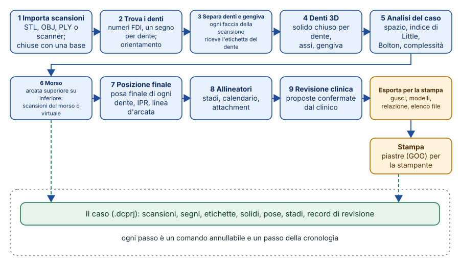
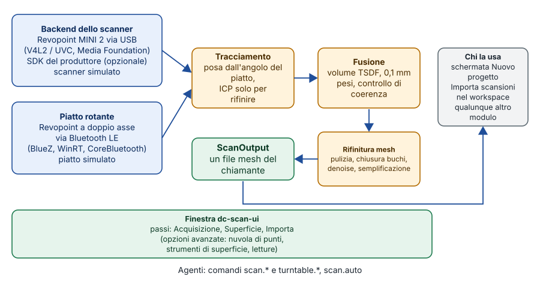

# DentalCraft: Architettura

*I livelli, il flusso dei dati della pipeline degli allineatori, la pipeline di stampa e il connettore dello scanner. Edizione del 28 novembre 2026, per DentalCraft 0.2.0-alpha.16 (modulo Allineatori 0.2.0-alpha.14, motore 0.3.0-alpha.10).*

> **Non è un dispositivo medico.** DentalCraft è software per la ricerca e la progettazione; nulla qui costituisce una dichiarazione di validità clinica.

## 1. Obiettivi e vincoli

DentalCraft trasforma scansioni intraorali o da banco in un piano di trattamento, una serie di allineatori e i file per stamparli. L'architettura risponde a questi vincoli:

| Vincolo | Conseguenza |
|---|---|
| Il motore deve essere provabile senza GPU né finestra. | `dentalcraft-core` non ha interfaccia; l'applicazione è un sottile involucro sopra di esso. |
| La logica dentale deve essere sostituibile e concedibile in licenza per modulo. | I moduli dipendono solo dal core, attraverso un unico contratto (`dc-module-api`). |
| Agenti di intelligenza artificiale e script devono poter fare tutto ciò che fa un utente. | Ogni azione è un comando registrato con un id, uno schema dei parametri e una documentazione. |
| Un caso deve sopravvivere a arresti, riavvii e cambi di versione. | Stati del caso immutabili, stack di annullamento, salvataggi atomici, blob indirizzati dal contenuto, migrazioni. |
| Lo stesso comportamento su Linux, Windows e macOS. | Le parti di piattaforma stanno dietro trait con un'implementazione per ciascuna. |
| Nessuna toolchain C++ sulle macchine di compilazione. | Dipendenze in Rust puro (rustls con ring, zip con deflate, stack USB e Bluetooth in Rust puro). |
| Gli algoritmi devono riprodurre un riferimento esistente e validato. | Il componente aggiuntivo Blender originale resta in sola lettura come **oracolo**; i test di riferimento confrontano il codice Rust con esso. |

## 2. Livelli

*Figura 1. Core, modulo e applicazione. Il server di accesso e diagnostica è un servizio separato raggiunto via HTTPS.*

La regola delle dipendenze è a senso unico: **applicazione → modulo → core**. Il core non conosce mai un modulo, e un modulo non conosce mai l'applicazione: un modulo consegna alla shell un albero del menu, ispettori disegnati con egui, comandi e una descrizione della scena, e la shell li ospita. Le finestre come quella di scansione e quella di stampa sono componenti generici dell'applicazione: non dipendono né dall'area di lavoro né da alcun modulo, quindi qualsiasi schermata o modulo può ospitarle.

## 3. Il core

### 3.1 Il caso e la sua storia

- Un **caso** (`dc-case`) contiene le scansioni (con ruoli superiore, inferiore o morso), i denti numerati FDI, le pose (`Pose { t: DVec3, q: DQuat }`), il sistema di riferimento del mondo, i riferimenti ai blob (l'hash BLAKE3 di una mesh) e uno **stato di modulo** opaco per ogni modulo.
- Uno stato del caso è **immutabile** e condiviso (`Arc<CaseState>`). Un **comando** (`dc-command`) prende uno stato e restituisce il successivo: `fn apply(&self, &CaseState, &mut JobCtx) -> Result<CaseState>`. Lo **stack di annullamento** è una pila di stati con condivisione strutturale e un budget di memoria, quindi annulla e ripeti sono spostamenti di puntatori e una mesh invariata non viene mai copiata.
- La **cronologia dei passi** registra i passi di elaborazione (`StepRecord { step, inputs_hash, outputs, by_hand }`) con ripetizione, riavvolgimento e annullamento del riavvolgimento. Si salva con il progetto; lo stack di annullamento no.
- I **lavori** (`dc-jobs`) eseguono lavori lunghi su thread di lavoro con avanzamento (una frazione e una chiave di messaggio) e un segnale di annullamento. Il risultato di un lavoro torna come comando, quindi si può annullare come ogni altra cosa.

### 3.2 Mesh e geometria

`dc-mesh` contiene la mesh triangolare, la topologia (adiacenze, anelli di bordo, componenti), la validazione e l'I/O dei file; le unità sono riconosciute all'importazione (metri, centimetri, micrometri diventano millimetri). `dc-geom` contiene i kernel dietro un trait `Backend`, così in futuro si potrà aggiungere un backend GPU: un BVH, ICP punto-piano, decimazione a collasso di spigoli con metrica quadrica, riempimento dei buchi di Liepa, campi di distanza con segno (offset, chiusura, meshing), un volume TSDF, risoluzioni armoniche e sparse con gradiente coniugato precondizionato, riparazione e rifinitura delle mesh. Tutto è parallelo con rayon e deterministico dove l'output non deve cambiare tra piattaforme.

### 3.3 Sessione, registro e MCP

`dc-session` possiede il progetto aperto, lo stato del caso dentro il suo stack di annullamento, la cronologia dei passi, i moduli registrati, i lavori e il **registro di ogni comando pilotabile da agenti**: quelli incorporati (`project.*`, `case.*`, `edit.*`, `steps.*`, `view.set`, `scan.*`, `turntable.*`, `print.*`) più le specifiche che i moduli registrano. La CLI e il server MCP chiamano `execute`, `batch`, `describe` e `inspect` su di esso. `dc-mcp` è un server JSON-RPC scritto a mano su stdio dietro un trait `Host`: l'host è la sessione senza interfaccia oppure un **host remoto** che inoltra all'applicazione in esecuzione attraverso un ponte locale, così gli stessi strumenti funzionano con e senza finestra.

### 3.4 Scena, i18n, tema

`dc-scene` descrive ciò che mostra il viewport (mesh con colori o etichette, linee, punti, etichette 3D, sovrapposizioni) senza alcun tipo di GPU, così i moduli restano senza GPU e il renderer su CPU (`dc-raster`) può disegnare la stessa scena in un PNG. `dc-i18n` incorpora un bundle Fluent per crate e li cambia tutti insieme; `dc-theme` trasforma i token di design in un tema egui.

## 4. Il contratto dei moduli

Un modulo implementa il trait `Module` di `dc-module-api`:

| Membro | Significato |
|---|---|
| `id`, `name_key` | `aligners`, e la chiave Fluent di «Aligners» / «Allineatori». |
| `menu()` | Un `MenuTree`: gruppi e foglie, ognuna con un id, chiavi di etichetta e descrizione, un'icona e uno stato (`Ready` o `Stub`). Una foglia può dichiarare tipi di ingresso, per esempio `ScannerInput { roles }`, che fa comparire il pulsante **Scansiona**. |
| `commands()` | `CommandDesc` e `CommandSpec`: gli id, gli schemi dei parametri e le funzioni di esecuzione che la sessione registra. |
| `inspector(ui, ctx)` | Disegna l'ispettore con egui, leggendo il flag delle opzioni avanzate. |
| `scene(state)` | I `SceneItem` che il viewport mostra per uno stato del caso. |
| `data_codec()` | Un `ModuleCodec` che legge e scrive lo stato del modulo in `.dcprj`, con migrazioni dello schema. |

I moduli sono compilati dentro e raccolti in un `ModuleRegistry`; quali sono utilizzabili dipende dal diritto d'uso dell'utente. Il modulo Allineatori è il primo; altri (costruttore di modelli, bite, corone) si inserirebbero allo stesso modo.

## 5. La pipeline degli allineatori

*Figura 2. I nove passi e le due uscite di produzione. Ogni freccia è un comando; ogni stato è salvato nel caso.*

Le fasi stanno in `dca-algo`, un modulo per fase, e sono esposte come comandi da `dca-module`. Ogni fase legge il caso, produce un nuovo stato ed è un solo passo annullabile.

| Passo | Comando (foglia) | Cosa calcola | Salvato nel caso |
|---|---|---|---|
| 1 Importa scansioni | `aligners.case.import-scans` | Legge STL, OBJ, PLY, riconosce l'arcata (nome, poi geometria), converte le unità e **chiude una scansione d'arcata aperta con una base piana** perpendicolare al suo asse occlusale, nello stesso passo annullabile. Il solido chiuso è *la* scansione del caso; la scansione com'era stata letta resta come suo prefisso. Una scansione di qualunque ruolo esce dal caso con `case.remove-scan` (un solo passo annullabile; il modulo cancella ciò che ne dipendeva). | Scansioni, ruoli, `scan_bases` |
| 2 Trova i denti | `aligners.teeth.find` | Trova la direzione occlusale (asse principale più piccolo della scansione) e l'orientamento dell'arcata (un polinomio simmetrico di quarto grado adattato alle sommità delle corone), costruisce un profilo delle cuspidi lungo l'arcata con un punteggio della corona, poi colloca i confini dei denti con la programmazione dinamica su larghezze tipiche, ammettendo denti assenti. Un **punto** FDI per dente. La proposta viene controllata prima di essere accettata (sotto). | Punti dente, denti assenti, orientamento |
| 3 Separa denti e gengiva | `aligners.preparation.segmentation.automatic` | Semplifica la scansione a circa 30 000 facce, poi esegue una **segmentazione a passeggiata aleatoria sul grafo delle facce**: i pesi degli spigoli vengono dall'angolo diedro (le pieghe concave pesano più di quelle convesse), i semi sono un disco attorno a ogni punto dente più vincoli gengivali. Le etichette sono riportate sulla scansione completa, ripulite, e ogni bordo è rifinito alla piena risoluzione. | Un'etichetta di dente per faccia |
| 4 Denti 3D | `aligners.teeth.build` | Taglia ogni corona lungo una linea di margine liscia, toglie i ponti dello scanner tra i vicini e chiude l'apertura con anelli che si restringono in un colletto e un moncone arrotondato, rifiniti come la superficie più liscia tangente alla corona (minima energia di piastra sottile). Il risultato è un solido a tenuta stagna con avvolgimento coerente; si misurano asse, larghezza e centro di resistenza del dente; si costruisce una gengiva che segue i denti e la si **chiude con una base piana** 3 mm sotto il suo punto più basso lungo l'asse occlusale (`FLAG_BASE`), così è un solido chiuso. La base resta ferma quando i denti si muovono; la scena degli allineatori, il guscio e l'esportazione usano la gengiva senza base. | Solidi, sistemi di riferimento, gengiva, `teeth_basis` |
| 5 Analisi del caso | `aligners.diagnosis.space-analysis` | Spazio disponibile e necessario, indice di irregolarità di Little, rapporti di Bolton, un punteggio di complessità. | Diagnosi, correzioni a mano |
| 6 Morso | `aligners.occlusion.align` | Registra le arcate sulle scansioni del morso: l'arcata inferiore resta ferma, ogni scansione del morso viene cercata su di essa (accoppiamento grossolano, poi ICP fine sulle corone) e l'arcata superiore si sposta sulle scansioni del morso; oppure colloca un **morso virtuale** per massima intercuspidazione partendo da una posa iniziale (linee mediane allineate, overjet, molari di Classe I). Una scansione parziale o di bassa qualità si registra se i suoi denti combaciano: quanto è buona e che cosa copre diventano **motivi da verificare** nella relazione del morso (`rms_above_good`, `few_teeth`, `low_coherence`, `front_only`, `one_side_only`, `scans_disagree`, `interpenetration`, `arches_not_in_contact`, `scan_ignored:<scansione>`), con esito `good` o `to_review`. Viene rifiutata (`BiteError`, nulla si sposta) solo per un accoppiamento non affidabile: nessuna scansione del morso combacia, le arcate non si affacciano, oppure si compenetrano oltre `bite_penetration_max` (1,0 mm). Riporta scarti, area di contatto e compenetrazione; facoltativamente la corregge. | Relazione tra arcate, relazione del morso |
| 7 Posizione finale | `aligners.planning.setup.automatic` | Una posa finale per dente entro limiti di movimento: linea d'arcata, espansione, chiusura degli spazi, IPR, movimenti verticali, denti tenuti fermi. | Setup, linea d'arcata, risultati |
| 8 Allineatori | `aligners.planning.aligners` | Suddivide il movimento di ogni dente in stadi (schemi, velocità per dente, sovracorrezione, evitamento delle collisioni), poi il calendario. | Stadi con pose, calendario |
| 9 Revisione clinica | `aligners.review.classify` | Propone classificazioni in base alle evidenze (difficoltà, schema, attacchi, rischio); il clinico conferma. | Record di revisione |
| Esportazione | `aligners.output.export-all` | Costruisce il modello stampabile di ogni stadio su base piana, il **guscio** (solido in offset, svuotato), il taglio lungo il bordo dell'allineatore, le rampe del morso e un timbro inciso, esegue il **controllo di stampa**, e scrive relazione, calendario ed elenco dei file. | File in una cartella |

**Regole che la pipeline deve mantenere.** Si sono già rotte in passato e ognuna ha un test:

- I denti adiacenti separati restano oggetti separati; non vengono mai fusi.
- Il riconoscimento dei denti si ferma agli ultimi molari. Una proposta con un terzo molare dove la scansione ha solo gengiva dietro l'ultimo molare, o che allunga un dente sulla gengiva, o che fonde denti affollati, viene corretta: i denti vengono cercati di nuovo con l'arcata libera di finire all'ultima corona (`FreeEnds` nella programmazione dinamica; i motivi e la prima numerazione sono in `diagnostics.checked`). È uno scostamento voluto dal componente aggiuntivo: la sua proposta semplice resta disponibile e identica bit per bit (`autoseed::propose`), e l'applicazione usa quella controllata (`autoseed::propose_checked`, tramite `autoseed::run`).
- La scansione del morso è una scansione funzionale: l'applicazione non la disegna mai nella vista 3D (solo mentre lo strumento Tre punti è aperto) e lì non si può selezionare.
- I denti non fanno mai un giro completo: le pose sono memorizzate come quaternioni canonici con parte scalare non negativa (una legge di Kani), così si prende sempre la rotazione più breve.
- Il modello di studio viene generato all'inizio (le scansioni si chiudono all'importazione) così la vista 3D è un gemello digitale della realtà.
- Gli allineatori non si disegnano in partenza; si costruiscono per la vista solo su richiesta.
- I numeri dei denti sono solo di denti permanenti, FDI da 11 a 48. Un numero deciduo (da 51 a 85) viene rifiutato per nome ovunque entri un numero di dente (i denti mancanti, un punto dente, un seme della segmentazione), mai dato in silenzio a un dente vicino o alla gengiva. Il terzo molare viene deciso per ogni lato da solo.
- Un dente non viene mai tenuto aperto. Una corona ricostruita è accettata solo quando ogni lato appartiene a esattamente due facce; quando nessun tentativo è chiuso il dente fallisce con il suo numero (`ReconstructError::NotClosed`) e il passo non cambia nulla. La separazione nomina nel suo risultato un'arcata saltata per mancanza di punti dente, e mettere un punto più vicino a un altro di metà della larghezza di un dente dà un avviso.
- Ogni numero che limita il lavoro o la dimensione viene controllato su ogni strada che può fornirlo, non solo nel comando delle impostazioni: i limiti della pianificazione, il tetto della corona e la velocità di un dente (un tetto pari a 0 non è «nessun tetto»; al massimo 999 allineatori per dente), la velocità di recupero della visita di controllo (da 0,3 a 1), i voxel (da 0,04 a 0,5 mm) e la parete del guscio (almeno due voxel). Il risultato della pianificazione riporta i passi oltre un limite (un controllo di postcondizione del piano) e gli IPR che nessun allineatore porta.
- Un allineatore passivo non è una copia: è l'ultimo guscio con il proprio numero, il segno di passivo `P` e la propria data. Il controllo di stampa adatta un pezzo al piatto della Elegoo Saturn 4 Ultra 16K (211,68 × 118,37 × 220 mm meno il margine di disposizione di 4 mm in X e Y).
- Un progetto con una sola arcata non ha un morso. Una sola decisione, `bite_use(upper, lower, stored)` (`BiteUse::of` per un caso), viene chiesta da ogni fase: una sola arcata non usa mai un morso qualunque cosa sia salvata, un morso salvato è usato solo con entrambe le arcate e qualcosa di salvato, entrambe le arcate tengono il morso (tre leggi Kani). Con una sola arcata non si stima, non si sintetizza e non si prende per impostazione predefinita nulla; i comandi del morso rispondono `applies: false`, `reason: "one_arch"` e non cambiano nulla; il passo Morso conta come completo quando l'arcata della scansione è stabilita; gli allineatori sono fatti dalla sola arcata (niente modellazione occlusale, niente rampe, niente morso con gli allineatori indossati, niente rapporto di Bolton); `aligners.demo` non crea mai un'arcata accanto alle scansioni di un paziente. L'ispettore di Morso dell'app dice che non si applica.
- L'ultimo dente di ogni lato deve essere una corona. La proposta controllata mette alla prova i suoi denti di estremità (attraverso l'arcata la scansione scende di 2,5 mm sotto la loro cima entro 7,5 mm da entrambi i lati, le due pareti distano al massimo 12,5 mm); uno che non la supera (il tallone, la scarpata o il retro della base di un modello alti quanto le corone) è il dubbio `EndNotTooth`, e l'arcata viene profilata di nuovo su tutta la scansione con la parte di altezza del punteggio di corona, tagliata a metà di ogni dente di estremità che non è una corona, e i denti vengono cercati e controllati di nuovo (`autoseed/ends.rs`), tenuti solo se non peggiori (i suoi denti di estremità sono corone e ogni contatto della prima proposta è ancora un confine entro 1 mm). Nella segmentazione, a più di 2 mm oltre la superficie distale dell'ultimo dente di un lato la scansione è un vincolo gengivale della passeggiata, per quanto sia alta (`GUM_DISTAL_MM`). Il controllo dopo la segmentazione unisce due regioni solo con la prova di una sola corona (`one_crown`: nessun solco, piega sotto 1,25; le due parti insieme al massimo 1,5 larghezze tipiche del dente tenuto, ciascuna parte più stretta di 0,9 di esso); le coppie che tiene separate sono un dubbio (`kept_apart`), e dopo una correzione possono cambiare numero solo i denti dal seme cambiato più mesiale in poi nel suo quadrante (`renumber_touched`).
- Un dente 3D non ha tunnel. Una scansione può avere un tunnel largo pochi triangoli attraverso un bordo incisale sottile, la punta di una cuspide o un solco, che in una corona è un'ansa della sua superficie. `crown_patch` taglia ogni ansa dove è più stretta (`reconstruct/handles.rs`: il ciclo più corto di lati che non divide la corona, i suoi triangoli tolti, i buchi chiusi da un ventaglio verso il loro centro) e il controllo del dente chiuso giudica ogni chiusura con `dc_mesh::solid_topology` (chiuso, un solo pezzo, genere 0); se nessuna lo soddisfa, il dente fallisce con `Tunnel(fdi)`. Una corona senza anse viene lasciata com'è, byte per byte. Questo si discosta dal componente aggiuntivo, che mantiene i tunnel; i test con oracolo lo segnalano come scostamento.
- Il bordo dell'allineatore e lo spazio sopra la gengiva. Il bordo liscio viene alzato almeno di `papilla_relief_mm` (predefinito 1, da 0 a 3) sopra il margine gengivale lungo tutta l'arcata, in un incavo arrotondato attorno a ogni papilla tenuto 0,5 mm sotto il contatto delle due corone e mai abbassato (quattro leggi Kani sull'alzata); dove l'incavo lascia un foro nella parete o una calotta separata, l'allineatore viene rifilato di nuovo con metà dello scarico, poi senza (`PAPILLA_RETRY_SHARES`), e l'esportazione lo annota. Il campo chiuso da cui si legge il guscio comprende anche la regione entro `gum_clearance_mm` (predefinito 0,3, da 0 a 1) dalla gengiva (`shell::gum_relieved`), così sopra la gengiva, anche le papille, il guscio sta quella distanza più in fuori con una parete altrettanto spessa; il modello stampato mantiene il campo senza di essa. 0 per l'una o l'altra restituisce il bordo e il guscio del componente aggiuntivo, che i test con oracolo mantengono. Un bordo preso dal margine viene tenuto sotto una parete piana che taglierebbe (`trim/flat.rs`), e il controllo di stampa riporta dove c'è un foro nella parete (il centro del ciclo più corto attraverso ogni ansa).
- Una scansione e un modello da studio sono solidi puliti, e la pipeline dice quando uno non lo è. `scan_base` chiude una scansione aperta: le facce ripiegate sopra di essa vengono tolte, gli spigoli aperti vengono seguiti in cicli, solo il bordo di ogni pezzo viene sceso fino alla base e ogni altro ciclo viene riempito sul posto (mai estruso in un camino), e il risultato è contato con `dc_mesh::solid_topology`; una scansione che non è ancora un solido chiuso solleva l'avviso d'importazione `not_closed` (`dc_case::WarningCode::NotClosed`) con gli spigoli rimasti. I modelli da studio sono costruiti dalla scansione allo stesso modo, conservano l'anatomia scansionata (sottosquadri compresi), chiudono i tunnel che la costruzione crea e mettono su base due arcate come coppia solo quando sono in occlusione (altrimenti ciascuna da sola); un modello che non è un solido pulito riceve l'avviso `not_solid`. L'app li mostra entrambi come avvisi fissi.
- Il piano non deve saltare quando cambiano pochi vertici della segmentazione. Il setup derota un dente solo dell'eccesso della sua rotazione sulla tolleranza della sua zona (non sotto 0,5°) e prende la scala della linea d'arcata robusta una sola volta, dai canini e dai premolari; la pianificazione degli stadi controlla le collisioni su ogni punto della corona, non ritarda mai un dente rispetto a un vicino che non si muove mai, tiene un ritardo solo se abbassa la compenetrazione peggiore della sua coppia, ed elenca ogni collisione che lascia (`unresolved`, le note, `staging_collisions`, la relazione). Le regole del componente aggiuntivo restano dietro opzioni di configurazione usate solo dai test di parità (`Config::plugin_derotation`, `Config::plugin_line_scale`, `Params::delay_against_still`, `Params::delay_without_gain`, `Params::sample_points`).

**Obsolescenza.** Ogni risultato a valle registra da cosa è stato costruito (per esempio `teeth_basis`). Quando una modifica a monte lo rende obsoleto (i punti dente, i colori del pennello, i denti), il risultato è **conservato ma segnato come non aggiornato**, oppure azzerato quando non può più essere valido, e l'interfaccia dice quali passi rieseguire.

## 6. L'applicazione

`dentalcraft-app` è un sottile involucro sopra il motore:

- **Schermate:** Home, accesso, assistenza, nuovo progetto e l'**area di lavoro** del modulo (albero del menu, vista 3D, ispettore, linea del tempo, barra di stato). L'ispettore di ogni funzione è disegnato da un'unica tabella, quindi una nuova funzione segue la regola del menu aggiungendo una voce.
- **Thread:** il thread dell'interfaccia disegna e non si blocca mai. Un comando da un pulsante gira su un thread di lavoro con un contesto di lavoro; il suo risultato arriva come un nuovo stato del caso. Un regolatore di fotogrammi con vsync limita la frequenza a 60 FPS.
- **Viewport (`dc-viewport`):** wgpu dentro egui. La selezione avviene su CPU tramite il BVH del motore; la selezione è mostrata da un passaggio di contorno su una maschera, e un gizmo di trasformazione mostra in anteprima gli spostamenti senza cambiare il caso finché il trascinamento non finisce.
- **Salvataggio:** l'area di lavoro salva un progetto che ha un file due secondi dopo l'ultima modifica (mai durante un comando, un salvataggio o una finestra), un salvataggio alla volta con il successivo in coda; uscire salva prima. Il caso viene scritto intero, compresa la composizione dei denti modificata con il pennello. Un salvataggio viene rifiutato, con un messaggio che nomina dove si trova il numero (formulato in inglese e in italiano, la voce e il percorso come dettaglio), quando il progetto contiene un numero non finito, e il file precedente resta intatto; un `.bak` che non si può sostituire o una cartella che non si può sincronizzare è un avviso dopo un salvataggio riuscito. Un file aperto in sola lettura non viene mai sovrascritto, comunque sia scritto il suo percorso, da Salva, dal salvataggio automatico, da Salva con nome o dal `project.save` del ponte. Un comando che lascia il caso com'era non aggiunge alcun passo annullabile né nulla da salvare.
- **Ponte:** `dentalcraft --control <porta>` è in ascolto su `127.0.0.1` ed esegue gli stessi comandi della CLI dentro la finestra, così le modifiche di un agente si possono annullare lì. Pochi comandi esistono solo sul ponte (disposizione della finestra, vista, schermate). Ogni connessione deve prima dimostrare un token valido per un solo avvio (un segreto di 256 bit in un file leggibile solo dall'utente) nei due sensi, con hash BLAKE3 con chiave, prima che giri qualsiasi cosa; una riga è al massimo di 16 MiB, al massimo 4 connessioni sono aperte insieme, e il consenso alla diagnostica non si può dare attraverso di esso (guida per sviluppatori, sezione 6.7).
- **Accesso (`dc-auth-client`):** codice di autorizzazione OpenID Connect con PKCE su reindirizzamento locale a `127.0.0.1:<porta>/callback`; l'id token viene verificato con il JWKS del server; il token di aggiornamento è nel portachiavi del sistema (Secret Service, Keychain, Credential Manager) così la sessione sopravvive ai riavvii. Un orologio del computer sfasato di più di cinque minuti è un errore a sé (`Clock`, un messaggio sull'orologio) e non cancella mai la sessione salvata.
- **Aggiornamenti (`dc-update`):** un manifesto firmato con minisign viene controllato con una chiave incorporata nel programma; ogni download è verificato su dimensione e SHA-256; ogni tipo di pacchetto ha il suo percorso di installazione: una cartella autonoma e un AppImage vengono sostituiti alla chiusura dell'app, il setup e l'MSI di Windows vengono eseguiti dopo che l'app si è chiusa, e per deb, rpm e Flatpak si dà solo il comando del gestore di pacchetti (il manuale utente, sezione 2.4, descrive ciò che vede l'utente). L'installer viene calcolato di nuovo (hash) subito prima di essere eseguito (un AppImage prima di sostituire se stesso; su Windows l'assistente che avvia il setup o l'MSI dopo la chiusura dell'app controlla anche il suo firmatario Authenticode rispetto al certificato DentalCraft fissato).
- **Diagnostica (`dc-diagnostics`):** disattivata finché l'utente non dà il consenso, e il consenso si può dare solo nell'applicazione: la riga di comando, MCP e il ponte possono solo disattivarla. Un sanificatore toglie percorsi (resta solo una lista consentita di cartelle di DentalCraft e del sistema), nomi dei file di progetto e di scansione, nomi, numeri di serie dei dispositivi e indirizzi MAC, indirizzi e-mail e token prima che qualsiasi cosa venga messa in coda, e trasforma i codici paziente che l'app ricorda in digest con sale; la coda è limitata; l'invio ha un limite di frequenza, rallenta quando serve e va solo a un indirizzo HTTPS.
- **Impostazioni (`dc-app`):** una finestra aperta dall'ingranaggio delle barre in alto o dal menu dell'account, con quattro sezioni (Generale: lingua e tema; Area di lavoro: **Opzioni e parametri avanzati**; Aggiornamenti; Privacy). Ogni modifica è salvata subito in `settings.json`. L'impostazione è **disattivata in partenza**: la shell la mette nella memoria di egui a ogni fotogramma (`dc_module_api::set_advanced_ui`) e widget e moduli la leggono con `advanced_ui`, così un modulo non deve mai conoscere la finestra. Disattivata, gli ispettori mostrano solo i passaggi automatici e le correzioni a mano più utili, e il menu segna il passo da fare dopo con una targhetta **Avanti**; i comandi mantengono tutti i loro parametri (`app.settings.get` e `app.settings.set` la leggono e la cambiano).
- **Finestra di stampa (`dc-print-ui`):** si apre con gli allineatori che elenca la foglia **Stampa**; legge i gusci, abbina ogni guscio di un'esportazione al suo modello dello stadio (un modello che non corrisponde fa rifiutare la preparazione; un guscio sciolto viene preparato con un avviso), chiede una sola volta i valori della resina (conservati in `print-resin.json` accanto a `settings.json`), prepara i piatti in un thread in background con avanzamento e un pulsante per annullare, mostra ogni piatto visto dall'alto con le stime e salva i file in una cartella o su una chiavetta USB. Quando i file sono salvati, l'area di lavoro registra i loro allineatori come inviati con un solo `aligners.print.mark` annullabile.
- **Cronologia dei passi (`dc-workspace`, `history.rs`):** uno `StepHistory` per ogni versione del caso. L'esecuzione di una funzione del menu che dà una nuova versione viene registrata, una correzione con uno strumento del suo ispettore viene registrata come fatta a mano, un passo rieseguito o corretto a mano toglie le registrazioni delle funzioni successive, e dopo ogni modifica una registrazione sparisce quando il caso non contiene più il risultato della sua funzione (`Module::leaf_done`); annulla e ripeti riportano la cronologia della loro versione. Un passo è fatto solo quando il caso contiene il suo risultato; una funzione che non è un passo (un'esportazione, i modelli da studio) è fatta anche dalla sua registrazione, sul caso che la sua esecuzione ha lasciato. All'apertura, la registrazione di un passo viene tenuta solo quando il caso contiene il suo risultato; una cronologia che non si legge lascia il file in sola lettura, con un avviso. Il salvataggio scrive la cronologia viva.
- **Allineatore nella vista:** l'allineatore di `aligners.view.aligner` viene disegnato sopra ciò che mostra la sua arcata (la scansione, i denti 3D o il modello da studio; `scene_meshes` e le immagini del ponte e della CLI), allo stadio mostrato, traslucido e mai selezionato; un'arcata nascosta, la scansione di Tre punti e la zona di un dente lo escludono. `app.window.view` accetta `model` (`scan` o `teeth`), la scelta **Scansione** / **Denti 3D** della barra degli strumenti. Gli ispettori di Allineatori e di Trova i denti mostrano ciò che i comandi si limitano a riportare (passi oltre un limite, IPR che nessun allineatore porta, punti troppo vicini), tenuto con la parte del caso a cui si riferisce, così un annullamento o una nuova esecuzione non lascia mai un avviso non più vero.
- **Interruttori della vista (`dc-workspace`, `overlay.rs`):** i colori dei denti, i punti dente, i numeri dei denti e la mappa dei contatti sono sempre nella barra degli strumenti, con le opzioni avanzate accese o spente, e spenti all'avvio dell'applicazione, in un nuovo progetto e in uno aperto; nulla li accende se non l'utente, e non sono conservati né nel progetto né nelle impostazioni. Il pennello dei denti ne presta due: `overlay::follow_brush` è la decisione pura (lo stato mostrato, lo stato prima del pennello, se il pennello è lo strumento aperto). Aprire il pennello accende i colori e i numeri e li ricorda; dentro, una scelta a mano vince; chiuderlo, in qualunque modo, rimette ciascuno com'era prima; i punti dente e la mappa dei contatti non vengono mai toccati (cinque leggi Kani). Il pennello è legato allo strumento aperto, non alla selezione della sua voce di menu, che seleziona soltanto. `app.window.view` imposta e restituisce `colours`, `marks`, `numbers` e `contacts`.

## 7. La pipeline di stampa

*Figura 3. Dai gusci esportati a un file GOO per piatto. Il riquadro rosso elenca i controlli obbligatori che fermano la preparazione prima che venga scritto un file.*

La stampa è realizzata in `dc-print` (motore, senza interfaccia) e `dc-print-ui` (la finestra). Prepara i **gusci degli allineatori stampati direttamente** per la Elegoo Saturn 4 Ultra 16K, in resina trasparente biocompatibile. Il modulo Allineatori aggiunge la foglia **Stampa** e il tracciamento per allineatore.

### 7.1 Ingressi

- **Pezzi:** i gusci esportati (`stampa_resina/*.stl`), un pezzo per allineatore. Un pezzo può portare un flag per faccia, di calzata o no, quando lo fornisce chi chiama la libreria; i comandi e la finestra di stampa leggono semplici file di mesh e ricavano i flag dal **modello dello stadio** o dalla geometria (punto seguente).
- **Lato di calzata:** la superficie di un guscio che tocca i denti, e che non riceve mai un supporto. **Per un guscio di un'esportazione si legge dal suo modello dello stadio, non si indovina.** L'esportazione scrive ogni guscio accanto al modello su cui è stato costruito: `modelli_termoformatura/<modello>.stl` accanto a `stampa_resina/`, abbinato al guscio dal `*_manifest_stampa.csv` dell'esportazione o altrimenti per nome (un guscio passivo prende il modello dell'ultimo stadio), con il gioco preso da `manifest.json`. L'intaglio del guscio è la superficie di quel modello spostata verso l'esterno del gioco, tranne dove il guscio colma gli spazi tra i denti, quindi i lati si decidono per superficie di parete: le facce di parete si accoppiano attraverso la parete (un raggio nel materiale incontra una faccia rivolta nel verso opposto a 0,6–1,6 volte lo spessore mediano della parete), si uniscono per spigoli in superfici, e una superficie è di calzata quando la maggior parte delle sue facce poggia sul modello (entro il gioco più 0,3 mm); le fasce del bordo e i tratti del timbro inciso si decidono faccia per faccia. Se meno del 30 % delle facce poggia sul modello, guscio e modello sono di un altro stadio o di un altro sistema di riferimento e la preparazione rifiuta (`print-model-mismatch`). Un pezzo che non viene da un'esportazione ricava il lato di calzata dalla geometria: la chiusura di ogni faccia (raggi sul suo emisfero esterno) si confronta con quella della faccia che le sta di fronte attraverso la parete, e il lato della cavità è quello più chiuso. Il riepilogo di `print.prepare` dice quale strada ha preso ogni pezzo (`fitting_source`: `model` o `geometry`). La finestra di stampa segue le stesse due strade: abbina un guscio di un'esportazione al suo modello esattamente come `print.prepare` e rifiuta un modello che non corrisponde, e prepara comunque un guscio sciolto fuori da un'esportazione, ma avverte «Lato d'appoggio stimato dalla forma; esporta di nuovo.» e nomina gli allineatori interessati.
- **Profilo della stampante:** dati, non codice. Il profilo della Saturn 4 Ultra 16K dà la risoluzione (15120 × 6230), il passo dei pixel (14 µm su X, 19 µm su Y), il volume di stampa (211,68 × 118,37 × 220 mm), le altezze di strato accettate (da 10 a 200 µm), i flag di specchiatura e i **parametri macchina** della stampante: l'insieme incorporato **DENTAL 45**, un file `M5000` di firmware preparato con gli ingegneri di Elegoo (corsa Z 230 mm, inclinazione 140°, vasca a 45 °C, sorgente luminosa combinata, velocità e tempi di distacco lento e veloce, volume della vasca 870 ml). I parametri macchina alimentano le stime di tempo e resina.
- **Valori della resina:** inseriti una volta dall'utente dalla scheda del produttore (altezza dello strato, esposizioni, strati di base, pausa, densità). Non esiste un preset di resina incorporato.
- **Validazione del profilo:** il profilo ha un flag `validated`, falso per la Saturn 4 Ultra 16K finché la sua scala delle dimensioni (passo del pixel) e il suo orientamento sinistra/destra (flag di specchio) non sono verificati sulla stampante con una stampa di prova misurata. Finché è falso, ogni risultato di `print.prepare` porta l'avviso `print-profile-not-validated` e la finestra di stampa lo mostra.

### 7.2 Fasi

1. **Orienta.** Una ricerca su un piccolo insieme di pose candidate: la posa di base porta l'apertura della cavità (la normale media, pesata per area, delle facce di calzata) dritta verso l'alto, **lontano dal piatto**, così il lato occlusale guarda il piatto e porta i supporti, la resina scola e non si forma un bicchiere; inclinazioni fino a 45° a passi di 15° attorno a otto assi orizzontali (X, Y e le diagonali) tagliano la parete sottile in obliquo, il che riduce la sezione per strato e la forza di distacco. Il punteggio penalizza prima l'area di calzata rivolta verso il basso, poi l'area esterna che richiede supporto, poi altezza e sezione; a parità vince il candidato precedente. I candidati si provano dal migliore, affettati all'altezza di strato del lavoro (solo gli strati in cui un vertice di calzata fa iniziare il solido), e vince il primo che non fa iniziare alcuna isola sul lato di calzata (una tale isola, per esempio il controspazio di una lettera incisa rivolta in basso, non potrebbe mai avere un puntello). Quando i supporti di quella posa non superano un controllo obbligatorio, parte una **ricerca ampia** (`orient::wide_poses`): ogni direzione dell'apertura su una griglia di 5° su tutta la sfera (comprese le vecchie inclinazioni e le pose capovolte), raffinata a 2,5° e 1,25° attorno alla migliore quando nessuna è idonea. Una direzione è idonea quando non fa iniziare alcuna isola sul lato di calzata; quelle idonee sono ordinate con il vecchio punteggio, prima quelle le cui isole iniziano tutte lontano dal lato di calzata, e il lavoro mette i supporti e controlla al massimo 16 di esse una dopo l'altra, tenendo la prima che passa. La ricerca è deterministica (raccolta parallela ordinata, spareggi per indice); la regola delle isole e i giochi dei puntelli non cambiano. Se nessuna posa passa, si riporta il fallimento con meno isole, con il numero di pose provate e dove inizia l'isola più bassa. Una rotazione finale dispone il lato lungo del rettangolo minimo che racchiude l'impronta lungo l'asse X del piatto.
2. **Supporti, solo lato esterno, su una zattera a U.** I punti più bassi delle regioni rivolte verso il basso e un insieme spaziato di punti (a 2,5 mm l'uno dall'altro, su facce non di calzata rivolte in basso oltre 45°) ricevono un puntello ciascuno: un prisma rastremato chiuso a 8 lati con una punta conica da 0,35 mm che entra nel pezzo di 0,2 mm e un fusto da 1,0 mm. Un contatto è accettato solo se tocca una faccia non di calzata rivolta verso il basso, resta ad almeno 0,35 mm da ogni faccia di calzata e il suo corpo non incontra il pezzo; altrimenti si provano spostamenti di 0,5 e 1 mm in otto direzioni. Poi il controllo delle isole gira all'altezza di strato del lavoro e aggiunge puntelli, in al più quattro giri, dove una regione inizia nel vuoto sul lato esterno. I puntelli poggiano su una **zattera** (*raft*) di 1,0 mm che **segue i piedi invece di riempirne l'involucro**: un cuscinetto smussato attorno a ogni piede (1,5 mm oltre il piede svasato), unito ai vicini da fasce smussate larghe 4 mm lungo gli spigoli dell'albero di copertura minimo dei piedi. Su un'arcata di denti i piedi seguono l'arcata, quindi la zattera ha la **forma di una U**; è una mesh chiusa, affettata insieme al pezzo e ai puntelli, e risparmia resina e forza di distacco rispetto a un piatto pieno.
3. **Controlli obbligatori.** *Nessun contatto di supporto sul lato di calzata né vicino ad esso*, e *nessuna isola senza supporto*: sugli strati affettati, ogni regione che inizia nel vuoto deve poggiare su una punta di supporto. Un controllo fallito ferma la preparazione con un codice che indica la causa; non viene scritto nulla.
4. **Disponi.** Le impronte (involucri convessi) sono rasterizzate su una griglia e disposte con un riempimento dal basso a sinistra a quarti di giro, prima le più alte e le più grandi, rispettando la distanza e i margini del piatto. Si provano diverse strategie fisse e si tiene la migliore (meno piatti, altezza totale minore). L'aritmetica è intera una volta rasterizzata un'impronta, quindi gli stessi pezzi danno gli stessi piatti su ogni piattaforma.
5. **Affetta.** Lo strato *i* è la sezione a *z = (i + ½)·h*. I triangoli sono ordinati per il primo strato che attraversano e spazzati; ogni attraversamento dà un segmento orientato, con i punti di attraversamento interpolati in modo identico per i vicini, così i contorni si chiudono esattamente. I pixel si campionano al centro con la **regola dell'avvolgimento non nullo su tutte le mesh insieme**, così i supporti che si sovrappongono a un pezzo formano un solido unico senza operazioni booleane sulle mesh. Il risultato è un elenco di **tratti** per strato; **una bitmap dello strato non esiste mai**. Gli strati si calcolano in parallelo a gruppi, rigorosamente in ordine, in f64 con un ordine fisso delle operazioni, così l'output è identico su ogni piattaforma e con qualsiasi numero di thread.
6. **GOO V3.** Lo scrittore segue la «Goo Format Spec V1.2» pubblicata da Elegoo: big-endian, un'intestazione di 195 477 byte con due anteprime RGB565, poi per ogni strato 64 byte di impostazioni, l'immagine codificata RLE con il suo checksum e la chiusura del file. L'intestazione contiene il volume (pixel accesi × area del pixel × altezza dello strato, supporti inclusi), il peso (volume × densità), il tempo e l'MD5. Un lettore rilegge un file per i test e per l'ispezione con `print.*`.
7. **Stima.** Il tempo è il preriscaldo (vasca dalla temperatura ambiente a 45 °C), più gli strati di base (esposizione e inclinazione lenta), più gli altri strati (esposizione, pausa e tempo di inclinazione dai parametri macchina); la resina da versare comprende ciò che deve restare nella vasca. La stima assume la modalità di distacco lenta, che limita il tempo dall'alto.

### 7.3 Uscite e tracciamento

Un piatto è un `plate_NN.goo` (e facoltativamente `plate_NN.stl`, piatto con i supporti, per ispezione), salvato su una chiavetta USB o in una cartella. Un pezzo che non sia un solido chiuso, orientato in modo coerente e con volume positivo viene rifiutato (`print-invalid-part`) prima di essere affettato. `print.prepare` scrive prima ogni file in un file temporaneo nuovo e lo sincronizza; solo quando l'intero insieme è scritto rimuove i file di piatto di un'esecuzione precedente che non ha scritto e rinomina al loro posto i nuovi, così un'esecuzione fallita o annullata lascia la cartella com'era. Scrive anche `summary.json`, che porta `profile_validated` e `warnings`. L'immagine di anteprima di ogni piatto segue la stessa mappa dei pixel degli strati.

**Tracciamento.** Il modulo ha una foglia, **Stampa** (`aligners.production.print`, gruppo Produzione), e tre comandi. La foglia si limita a elencare gli allineatori da stampare, con la cartella dell'ultima esportazione (**Esporta per la stampa** la registra, assoluta, nello stato del modulo come `export_dir`), e non cambia nulla; nell'applicazione il suo risultato apre la finestra di stampa con quei pezzi. La serie è quella che scrive l'esportazione: gli allineatori da 1 a N di ogni arcata con allineatori, poi i passivi fino alla serie più lunga delle due. Ogni allineatore ha un id (`SUP-03`, `INF-12-P`) e, una volta segnato, un **record di stampa** nello stato del modulo nel `.dcprj` (versione dello schema 2): stato, momento, chi lo ha segnato (`user`, `printer` o `app`), il lavoro (il file del piatto) e un motivo. Gli stati sono *missing* (nessun record: ancora da stampare), *queued*, *sent*, *printed*, *failed* e *reprint*. Le transizioni sono validate da una sola funzione pura e applicate da un solo comando annullabile, `aligners.print.mark`, tutte o nessuna:

| A | Da | Da parte di |
|---|---|---|
| `queued` | missing, `failed`, `reprint` | chiunque |
| `sent` | tutto tranne `printed` (un nuovo lavoro da `sent` è ammesso) | chiunque |
| `failed` | `queued`, `sent` | chiunque |
| `reprint` | `printed`, `failed` | l'utente |
| `printed` | tutto tranne `printed` | l'utente |
| `printed` | `sent` | il rapporto della stampante |

`printed` non è mai impostato dall'app da sola, e un allineatore stampato esce da `printed` solo verso `reprint` per volontà dell'utente: entrambe sono leggi Kani. I record sono fatti sugli allineatori prodotti, quindi restano quando una scansione viene sostituita o la serie viene ricalcolata. Quando la finestra di stampa salva i file, l'applicazione segna i loro allineatori come `sent` con `by: app` e i file dei piatti come lavoro.

### 7.4 Punti di estensione

Una stampante è **dati più un formato**, quindi se ne possono aggiungere altre: un profilo (come riconoscerla, griglia di pixel, volume di stampa, intervallo degli strati, valori predefiniti, parametri macchina) e un formato di affettatura dietro un trait di scrittura; GOO V3 è il primo. I backend di rete (il protocollo SDCP V3 della stampante via Wi-Fi) e una stampante simulata sono previsti e **non** fanno parte di questa edizione: i file viaggiano con una chiavetta USB.

## 8. Il connettore dello scanner

*Figura 4. Dispositivi, tracciamento, fusione e rifinitura della mesh, fino a un file mesh che il chiamante importa.*

Il connettore dello scanner (`dc-scanner`, con `dc-ble` e `dc-turntable`) è una capacità dell'intera applicazione, non di un modulo: la **finestra di scansione** (`dc-scan-ui`) è generica, possiede i propri lavori e i propri file temporanei, e consegna una mesh a qualunque schermata l'abbia aperta. Un modulo dichiara su una foglia che accetta lo scanner e quali ruoli (`ScannerInput`); la schermata Nuovo progetto e l'area di lavoro ospitano la finestra. Il connettore è in alpha.

### 8.1 Dispositivi estensibili

- Un `ScannerBackend` elenca i dispositivi rapidamente senza aprirli e ne apre uno per id; un `ScannerDevice` trasmette fotogrammi di profondità (millimetri, intrinseci a foro stenopeico, timestamp del dispositivo). Uno **scanner simulato** è sempre registrato, così ogni percorso si può provare senza hardware.
- **Revopoint MINI 2 via USB** (`revopoint-usb`): lo scanner calcola la profondità sul dispositivo e la trasmette come una normale fotocamera UVC. Il backend legge il nodo di profondità con semplice V4L2 su Linux e Media Foundation su Windows, e con un proprio lettore UVC in spazio utente su macOS (solo compilato, mai eseguito su un Mac). Non richiede alcun SDK del produttore. Si usa un **elenco chiuso** di richieste dell'extension unit del produttore, uguale su ogni piattaforma: la luce di riempimento (accesa durante l'acquisizione, spenta dopo), un profilo di esposizione rapida e la lettura in sola lettura del file di calibrazione di fabbrica. Nessun'altra richiesta, nessun firmware, nessuna scrittura.
- **Piatti rotanti** (`dc-turntable`): un trait di dispositivo con un piatto simulato e il piatto a doppio asse Revopoint via **Bluetooth LE** (`dc-ble`: BlueZ su Linux, WinRT su Windows, CoreBluetooth su macOS). Un collegamento deve riuscire al primo tentativo e un collegamento caduto viene ricollegato e il lavoro ripreso.
- Aggiungere hardware significa implementare i due trait e registrare il backend; gli SDK dei produttori si caricano durante l'esecuzione se l'utente li ha installati, mai collegati in compilazione.

### 8.2 La scansione automatica

1. **Calibrazione:** `turntable.calibrate` stima l'asse del piatto da soste registrate a coppie (24 soste da 15°), con codici di errore per ogni modo in cui può fallire; una calibrazione viene ricaricata quando il suo file cambia e rifiutata come obsoleta quando l'apparato non la rispetta più.
2. **Ferma e acquisisci:** `scan.auto` ruota il piatto a passi, aspetta che si assesti e prende la mediana di più fotogrammi a ogni sosta. L'impostazione predefinita copre cinque inclinazioni (da −20° a +20° a passi di 10°) con passi di rotazione di 7,5°, 3 fotogrammi per sosta, 245 soste, circa nove minuti.
3. **Tracciamento:** la posa viene dall'angolo del piatto (letto al momento dell'acquisizione, perché i fotogrammi arrivano in ritardo), e un ICP vincolato rifinisce solo ciò che l'angolo non può sapere, su punti dentro una regione di interesse attorno al piatto, così lo sfondo fermo non trascina mai la posa verso l'identità. Un controllo di coerenza ri-registra o scarta le viste di un oggetto che si è mosso.
4. **Fusione:** un volume TSDF sparso a 0,1 mm, con pesi; la mesh viene presa direttamente dal volume.
5. **Rifinitura:** pulizia, chiusura di ogni buco tranne la base, denoise bilaterale (fino a 0,01 mm), decimazione quadrica parallela limitata da un errore di superficie campionato di 0,015 mm, un limite di 8° sulle normali e uno spigolo massimo di 0,3 mm.
6. **Consegna:** un `ScanOutput` possiede il suo file mesh temporaneo finché il chiamante non lo rilascia; il chiamante lo importa con un ruolo.

Il sistema di riferimento di una scansione sul piatto ha +Z lungo l'asse del piatto, l'origine sull'asse all'altezza del piatto e +X verso lo scanner. Il risultato di bassa qualità di una scansione non è mai accettato come risultato del flusso automatico.

## 9. Aspetti trasversali

| Aspetto | Come è gestito |
|---|---|
| **Persistenza** | Contenitore ZIP `.dcprj`, blob verificati con BLAKE3, salvataggi atomici attraverso un file temporaneo con nome univoco e un `.bak`, migrazioni per contenitore e per modulo, apertura in sola lettura per le versioni più recenti e per i file con una parte danneggiata o una cronologia dei passi illeggibile. Un salvataggio rifiuta un numero non finito (non viene scritto nulla) e segnala come avviso un errore del `.bak` o della sincronizzazione della cartella; un caricamento limita ogni dimensione dichiarata e rifiuta voci duplicate o incoerenti. |
| **Errori** | Codici stabili in kebab-case; l'interfaccia li trasforma in frasi localizzate; un fallimento lascia il caso com'era. |
| **Internazionalizzazione** | Un bundle Fluent per crate, base inglese e italiano, test di parità delle chiavi; cambio di lingua a runtime. |
| **Determinismo** | Ordine fisso delle operazioni e aritmetica intera dove gli output devono coincidere tra piattaforme (disposizione, affettatura, orientamento). |
| **Privacy** | Il caso contiene un codice pseudonimizzato; la diagnostica è facoltativa (consenso solo nell'applicazione), sanificata, anonima e inviata solo su HTTPS; il sito non raccoglie nulla. |
| **Confini di fiducia** | Il ponte di controllo richiede un token per ogni avvio (sfida e risposta reciproche) e limita righe, connessioni e lunghezza dei batch; un installer di aggiornamento viene verificato di nuovo subito prima di essere eseguito; i file ostili di progetto, PLY e STL vengono limitati e rifiutati invece di essere letti. |
| **Parità tra piattaforme** | Trait con un'implementazione Linux, Windows e macOS; ciò che non si è potuto eseguire su una piattaforma è detto con chiarezza. |
| **Verifica** | Test unitari e di proprietà, test con oracolo di riferimento, test dell'interfaccia senza finestra, model checking limitato (Kani) delle regole che devono valere sempre. |

## 10. Decisioni che hanno dato forma al progetto

| Decisione | Motivo |
|---|---|
| Riscrittura completa in Rust (ADR 0001) | L'ambiente Blender limitava interfaccia, annullamento, modello dei dati, test e dossier normativo. |
| Repository separati per core, modulo e app | I moduli si possono concedere in licenza e distribuire separatamente; il core resta senza interfaccia. |
| Scansioni chiuse all'importazione | Il solido chiuso è il gemello digitale usato da vista, morso, timbro, linea di taglio ed esportazione. |
| Numerazione dei denti controllata | Una proposta semplice numerava la gengiva dietro gli ultimi molari; il controllo ferma il riconoscimento agli ultimi molari. |
| Regola del menu | Un clic non esegue mai nulla, così si può guardare qualsiasi passo senza effetti collaterali. |
| Opzioni avanzate disattivate in partenza | La vista semplice mostra cosa fare dopo; i valori nascosti restano in vigore. |
| Prima la stampa con chiavetta USB | Nessuna dipendenza dalla rete; il protocollo di rete si aggiunge dopo dietro lo stesso trait di backend. |
| Nessun preset di resina | Solo il produttore della resina conosce l'esposizione per il suo materiale su questa stampante. |

## 11. Limiti noti di questa edizione

- La stampa non è stata validata stampando allineatori reali; la compensazione dello spessore delle pareti e la calzata sono da misurare. La stampante dichiara una dimensione del piano leggermente diversa da quella delle specifiche del produttore; il profilo usa le specifiche.
- Il profilo della Saturn 4 Ultra 16K non è validato: la sua scala delle dimensioni (passo del pixel) e il suo orientamento sinistra/destra (flag di specchio) non sono stati verificati sulla stampante, quindi ogni risultato di `print.prepare` porta l'avviso `print-profile-not-validated` e la finestra di stampa lo mostra. Controlla le misure di un pezzo di prova prima dell'uso.
- Le versioni per macOS non sono pubblicate; i percorsi di codice macOS (lettore UVC, CoreBluetooth, bundle, aggiornamento) sono stati solo compilati.
- La pianificazione (setup, stadi) e le uscite di produzione non sono validate per l'uso clinico.
- Calibrazione e qualità dello scanner sono state misurate su Linux e in una macchina virtuale Windows; le viste inclinate sono più deboli su Windows.
