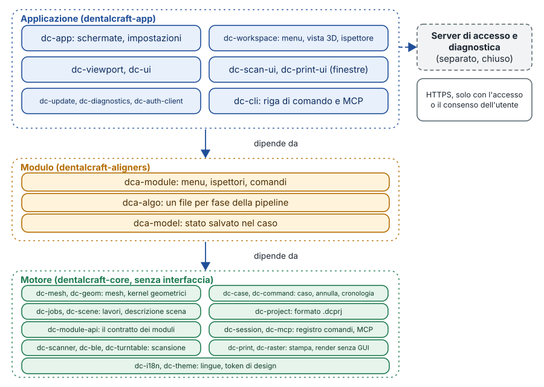
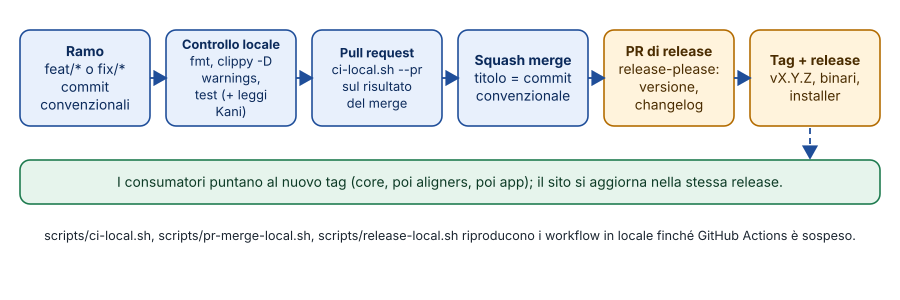
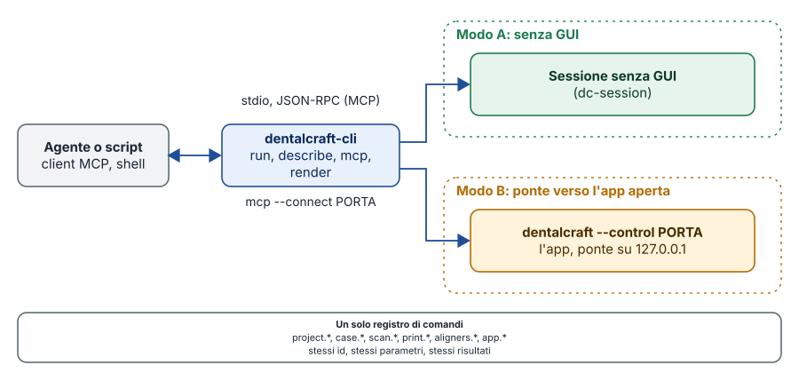
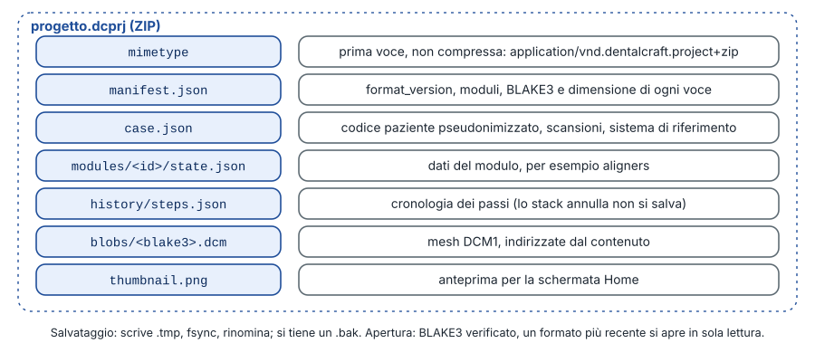

# DentalCraft: Guida per sviluppatori

*Come si combinano i repository, come si compilano, si provano e si rilasciano, come un agente pilota l'applicazione e come contribuire. Edizione del 21 novembre 2026, per DentalCraft 0.2.0-alpha.13 (modulo Allineatori 0.2.0-alpha.12, motore 0.3.0-alpha.8).*

> **Non è un dispositivo medico.** DentalCraft è software per la ricerca e la progettazione. Non è certificato per l'uso clinico, e nulla in questa guida lo cambia.

## 1. Introduzione

DentalCraft è un'applicazione desktop per l'odontoiatria digitale, scritta in Rust. Il suo primo modulo, **Allineatori** (*Aligners*), pianifica trattamenti con allineatori trasparenti a partire da scansioni. Il progetto sostituisce un precedente componente aggiuntivo per Blender con un'applicazione autonoma e un motore senza interfaccia (decisione registrata `0001`, «Riscrittura completa in Rust»); il comportamento del componente aggiuntivo è ancora l'oracolo con cui si provano gli algoritmi.

Il sorgente è pubblico con la **PolyForm Noncommercial License 1.0.0**: puoi leggerlo, compilarlo, studiarlo, modificarlo e condividerlo, e usare l'applicazione, per qualsiasi scopo non commerciale. L'uso commerciale non è consentito, e non è una licenza open source nel senso OSI; per una licenza commerciale scrivi all'autore a `hello@dentalcraft.app`. Il server di autenticazione (un servizio Go separato) è chiuso e non fa parte dei sorgenti pubblicati.

### 1.1 Repository

| Repository | Linguaggio | Ruolo |
|---|---|---|
| `dentalcraft` | nessuno | Superprogetto: fissa gli altri repository come submodule git, contiene il piano, le decisioni registrate, i file di design, gli script di CI e rilascio in locale, le note su Kani e i progetti hardware. Nessun codice, nessuna versione. |
| `dentalcraft-core` | Rust | Il motore senza interfaccia: mesh, geometria, modello del caso, I/O `.dcprj`, comandi, lavori, API dei moduli, sessione, server MCP, scanner, stampa, i18n, tema. |
| `dentalcraft-aligners` | Rust | Il modulo *Aligners* (id `aligners`; «Aligners» in inglese, «Allineatori» in italiano). Dipende solo dal core. |
| `dentalcraft-app` | Rust | L'applicazione distribuita e il suo strumento a riga di comando: shell, schermate, viewport, finestre, aggiornamento, diagnostica, packaging. Dipende da core e aligners. |
| `dentalcraft-web` | Node | Il sito web: download, stato delle funzioni e le «Novità» di ogni release. |
| `dentalcraft-docs` | Markdown | Questi documenti, in inglese e in italiano, come Markdown, DOCX e PDF. |

Tutti i repository sono sotto `https://github.com/dnviti/`.

### 1.2 Principi

- **Il core non ha interfaccia.** Si compila e si prova senza GPU né finestra. I moduli dipendono solo dal core. L'applicazione dipende da entrambi.
- **Tutto è un comando.** Ogni azione dell'utente è un comando registrato con un id, uno schema dei parametri e una documentazione, raggiungibile dalla finestra, dalla CLI e dal server MCP allo stesso modo. Una funzione non è finita finché non è raggiungibile come comando.
- **Stesso comportamento su ogni piattaforma.** Linux è la piattaforma di sviluppo; ogni modifica e funzione funziona in modo identico su Linux, Windows e macOS, altrimenti il lavoro non è finito. Una parte specifica di una piattaforma (V4L2 contro Media Foundation, BlueZ contro WinRT e CoreBluetooth) richiede il suo equivalente altrove.
- **Rust puro.** Per compilare non serve alcuna toolchain C++: TLS è `rustls` con `ring` (non `aws-lc`), `zip` usa deflate (non zstd).
- **La persistenza è completa.** Il salvataggio scrive l'intero caso, compresa la composizione dei denti fatta con il pennello; un salvataggio deve riuscire per ogni tipo di contenuto.

## 2. Mappa di repository e crate



*Figura 1. Core, modulo e applicazione. Le frecce vanno da un livello a ciò da cui dipende.*

### 2.1 dentalcraft-core

| Crate | Cosa contiene |
|---|---|
| `dc-mesh` | Contenitore delle mesh triangolari, interrogazioni topologiche, validazione, I/O STL/OBJ/PLY. |
| `dc-geom` | Kernel geometrici dietro un trait `Backend`: BVH, ICP, decimazione QEM, riempimento dei buchi, campi di distanza con segno, TSDF, solutori sparsi, rifinitura delle mesh. |
| `dc-case` | Il caso: scansioni e loro ruoli, numerazione FDI, pose, sistema di riferimento del mondo, blob indirizzati dal contenuto, stato dei moduli. |
| `dc-command` | Comandi annullabili, stack di annullamento, cronologia dei passi di elaborazione. |
| `dc-jobs` | Lavori in secondo piano con avanzamento e annullamento. |
| `dc-scene` | Descrizione della scena indipendente dalla GPU: mesh, linee, punti, etichette 3D, sovrapposizioni. |
| `dc-project` | Il formato `.dcprj`: manifesto, struttura, apertura e salvataggio, migrazioni. |
| `dc-module-api` | Il contratto dei moduli: `Module`, albero del menu, descrittori e specifiche dei comandi, registro, codec, il flag delle opzioni avanzate. |
| `dc-session` | La sessione del motore senza interfaccia: progetto aperto, annullamento, cronologia dei passi, lavori e il **registro dei comandi** (`execute`, `batch`, `describe`, `inspect`). |
| `dc-mcp` | Un server MCP JSON-RPC scritto a mano su stdio, dietro un trait `Host` (sessione senza interfaccia o app in esecuzione). |
| `dc-scanner`, `dc-ble`, `dc-turntable` | Connettore dello scanner 3D: backend dei dispositivi, tracciamento in tempo reale, fusione TSDF, modifica di nuvole di punti e mesh; collegamenti Bluetooth LE; piatti rotanti. |
| `dc-print` | Stampa in resina: profili delle stampanti, i parametri macchina DENTAL 45, orientamento (lato di calzata dal modello dello stadio o dalla geometria), supporti su una zattera a U, disposizione, affettatrice, scrittore e lettore GOO V3 e i comandi `print.*`. |
| `dc-raster` | Rasterizzatore su CPU per rendering e schermate senza interfaccia. |
| `dc-i18n`, `dc-theme` | Localizzazione Fluent (inglese, italiano, commutabile durante l'esecuzione) e token di design. |

### 2.2 dentalcraft-aligners

| Crate | Cosa contiene |
|---|---|
| `dca-model` | Lo stato del modulo salvato nel caso: punti dente, etichette, sistemi di riferimento dei denti, diagnosi, setup, stadi, record di revisione e di stampa, impostazioni; migrazioni dello schema. |
| `dca-algo` | Un modulo per ogni fase della pipeline: `autoseed`, `frame`, `segmentation`, `reconstruct`, `gingiva`, `diagnosis`, `occlusion` e `bite`, `setup`, `staging`, `schedule`, `review`, `shell`, `trim`, `stamp`, `ramps`, `export`, `visits`. |
| `dca-module` | `AlignersModule`: albero del menu, ispettori, i comandi (`aligners.*`) e la loro i18n. |

### 2.3 dentalcraft-app

| Crate | Cosa contiene |
|---|---|
| `dc-app` | Il binario `dentalcraft`: Home, accesso, assistenza, nuovo progetto, finestra delle impostazioni, ponte (`--control`). |
| `dc-workspace` | L'area di lavoro del modulo: menu, ospite del viewport, ispettore, linea del tempo, barra di stato, importazione, salvataggio e salvataggio automatico. |
| `dc-viewport` | Il viewport 3D con wgpu dentro egui: telecamera orbitale, viste dentali standard, selezione su CPU, contorno, gizmo. |
| `dc-ui` | Il sistema di design: token, caratteri, icone, tema e widget condivisi. |
| `dc-scan-ui`, `dc-print-ui` | La finestra generica di scansione e di stampa, ospitate da qualsiasi schermata o modulo. |
| `dc-auth-client` | Accesso OpenID Connect con PKCE su reindirizzamento locale; token di aggiornamento nel portachiavi del sistema. |
| `dc-update` | Controllo del manifesto di aggiornamento firmato e installazione secondo il tipo di installazione. |
| `dc-diagnostics` | Rapporti anonimi di arresti, errori e sessioni, solo con il consenso. |
| `dc-cli` | Il binario `dentalcraft-cli`: riga di comando e server MCP. |

## 3. Compilare, avviare, provare

### 3.1 Toolchain

Rust 1.99.1, fissato da `rust-toolchain.toml` in ogni repository Rust (con `rustfmt` e `clippy`). Edizione 2024. `egui`, `eframe` ed `egui-wgpu` sono fissati a `=0.37.0` in ogni repository e si devono aggiornare insieme.

```sh
export PATH="$HOME/.cargo/bin:$PATH"
```

Su Linux l'interfaccia grafica carica Wayland, X11, xkbcommon e Vulkan durante l'esecuzione, quindi non servono pacchetti `-devel`. Serve un compilatore C (`gcc`) per alcuni script di compilazione.

### 3.2 Ottenere il codice

```sh
git clone --recurse-submodules https://github.com/dnviti/dentalcraft.git
cd dentalcraft
git submodule update --init --recursive   # se hai clonato senza --recurse-submodules
```

Gli URL dei submodule sono relativi (`../<repo>.git`), quindi usano lo stesso protocollo e le stesse credenziali del superprogetto. Ogni submodule segue `main`.

### 3.3 Avviare

```sh
cd dentalcraft-app
cargo run -p dc-app --release          # l'applicazione
cargo run -p dc-cli -- info            # lo strumento a riga di comando
```

L'accesso è facoltativo: i progetti locali funzionano senza account. Una build di debug cerca il server degli account a `http://127.0.0.1:8787` e una build di release all'indirizzo di produzione; `DC_AUTH_ISSUER=<url>` lo sostituisce. `DC_UPDATE_URL` indirizza il controllo degli aggiornamenti verso un altro sito (la chiave di verifica non cambia mai).

### 3.4 Il controllo per crate

Ogni repository Rust supera gli stessi tre comandi, e una modifica non è pronta finché non li supera:

```sh
cargo fmt --all --check
cargo clippy --workspace --all-targets -- -D warnings
cargo test --workspace
```

Il repository aligners esegue i test in modalità release con asserzioni di debug e controlli di overflow attivi (`cargo test --workspace --release` con `CARGO_PROFILE_RELEASE_DEBUG_ASSERTIONS=true` e `CARGO_PROFILE_RELEASE_OVERFLOW_CHECKS=true`), perché i test di geometria sono lenti in debug.

Dopo ogni modifica compila anche i binari di release, così il risultato si può provare:

```sh
cd dentalcraft-app
cargo build --release --workspace --bins
git checkout -- Cargo.lock        # vedi la sezione 4
# target/release/dentalcraft e target/release/dentalcraft-cli
```

### 3.5 Test che richiedono dati

Alcuni test confrontano il codice Rust con il componente aggiuntivo Blender originale su scansioni reali. Servono dati che non vengono mai committati e che si saltano da soli quando mancano:

- `DC_REAL_SCANS` (le scansioni) con `DC_TEETH_REAL_ORACLE` o `DC_SEGMENTATION_REAL_ORACLE` (output dell'oracolo rigenerato con gli script sotto `tests/fixtures/`);
- `DC_TEETH3DS` per il dataset pubblico Teeth3DS;
- `DC_AUTH_IT=1` per il test di integrazione dell'accesso, che richiede il server degli account (chiuso).

Non committare mai scansioni, coordinate di pazienti o dataset.

### 3.6 Compilazioni di sviluppo più rapide

Il `.cargo/config.toml` del superprogetto abilita `sccache` e il linker `mold` per le compilazioni avviate al suo interno (Fedora: `sudo dnf install mold sccache`). Servono solo per lo sviluppo: la CI locale e gli script di rilascio compilano fuori dal superprogetto con un ambiente pulito, quindi i binari di release non usano mai acceleratori di compilazione né linker alternativi e coincidono con quelli di una macchina pulita.

## 4. Il `[patch]` locale e `Cargo.lock`

`dentalcraft-aligners` e `dentalcraft-app` dipendono dagli altri repository come dipendenze git, fissate per tag:

```toml
dc-case = { git = "https://github.com/dnviti/dentalcraft-core.git", tag = "v0.3.0-alpha.8" }
```

Per lavorare insieme su core e un consumatore senza pubblicare nulla, il `.cargo/config.toml` del superprogetto reindirizza quelle sorgenti git verso gli alberi di lavoro:

```toml
[patch."https://github.com/dnviti/dentalcraft-core.git"]
dc-mesh = { path = "dentalcraft-core/crates/dc-mesh" }
# ...una riga per crate...

[patch."https://github.com/dnviti/dentalcraft-aligners.git"]
dca-model = { path = "dentalcraft-aligners/crates/dca-model" }
# ...

[net]
git-fetch-with-cli = true     # usa la CLI di git: agente SSH e helper delle credenziali
```

Il patch si applica solo alle compilazioni avviate **dentro il superprogetto**. Un submodule clonato da solo, e la CI, risolvono i tag fissati.

Regole che ne derivano:

- Compilare dentro il superprogetto riscrive il `Cargo.lock` del submodule con sorgenti di percorso per `dc-*` e `dca-*`. **Non committarlo mai.** Esegui `git checkout -- Cargo.lock` nel submodule prima del commit.
- Le dipendenze interne per percorso non portano un requisito `version =`: release-please lo riscriverebbe e romperebbe la compilazione.
- I consumatori fissano i tag (`tag = "vX.Y.Z"`). Dopo una release del core, sposta il pin di aligners, poi quelli dell'app, poi aggiorna i puntatori del superprogetto.

## 5. CI e rilascio in locale



*Figura 2. Il percorso da un ramo a una release con tag.*

GitHub Actions è al momento sospeso sui repository, per risparmiare capacità dei runner. I file dei workflow restano al loro posto, intatti, e restano il riferimento. Gli script in `scripts/` del superprogetto li riproducono, passo per passo, così una modifica si comporta in locale esattamente come farebbe su un runner. La procedura completa è `docs/local-ci.md` nel superprogetto; questa sezione ne è il riassunto.

| Script | Sostituisce |
|---|---|
| `scripts/ci-local.sh <repo\|super\|all> [--ref R] [--pr]` | Il workflow di CI di ogni repository. |
| `scripts/pr-merge-local.sh <repo> <pr>` | I controlli della pull request, poi il merge squash. |
| `scripts/release-local.sh <repo>` | release-please e i lavori che concatena (binari, installer, immagini). |
| `scripts/kani-local.sh <core\|aligners\|app>` | Verifica formale (sezione 9); un controllo locale, mai eseguito dalla CI. |
| `scripts/actions-status.sh` | Mostra e ripristina l'interruttore di Actions dei repository. |
| `scripts/third-party-notices.py` | Rigenera gli avvisi sui componenti di terzi prima di una release dell'app. |

### 5.1 Il flusso di ogni giorno

1. Fai il commit su un ramo `feat/*` o `fix/*` nel submodule, poi esegui `scripts/ci-local.sh <repo>`.
2. Pubblica il ramo e apri una pull request.
3. Esegui `scripts/pr-merge-local.sh <repo> <pr>`. Prova il merge della PR in `origin/main` (come GitHub prova `refs/pull/N/merge`), poi fa il merge squash solo se è passato.
4. I titoli dello squash sono **commit convenzionali** (`feat:`, `fix:`, `chore:`…), perché li legge release-please.
5. Esegui `scripts/release-local.sh <repo>` (prima con `--dry-run`). Esegue la vera CLI di release-please, alla versione inclusa nell'azione ufficiale, con la configurazione e il manifesto del repository: prima `github-release`, poi `release-pr`. Fare il merge della PR di release ed eseguirlo di nuovo crea il tag e la release su GitHub ed esegue i lavori concatenati.

### 5.2 Cosa significa una CI pulita

`ci-local.sh` prova un **ref committato** (rifiuta un albero sporco) estratto fuori dal superprogetto, così core e aligners si risolvono ai loro tag fissati. Scarta ogni variabile d'ambiente che cambia la compilazione (`CARGO_*`, `RUST*`, `GO*`…), usa la toolchain fissata ed esegue gli stessi passi del workflow: formato, clippy con `-D warnings`, test. Una compilazione di sviluppo verde dentro il superprogetto **non** è la CI: non fare mai merge, rilascio né dichiarare finito un lavoro senza un `ci-local.sh` verde sul commit esatto.

### 5.3 Versioni e rilascio

- Il versionamento è release-please: tipo di release `simple` per i repository Rust, versionamento `prerelease` con tipo `alpha`, tag `vX.Y.Z[-alpha.N]` senza prefisso di componente, con la versione mantenuta in `Cargo.toml` e `version.txt` dalla configurazione. **Non modificare mai a mano versioni, changelog o manifesti, e non creare mai tag a mano.**
- Prima viene la release del core (tag, poi i consumatori lo fissano); seguono aligners e app; i puntatori del superprogetto si aggiornano per ultimi con `chore(submodule): <repo> a vX.Y.Z`.
- Una release dell'app costruisce i binari (Linux e Windows) e gli installer: AppImage, deb, rpm, Flatpak, un setup per Windows e un MSI, e il manifesto di aggiornamento firmato `update.json`, più un file di checksum. I binari Linux sono costruiti su Ubuntu 24.04, quindi richiedono al massimo glibc 2.39; i file Windows sono firmati con il certificato autofirmato del progetto. Le chiavi di rilascio sono in mano solo al responsabile.
- **Il sito segue ogni release:** download, stato delle funzioni e una voce «Novità» per la versione, poi l'immagine del sito viene ricostruita e messa in produzione. Una release non è finita finché il sito pubblico non mostra la nuova versione.

## 6. L'interfaccia per agenti: CLI e MCP



*Figura 3. La modalità senza interfaccia e la modalità ponte pilotano lo stesso registro dei comandi.*

`dentalcraft-cli` (il binario del crate `dc-cli`) è insieme uno strumento a riga di comando e un server MCP. Ci sono due modalità:

- **Senza interfaccia:** una sessione del motore in-process con il modulo Allineatori. Nessuna finestra.
- **Ponte:** l'applicazione gira con `dentalcraft --control <porta>`, e la CLI usa `mcp --connect <porta>`. I comandi poi girano dentro la finestra e lì si possono annullare.

```sh
dentalcraft-cli app -- --control 7300      # avvia l'app con il ponte, stampa il suo pid
dentalcraft-cli mcp --connect 7300         # serve l'app in esecuzione via MCP
dentalcraft-cli mcp                        # serve una sessione senza interfaccia via MCP
```

### 6.1 I sottocomandi

| Sottocomando | Scopo |
|---|---|
| `info` | Il motore, i suoi moduli e comandi in JSON; con `--in`, il riepilogo di un caso. |
| `commands` | Elenca gli id dei comandi, uno per riga, con le loro etichette. |
| `describe <id>` | Spiega un comando e stampa il suo schema dei parametri (JSON Schema). |
| `run` | Esegue comandi in ordine su un caso, poi lo salva. |
| `render` | Disegna il caso come PNG con il renderer su CPU (`--view occlusal\|occlusal_lower\|frontal\|back\|left\|right\|top\|iso`, `--stage N`, `--model teeth\|scan`). |
| `mcp` | Serve i comandi via MCP su stdio. |
| `app` | Avvia l'applicazione, trovata accanto alla CLI o nel `PATH`. |
| `update`, `licence` | Cerca e installa un aggiornamento; stampa la licenza o gli avvisi sui componenti di terzi. |

### 6.2 `run`

```sh
dentalcraft-cli run --in upper.stl --in lower.stl --role upper --role lower \
  --cmd 'aligners.teeth.find' \
  --cmd 'aligners.preparation.segmentation.automatic={"arch":"all"}' \
  --save case.dcprj --print
```

- `--in FILE` si può ripetere: un `.dcprj` (solo il primo; viene aperto) e/o scansioni STL, OBJ o PLY, importate in una sola chiamata. L'arcata di una scansione si ricava dal nome, altrimenti dalla geometria.
- `--role auto|upper|lower|bite`, una volta per tutte le scansioni o una per scansione nell'ordine di `--in`.
- `--cmd ID[=JSON]` esegue un comando; `--cmd-file FILE` ne legge uno per riga (`ID=JSON` oppure righe JSON `{"id":…,"params":{…}}`; righe vuote e commenti `#` sono ignorati).
- Stampa un solo oggetto JSON: `{"results": [{"id","output"}…], "import", "saved", "case"}`. Le coordinate sono in millimetri. Le modifiche si annullano con `edit.undo`.

### 6.3 Gli strumenti MCP

Il server parla MCP (JSON-RPC 2.0, un messaggio per riga, protocollo 2025-06-18) ed espone questi strumenti:

| Strumento | Scopo |
|---|---|
| `list_commands`, `describe_command` | Scoprire gli id dei comandi e i loro schemi dei parametri. |
| `execute`, `batch` | Eseguire un comando, o più in ordine. |
| `inspect` | Rileggere il caso (`scans`, `modules.aligners`, passi…, con un percorso come `scans.0`). |
| `new_project`, `open`, `save` | Ciclo di vita del progetto. |
| `import_scan` | Importare file STL, OBJ o PLY, con un ruolo. |
| `undo`, `redo`, `steps` | Stack di annullamento e cronologia dei passi di elaborazione. |
| `render` | Un PNG della vista corrente. |

Per usarlo da un client MCP, registra il comando come server stdio, per esempio:

```json
{ "mcpServers": { "dentalcraft": { "command": "dentalcraft-cli", "args": ["mcp"] } } }
```

Un flusso tipico di un agente è `new_project` oppure `open`, poi `import_scan`, poi i comandi del modulo con `execute`, `inspect` per leggere i risultati, `save`.

### 6.4 Il registro dei comandi

Gli id dei comandi sono con i punti e stabili. I gruppi sono:

| Prefisso | Cosa pilota |
|---|---|
| `project.*`, `case.*`, `edit.*`, `steps.*`, `view.set` | Ciclo di vita del progetto, importazione e ruoli delle scansioni, annulla e ripeti, cronologia dei passi, la vista. |
| `scan.*`, `turntable.*` | Il connettore dello scanner e il piatto rotante (compresi `scan.auto` e `turntable.calibrate`). |
| `print.*` | Profili e parametri macchina delle stampanti, e la preparazione dei piatti di stampa (`print.prepare`): sezione 6.6. |
| `aligners.*` | Il modulo Allineatori: la pipeline, le sue impostazioni (`aligners.settings.*`), gli strumenti manuali, revisione, produzione, esportazione, controllo successivo, la foglia Stampa e il tracciamento degli allineatori stampati (`aligners.production.print`, `aligners.print.*`: sezione 6.6). |
| `app.*` | Comandi dell'applicazione: aggiornamento, diagnostica, impostazioni (`app.settings.get`, `app.settings.set {advanced}`: sezione 6.6), disposizione e vista della finestra. Sul ponte solo dove serve una finestra. |

L'appendice A elenca ogni id e etichetta dei comandi di questa edizione; `dentalcraft-cli describe <id>` dà i parametri. Le foglie del menu sono i comandi `aligners.<percorso>`: **Esegui tutto in automatico** è `aligners.auto`, **Trova i denti** è `aligners.teeth.find`, **Esporta per la stampa** è `aligners.output.export-all`.

### 6.5 Regole per i nuovi comandi

- Registra il comando nel modulo (o in `dc-session` per i comandi del motore) con un id stabile, una struct dei parametri che deriva `JsonSchema` e la documentazione nei file Fluent del modulo.
- Un comando che cambia il caso è **un solo passo annullabile**. I rifiuti sono errori con un codice stabile in kebab-case, e non cambiano nulla.
- Il lavoro lungo gira come un lavoro con avanzamento e annullamento, e se annullato lascia il caso com'era.
- Ogni comando che può cambiare il caso va classificato nel test di salvataggio dell'area di lavoro (`dc-workspace/tests/save.rs`), che lo esegue attraverso l'area di lavoro, salva, riapre e confronta il caso.

### 6.6 I comandi di stampa, tracciamento della stampa e impostazioni

**`print.*`** sono comandi di sessione del core (`dc-print`): ci sono nella CLI, in MCP e sul ponte allo stesso modo. Lavorano su file, non sul caso, e non vi cambiano nulla. Nell'applicazione ognuno gira su un thread proprio e risponde quando finisce (`print.prepare` richiede minuti), mentre la finestra continua a disegnare.

| Comando | Parametri | Risultato |
|---|---|---|
| `print.profiles` | nessuno | `{profiles}`: per ogni stampante `id`, `machine_name`, `resolution_x`, `resolution_y`, `pixel_pitch_x_um`, `pixel_pitch_y_um`, `build_mm` (X, Y, Z; Z è l'altezza massima di stampa), `layer_min_um`, `layer_max_um`, `mirror_x`, `mirror_y` e `machine`, un riepilogo dei suoi parametri macchina (`entries` è il loro numero). Incorporato: `saturn-4-ultra-16k` (Elegoo Saturn 4 Ultra 16K, parametri macchina DENTAL 45). |
| `print.machine-params` | `profile?` (predefinito `saturn-4-ultra-16k`) | I parametri macchina come li imposta il file `M5000` del firmware: `name`, `source`, `z_travel_mm` (230), `tilt_angle_deg` (140), `tank_target_c` e `preheat_target_c` (45), `heat_cycle_limit_min` (35), `light_source` (`combined`), `light_pwm` (255), `vat_max_ml` (870), `vat_min_level_mm` (4), `vat_size_mm`, `resin_estimate`, `slow` e `fast` (le modalità di distacco), `estimate_correction_ms`, `first_layers_rest_s`, `saved`, ed `entries`: tutti i 160 valori del file, ciascuno con gruppo, asse, lettera, valore, testo e il commento della sua riga. |
| `print.prepare` | esattamente uno tra `inputs` (file dei gusci, STL, OBJ o PLY) e `dir` (ogni `.stl` di una cartella, in ordine di nome, per esempio `stampa_resina`); `out_dir` (una cartella diversa da `dir`); i valori della resina `layer_um`, `exposure_s`, `bottom_exposure_s`, `bottom_layers`, `rest_s`, `resin_name`, `density_g_ml`, **tutti obbligatori**; `profile?`, `pwm?` (255), `gap_mm?` (3), `margin_mm?` (4) | Orienta ogni pezzo, aggiunge supporti e zattera, li controlla, dispone i pezzi sul minor numero possibile di piatti, affetta ogni piatto e scrive `plate_NN.goo`, `plate_NN.stl` e `summary.json` in `out_dir` (ognuno passando da un file `.tmp`, sincronizzato e rinominato). Restituisce il riepilogo: i totali (piatti, pezzi, volume, peso, tempo stimato), ogni piatto e, per ogni pezzo, il suo piano (piatto, orientamento, contatti, quarti di giro, spostamento, altezza e `fitting_source`: `model` se il lato di calzata è stato letto dal modello dello stadio, `geometry` altrimenti). |

Un valore della resina mancante viene rifiutato prima di leggere qualunque cosa (`print-no-resin-preset`, che elenca i nomi mancanti): nessun valore è mai indovinato. I codici dei comandi di stampa sono stabili e il messaggio comincia con il codice: `invalid-params`, `print-no-resin-preset`, `print-unknown-profile`, `print-no-machine-params`, `print-no-inputs`, `print-read`, `print-write`, `print-model-mismatch`, `print-no-parts`, `print-invalid-part`, `print-invalid-settings`, `print-fitting-contact`, `print-island-unsupported`, `print-part-too-tall`, `print-part-too-big`, `print-invalid-footprint`, `print-invalid-layout`, `print-vat-overflow`, `print-file`, `print-io`, `print-mesh` e `print-cancelled`. Una chiamata da cambiare (parametri, valori della resina, profilo, ingressi, un modello non corrispondente, impostazioni o disposizione non valide) è un comando non valido; gli altri fallimenti sono comandi falliti; un'esecuzione annullata è un comando annullato, e un'esecuzione fallita o annullata non lascia file parziali.

**`aligners.print.*`** sono comandi del modulo Allineatori (`dca-module`):

| Comando | Parametri | Cosa fa |
|---|---|---|
| `aligners.production.print` | `arch?` (`all`, `upper`, `lower`) | La foglia **Stampa**. Elenca gli allineatori da stampare e non cambia nulla. Risultato: `print_parts` (per allineatore: id come `SUP-03` o `INF-12-P`, nome, arcata, numero, flag di passivo, il file del guscio dell'ultima esportazione o `null`, stato), `export_dir` (la cartella dell'ultima **Esporta per la stampa**, o `null`), `printed`, `missing`. Nell'applicazione il suo risultato apre la finestra di stampa. |
| `aligners.print.parts` | `arch?` | Gli stessi allineatori, con stato e record (quando, da chi, lavoro, motivo). Risultato: `parts`, `export_dir`. |
| `aligners.print.status` | `arch?` | `total`, `printed`, `missing` (ogni allineatore non ancora stampato), `by_status`, `printed_ids`, `missing_ids`. |
| `aligners.print.mark` | `ids`, `status` (`queued`, `sent`, `printed`, `failed`, `reprint`), `by?` (`user` in partenza, `printer`, `app`), `job?`, `reason?` | Una sola modifica annullabile, tutto o niente: un allineatore il cui stato non può cambiare così fa rifiutare tutto il segno (le transizioni sono nell'architettura, sezione 7.3). Risultato: `marked`, `summary`. |

Gli stati e la funzione di transizione stanno in `dca-model` (`print_transition`), con due leggi Kani: solo l'utente (o la stampante, da `sent`) segna un allineatore come stampato, e un allineatore stampato esce da `printed` solo verso `reprint` per volontà dell'utente. I record stanno nello stato del modulo (schema versione 2: `prints`, `export_dir`); uno stato di schema 1 si migra con entrambi vuoti.

**`app.settings.get`** e **`app.settings.set`** (sorgente `app`, in `dc_diagnostics::settings`) pilotano la finestra Impostazioni. `app.settings.get` risponde `{advanced, language, theme, check_updates, diagnostics}` (valori predefiniti: `false`, la lingua del sistema, `dark`, `true`, `null` finché l'utente non sceglie). `app.settings.set` accetta `advanced` (vero o falso) e nient'altro: un'altra chiave, o un valore che non è booleano, viene rifiutato. Sul ponte la finestra cambia subito e l'impostazione è salvata in `settings.json`; in `dentalcraft-cli` (senza finestra, anche via MCP) il comando scrive il file delle impostazioni dell'applicazione, ne mantiene le altre chiavi, e l'applicazione lo legge al successivo avvio. I comandi mantengono tutti i loro parametri con l'interruttore attivo o no: **avanzate** nasconde controlli, non toglie mai un parametro a un comando.

## 7. Il formato `.dcprj`



*Figura 4. Il contenitore di progetto.*

Un progetto è un file ZIP. La prima voce, `mimetype`, è memorizzata (non compressa) e contiene `application/vnd.dentalcraft.project+zip`; le altre voci JSON sono compresse con deflate.

| Voce | Contenuto |
|---|---|
| `manifest.json` | `format`, `format_version`, id del progetto, versione dell'app, unità (`mm`), i moduli con le loro versioni e versioni dello schema, e per ogni voce il suo hash BLAKE3 e la dimensione. |
| `case.json` | Un codice paziente **pseudonimizzato** (nessun nome), le scansioni con ruolo, nome sorgente, unità sorgente e riferimento alla mesh, e il sistema di riferimento (piano occlusale XY, linea mediana Y, incisivi verso −Y, arcata inferiore verso +Z). |
| `modules/<id>/state.json` | I dati del modulo, per esempio tutto ciò che è di `aligners`: le pose dei denti sono `Pose { t: [f64; 3], q: [f64; 4] xyzw }` relative alla posa iniziale del dente, in millimetri del mondo. |
| `history/steps.json` | La cronologia dei passi di elaborazione. Lo stack di annullamento non si salva. |
| `blobs/<blake3>.dcm` | Mesh nel formato blob `DCM1`, indirizzate dal BLAKE3 dei loro byte canonici (così mesh uguali si memorizzano una volta sola). |
| `thumbnail.png` | L'anteprima mostrata nella schermata Home. |

`DCM1` è little-endian: un numero magico, una versione, il numero di vertici e di facce e una tabella degli attributi, poi posizioni `f32×3`, indici `u32×3`, normali facoltative ed etichette `u16` facoltative per vertice e per faccia.

Garanzie:

- **BLAKE3 è verificato al caricamento.** Una discordanza apre il progetto in sola lettura con un errore.
- **Il salvataggio è atomico:** si scrive `*.dcprj.tmp`, `fsync`, rinomina; si tiene un `.bak` del file precedente.
- **Le migrazioni** sono concatenate sul valore JSON, per contenitore (`format_version`) e per modulo (`schema_version`). Un file di una versione più recente si apre in sola lettura. Lo stato di un modulo sconosciuto viene conservato opaco e riscritto, e segnalato nell'interfaccia.
- I numeri in virgola mobile fanno il giro esatto (`serde_json` con `float_roundtrip`): un progetto salvato e riaperto conserva ogni decimale.

## 8. Internazionalizzazione e regole dell'interfaccia

### 8.1 Chiavi Fluent

Ogni stringa visibile all'utente è una chiave Fluent, in inglese (la base) e in italiano. Ogni crate con testo ha `i18n.toml` e `i18n/{en,it}/<crate>.ftl`, e dichiara il suo bundle una sola volta:

```rust
dc_i18n::bundle!(pub fn loader);

let label = dc_i18n::fl!(loader(), "aligners-title");   // chiave controllata in compilazione
let text  = dc_i18n::tr("aligners-menu-planning-aligners"); // chiave risolta in esecuzione
```

Tutti i bundle si registrano in un unico registro del processo, così `dc_i18n::set_language` cambia insieme ogni crate. **Un test controlla che ogni chiave esista in entrambe le lingue** (`dc_i18n::parity`): una chiave nuova richiede entrambe le voci o la compilazione fallisce. Non scrivere mai testo nel codice.

Convenzioni delle chiavi di un modulo: `aligners-menu-<percorso>` (etichetta) e `aligners-desc-<percorso>` (descrizione) per una foglia, con i punti del percorso trasformati in trattini; `aligners-cmd-<nome>` e `aligners-cmd-<nome>-doc` per un comando; `aligners-err-…` per un errore. Gli errori viaggiano come **codici** stabili in kebab-case e l'interfaccia li trasforma in frasi localizzate, così agenti e test si basano sui codici.

L'italiano è più lungo dell'inglese di circa il 20-35 %: non fissare mai larghezze ai pulsanti e lascia andare a capo le intestazioni delle sezioni.

### 8.2 Il sistema di design

Costruisci l'interfaccia con i widget e i token di `dc-ui`, non con stili improvvisati. La fonte del design è `docs/design` nel superprogetto (`tokens.json`, `ui-spec.md`, le schermate). Convenzioni: nessuno spigolo o bordo vivo, un'interfaccia semplice e ordinata che mostra cosa deve fare l'utente dopo, vsync attivo con frequenza limitata a 60 FPS.

### 8.3 La regola del menu

- Il menu è raggruppato per **funzione**, mai per «automatico» contro «manuale».
- Fare clic su una voce del menu, premere Invio su di essa o il suo tasto rapido **la seleziona soltanto e mostra il suo ispettore**. Non avvia mai un calcolo, una finestra o uno strumento, che il passo sia fatto o no.
- L'ispettore di una funzione contiene tutto ciò che la riguarda, in quest'ordine: titolo e descrizione, stato, parametri, il pulsante automatico Esegui, poi le correzioni a mano. Un passo già fatto non viene rieseguito con un clic.

### 8.4 Impostazioni e interruttore avanzato

`Settings.advanced` (disattivato in partenza, salvato in `settings.json`) si imposta dalla finestra **Impostazioni** (`dc-app`, sezioni Generale, Area di lavoro, Aggiornamenti, Privacy; ogni modifica è salvata subito), e la shell lo consegna a ogni schermata a ogni fotogramma con `dc_module_api::set_advanced_ui(ctx, on)`. Ispettori, finestra di scansione e finestra di stampa lo leggono con `dc_module_api::advanced_ui(ctx)`. I controlli sono classificati: quelli ESSENTIAL si vedono sempre; gli altri solo con le opzioni avanzate attive (per la finestra di stampa, le **Impostazioni di stampa**: punta del supporto, spessore, zattera, spazi sul piatto). I valori che diventano nascosti restano in vigore: disattivare nasconde, non azzera mai. Nella vista semplice il passo successivo è segnato da una targhetta **Avanti** nel menu (`ws-menu-next`) e da un contrassegno **Prossimo passo** nell'ispettore (`ws-next-step`). I comandi per gli agenti sono `app.settings.get` e `app.settings.set` (sezione 6.6).

## 9. Verifica formale con Kani

[Kani](https://github.com/model-checking/kani) è un model checker limitato per Rust: un'armatura di prova prende ingressi simbolici (`kani::any()`) e Kani verifica ogni valore che possono assumere entro i limiti fissati dall'armatura, più ogni panic, overflow, indice fuori limite e `unwrap` che raggiunge.

- Le leggi sono armature in un modulo `#[cfg(kani)] mod kani_proofs { … }`, nel file del codice sotto prova. Le normali compilazioni, clippy e i test non le compilano mai, e la CI non le esegue mai. I crate che contengono armature dichiarano `unexpected_cfgs = { level = "warn", check-cfg = ['cfg(kani)'] }` sotto `[lints.rust]`.
- Installazione, una volta: `cargo install --locked kani-verifier && cargo kani setup`.
- Esecuzione: `scripts/kani-local.sh <core|aligners|app> [--ref R] [--dev]`; `--dev` verifica l'albero di lavoro mentre scrivi le armature; `-- --harness <nome>` ne esegue una.
- **Quando una regola deve valere sempre, scrivila come legge:** trova la funzione pura che la decide, scrivi l'armatura, correggi il codice se la legge fallisce e aggiungi la legge alla tabella in `docs/kani.md`. **Non indebolire mai una legge per farla passare**; restringi i limiti solo quando Kani non finisce, e scrivi perché.
- Prova la logica pura, non l'I/O. Mappe di closure, `HashMap`, `format!`, ZIP, BLAKE3 e `serde_json` sono fuori portata: prova il piccolo helper puro, oppure usa `proptest`.
- Prima di fare il merge di una modifica a codice coperto da leggi, esegui Kani sul ref committato insieme alla CI locale.

In questa edizione ci sono 38 armature (core 19, aligners 15, app 4): regole della numerazione FDI, impacchettamento delle chiavi dei voxel, chiavi di coda, date e intervalli del calendario, la rotazione per la via breve (nessun giro di 360°), appartenenza di ogni dente a un'arcata, il tracciamento della stampa (stampato solo dall'utente o dalla stampante; un allineatore stampato esce da `printed` solo per una ristampa), limiti della linea del tempo e il limite di 60 FPS. La codifica a lunghezze di corsa del GOO di `dc-print` è invece campionata con proptest: Kani non la porta a termine.

## 10. Strategia di test

- **Test unitari** per crate; **proptest** per topologia, `.dcprj` e codifica a lunghezze di corsa del GOO. Il motore di stampa ha test per ogni fase (orientamento, supporti e controlli obbligatori, disposizione, affettatura, scrittore e lettore dei file, parametri macchina, il lavoro intero) e per i comandi `print.*` attraverso una sessione senza finestra.
- **Test con oracolo di riferimento:** gli algoritmi Rust vengono confrontati con il componente aggiuntivo Blender originale su fixture e su scansioni reali, con tolleranze (Hausdorff dei vertici sotto 0,01 mm, etichette almeno al 99 %, pose entro 0,01 mm e 0,05°, errore relativo della diagnosi sotto 1e-3). Dove il codice Rust si discosta di proposito (per esempio il controllo dei capi dell'arcata di *Trova i denti*), lo scostamento è registrato e provato.
- **Logica dell'interfaccia senza finestra** con `egui_kittest`: ogni schermata in entrambe le lingue, parità delle chiavi, le impostazioni, il test di salvataggio dell'area di lavoro. I test di istantanee wgpu richiedono una GPU e girano solo in locale.
- **Un comportamento che si è già rotto una volta ha un test:** denti adiacenti restano separati, il riconoscimento si ferma agli ultimi molari, i denti non fanno mai giri di 360°, un morso non si compenetra mai in modo visibile, la sessione sopravvive a un riavvio.

## 11. Aggiungere una funzione

1. Leggi il piano e le decisioni nel superprogetto (`docs/plan/`), e decidi quale repository la possiede: comportamento del motore nel core, logica dentale in aligners, schermate nell'app.
2. Scrivi l'algoritmo come funzione pura in `dca-algo` (o `dc-geom`), con test, e un test con oracolo quando esiste un riferimento.
3. Aggiungi lo stato a `dca-model` (un campo con valore predefinito evita un aumento di schema; altrimenti aggiungi una migrazione).
4. Registra il comando in `dca-module` con il suo schema dei parametri e la documentazione; fanne un solo passo annullabile; aggiungi le chiavi Fluent in entrambe le lingue.
5. Aggiungi la foglia al menu (o uno strumento a un ispettore) e la sua voce nell'ispettore; segui la regola del menu.
6. Classifica il comando nel test di salvataggio dell'area di lavoro; verifica che sia raggiungibile dalla CLI e da MCP.
7. Controlla gli equivalenti Windows e macOS di qualsiasi parte specifica di una piattaforma.
8. Esegui il controllo (sezione 3.4), la CI locale sul commit, Kani se tocchi una legge, e compila il binario di release.
9. Aggiorna questa documentazione e lo stato delle funzioni del sito con la release.

## 12. Contribuire

Ogni repository di codice ha il proprio `CONTRIBUTING.md`, con le stesse regole; quello del superprogetto riguarda la documentazione, i file di design, i progetti hardware e gli script. È un piccolo progetto con un solo responsabile: tieni le modifiche focalizzate e parlane prima di fare qualcosa di grande. Leggi prima il `CODE_OF_CONDUCT.md` e la licenza.

### 12.1 Licenza di un contributo e Developer Certificate of Origin

Inviando un contributo accetti che: l'hai scritto tu, o hai il diritto di proporlo; ne conservi il copyright; concedi all'autore una licenza perpetua, mondiale, non esclusiva, gratuita e irrevocabile per usarlo, copiarlo, modificarlo, distribuirlo e concederlo in sublicenza con qualsiasi condizione di licenza, anche commerciale (questo permette all'autore di cambiare la licenza del progetto, per esempio per offrire licenze commerciali); e che è disponibile a tutti anche con la PolyForm Noncommercial License 1.0.0, come il resto del progetto. Il testo esatto è in `CONTRIBUTING.md`; se non puoi accettarlo, non inviare un contributo.

Ogni commit richiede una riga `Signed-off-by` con il tuo vero nome e il tuo indirizzo e-mail. Dice che accetti il **Developer Certificate of Origin 1.1** (<https://developercertificate.org/>), che in breve afferma: il contributo è tuo o puoi proporlo con la licenza del progetto; è pubblico e ne viene conservata una registrazione, compresa la tua firma; lo proponi con la licenza del repository. Git aggiunge la riga per te:

```sh
git commit -s -m "docs: descrivi la modifica"
```

Una pull request con commit non firmati non viene accettata.

### 12.2 Come proporre una modifica

- Apri prima una issue per qualsiasi cosa più grande di una piccola correzione, così la direzione si concorda prima del lavoro.
- Lavora su un ramo `feat/<argomento>`, `fix/<argomento>` o `docs/<argomento>` e apri una pull request verso `main`. Una funzione alla volta; tieni la modifica piccola e completa.
- Usa **commit convenzionali** (`feat:`, `fix:`, `perf:`, `docs:`, `test:`, `refactor:`, `chore:`). La pull request viene unita con squash e il suo titolo diventa il messaggio del commit, quindi il titolo segue lo stesso formato; lo legge release-please.
- Non modificare versioni, changelog, manifesti o tag, e non includere un aggiornamento del puntatore dei submodule: lo fa il responsabile dopo una release.
- Aggiungi a un commit solo i tuoi percorsi; non committare mai il `Cargo.lock` riscritto dal patch locale, scansioni, dataset o credenziali. **Non committare mai dati di pazienti:** niente scansioni reali, niente `.dcprj` di casi reali, niente dataset di terzi. I dati di prova devono essere sintetici.
- Non aggiungere a nessun file segreti, nomi di host, dati di clienti o altri dettagli di infrastrutture private.
- Segui le regole dell'interfaccia e dell'i18n (capitolo 8), tieni verde il controllo (sezione 3.4) e descrivi nella pull request cosa hai eseguito e cosa non hai potuto verificare (per esempio le piattaforme che non hai potuto provare).
- Nessuna nuova dipendenza senza discussione; solo Rust puro.
- Se aggiungi una fonte scientifica, tecnica o normativa, aggiungila a `SOURCES.md` (e al documento Fonti di questa documentazione) con autori, anno, titolo, sede di pubblicazione e DOI o URL.
- DentalCraft non è un dispositivo medico certificato: non presentare mai una modifica come validata clinicamente.
- I contributi scritti con l'aiuto dell'intelligenza artificiale sono benvenuti alle stesse condizioni: chi firma risponde della modifica.

### 12.3 Segnalare problemi

Bug e idee: apri una issue nel repository interessato, dicendo cosa hai fatto, cosa ti aspettavi e cosa è successo. **Non allegare dati di pazienti.** **I problemi di sicurezza si segnalano in privato**, mai in una issue o pull request pubblica: usa la segnalazione privata di vulnerabilità di GitHub per il repository (scheda Security, «Report a vulnerability»), oppure scrivi a `hello@dentalcraft.app` con oggetto `Security: dentalcraft`. Il server degli account, chiuso, si segnala per e-mail. DentalCraft è in alpha, quindi solo l'ultima release riceve correzioni.

## Appendice A. Id dei comandi

I comandi registrati in questa edizione, come li stampa `dentalcraft-cli commands`. `dentalcraft-cli describe <id>` dà i parametri di uno.


| Command id | Label |
|---|---|
| `project.new` | New project |
| `project.open` | Open project |
| `project.save` | Save project |
| `case.import` | Import scan |
| `case.set-role` | Set scan role |
| `edit.undo` | Undo |
| `edit.redo` | Redo |
| `steps.list` | List steps |
| `steps.rewind` | Go back to step |
| `view.set` | Set view |
| `scan.devices` | List scanners |
| `scan.connect` | Connect scanner |
| `scan.disconnect` | Disconnect scanner |
| `scan.start` | Start scanning |
| `scan.pause` | Pause scanning |
| `scan.resume` | Resume scanning |
| `scan.stop` | Stop scanning |
| `scan.reset` | Reset scan |
| `scan.status` | Scan status |
| `scan.settings` | Scan settings |
| `scan.cloud` | Edit point cloud |
| `scan.mesh-build` | Build mesh |
| `scan.reconstruct` | Rebuild fine mesh |
| `scan.mesh` | Repair mesh |
| `scan.undo` | Undo scan edit |
| `scan.redo` | Redo scan edit |
| `scan.export` | Export scan |
| `scan.import` | Import scan into the case |
| `scan.close` | Close the scan session |
| `scan.auto` | Automatic turntable scan |
| `turntable.devices` | List turntables |
| `turntable.connect` | Connect turntable |
| `turntable.disconnect` | Disconnect turntable |
| `turntable.move` | Move turntable |
| `turntable.speed` | Turntable speed |
| `turntable.stop` | Stop turntable |
| `turntable.home` | Turntable to zero |
| `turntable.status` | Turntable status |
| `turntable.calibrate` | Calibrate turntable |
| `turntable.calibration` | Turntable calibration |
| `aligners.case.import-scans` | Import scans |
| `aligners.case.detect-arch` | Arch recognition |
| `aligners.case.set-arch` | Choose the arch |
| `aligners.case.make-base` | Close with a base |
| `aligners.frame` | Patient position |
| `aligners.demo` | Demo arch |
| `aligners.preparation.orientation.automatic` | Automatic orientation |
| `aligners.preparation.numbering.automatic` | Number the teeth |
| `aligners.settings.find-teeth` | Settings of Find the teeth |
| `aligners.preparation.segmentation.automatic` | Separate teeth and gum |
| `aligners.settings.segmentation` | Settings of Separate teeth and gum |
| `aligners.preparation.segmentation.check` | Check the separated teeth |
| `aligners.teeth.frames` | Tooth axes and widths |
| `aligners.preparation.reconstruction.automatic` | Close all the 3D teeth |
| `aligners.preparation.reconstruction.rebuild-tooth` | Rebuild one 3D tooth |
| `aligners.preparation.gingiva` | Gingiva |
| `aligners.diagnosis.space-analysis` | Case analysis |
| `aligners.diagnosis.little-index` | Little irregularity index |
| `aligners.diagnosis.bolton` | Bolton analysis |
| `aligners.diagnosis.complexity` | Complexity score |
| `aligners.diagnosis.edit-values` | Correct the case analysis by hand |
| `aligners.planning.setup.automatic` | Final position |
| `aligners.settings.setup` | Settings of Final position |
| `aligners.planning.setup.reset` | Back to the initial position |
| `aligners.planning.setup.line` | Arch line |
| `aligners.planning.staging.automatic` | Aligner sequence |
| `aligners.settings.staging` | Settings of Aligners |
| `aligners.planning.tooth-speed` | Slow a tooth |
| `aligners.review.classify` | Clinical review |
| `aligners.review.decide` | Decide a review item |
| `aligners.review.set-value` | Choose a review value |
| `aligners.review.bulk` | Decide all review items |
| `aligners.planning.schedule` | Aligner calendar |
| `aligners.occlusion.virtual-bite` | Virtual bite |
| `aligners.occlusion.contact-map` | Contact map |
| `aligners.occlusion.bite-registration.icp` | Bite from the bite scans |
| `aligners.occlusion.bite-registration.three-points` | Three points |
| `aligners.occlusion.bite-correct` | Correct the interpenetration |
| `aligners.components.transform` | Move, turn or scale a 3D component |
| `aligners.occlusion.bite-with-aligners` | Bite with aligners |
| `aligners.occlusion.bite-ramps` | Bite ramps |
| `aligners.settings.production` | Production settings |
| `aligners.production.aligner-end` | Where the aligner ends |
| `aligners.production.shell.automatic` | Aligner shell |
| `aligners.production.base-labels` | Printable model |
| `aligners.production.blockout` | Blockout model |
| `aligners.production.trim-line` | Trim line |
| `aligners.production.stamp` | Identification stamp |
| `aligners.output.export-stl` | Export moved scans and calendar |
| `aligners.output.print-check` | Print check |
| `aligners.output.manifest` | List of exported files |
| `aligners.output.report` | Full export package |
| `aligners.view.aligner` | Aligner in the 3D view |
| `aligners.view.aligner-exact` | Exact aligner of a stage |
| `aligners.output.study-models` | Study models |
| `aligners.settings.study-models` | Study model settings |
| `aligners.followup.visits` | Control visit |
| `aligners.followup.tracking` | Re-plan |
| `aligners.preparation.segmentation.manual-brush` | Tooth brush |
| `aligners.preparation.segmentation.clean-borders` | Clean borders |
| `aligners.preparation.numbering.renumber` | Change a tooth number |
| `aligners.preparation.numbering.mark-missing` | Missing tooth |
| `aligners.preparation.numbering.place-seeds` | Mark a tooth |
| `aligners.preparation.numbering.delete-seed` | Delete a tooth |
| `aligners.preparation.numbering.sequence` | Number the teeth in order |
| `aligners.preparation.numbering.clear-seeds` | Clear the tooth marks |
| `aligners.manual.rebuild-tooth` | Rebuild one tooth by hand |
| `aligners.manual.tooth-region` | Show the region of a tooth |
| `aligners.planning.movements` | Move a tooth |
| `aligners.teeth.find` | Find the teeth |
| `aligners.teeth.build` | 3D teeth |
| `aligners.occlusion.align` | Bite |
| `aligners.planning.aligners` | Aligners |
| `aligners.output.export-all` | Export for printing |
| `aligners.auto` | Run everything automatically |
| `app.update.check` | Check for updates |
| `app.update.apply` | Update DentalCraft |
| `app.diagnostics.status` | Diagnostics status |
| `app.diagnostics.set` | Turn diagnostics on or off |
| `app.diagnostics.preview` | Show what is sent |
| `app.diagnostics.send` | Send diagnostics now |
| `app.settings.get` | Settings |
| `app.settings.set` | Change the settings |
| `print.profiles` | List printer profiles |
| `print.machine-params` | Printer machine parameters |
| `print.prepare` | Prepare print plates |
| `aligners.production.print` | Print |
| `aligners.print.parts` | List the aligners to print |
| `aligners.print.status` | Count the printed aligners |
| `aligners.print.mark` | Mark aligners as printed |
