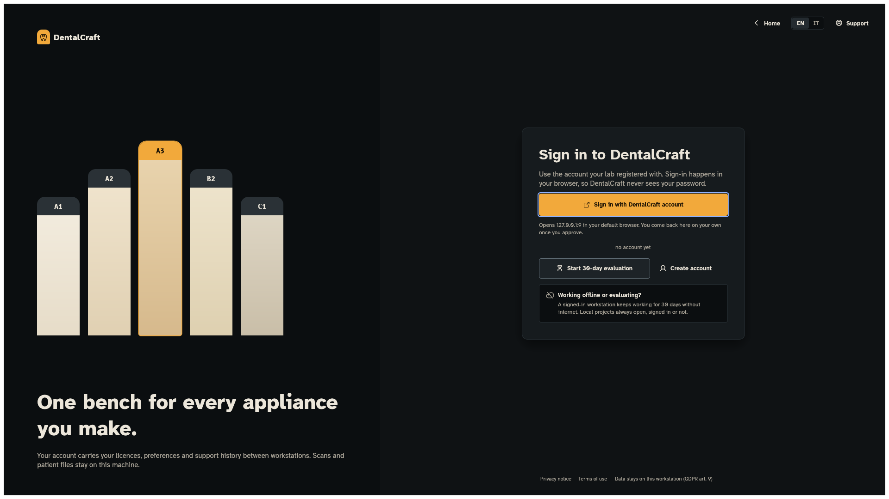
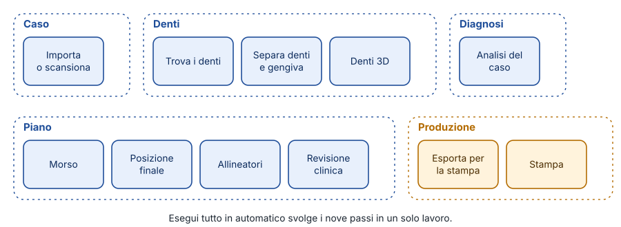
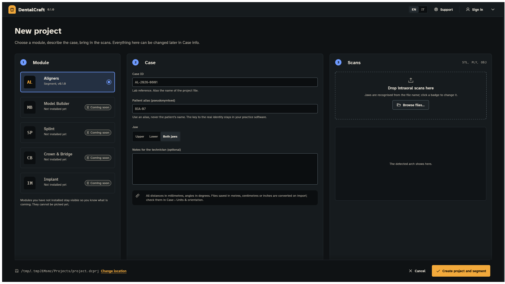
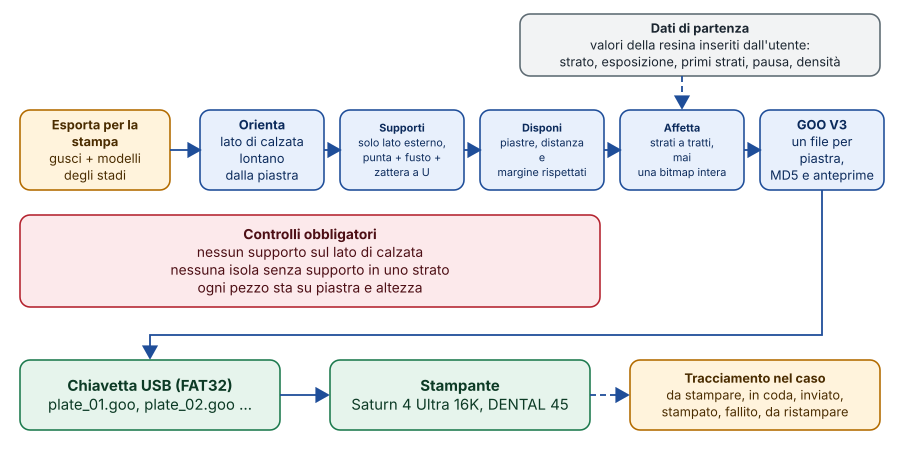
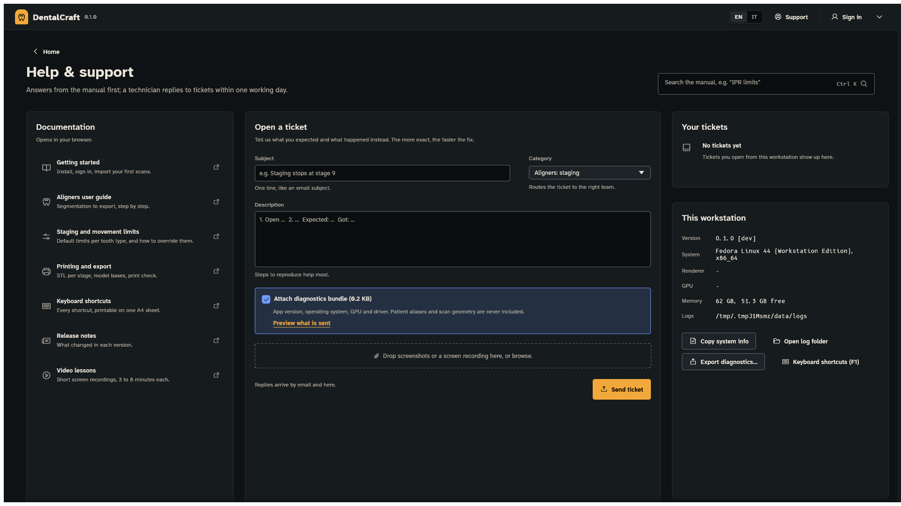

# DentalCraft: Manuale utente

*Pianificare trattamenti con allineatori trasparenti con il modulo Allineatori: dalla scansione all'allineatore stampato. Edizione del 22 novembre 2026, per DentalCraft 0.2.0-alpha.15 (modulo Allineatori 0.2.0-alpha.13, motore 0.3.0-alpha.9), che aggiunge la rimozione delle scansioni, una registrazione del morso che accetta scansioni parziali, la base chiusa della gengiva e una numerazione dei denti più affidabile, oltre alle Impostazioni con l'interruttore «Opzioni e parametri avanzati» e alla stampa diretta sulla Elegoo Saturn 4 Ultra 16K.*

> **Importante: non è un dispositivo medico.** DentalCraft non è un dispositivo medico certificato. Non ha marcatura CE, autorizzazione FDA né validazione clinica. Non usarlo sui pazienti né per decisioni cliniche. Ogni piano che produce deve essere controllato da un clinico qualificato, e ogni allineatore stampato da una persona qualificata, prima di qualsiasi uso. Usalo solo per valutazione, formazione, ricerca e prove di progettazione; la licenza consente solo l'uso non commerciale.

## 1. Informazioni su questo manuale

DentalCraft è un'applicazione desktop per l'odontoiatria digitale, scritta in Rust. Il suo primo modulo, **Allineatori**, pianifica trattamenti ortodontici con allineatori a partire da scansioni intraorali o da scanner da banco: trova e separa i denti, li costruisce come solidi 3D, analizza il caso, registra il morso, calcola le posizioni finali dei denti, suddivide il movimento in stadi di allineatore ed esporta i file necessari per stampare gli allineatori, oppure li stampa direttamente in resina trasparente.

DentalCraft è in versione alpha. Alcune funzioni sono parziali, cambiano da una versione all'altra e le schermate di questo manuale possono differire in qualche dettaglio dalla tua versione. Dove il manuale descrive qualcosa che non è finito, lo dice.

### 1.1 Come leggerlo

- Il capitolo 2 installa il programma. Il capitolo 3 riguarda il primo avvio, l'accesso e le **Impostazioni**.
- Il capitolo 4 spiega come è organizzata la finestra. Il capitolo 5 segue il flusso di lavoro passo per passo, dalla scansione alla stampante.
- I capitoli da 6 a 9 trattano la vista 3D, il salvataggio, la risoluzione dei problemi e la privacy.
- I nomi di menu e pulsanti sono in **grassetto**, come compaiono nell'interfaccia italiana. L'interfaccia inglese ha la stessa struttura; i suoi nomi sono nell'edizione inglese di questo manuale.

### 1.2 Cosa serve

- Un computer a 64 bit con scheda grafica e driver recenti per Vulkan (Linux) o DirectX 12 o Vulkan (Windows). Per un solo caso basta una GPU integrata recente.
- Le scansioni delle arcate in formato STL, OBJ o PLY, oppure uno scanner Revopoint MINI 2 (alpha, vedi la sezione 5.2.4).
- Per la stampa: una Elegoo Saturn 4 Ultra 16K, una resina trasparente biocompatibile per allineatori con le impostazioni del suo produttore per quella stampante e una chiavetta USB FAT32.

## 2. Installazione

DentalCraft è disponibile sia come installer sia come cartella autonoma. Scegline una. Ogni pacchetto contiene l'applicazione (`dentalcraft`) e lo strumento a riga di comando (`dentalcraft-cli`).

### 2.1 Linux

I programmi Linux richiedono glibc 2.39 o successiva: vanno bene Debian 13, Ubuntu 24.04, Fedora 40 e successive. Le librerie grafiche (Wayland o X11, Vulkan) vengono caricate durante l'esecuzione.

| Formato | Come si installa | Come si aggiorna |
|---|---|---|
| Flatpak (qualsiasi distribuzione) | `flatpak install --user --from https://dentalcraft.app/linux/DentalCraft.flatpakref` | `flatpak update` |
| Fedora (dnf) | `sudo dnf config-manager addrepo --from-repofile=https://dentalcraft.app/linux/dentalcraft.repo` poi `sudo dnf install dentalcraft` | `sudo dnf upgrade dentalcraft` |
| Debian e Ubuntu (apt) | aggiungi la chiave e il repository, poi `sudo apt update && sudo apt install dentalcraft` (comandi sotto) | `sudo apt upgrade dentalcraft` |
| AppImage | scarica il file, `chmod +x DentalCraft-<versione>-x86_64.AppImage`, avvialo | l'aggiornamento integrato |
| Autonomo | decomprimi `dentalcraft_<versione>_linux_x86_64.tar.gz` dove vuoi e avvia `dentalcraft` | l'aggiornamento integrato |

Per apt, aggiungi una sola volta la chiave di firma e il repository:

```sh
curl -fsSL https://dentalcraft.app/linux/dentalcraft.gpg | sudo tee /usr/share/keyrings/dentalcraft.gpg > /dev/null
curl -fsSL https://dentalcraft.app/linux/dentalcraft.list | sudo tee /etc/apt/sources.list.d/dentalcraft.list > /dev/null
sudo apt update && sudo apt install dentalcraft
```

I pacchetti dnf e apt installano da soli il repository, così gli aggiornamenti successivi arrivano con il resto del sistema. dnf ti chiede di accettare la chiave di firma: confronta la sua impronta con quella sulla pagina di download. Per un AppImage senza FUSE (per esempio in un container) aggiungi `--appimage-extract-and-run`. L'AppImage esegue anche lo strumento a riga di comando: `DentalCraft-<versione>-x86_64.AppImage --cli <argomenti>`.

Il Flatpak ha accesso alla tua cartella personale (i progetti stanno in `~/DentalCraft`), alla rete (accesso, controllo degli aggiornamenti) e al portachiavi di sistema (la sessione di accesso sopravvive al riavvio).

### 2.2 Windows

Windows 10 o 11, 64 bit.

| Formato | Cosa fa |
|---|---|
| `DentalCraft-<versione>-setup.exe` | Installa per l'utente corrente, senza diritti di amministratore. Collegamento nel menu Start, collegamento facoltativo sul desktop, voce in **App e funzionalità**. |
| `DentalCraft-<versione>-x86_64.msi` | Installa per tutti gli utenti in `C:\Program Files\DentalCraft` (diritti di amministratore). `msiexec /i <file> /passive` mostra solo una barra di avanzamento. |
| `dentalcraft_<versione>_windows_x86_64.zip` | Autonomo: decomprimi dove vuoi, anche su una chiavetta USB, e apri `dentalcraft.exe`. Non si installa nulla. |

I programmi e gli installer per Windows sono firmati con il certificato autofirmato di DentalCraft. Windows non conosce quel certificato, quindi SmartScreen («Windows ha protetto il PC») può comunque avvisare e mostrare un autore sconosciuto: scegli **Ulteriori informazioni** e poi **Esegui comunque** solo per un file scaricato dalla pagina di download ufficiale. Prima di avviarlo, confronta il suo checksum SHA-256 con quello della pagina o del file dei checksum della release.

### 2.3 macOS

Non c'è ancora un download per macOS. Il codice per una versione macOS (un `DentalCraft.app` universale, CoreBluetooth, accesso alla fotocamera) esiste, ma è stato verificato solo compilandolo su Linux: nessuno l'ha eseguito su un Mac. La versione macOS sarà pubblicata dopo i test.

### 2.4 Aggiornamenti

All'avvio l'applicazione controlla sul sito di DentalCraft se c'è una versione più recente (puoi disattivarlo nelle **Impostazioni**, sezione **Aggiornamenti**) e quando scegli **Controlla ora**. La risposta è firmata, e l'applicazione verifica la firma, la dimensione e il checksum di tutto ciò che scarica prima di installare qualsiasi cosa.

- **Cartella autonoma, AppImage, setup.exe e MSI:** la finestra offre **Aggiorna ora**, **Più tardi** e **Salta questa versione**. **Riavvia ora** salva il progetto aperto, installa l'aggiornamento e avvia la nuova versione; **Più tardi** lo installa alla chiusura di DentalCraft.
- **deb, rpm, Flatpak:** la finestra ti dà il comando per il tuo gestore di pacchetti; DentalCraft non scarica nulla.

### 2.5 Lo strumento a riga di comando

`dentalcraft-cli` è installato accanto all'applicazione. Esegue gli stessi comandi senza finestra e li mette a disposizione degli agenti di intelligenza artificiale (capitolo 6 della guida per sviluppatori). `dentalcraft-cli --version` stampa la versione, `dentalcraft-cli licence` la licenza e `dentalcraft-cli licence --third-party` gli avvisi sui componenti di terzi.

## 3. Primo avvio

### 3.1 Consenso alla diagnostica

Al primo avvio DentalCraft chiede se può inviare **dati diagnostici anonimi**. La casella non è spuntata: se non la spunti, non viene raccolto né inviato nulla. Il capitolo 9 dice esattamente cosa viene e cosa non viene inviato. Puoi cambiare idea in qualsiasi momento nelle **Impostazioni**, sezione **Privacy**.

### 3.2 Lingua e tema

L'interruttore **EN / IT** in alto a destra nella schermata Home cambia di colpo la lingua di tutta l'interfaccia; si trova anche nelle **Impostazioni**, sezione **Generale**, dove si sceglie il tema (**Scuro**, **Chiaro** o **Di sistema**).

### 3.3 Accedere

I progetti locali si aprono sempre, con o senza accesso. Accedere carica le tue licenze e le tue preferenze e le mantiene allineate tra le postazioni.



*Figura 1. La schermata di accesso (schermata della versione 0.1.0, con l'interfaccia in inglese; il testo di alcuni elementi secondari è cambiato da allora).*

1. Scegli **Accedi con l'account DentalCraft**. DentalCraft apre il browser predefinito su una pagina del server degli account DentalCraft; l'applicazione non vede mai la tua password.
2. Accedi lì e approva. Il browser ti riporta all'applicazione, che aspetta la risposta su un indirizzo locale del tuo computer (`127.0.0.1`).
3. La finestra passa a **Accesso eseguito**. La sessione è conservata nel portachiavi del sistema operativo e sopravvive ai riavvii dell'applicazione.

Se il browser non si apre, usa **Riapri il browser** o **Copia il link di accesso** nella schermata di attesa. **Annulla** o il tasto Esc interrompono il tentativo. Il pulsante della prova di 30 giorni non è ancora disponibile: per lavorare in locale non serve un account. Una postazione che ha eseguito l'accesso continua a funzionare per 30 giorni senza internet.

### 3.4 Impostazioni e l'interruttore «Opzioni e parametri avanzati»

Apri le **Impostazioni** con il pulsante a forma di ingranaggio nella barra in alto della schermata Home e dell'area di lavoro, oppure dal menu dell'account (**Impostazioni…**). La finestra ha quattro sezioni. Ogni modifica ha effetto subito e viene salvata; Esc, un clic fuori dalla finestra o **Chiudi** la chiudono.

| Sezione | Cosa contiene |
|---|---|
| **Generale** | **Lingua dell'interfaccia** (EN / IT) e **Tema** (**Scuro**, **Chiaro**, **Di sistema**). |
| **Area di lavoro** | L'interruttore **Opzioni e parametri avanzati**. |
| **Aggiornamenti** | **Cerca aggiornamenti all'avvio** (attivo in partenza) e **Controlla ora**. |
| **Privacy** | **Invia dati diagnostici anonimi** (la stessa scelta del primo avvio; disattivata finché non la spunti). |

**Opzioni e parametri avanzati è disattivato in partenza**, e l'applicazione mostra la vista semplice:

- i pannelli laterali mostrano solo i passaggi automatici e le correzioni a mano più utili;
- il menu segna il passo da fare dopo con la targhetta **Avanti**, e il suo ispettore porta il contrassegno **Prossimo passo**, così è sempre evidente cosa fare per arrivare agli allineatori;
- sono nascosti le letture della barra di stato, le impostazioni tecniche di ogni funzione, gli strumenti della nuvola di punti dello scanner e le impostazioni di stampa aggiuntive.

**Attivalo** quando vuoi tutti i parametri e tutti i valori tecnici. I valori che imposti mentre era attivo restano in vigore quando lo disattivi di nuovo: disattivare nasconde i controlli, non azzera nulla. Agenti e script leggono e cambiano lo stesso interruttore con i comandi `app.settings.get` e `app.settings.set` (guida per sviluppatori, sezione 6.6); i comandi mantengono tutti i loro parametri, con l'interruttore attivo o no.

## 4. Come è organizzata la finestra



*Figura 2. I sei gruppi del menu e i passi che contengono.*

L'area di lavoro ha queste parti:

- **Barra in alto:** ritorno alla Home, nome del modulo e del progetto, stato del salvataggio (sezione 7), **Annulla**, **Ripeti**, **Salva**, **Impostazioni**, **Guida** e l'account.
- **Menu a sinistra**, raggruppato per funzione: **Caso**, **Denti**, **Diagnosi**, **Piano**, **Produzione**, **Visite**. Il piè di pagina conta i nove passi del flusso di lavoro fatti finora (`3/9`). Un segno di spunta indica una funzione il cui risultato è nel caso. Al campo del filtro, in alto, si arriva con il tasto `/`.
- **Vista 3D** al centro, con una barra degli strumenti (viste, arcate, visualizzazione, livelli), il cubo di orientamento e, in basso, la linea del tempo degli stadi degli allineatori.
- **Ispettore** a destra: tutto ciò che riguarda la funzione selezionata.
- **Barra di stato:** suggerimenti, il lavoro in corso con la sua barra di avanzamento e una croce per fermarlo.

Il menu e l'ispettore si ridimensionano trascinandone i bordi (il doppio clic ripristina); le loro dimensioni vengono ricordate.

### 4.1 La regola del menu

Fare clic su una voce del menu, o premere Invio o il suo tasto rapido, **la seleziona soltanto e mostra il suo ispettore**. Non avvia mai un calcolo, una finestra di file o uno strumento, che il passo sia fatto o no. Un passo si esegue solo con il pulsante nel suo ispettore, che dice **Esegui**, oppure **Esegui di nuovo** quando il passo è fatto. Un passo già fatto non viene rieseguito con un clic.

L'ispettore di ogni funzione ha la stessa struttura, dall'alto in basso: titolo e descrizione; **stato** (**Fatto** o **Non ancora fatto**, con il risultato dell'ultima esecuzione); **Parametri** (vista avanzata); **Automatico** (il pulsante Esegui); **Correzioni a mano** (gli strumenti di quella funzione, uno per pulsante).

### 4.2 Ogni modifica si può annullare

Ogni comando che esegui, ogni correzione a mano e ogni cambio di parametro è un passo annullabile: **Annulla** e **Ripeti** (`Ctrl+Z`, `Ctrl+Maiusc+Z`) nella barra in alto li ripercorrono.

### 4.3 I nove passi e la scorciatoia

I passi sono: Importa scansioni, Trova i denti, Separa denti e gengiva, Denti 3D, Analisi del caso, Morso, Posizione finale, Allineatori, Revisione clinica. **Esegui tutto in automatico** (gruppo **Caso**) li svolge tutti in un solo lavoro in secondo piano, con un unico risultato annullabile; se un passo fallisce si ferma con un messaggio chiaro e il caso resta com'era.

## 5. Il flusso di lavoro, passo per passo

### 5.1 Nuovo progetto

Dalla **Home** scegli **Nuovo progetto** (oppure **Apri progetto…** per un file `.dcprj` esistente).



*Figura 3. La schermata Nuovo progetto (schermata della versione 0.1.0 con l'interfaccia in inglese: il pulsante ora dice **Crea il progetto**, e creare un progetto non avvia più alcuna elaborazione).*

1. **Modulo:** **Allineatori**. Le altre voci sono moduli futuri e non si possono scegliere.
2. **Caso:**
   - **ID del caso**: il riferimento del tuo laboratorio. Il nome del file di progetto è composto da questo e dall'alias del paziente.
   - **Alias del paziente**: uno pseudonimo. **Non scrivere mai il nome del paziente**; la chiave dell'identità reale resta nel gestionale dello studio.
   - **Arcata**: **Superiore**, **Inferiore** o **Entrambe le arcate**.
   - **Note per il tecnico** (facoltative).
3. **Scansioni:** trascina file STL, PLY o OBJ, scegli **Sfoglia i file…**, oppure scegli **Scansiona** per scansionare con uno scanner 3D collegato (sezione 5.2.4). Puoi anche iniziare senza scansioni e importarle più tardi nell'area di lavoro.
4. Il percorso del file di progetto è in fondo (**Cambia posizione**). **Crea il progetto** crea soltanto il progetto; non viene ancora elaborato nulla.

Per impostazione predefinita i progetti sono conservati in una cartella `DentalCraft/Projects` nella tua cartella personale. Il file è un unico contenitore `.dcprj` (capitolo 7).

### 5.2 Passo 1: Importa scansioni (gruppo Caso)

Il pulsante **Esegui** dell'ispettore apre la finestra dei file (STL, OBJ o PLY).

#### 5.2.1 Ruoli delle scansioni

Ogni scansione ha un ruolo: **Superiore**, **Inferiore** o **Morso**. DentalCraft riconosce l'arcata dal nome del file e, quando il nome non dice nulla, dalla forma della scansione. Un'etichetta su ogni scansione dice come è stato deciso il suo ruolo; un'ipotesi si può confermare e qualsiasi ruolo si cambia facendo clic sull'etichetta. Metri, centimetri e micrometri vengono convertiti in millimetri all'importazione.

#### 5.2.2 Chiuse all'importazione

Una scansione d'arcata aperta sotto la gengiva viene **chiusa con una base piana** (3 mm sotto il suo punto più basso) nello stesso passo annullabile. Il solido chiuso è la scansione che viene mostrata, salvata, usata per il morso e stampata; la scansione com'era stata letta resta conservata al suo interno. Una scansione del morso, una già chiusa e una mesh con meno di 1000 facce restano come sono.

#### 5.2.3 Correzioni a mano

Nell'ispettore, sotto **Correzioni a mano** e **Scansioni nel caso**:

- **Ruolo** di ogni scansione. Spostare una scansione sull'altra arcata rinumera i suoi punti dente (13 diventa 43) e ricostruisce ciò che ne dipendeva.
- **Capovolgi il lato occlusale**, se il lato dei denti è stato riconosciuto al contrario. Premuto di nuovo lo ricapovolge.
- **Chiudi con una base** (e **Esegui di nuovo**) per ogni scansione d'arcata; il cursore **Altezza della base** regola la base da 0,5 a 20 mm.
- **Rimuovi la scansione** (il pulsante cestino sulla riga, o il tasto Canc): vedi la sezione 5.2.5. Una finestra chiede conferma; tutto ciò che è stato calcolato dalla scansione sparisce e `Ctrl+Z` lo ripristina.

#### 5.2.4 Scansionare con uno scanner 3D (alpha)

Il pulsante di scansione accanto a **Importa scansioni** apre la **finestra di scansione**, che funziona allo stesso modo dalla schermata Nuovo progetto e dall'area di lavoro. Pilota uno scanner **Revopoint MINI 2** e il **piatto rotante a doppio asse Revopoint** (via Bluetooth LE). Il connettore dello scanner è in alpha ed è stato provato su Linux e in Windows; non è mai stato eseguito su macOS.

Nella vista semplice la finestra ha tre passi: **1 Acquisizione**, **2 Superficie**, **3 Importa**. La vista avanzata aggiunge gli strumenti della nuvola di punti, gli strumenti di superficie, le letture e le impostazioni di acquisizione.

1. **Acquisizione.** Collega lo scanner e il piatto rotante. Fissa l'oggetto al piatto con un po' di mastice: un modello che si limita ad appoggiare sul piatto può scivolare quando il piatto si inclina. Calibra il piatto rotante una volta per una data posizione di scanner e piatto (circa due minuti), poi avvia la **scansione automatica**: il piatto ruota a passi, si ferma, e lo scanner acquisisce più fotogrammi a ogni sosta. L'impostazione predefinita copre cinque inclinazioni (−20°, −10°, 0°, +10°, +20°) con passi di 7,5° e dura circa nove minuti. La scansione è fatta alla migliore qualità; un risultato di bassa qualità non viene accettato.
2. **Superficie.** La mesh viene costruita e pulita, i buchi si chiudono (tranne la base), la superficie viene levigata entro 0,01 mm e ottimizzata.
3. **Importa.** Scegli il ruolo della scansione (superiore, inferiore o morso) e consegnala al progetto.

Una luce costante e diffusa dà le scansioni più pulite: il repository comprende il progetto di una custodia per lo scanner con illuminazione LED controllata. La luce di riempimento dello scanner si accende durante l'acquisizione e si spegne dopo.

#### 5.2.5 Rimuovere una scansione o un modello importato

Ogni scansione del caso, qualunque sia il suo ruolo (**Superiore**, **Inferiore** o **Morso**), si può rimuovere: un file importato per errore, il modello di un altro paziente, una presa del morso venuta male.

**Quattro modi per avviare la rimozione** (fanno tutti la stessa cosa):

- Il **pulsante cestino** sulla riga della scansione in **Scansioni nel caso** (inspector di **Importa scansioni**).
- Il **pulsante cestino** su ogni riga delle scansioni del morso nell'inspector di **Morso**.
- Il pulsante **Rimuovi la scansione** in **Componente selezionato**, il primo blocco del pannello destro, quando la scansione è il componente selezionato.
- Il tasto `Canc` o `Backspace` con la scansione selezionata. Il tasto non fa nulla mentre uno strumento è aperto o mentre scrivi in un campo di testo, quindi Backspace in un campo non rimuove mai una scansione.

**Conferma.** Una finestra **Rimuovere la scansione?** nomina la scansione e dice che esce dal caso insieme a tutto ciò che è stato calcolato da essa, e che `Ctrl+Z` la riporta. **Rimuovi** conferma; qualunque altra scelta annulla, e fino alla conferma non è cambiato nulla.

**Risultato.** La rimozione è un solo passo annullabile. Un avviso dice **Scansione rimossa**; se dei risultati sono stati cancellati, un secondo avviso, **Risultati cancellati**, li elenca. `Ctrl+Z` riporta insieme la scansione e tutto ciò che ha cancellato; `Ctrl+Maiusc+Z` la rimuove di nuovo.

**Che cosa viene cancellato:**

- **La scansione di un'arcata (superiore o inferiore)** porta via tutto ciò che deriva da quell'arcata: i suoi punti dente e i denti segnati come mancanti, i colori dei denti (denti e gengiva), gli assi e le misure dei denti, i denti 3D, la gengiva, l'analisi del caso (compresi i rapporti di Bolton e il punteggio di complessità, che richiedono entrambe le arcate), la posizione finale, gli allineatori, la revisione clinica, le rampe del morso, le visite di controllo e il modello da studio di quell'arcata. Viene cancellata anche la registrazione del morso, da rifare. Le tue impostazioni restano. L'altra arcata non viene toccata: resta dove la registrazione del morso l'aveva spostata, quindi esegui di nuovo **Morso**. Il sistema di riferimento del caso viene azzerato, come quando una scansione viene sostituita.
- **La scansione di un morso** cancella solo la registrazione del morso, e solo se quella scansione vi ha partecipato. Un morso virtuale e una registrazione fatta sull'altra scansione del morso restano. Le arcate restano dove la registrazione le aveva spostate: esegui di nuovo **Morso**.

**Quando viene rifiutata.** La scansione di un'arcata non si può rimuovere finché il caso contiene dati di un modulo che questa versione non sa leggere (un file scritto da una versione più recente): l'avviso ne dice il motivo. La scansione di un morso si può rimuovere comunque.

### 5.3 Passo 2: Trova i denti (gruppo Denti)

**Esegui** numera automaticamente i denti di ogni arcata (numeri FDI) e poi orienta l'arcata; il risultato è un **punto dente** per ogni dente, in un solo passo annullabile.

**Parametri:**

- **Cerca anche i terzi molari** (disattivato in partenza).
- **Denti assenti**: numeri FDI separati da virgole (per esempio `35, 45`). Un numero sbagliato mostra un messaggio rosso; l'elenco si salva quando esci dal campo.
- **Denti trovati**: una griglia per arcata, prima il lato destro del paziente. Una casella piena significa che il dente ha un punto, una casella barrata che è assente, una casella vuota che non ha un punto.

DentalCraft controlla la propria proposta. Se la numerazione desse un terzo molare dove la scansione ha solo gengiva dietro gli ultimi molari, estendesse un dente sulla gengiva in fondo all'arcata, o fondesse due denti affollati in uno, i denti vengono cercati di nuovo con l'arcata libera di finire all'ultima corona, invece di spostare ogni numero successivo all'errore. Un dente fantasma dietro l'ultimo molare quindi non viene numerato, e i denti vicini restano denti separati. Un terzo molare erotto mantiene il suo numero. Il riconoscimento si ferma agli ultimi molari; non inventa mai denti oltre. Come sempre, controlla i numeri prima di proseguire.

**Correzioni a mano:** **Segna un dente** (clic per posizionare o spostare, Maiusc+clic per eliminare il punto più vicino), **Elimina un dente**, **Cambia il numero di un dente**, **Dente assente**, **Numera i denti in ordine** (fai clic su ogni dente a turno: `S` salta, Backspace torna indietro, Invio o Esc termina) e **Elimina tutti i punti dente**.

Quando i punti cambiano, i passi che ne dipendevano vengono segnati come non aggiornati o azzerati, e un avviso li elenca. `Ctrl+Z` riporta tutto com'era.

### 5.4 Passo 3: Separa denti e gengiva (gruppo Denti)

**Esegui** colora ogni dente della scansione con il suo colore; la gengiva resta senza colore. Parte dai punti dente, richiede almeno quattro punti che coprano entrambi i lati e i denti anteriori, e lavora un'arcata alla volta. La barra di stato mostra i suoi sotto-passi (scansione semplificata, prima separazione, colori sulla scansione completa, bordi alla piena risoluzione, pulizia).

**Parametri:** **Dettaglio della scansione (facce)** da 5000 a 200000 (predefinito 30000), **Sensibilità dei bordi dei denti** da 0,01 a 1 (predefinito 0,2), **Levigatura dei bordi** da 0,1 a 10 (predefinito 1,0).

I denti vicini restano denti separati: non vengono mai fusi in uno solo. Eseguire di nuovo cancella i colori dipinti a mano. **Correzioni a mano:** **Pennello dei denti** (tasto `B`: clic o trascinamento sulla scansione per dipingere il dente scelto; Maiusc dipinge la gengiva, Ctrl riempie la corona) e **Pulisci i bordi**. La vista passa alla scansione, così i nuovi colori sono visibili.

### 5.5 Passo 4: Denti 3D (gruppo Denti)

**Esegui** dà ogni dente come **solido 3D chiuso** con il suo asse e costruisce una gengiva che segue i denti. Ogni dente viene chiuso e squadrato, quindi nessuna mesh resta aperta, e anche la gengiva è chiusa: una base piana, 3 mm sotto il suo punto più basso lungo l'asse occlusale, ne fa un solido chiuso come la base di una scansione d'arcata importata. La base resta ferma mentre i denti si muovono; gli allineatori e l'esportazione sono costruiti senza di essa. Richiede che i denti siano separati. La posizione finale e gli allineatori dell'arcata, se ci sono, vengono azzerati perché erano pianificati sui vecchi denti.

Dopo le correzioni con il pennello, **Esegui di nuovo** ricostruisce solo i denti dell'arcata che sono cambiati; gli altri tengono i loro solidi. **Ricostruisci un dente** ricostruisce un singolo dente, e **Mostra la zona** evidenzia la zona da cui un dente è stato costruito.

### 5.6 Passo 5: Analisi del caso (gruppo Diagnosi)

**Esegui** calcola, per arcata: lo spazio disponibile e necessario (**Affollamento**, **Spaziatura** o **Spazio sufficiente**), l'**indice di irregolarità di Little** con la sua categoria, lo scostamento della linea mediana e lo spazio più grande; poi i **rapporti di Bolton** e un **punteggio di complessità** del caso.

Le **Correzioni a mano** (**Correggi a mano l'analisi del caso**) permettono al clinico di impostare i quattro valori che può misurare da sé: affollamento o spaziatura, indice di Little, scostamento della linea mediana, spazio più grande. Una scheda che porta un valore a mano mostra il contrassegno **Include valori impostati a mano**, e la relazione di esportazione li segnala.

### 5.7 Passo 6: Morso (gruppo Piano)

Il morso stabilisce come l'arcata superiore si affaccia all'inferiore. È solo funzionale: imposta l'occlusione, e la **scansione del morso non viene mai mostrata come oggetto 3D** nella vista (compare solo mentre scegli i suoi tre punti, e non si può selezionare facendo clic nella vista).

- Con **scansioni del morso** nel caso (una per lato per uno scanner intraorale, oppure una scansione attorno all'arcata per modelli in occlusione), **Esegui** registra le arcate su di esse. Anche una scansione del morso parziale o di bassa qualità viene usata, purché i suoi denti combacino con le arcate: una scansione dei soli denti anteriori, di un solo lato, o con buchi, rumore o tessuti molli. Non viene rifiutata perché incompleta: si registra, e la relazione dice che cosa verificare (**da verificare**, sotto). Un morso è accettato quando la parte anteriore è acquisita correttamente: la parte posteriore della bocca non deve essere completa.
- Senza scansione del morso, **Esegui** usa un **morso virtuale**, e lo dice in un avviso: per la relazione clinica, registra il morso vestibolare.
- **Importa le scansioni del morso…** importa i file con il ruolo morso.
- **Tre punti** (a mano): scegli tre punti ben distanziati sull'arcata inferiore, poi gli stessi tre, nello stesso ordine, sulla scansione del morso e, se vuoi, gli stessi per l'arcata superiore.
- **Correggi la compenetrazione** sposta l'arcata superiore lungo l'asse occlusale fino al primo contatto. La relazione mostra la compenetrazione trovata, quella rimasta e l'apertura.

La relazione di registrazione mostra **Morso registrato** quando non c'è nulla da verificare, oppure **Morso registrato, da verificare** con una riga per ogni motivo. I motivi dipendono da quanto è buona la scansione e da quanta parte della bocca copre, mai da un rifiuto:

- **Scarto RMS oltre il buono:** la scansione si discosta più di 0,10 mm da un'arcata (scarto RMS sull'arcata inferiore o superiore).
- **Pochi denti:** nella scansione del morso ci sono meno di quattro denti di un'arcata.
- **Bassa coerenza:** meno del 70 % della superficie della scansione affacciata a un'arcata sta entro 0,10 mm da essa (scansione rumorosa o deformata).
- **Solo denti anteriori** o **un solo lato:** la scansione non arriva ai denti posteriori, o all'altro lato; lì la relazione è estrapolata. Aggiungi la scansione dell'altro lato, o verifica i contatti sul paziente.
- **Le due scansioni del morso non concordano:** con due scansioni, i denti superiori distano più di 0,10 mm (il paziente ha chiuso in modo diverso?).
- **Compenetrazione:** le arcate si compenetrano per più di 0,10 mm; **Correggi la compenetrazione** la elimina.
- **Le arcate non si toccano:** i punti più vicini distano più di 0,10 mm (il paziente era in massima intercuspidazione?).
- **Scansione ignorata:** con due scansioni del morso (i due lati, o due prese degli stessi denti), quella che non combacia con le arcate mentre l'altra sì viene lasciata fuori e nominata nella relazione. La registrazione si basa sull'altra scansione, e quella ignorata resta dov'era. Due prese salvate con lo stesso nome di file si distinguono con un numero, per esempio `(2)`.

Un morso «da verificare» è registrato e usato: la riga dice che cosa controllare. Un morso viene **rifiutato**, e nulla si sposta, solo quando l'accoppiamento non è affatto affidabile: nessuna scansione del morso combacia con le arcate (altro paziente, scansione speculare, o scansione senza i denti di entrambe le arcate; con due scansioni il messaggio dà il motivo di quella che si è avvicinata di più), le arcate registrate non si affacciano, oppure dopo l'accoppiamento si compenetrano per più di 1,0 mm. Lo stesso messaggio compare anche con più di due scansioni del morso, con un'arcata senza denti separati o con una scansione troppo piccola. Dopo un rifiuto, prova un'altra presa o **Tre punti**, oppure rimuovi la scansione sbagliata (sezione 5.2.5). La stima di un morso virtuale non subentra mai in silenzio dopo un rifiuto. Dopo questo passo le due arcate non si compenetrano mai in modo visibile nella vista 3D.

### 5.8 Passo 7: Posizione finale (gruppo Piano)

**Esegui** calcola la posa finale di ogni dente con i parametri del piano, l'IPR (riduzione interprossimale) necessaria e la linea d'arcata. Con entrambe le arcate e nessun morso registrato mostra **Prima il morso** e rifiuta: esegui **Morso**, poi questo passo. Le righe del risultato nell'ispettore danno, per arcata, l'espansione, il movimento degli incisivi, l'IPR in millimetri e contatti, i denti tenuti fermi e, come avviso, **Affollamento non risolto** quando serve.

**Parametri** (vista avanzata): quali **Denti** si muovono (incisivi e canini, fino ai premolari, oppure tutti) e gruppi richiudibili per **Linea d'arcata e tolleranze**, **Denti fermi e linea mediana**, **Spazio** (ordine, espansione, avanzamento, retrazione, chiudere gli spazi), **IPR** e **Movimenti verticali**. Dopo aver cambiato i parametri, esegui di nuovo il passo. **I valori da confermare vanno verificati da un ortodontista.**

**Correzioni a mano:** **Sposta un dente** (le componenti cliniche mesiale/distale, vestibolare/linguale, estrusione/intrusione, torque, inclinazione e rotazione, con passi − e +; blocca il dente; valori esatti), **Linea d'arcata** (trascina gli 11 punti della curva e **Applica la linea**, che può ricalcolare la posizione finale su di essa) e **Torna alla posizione iniziale**.

Il livello **Posizione finale** della vista 3D mostra i denti nella loro posizione finale come un'ombra traslucida.

### 5.9 Passo 8: Allineatori (gruppo Piano)

**Esegui** suddivide il movimento in stadi: un allineatore per stadio, con un calendario. Il risultato mostra il numero di allineatori, i giorni (per esempio da una data di inizio, portati 22 ore al giorno), lo schema usato e le collisioni rimaste.

**Parametri** (vista avanzata): **Parodonto** (sano, stadio I, II, III), **Schema** (automatico, simultaneo, sequenziale, strutturato), il calendario (**Cambio allineatore**: intervallo fisso o adattivo 7/14 giorni, **Giorni per allineatore** da 5 a 21, **Inizio trattamento**) e il gruppo **Movimento massimo per allineatore**.

**Correzioni a mano:** **Rallenta un dente** (seleziona il dente nella vista, scegli una velocità tra 0,2 e 1, **Rallenta il dente**; gli allineatori dell'arcata vengono ricalcolati nello stesso passo annullabile).

**L'allineatore nella vista 3D.** Gli allineatori **non** sono mostrati in partenza. La sezione dell'ispettore **L'allineatore nella vista** ha **Mostra l'allineatore** / **Nascondi l'allineatore** e **Allineatore esatto di questo stadio** (il solido che l'esportazione scrive, per lo stadio mostrato). Vengono costruiti solo quando lo chiedi.

La **linea del tempo** in basso nella vista 3D è un normale cursore sugli stadi da 0 a N. Trascinalo, oppure usa `,` e `.` per lo stadio precedente e successivo (Maiusc per cinque), Spazio per riprodurre, Home e Fine per il primo e l'ultimo. Il numero dello stadio è scritto sopra la maniglia.

### 5.10 Passo 9: Revisione clinica (gruppo Piano)

**Esegui** crea un record per ogni classificazione che il programma propone in base alle evidenze: difficoltà del caso, schema degli allineatori, se il caso è trattabile solo con allineatori, rischio di movimento e attacco per ogni dente, misure della corona e tipo di dente. Il clinico li conferma o li cambia prima della produzione.

Filtra l'elenco (**Tutti**, **Da rivedere**, **Con avviso**, **Dente selezionato**). Per ogni voce puoi usare **Conferma** per accettare la proposta, scegliere un altro valore tra le sue opzioni, oppure **Torna alla proposta**. Il gruppo **Tutte insieme** ha **Conferma quelle senza avvisi**: le voci che portano un avviso da verificare non vengono mai confermate in blocco. Gli attacchi e lo schema degli allineatori in vigore alimentano il calendario, l'esportazione e la relazione.

### 5.11 Esporta per la stampa (gruppo Produzione)

Questa funzione non è uno dei nove passi. Il suo ispettore chiede prima dove finisce l'allineatore e poi la qualità dei file di stampa.

- **Fin dove arriva l'allineatore:** per ogni arcata e lato, l'ultimo dente coperto dall'allineatore. I denti dietro non sono coperti e non si muovono. Se manca un dente e il guscio dietro lo spazio sarebbe debole, l'ispettore consiglia un'altra fine.
- **Qualità dei file di stampa:** **Bozza** (dettaglio 0,25 mm), **Leggera** (0,15 mm), **Standard** (0,1 mm, file di produzione, il valore predefinito), **Alta** (0,08 mm).
- Gruppi avanzati: **Bordo dell'allineatore** (equatore, dritto, a festoni, liscio; altezza e prolungamento del bordo; direzione di inserzione), **Guscio** (spessore, gioco interno), **Scritta di riconoscimento** (arcata, numero e data incisi all'interno), **Morso con gli allineatori indossati**, rampe e qualità.

**Esporta** apre una finestra di cartella e lavora in secondo piano (può richiedere molto tempo; fermalo con la croce nella barra di stato). I file vengono costruiti in una cartella nascosta e spostati a posto quando sono tutti pronti; l'elenco dei file viene per ultimo, quindi un'esportazione interrotta non lascia cartelle scritte a metà. Scrive i gusci degli allineatori e i modelli (STL), il calendario, un **controllo di stampa** per ogni file (superficie chiusa, un solo pezzo, nessuna autointersezione, nessun foro attraverso la parete, volume positivo, entra nel piatto) e una relazione. I file stanno nelle cartelle `modelli_termoformatura` e `stampa_resina`, insieme a `print_check.json`, `stages.csv`, `visits.ics`, `report.html` e `manifest.json`. Un guscio che non supera il controllo di stampa ferma l'esportazione di tutti gli allineatori con un messaggio: non stampare un file così.

**Modelli da studio** (stesso gruppo) esporta modelli delle arcate con base piana.

### 5.12 Stampa (gruppo Produzione)

Stampa porta gli allineatori esportati alla **Elegoo Saturn 4 Ultra 16K**: orienta ogni guscio, aggiunge i supporti, dispone i gusci sul piatto della stampante, li affetta e scrive un file di stampa per ogni piatto. Gli allineatori sono stampati direttamente in resina trasparente biocompatibile. Lavaggio e polimerizzazione si fanno a mano in laboratorio e restano fuori dal programma.

> **Non ancora provato con stampe reali.** I file di stampa sono stati verificati rispetto al formato pubblicato da Elegoo e a una stampante simulata. Stampare allineatori veri e misurarne spessore delle pareti e calzata è una fase successiva; fino ad allora considera il risultato una prova.



*Figura 4. Esportazione, orientamento, supporti, disposizione, affettatura, file GOO, chiavetta USB, stampante e il tracciamento conservato nel caso.*

#### 5.12.1 Prima di cominciare

1. Crea gli allineatori (passo 8) ed esegui **Esporta per la stampa**. Il progetto ricorda la cartella di quell'esportazione: la finestra di stampa legge i gusci degli allineatori dalla sua cartella `stampa_resina`. Senza esportazione dice **Non ancora esportato: esegui prima "Esporta per la stampa".**
2. Prepara la stampante con i parametri macchina DENTAL 45 (sezione 5.12.2).
3. Tieni a portata di mano le impostazioni del produttore della resina per la Saturn 4 Ultra 16K (sezione 5.12.3).
4. Procurati una chiavetta USB **FAT32** (funziona meglio da 16 GB o meno; la stampante legge nomi di file ASCII).

#### 5.12.2 La stampante: i parametri macchina DENTAL 45

DentalCraft include il profilo della Saturn 4 Ultra 16K con l'insieme di parametri macchina **DENTAL 45**, preparato con gli ingegneri di Elegoo. L'insieme è un file G-code `M5000` di parametri del firmware (asse Z, inclinazione della vasca, riscaldatore, sorgente luminosa, vasca); DentalCraft lo legge per calcolare riscaldamento, distacco e tempi. La stampante deve usare lo stesso insieme. I valori su cui il programma si basa:

| Parametro | DENTAL 45 |
|---|---|
| Corsa dell'asse Z | 230 mm (il limite di altezza di stampa resta 220 mm) |
| Angolo totale di distacco | 140° |
| Temperatura obiettivo della resina (vasca) | 45 °C, preriscaldo a 45 °C |
| Limite di tempo di un ciclo di riscaldamento | 35 min |
| Sorgente luminosa (I3 C) | 2: si combinano le impostazioni di esposizione del file di stampa e quelle della macchina |
| Potenza della sorgente luminosa (PWM) | 255 (massima) |
| Volume massimo della vasca | 870 ml |
| Livello minimo di resina accettato dal rilevamento | 4 mm |
| Larghezza × lunghezza della vasca usate per trasformare il livello in volume | 143 × 244 mm |
| Velocità di inclinazione, primi 50 strati e dopo (insieme lento) | 36 °/s, poi 72 °/s |
| Velocità di inclinazione, primi 50 strati e dopo (insieme veloce) | 36 °/s, poi 144 °/s |
| Tempo del movimento di inclinazione per strato, modalità lenta | 8420 ms per i primi 50 strati, poi 4410 ms |
| Tempo del movimento di inclinazione per strato, modalità veloce | 8420 ms per i primi 50 strati, poi 2430 ms |

La modalità di distacco (lenta o veloce) si sceglie sul touchscreen della stampante. La stima del tempo nella finestra di stampa assume la modalità lenta, quindi il tempo reale può essere più breve in modalità veloce. La stampante inoltre scalda la vasca a 45 °C prima del primo strato, e la stima comprende questa attesa. La stampante dichiara una dimensione del piano leggermente diversa da quella delle specifiche del produttore; DentalCraft usa le specifiche (15120 × 6230 pixel da 14 × 19 µm, 211,68 × 118,37 mm) e confronta con esse ciò che la stampante dichiara.

#### 5.12.3 I valori della resina da inserire

DentalCraft **non include alcun preset per resine da allineatori**: solo il produttore della resina conosce l'esposizione per il suo materiale su questa stampante. Inserisci i valori una volta sola (si conservano in `print-resin.json` nella cartella delle impostazioni dell'applicazione: `~/.config/dentalcraft` su Linux, `%APPDATA%\DentalCraft\dentalcraft\config` su Windows, `~/Library/Application Support/app.DentalCraft.dentalcraft` su macOS) e restano per le stampe successive. Senza di essi **Prepara la stampa** è disattivato con il suggerimento **Inserisci prima i valori della tua resina**.

| Campo | Cosa inserire |
|---|---|
| **Nome della resina** | Da 1 a 31 lettere semplici, cifre o spazi (senza accenti). Viene scritto nei file di stampa. |
| **Altezza dello strato (mm)** | Tra 0,01 e 0,2 mm. |
| **Esposizione di ogni strato (s)** | Il valore del produttore per gli strati normali. |
| **Esposizione dei primi strati (s)** | Il valore del produttore per gli strati di base, che restano accesi più a lungo perché la stampa resti attaccata al piatto. |
| **Numero dei primi strati** | Quanti strati contano come strati di base. |
| **Pausa prima di ogni esposizione (s)** | Lascia assestare la resina prima di accendere ogni strato. |
| **Densità della resina (g/ml)** | Serve a trasformare il volume in peso. |

Copiali dalla scheda del produttore per questa stampante, mai da un'altra resina. DentalCraft non ne indovina né ne compensa nessuno.

#### 5.12.4 Preparare la stampa

1. Seleziona **Stampa** nel gruppo **Produzione**. L'ispettore mostra **Stampati x di y** e **Da stampare: n**, e una riga per ogni allineatore con il suo stato (sezione 5.12.6).
2. Scegli **Prepara la stampa…**. Si apre la finestra di stampa **Stampa allineatori** con gli allineatori ancora da stampare già scelti; usa **Tutti**, **Nessuno** o la spunta di ciascun allineatore.
3. Controlla **Stampante** (il profilo, e che i file arrivano alla stampante su una chiavetta USB, quindi non serve la rete) e **Resina** (il riepilogo dei tuoi valori, oppure **Inserisci i valori della resina**).
4. Scegli **Prepara la stampa**. La finestra legge gli allineatori, li orienta, aggiunge i supporti e li dispone sul piatto, poi prepara gli strati di ogni piatto.

**I supporti non stanno mai sul lato di calzata.** Ogni guscio viene orientato con il lato di calzata (la superficie interna che tocca i denti) rivolto lontano dal piatto: l'apertura dell'allineatore guarda in alto, così la resina scola e non si forma un bicchiere. L'orientamento prova anche inclinazioni fino a 45° a passi di 15°, che tagliano la parete sottile in obliquo e riducono la forza che stacca ogni strato dalla vasca, e ruota l'allineatore in modo che il suo lato lungo corra lungo il lato lungo del piatto. I supporti toccano solo il lato esterno: piccole punte coniche (0,35 mm) su un fusto sottile (1,0 mm). I fusti poggiano su una **zattera** (in inglese *raft*), una base di 1,0 mm stampata sul piatto. La zattera non riempie tutta l'area sotto l'allineatore: segue i piedi dei supporti, un cuscinetto smussato attorno a ciascun piede unito ai vicini da fasce di 4 mm, così sotto un'arcata dentale ha la **forma di una U**. Risparmia resina e si stacca insieme ai supporti. Prima che venga scritto un file girano due controlli, e un fallimento ferma la preparazione con un messaggio che indica la causa:

- nessun supporto può toccare il lato di calzata né il suo bordo (**Un supporto toccherebbe l'interno di un allineatore**);
- nessuna regione di alcuno strato può iniziare nel vuoto senza un supporto (**Una parte di un allineatore verrebbe stampata nel vuoto senza supporto**).

**Come si conosce il lato di calzata.** La preparazione deve sapere quale superficie di un guscio è il lato di calzata, così che nessun supporto la tocchi. Per un guscio di un'esportazione, la finestra di stampa e il comando `print.prepare` lo ricavano dal **modello dello stadio**: il modello dell'arcata in quello stadio che **Esporta per la stampa** scrive nella cartella `modelli_termoformatura`, accanto a `stampa_resina`, abbinato al guscio tramite l'elenco dei file dell'esportazione (un allineatore passivo usa il modello dell'ultimo stadio). La parte del guscio che poggia sul suo modello (compresi il gioco e il testo inciso) è il lato di calzata, e la finestra lo dice: **Lato d'appoggio preso dal modello di ogni allineatore nell'esportazione: i supporti restano sul lato esterno.** Se meno del 30 % di un guscio poggia sul suo modello (un altro stadio, o un'altra posizione), la preparazione si ferma, non scrive nulla e dice **Un allineatore non corrisponde al suo modello nell'esportazione (un altro passo o un'altra posizione). Esporta di nuovo gli allineatori.** (codice `print-model-mismatch`). Un guscio sciolto, che non sta in un'esportazione con i suoi modelli, viene comunque preparato, ma il suo lato di calzata è stimato dalla forma, e la finestra avverte **Lato d'appoggio stimato dalla forma; esporta di nuovo.** con **Stimato per:** e i nomi degli allineatori: un supporto potrebbe toccare il lato che poggia sui denti, quindi esporta di nuovo gli allineatori prima di stamparli.

Nella vista avanzata **Impostazioni di stampa** mostra la **Punta dove il supporto tocca** (predefinita 0,35 mm), lo **Spessore dei supporti** (1,0 mm), la **Base sotto i supporti** (1,0 mm, lo spessore della zattera) e gli spazi sul piatto (**Spazio tra gli allineatori** 3 mm, **Spazio dal bordo del piatto** 4 mm). Se un allineatore non entra, riduci lo spazio dal bordo del piatto.

L'anteprima del piatto mostra ogni piatto visto dall'alto (**Piatto n di N**, **Piatto precedente**, **Piatto successivo**) con le stime: gli allineatori sul piatto, gli strati, il tempo di stampa (circa; comprende l'attesa del riscaldamento) e la resina. **Resina da versare nella vasca (almeno)** tiene conto anche del livello minimo della vasca.

#### 5.12.5 Salvare su una chiavetta USB

1. Scegli **Salva i file di stampa…** e seleziona la chiavetta USB (FAT32). Ogni piatto diventa un file, `plate_01.goo`, `plate_02.goo` e così via, nel formato GOO delle stampanti Elegoo. Gli allineatori dei piatti salvati vengono registrati come **Inviato alla stampante** (sezione 5.12.6).
2. **Salva il piatto con i supporti come STL…** scrive gli stessi piatti come file STL, per ispezione.
3. Quando i file sono salvati la finestra dice **Inserisci la chiavetta USB nella stampante, scegli il file sul suo schermo e avvia la stampa.** Fallo sulla stampante.
4. Dopo la stampa: togli i supporti dal lato esterno, lava e polimerizza come indica il produttore della resina, poi controlla lo spessore delle pareti e l'adattamento prima dell'uso. Lavaggio e polimerizzazione sono passi manuali di laboratorio fuori da DentalCraft.

#### 5.12.6 Il tracciamento di stampati e mancanti

DentalCraft conserva nel progetto lo stato di stampa di ogni allineatore della serie (arcata, numero, passivo o attivo, scritto come il suo id: `SUP-03` è l'allineatore superiore 3, `INF-12-P` il passivo inferiore 12), così vedi sempre quali sono stampati e quali restano. Lo mostra la voce **Stampa** del gruppo **Produzione**: **Stampati x di y**, **Da stampare: n** e una riga per ogni allineatore. Selezionarla mostra soltanto questo; il suo pulsante **Prepara la stampa…** apre la finestra di stampa.

| Stato (ispettore / finestra di stampa) | Significato |
|---|---|
| **Da stampare** | Mai segnato. |
| **In coda** / **In preparazione** | Messo in coda per un piatto. La finestra di stampa non lo imposta da sola: passa direttamente a **Inviato** quando salvi i file; un agente può impostarlo con `aligners.print.mark`. |
| **Inviato** / **Inviato alla stampante** | Il file del piatto è stato salvato per la stampante. |
| **Stampato** | Lo hai confermato tu. DentalCraft non segna mai da solo un allineatore come stampato; lo fanno solo la tua conferma, o il rapporto di una stampante che il lavoro è finito. |
| **Non riuscito** | La stampa è fallita. |
| **Da ristampare** | Stampato, ma rotto o perso: torna nell'elenco. |

Nell'ispettore di **Stampa**, **Segna…** dà **Stampato**, **Non riuscito** o **Da ristampare** a un allineatore; ogni segno è una modifica annullabile salvata con il progetto. I segni sono fatti sugli allineatori che hai prodotto: restano quando una scansione viene sostituita o la serie viene ricalcolata. Un segno che non ha senso viene rifiutato e non cambia nulla (per esempio **Stampato** su un allineatore già stampato; un allineatore esce da **Stampato** solo quando chiedi di ristamparlo). La finestra di stampa preseleziona ciò che manca la volta successiva.

#### 5.12.7 Se la preparazione fallisce

| Messaggio | Cosa fare |
|---|---|
| **La forma di un allineatore non si può stampare così com'è** / **Non è stato possibile leggere il file di un allineatore** | Esporta di nuovo gli allineatori. |
| **Un valore della resina è fuori dall'intervallo** | Controlla i valori della resina (altezza dello strato da 0,01 a 0,2 mm). |
| **Un allineatore non corrisponde al suo modello nell'esportazione** | Il guscio e il suo modello devono venire dalla stessa esportazione: esporta di nuovo gli allineatori. |
| **Un supporto toccherebbe l'interno di un allineatore** / **una parte verrebbe stampata nel vuoto** | Prova altre impostazioni dei supporti (vista avanzata). |
| **Un allineatore con i suoi supporti è più alto di quanto la stampante possa stampare** | Stampa meno pezzi o pezzi più piccoli sul piatto; contatta l'assistenza se un solo allineatore è già troppo alto. |
| **Un allineatore non entra nel piatto** / **Gli spazi non lasciano posto** | Riduci lo spazio dal bordo del piatto o tra gli allineatori. |
| **Non è stato possibile salvare i file lì** | Controlla la chiavetta USB e che abbia spazio; usa FAT32. |
| **Non c'è una cartella in cui salvare** | Esporta prima gli allineatori. |

### 5.13 Visite (gruppo Visite)

**Visita di controllo** confronta una nuova scansione con il piano e dice quali denti sono in linea e quali in ritardo. **Ripianifica** crea una nuova serie di allineatori dall'ultima visita di controllo, mantenendo quelli già consegnati. Entrambe sono funzioni di controllo successivo e non contano tra i nove passi.

## 6. La vista 3D

La barra degli strumenti sopra la vista ha: le viste standard (**Occlusale**, **Frontale**, **Sinistra**, **Destra**, **Posteriore**); gli interruttori delle arcate **Superiore** e **Inferiore**; la modalità di visualizzazione (**Solido**, **Trasparente**, **Reticolo**); gli strumenti **Misura**, **Angolo** e **Piano di sezione**; i livelli (colori dei denti, punti dente, numeri dei denti, mappa dei contatti); i segni **IPR** e degli attacchi; e il gruppo **Modelli nella vista** (**Modelli da studio**, **Posizione finale**, **Allineatore**). La vista 3D mostra sempre insieme l'arcata superiore e l'inferiore (denti e gengiva) a meno che tu ne nasconda una.

- **Telecamera:** trascina con il tasto destro per orbitare, con il tasto centrale per spostare, scorri per ingrandire; il cubo di orientamento in alto a destra porta a una vista standard.
- **Selezione:** senza strumenti aperti, fai clic su un componente (un dente 3D, una gengiva, una scansione, un numero di dente). La selezione riceve un contorno marcato attorno all'oggetto, e l'ispettore inizia con **Componente selezionato**.
- **Gizmo:** il componente selezionato porta un gizmo di trasformazione: `W` sposta, `E` ruota, `R` scala (solo i denti; Ctrl aggancia a 0,5 mm, 5°, ×0,05). Un trascinamento viene mostrato in anteprima e applicato come un solo passo annullabile; Esc lo annulla. Un dente si muove nel piano allo stadio mostrato, mai allo stadio 0.
- **I numeri dei denti** compaiono come targhette sopra i denti; `Alt`+clic su un numero, un punto o sulla scansione sceglie quel dente per il pennello.
- **Scansione del morso:** la scansione del morso non viene disegnata nella vista (solo mentre lo strumento **Tre punti** è aperto) e non si può selezionare con un clic: è una scansione funzionale, non un modello. Rimuovila dalla sua riga negli elenchi (sezione 5.2.5).

| Tasto | Azione |
|---|---|
| `Ctrl+S`, `Ctrl+Z`, `Ctrl+Maiusc+Z` | Salva, annulla, ripeti |
| `Ctrl+W` | Chiudi il progetto (salva prima) |
| `/` | Porta il cursore sul filtro del menu |
| `A`, `B`, `S` | Seleziona Separa denti e gengiva, il suo pennello, Allineatori (non li esegue mai) |
| `,` `.` Maiusc, Spazio, Home, Fine | Stadio precedente/successivo (cinque con Maiusc), riproduci, primo, ultimo |
| `W`, `E`, `R` | Sposta, ruota, scala il componente selezionato |
| Canc, Backspace | Rimuovi la scansione selezionata (chiede conferma) |
| Esc | Deseleziona, chiudi lo strumento aperto |
| `F1` | Il foglio delle scorciatoie |

L'applicazione disegna con sincronizzazione verticale e limita la frequenza a 60 fotogrammi al secondo.

## 7. Salvataggio, salvataggio automatico e file di progetto

Un progetto è un unico file `.dcprj` (un contenitore ZIP: il caso, le scansioni come blob di mesh, i dati del modulo, la cronologia dei passi e una miniatura). Contiene lo **stato completo del caso**, compresa la composizione dei denti (punti dente e colori dipinti con il pennello), ogni parametro e ogni risultato.

- **Salva** (`Ctrl+S`) scrive il caso così com'è in quel momento, in modo atomico: si scrive un file temporaneo, lo si scarica su disco e lo si rinomina, e si tiene una copia `.bak` del file precedente. Un salvataggio richiesto mentre un altro è in corso lo segue.
- **Salvataggio automatico:** un progetto che ha un file si salva da solo circa due secondi dopo la tua ultima modifica (mai mentre è in corso un comando che cambia il caso, un salvataggio o è aperta una finestra). Un progetto mai salvato non ha ancora un file, quindi nulla si salva da solo fino al tuo primo **Salva**; un file aperto in sola lettura non viene mai scritto da solo.
- **Stato del salvataggio** dopo il nome del progetto: **Salvataggio…**, **Salvato**, **Modifiche non salvate** oppure **Non salvato**. Un salvataggio fallito non è mai silenzioso: un avviso di errore resta finché non lo chiudi.
- **Uscire** (Home, `Ctrl+W`, chiusura della finestra) salva prima un progetto che ha un file, senza chiedere; un progetto mai salvato chiede se salvare.
- Un file scritto da una versione più recente si apre in sola lettura. I dati di un modulo che la tua versione non sa leggere vengono conservati e riscritti.

## 8. Risoluzione dei problemi

| Problema | Cosa fare |
|---|---|
| L'applicazione non parte su Linux con un errore della GPU | Aggiorna il driver grafico; verifica che Vulkan funzioni (`vulkaninfo`). Avvia `dentalcraft` da un terminale per leggere il messaggio. |
| L'AppImage non parte | Aggiungi `--appimage-extract-and-run` (senza FUSE). |
| SmartScreen di Windows avvisa | Vedi la sezione 2.2: i file sono firmati con un certificato autofirmato. Verifica il checksum, poi **Esegui comunque**. |
| L'accesso non torna all'applicazione | Usa **Riapri il browser** o **Copia il link di accesso**. Verifica che il browser possa aprire `127.0.0.1`. |
| Un passo non fa nulla quando faccio clic sulla sua voce di menu | È voluto: il clic seleziona soltanto. Usa **Esegui** nell'ispettore. |
| **Esegui** è disattivato | Un altro comando è in corso (vedi la barra di stato); aspetta o fermalo con la croce. |
| **Prima il morso** | Con entrambe le arcate, esegui **Morso** prima di **Posizione finale**. |
| **Morso registrato, da verificare** | La registrazione è usata ma una o più righe dicono che cosa controllare (sezione 5.7). Verifica i contatti con la mappa dei contatti e sul paziente, oppure aggiungi una scansione del morso migliore. |
| Il morso è rifiutato | Nessuna scansione del morso combaciava con le arcate, le arcate non si affacciano, oppure si compenetrano per più di 1,0 mm. Leggi il messaggio, prova un'altra presa o **Tre punti**, oppure rimuovi la scansione sbagliata (sezione 5.2.5). |
| Un passo ha perso la spunta o mostra **Risultati da rifare** | Una modifica a monte (punti dente, colori, denti) l'ha reso obsoleto. Eseguilo di nuovo, poi i passi successivi. `Ctrl+Z` annulla la modifica. |
| **Non è un numero di dente** | Usa numeri FDI: da 11 a 18, da 21 a 28, da 31 a 38, da 41 a 48. |
| Un'arcata non è stata numerata | Il messaggio indica la scansione da controllare; quell'arcata conserva i punti che aveva. Segna i denti a mano o correggi la scansione, poi esegui di nuovo. |
| Ho importato la scansione sbagliata | Usa il pulsante cestino sulla sua riga (o selezionala e premi Canc). Conferma; `Ctrl+Z` la riporta con ciò che aveva cancellato. Vedi la sezione 5.2.5. |
| **Salvataggio non riuscito** | Controlla che la cartella sia scrivibile e che il disco abbia spazio, poi **Salva** di nuovo. Il file precedente è conservato come `.bak`. |
| Lo scanner non viene trovato o il flusso si interrompe | Ricollega lo scanner. Linux: il tuo utente deve poter usare il dispositivo della fotocamera. Windows: consenti l'accesso alla fotocamera alle app desktop. L'app dice se il dispositivo è andato perso. |
| Il piatto rotante non si collega | Spegnilo e riaccendilo, avvicinalo e collegalo di nuovo. Dovrebbe collegarsi al primo tentativo; non serve mai dimenticarlo o riassociarlo per cambiare dispositivo. Se non succede, invia la diagnostica (capitolo 9) con la tua segnalazione. |
| La preparazione della stampa fallisce | Vedi la sezione 5.12.7. |

La schermata **Assistenza** (dalla Home) ha il manuale, un modulo per i ticket, l'anteprima della diagnostica ed **Esporta la diagnostica…**, che scrive un file da allegare a una segnalazione.



*Figura 5. La schermata Assistenza (schermata della versione 0.1.0, con l'interfaccia in inglese).*

## 9. Privacy e diagnostica

- **I tuoi file restano sul tuo computer.** Scansioni, progetti e dati dei pazienti non vengono mai caricati. Il caso contiene solo un codice paziente pseudonimizzato; non scrivere mai il nome di un paziente.
- **La diagnostica anonima è disattivata finché non dai il consenso** (la casella al primo avvio, e **Impostazioni > Privacy**). Quando è attiva, DentalCraft invia rapporti su arresti ed errori: il tipo di problema, la parte del programma, un breve messaggio tecnico, le ultime righe del registro, e la versione del programma, il sistema operativo, la scheda grafica e la memoria. Non invia mai scansioni, progetti, dati dei pazienti, il tuo account, il tuo nome o indirizzo e-mail, né i nomi dei tuoi file e delle tue cartelle; questi vengono tolti da ogni testo prima.
- **Guarda prima che venga inviato:** **Assistenza** > **Mostra cosa viene inviato**. Disattivare la diagnostica cancella la coda e il numero casuale dell'installazione.
- **Il sito web** non ha moduli e non raccoglie dati.

## 10. Avvertenza, licenza e assistenza

- **Non è un dispositivo medico certificato.** Vedi l'avviso all'inizio di questo manuale. DentalCraft non dichiara alcuna accuratezza clinica, e il piano, gli allineatori e i file di stampa non sono validati per l'uso sui pazienti.
- **Licenza.** L'applicazione e il suo codice sorgente sono «source-available» con la PolyForm Noncommercial License 1.0.0: puoi usarli, modificarli e condividerli per qualsiasi scopo non commerciale; l'uso commerciale non è consentito (per una licenza commerciale scrivi a `hello@dentalcraft.app`). Il software è fornito così com'è, senza garanzia. Il testo della licenza è nei repository e nell'applicazione (menu dell'account > **Licenza e avvisi**, oppure `dentalcraft-cli licence`). I componenti di terzi restano soggetti alle rispettive licenze (`dentalcraft-cli licence --third-party`).
- **Segnalazioni e problemi:** la schermata **Assistenza**, oppure `hello@dentalcraft.app`.

## Appendice A. Glossario

| Termine | Significato |
|---|---|
| Allineatore | Un apparecchio trasparente rimovibile portato per uno stadio del trattamento. |
| Arcata | La fila superiore o inferiore dei denti. |
| Attacco | Una piccola sporgenza incollata a un dente per aiutare l'allineatore ad afferrarlo. |
| Morso | La relazione tra l'arcata superiore e l'inferiore quando si chiudono. |
| FDI | La numerazione dei denti a due cifre: da 11 a 18, da 21 a 28, da 31 a 38, da 41 a 48. |
| Lato di calzata | La superficie interna di un allineatore, che tocca i denti. |
| GOO | Il formato dei file di stampa delle stampanti a resina Elegoo. |
| IPR | Riduzione interprossimale: una piccola quantità di smalto tolta tra denti vicini per fare spazio. |
| Indice di Little | Una misura dell'irregolarità dei denti anteriori. |
| Allineatore passivo | Un allineatore che non muove più i denti: li tiene fermi mentre l'altra arcata finisce una serie più lunga. |
| Stadio | Un passo del movimento; un allineatore per stadio. |
| Modello dello stadio | Il modello di un'arcata in uno stadio del movimento, su cui è costruito l'allineatore di quello stadio. **Esporta per la stampa** lo scrive accanto ai gusci degli allineatori. |
| Punto dente | Il punto che DentalCraft mette su ogni dente quando trova i denti. |
| Zattera (raft) | La base sottile stampata sul piatto sotto i supporti. Segue i piedi dei supporti, quindi sotto un'arcata ha la forma di una U. |
